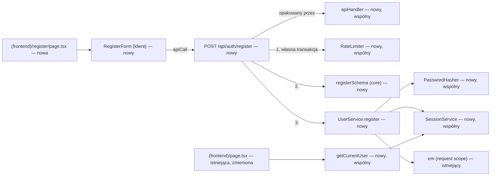
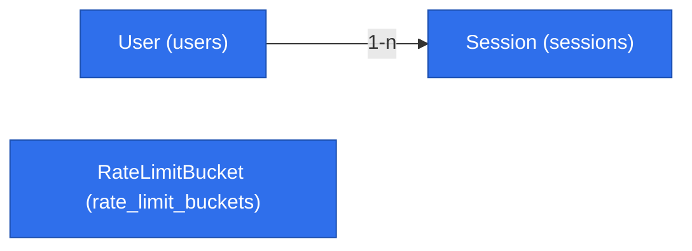

# Rejestracja konta i wspólna warstwa API/UI (E01-S01, #19)

> **Zmienione przez `2026-10-26-account-onboarding-simplification.md` (decyzje właściciela 2026-10-26, brief D-24…D-26, BR-26…BR-28).** Punkty poniżej są zastąpione; tekst niżej zostaje jako historia i jest oznaczony w miejscach zmian.
> - G3: hasło co najmniej **8 znaków** (BR-28), nie 16; maksimum 72 bajty bez zmian.
> - D-17 i BR-23 zastąpione przez D-24 i BR-26: konto aktywne od razu po rejestracji, bez bramki potwierdzenia e-maila; `/` i `/account` pokazują nieblokujący, zamykalny baner (nie „Potwierdź e-mail, aby grać”).
> - Reguła BR-25 zastąpiona przez BR-27 (reset tylko po potwierdzeniu).


> Status: **zatwierdzona do implementacji** — odpowiedzi właściciela z 2026-10-24: Q4 = b, Q7 = b, Q8 = a,
> pozostałe zgodnie z rekomendacją. Źródło: issue #19 (`Backlog id: E01-S01`), `.ai/specs/product-brief.md`,
> `.ai/docs/2026-09-01-engineering-standards.md`. Obejmuje też migrację z #28 (E01-S01-T01).

## 📝 TLDR

Dziś w Gomoku nie da się założyć konta. Aplikacja ma tylko stronę startową i `/api/health`, a każda funkcja z briefu wymaga zalogowanego użytkownika (D-02).
Po wdrożeniu (zachowanie przyszłe) gość na stronie `/register` podaje e-mail, nazwę gracza i hasło, zakłada konto i od razu jest zalogowany. Razem z rejestracją powstaje **cienka wspólna warstwa**: błędy, koperta odpowiedzi API, wrapper route'ów, sesja, walidacja, limit prób, klient `fetch` oraz komponenty formularza i komunikatów. Zbudują na niej wszystkie kolejne historyjki, zaczynając od logowania (#20).

## ✅ Decyzje z bramki pytań (2026-10-24, właściciel: Bartosz Wójcik)

| Pytanie | Decyzja |
|---|---|
| Q1 Mechanizm uwierzytelniania (OD-2) | Własny: hasło + sesja w tabeli PostgreSQL, losowy token w ciasteczku `httpOnly`. |
| Q2 Hashowanie hasła | `bcryptjs` (czysty JS), koszt 12. |
| Q3 Walidacja (OD-3, częściowo) | `zod` — wspólne schematy w `@gomoku/core`. Akceptacja dotyczy tylko `zod`; `pino` i walidacja env pozostają otwarte. |
| Q4 Dane konta (CP-2, część) | **E-mail (login) + nazwa gracza (widoczna dla innych) + hasło.** |
| Q5 Limit prób | Tabela w PostgreSQL. |
| Q6 Zakres | Migracja z #28 wchodzi tutaj (#28 zamknięte jako włączone). Rejestracja tworzy sesję; logowanie i wylogowanie zostają w #20. |
| Q7 Zajęty e-mail (z przeglądu) | **Nie ujawniamy.** Jednolity komunikat „Nie udało się założyć konta. Jeśli masz już konto, zaloguj się.” bez wskazania pola — zgodnie ze standardami §1 „Auth error messages”, które obejmują też rejestrację. Zajęta nazwa gracza (publiczna) jest wskazywana przy polu. |
| Brief 2026-10-24 (BR-15 → BR-23, D-17) | Rejestracja loguje, ale do gry potrzebny jest potwierdzony e-mail. Wysyłka i potwierdzenie to #34 (poza tą specyfikacją); tu dochodzi kolumna `emailVerifiedAt` i komunikat „Potwierdź e-mail, aby grać”. Blokadę akcji gry egzekwują route'y gry (#21, #25, #26), których jeszcze nie ma. | **[zastąpione 2026-10-26: konto aktywne od razu, BR-26]**
| Brief 2026-10-24 (BR-20) | Strony `/register` i `/` działają na szerokości telefonu. |
| G1 Hosting (przesłuchanie, 2026-10-24) | VPS mikr.us (kontener; plan z Dockerem, ≥ 2.1). Ruch HTTPS przez darmową subdomenę mikr.us (`byst.re` / `bieda.it` / `toadres.pl`), bez własnej domeny. Aplikacja nasłuchuje na IPv6. Czy proxy subdomeny przekazuje adres klienta i WebSockety — sprawdza spike #30. |
| G2 Wzmocnienia sesji i CSRF (przesłuchanie, 2026-10-24) | Domeny subdomen mikr.us nie są na Public Suffix List (sprawdzone 2026-10-24), więc sąsiednie `*.byst.re` to ta sama witryna: `SameSite` nie chroni, a sąsiad może podrzucić ciasteczko. Dlatego: ciasteczko `__Host-gomoku_session` w produkcji, obowiązkowy `Origin` równy `APP_ORIGIN`, brak `APP_ORIGIN` w produkcji przerywa start. |
| G3 Hasło (przesłuchanie, 2026-10-24) | Reguła właściciela: **co najmniej 8 znaków (zmienione 2026-10-26, BR-28), bez dodatkowych wymagań** (bez list popularnych haseł, bez wymogu cyfr czy wielkich liter). Górna granica 72 bajtów UTF-8 zostaje (ograniczenie bcrypt); 16 znaków zajmuje najwyżej 64 bajty, więc granice się nie wykluczają. |
| G4 Zastrzeżone nazwy (przesłuchanie, 2026-10-24) | Nazwa gracza nie może pokrywać się z zastrzeżonym rdzeniem: `usunietygracz`, `admin`, `administrator`, `moderator`, `system`, `gomoku`, `support`. Porównanie po normalizacji: małe litery, polskie znaki → łacińskie (`ę`→`e`, `ł`→`l`, …), bez `_` i `-`. Normalizację robi jedna funkcja `normalizeDisplayName` w `core/src/validators/auth/` (używana też do klucza unikalności, G6). Lista jest stałą w `registerSchema`; dopisanie słowa to zmiana kodu z testem. |
| G5 Czas życia sesji (przesłuchanie, 2026-10-24) | **30 dni od utworzenia, bez przedłużania — ale sesja nie wygasa w trakcie aktywnej partii.** Wygasła sesja pozostaje ważna, dopóki trwa partia, która była aktywna w chwili `expiresAt` (najwyżej ~20 min, BR-04, BR-13); po jej zakończeniu wygasa. Nowej partii po `expiresAt` nie da się zacząć, więc tego nie da się łańcuchować. Unieważnienie (wylogowanie #20, zmiana hasła #36, reset #35, usunięcie #37) działa natychmiast, także w trakcie partii. |
| G6 Unikalność nazwy (przesłuchanie, 2026-10-24) | Klucz unikalności = ta sama normalizacja co G4 (`normalizeDisplayName`: małe litery, polskie znaki → łacińskie, bez `_` i `-`). `Łukasz` blokuje `Lukasz`, `ala_7` blokuje `ala-7` i `ala7`. Wyświetlana nazwa zostaje w brzmieniu użytkownika. |
| G7 Gra gościa z zaproszenia (przesłuchanie, 2026-10-24) | Brief: BR-22, BR-23, BR-24, D-23 (nadpisują BR-15, BR-08, D-02). Zaproszony może grać bez konta; implementacja należy do #21. **W tej specyfikacji:** generowanie i hashowanie losowego tokenu wydzielone do wspólnego `opaque-token.ts` (użyje go sesja i token gościa z #21/#29); tabela `sessions` pozostaje tylko dla kont. | **[BR-23 w tej linii zastąpione przez BR-26 (2026-10-26)]**
| G8 Powrót po rejestracji (przesłuchanie, 2026-10-24) | `/register?next=<ścieżka>` — po sukcesie przekierowanie na `next`, jeśli `safeNextPath` je przepuści (ścieżka względna zaczynająca się od `/`, nie od `//` ani `/\`, bez schematu); inaczej `/`. Konsumenci: #19, #20 (logowanie), #21 (zaproszenie), #34 (potwierdzenie e-maila). |
| G9 „Pokaż hasło” (z przesłuchania #20, 2026-10-24) | Pole hasła na `/register` używa wspólnego `PasswordField` z przyciskiem „Pokaż hasło” (domyślnie ukryte) i `autocomplete="new-password"`; e-mail `autocomplete="email"`. Specyfikacja #20, H2. |
| Q8 Podział (z przeglądu) | **Dwa PR-y:** A = Faza 1 (API, migracja, warstwa serwerowa; `risk-high`, `Refs #19`, `Closes #28`), B = Faza 2 (formularz i strony; `Closes #19`). |

## 📝 Problem Statement

- **Kto:** niezalogowany gość, który chce grać (brief, „Użytkownicy i scenariusze”). Grupa docelowa opiera się na deklaracji właściciela, a nie na dowodzie popytu (brief, „Evidence and unknowns”). Ta specyfikacja nie rozstrzyga popytu.
- **Dziś:** brak kont, tabel domenowych (`entities = []`), route'ów domenowych i formularzy. `AppCradle` zawiera tylko `orm` i `healthService`.
- **Kryteria z #19 (bez zmian):**
  1. Poprawne dane → konto powstaje, a gość jest zalogowany.
  2. Zajęty identyfikator → odrzucenie, drugie konto nie powstaje.
  3. Niepoprawne dane → widoczny błąd, konto nie powstaje.
- **Kryterium z #28:** migracja przechodzi w górę i w dół na PostgreSQL, a encje są w `entities/index.ts`.

## 📝 Proposed Solution

Rejestracja działa przez route handler `POST /api/auth/register` wywoływany z formularza klienckiego przez `apiCall`. Logika siedzi w serwisach w DI, rozstrzygnięcia zapadają po stronie serwera.

**Rozważone i odrzucone:**
- **Server Action z `useActionState`** (wzorzec z `node_modules/next/dist/docs/01-app/02-guides/authentication.md`). Standardy uznają route handlery za API aplikacji: klient czasu rzeczywistego i kolejne ekrany i tak ich potrzebują. Server Action wymagałby drugiej ścieżki mapowania błędów. Zostaje dopuszczalny później dla prostych formularzy, ale tylko przez te same serwisy i schematy.
- **Sesja bezstanowa (JWT/podpisane ciasteczko).** Nie da się jej unieważnić bez listy odwołań, a #20 wymaga wylogowania. Sesja w bazie daje to za darmo.
- **Biblioteka auth** — odrzucona w Q1.

**Poza zakresem:**
- wysyłka i obsługa linku potwierdzającego e-mail (#34), reset hasła (#35), zmiana hasła (#36), usunięcie konta (#37), zmiana e-maila i nazwy (E05 — później);
- logowanie zewnętrzne (OAuth);
- panel administracyjny użytkowników.

Od odświeżenia briefu (2026-10-24) te funkcje są w MVP jako osobne zgłoszenia; ta specyfikacja przygotowuje pod nie model (`emailVerifiedAt`), ale ich nie implementuje.

## 📝 Wspólna warstwa (odpowiedź na pytanie o framework)

**Potrzebna jest wspólna warstwa, a nie framework.** Standardy (§1 „Reusable API & UI Layer”, „YAGNI”, „Composition over inheritance”, §2 pkt 8) zabraniają:
- loaderów modułów i auto-rejestracji,
- per-konceptowych `setup.ts`,
- klas bazowych serwisów.

Wymagają natomiast jednej definicji: błędów, koperty, wrappera route'ów, klienta `fetch` i komunikatów, wprowadzonej przy pierwszym route domenowym (§5 krok 2). Każdy komponent poniżej ma co najmniej dwóch znanych konsumentów w backlogu.

| # | Komponent | Plik | Konsumenci |
|---|---|---|---|
| 1 | `AppError` + `ValidationError`, `ConflictError`, `UnauthorizedError`, `ForbiddenError`, `TooManyRequestsError` (każdy z domyślnym `code`, który można nadpisać, i statusem HTTP) | `core/src/http/errors.ts` | rejestracja; #20 i wszystkie następne |
| 2 | `ApiResult<T>` (`{ ok: true, data }` / `{ ok: false, error: { code, message, fieldErrors? } }`) | `core/src/http/api-result.ts` | `apiHandler` i `apiCall` |
| 3 | `apiHandler(fn)` — mapuje `AppError` → status + koperta, `ZodError` → `ValidationError` z `fieldErrors`, nieznany błąd → 500 bez szczegółów + log; ochrona CSRF (niżej) | `app/src/server/http/api-handler.ts` | każdy route `/api/*` poza `/api/health` |
| 4 | Schematy `zod` współdzielone przez formularz i route; komunikaty po polsku | `core/src/validators/auth/register-schema.ts` | formularz i route rejestracji; wzorzec dla `loginSchema` (#20) |
| 5 | `SessionService` (`create`, `findValid`) + `getCurrentUser()` + zapis i odczyt ciasteczka. `revoke` i `requireSession()` (nazwa ze standardów) powstają w #20 — tu nie mają konsumenta | `app/src/server/services/auth/session-service.ts`, `app/src/server/http/auth.ts` | rejestracja (`create`), strona `/` i `/register` (`getCurrentUser`); #20 dokłada `revoke`/`requireSession` |
| 6 | `PasswordHasher` (`hash`; `verify` jest tu potrzebny tylko testom, konsument produkcyjny w #20) z kosztem wstrzykiwanym przez DI: 12 w aplikacji, 4 w testach | `app/src/server/services/auth/password-hasher.ts` | rejestracja; logowanie (#20) |
| 7 | `RateLimiter.consume(key, limit, windowMs)` → `TooManyRequestsError`; licznik zapisywany **we własnej transakcji**, zanim ruszy walidacja i hashowanie | `app/src/server/services/rate-limit/rate-limiter.ts` | rejestracja; logowanie (#20), dołączanie kodem (#21) |
| 7a | `clientKey(request)` — adres klienta z nagłówka `CLIENT_IP_HEADER` (`x-forwarded-for` domyślnie; także `x-real-ip`, `cf-connecting-ip`) według `TRUST_PROXY_HOPS`; adres IPv6 skracany do prefiksu /64 (jeden host IPv6 ma całą /64), IPv4 bez zmian | `app/src/server/http/client-address.ts` | rejestracja; logowanie (#20), zaproszenie (#21) |
| 7b | `createOpaqueToken()` / `hashOpaqueToken()` — 32 bajty z CSPRNG (base64url) i SHA-256 do zapisu (G7) | `app/src/server/http/opaque-token.ts` | sesja (#19); token gościa (#21), tokeny potwierdzenia e-maila (#34) i resetu (#35) |
| 7c | `safeNextPath(value)` — walidacja ścieżki powrotu przeciw otwartym przekierowaniom (G8) | `core/src/http/safe-next-path.ts` | `/register` (#19); `/login` (#20), zaproszenie (#21), potwierdzenie e-maila (#34) |
| 8 | `apiCall<T>()` — jedyny `fetch` do `/api/*`, nagłówek CSRF, defensywne parsowanie koperty (nie-JSON → błąd `network`; odpowiedzi `/api/*` zawsze mają kopertę JSON, także przy braku danych: `{ ok: true, data: null }`) | `app/src/lib/api-client.ts` | formularz rejestracji; każdy ekran gracza |
| 9 | `FormField`, `PasswordField` (przycisk „Pokaż hasło”, G9), `SubmitButton` (stan wysyłania), `ErrorMessage` — czysty Tailwind, motyw z `frontend.css` | `app/src/components/forms/`, `app/src/components/feedback/` | `/register`; `/login` (#20), zaproszenie (#21) |

**Świadomie nie teraz:**
- szyna zdarzeń `core/src/events` — pierwsze zdarzenie pojawi się przy partii;
- komponenty panelu w `ui/src/components/backend/` — brak ekranu admina;
- `loading-message` i `empty-state` — brak listy;
- transport czasu rzeczywistego (OD-1, spike #30);
- interfejsy/porty dla #6 i #7 — każdy ma jedną implementację, a wymienialność zapewnia DI.

## 📝 Architecture



Nowe są wszystkie elementy oprócz `em` (`withRequestScope`) i strony `/`, która zaczyna czytać sesję.

**Rejestracja w kontenerze:**
- `passwordHasher`: singleton, bez zależności;
- `userService`, `sessionService`, `rateLimiter`: scoped, bo potrzebują `em`;
- typy są dopisane do `AppCradle` i `RequestCradle`.

**Kierunki zależności bez zmian:**
- `zod` trafia do `@gomoku/core` (schematy i błędy walidacji);
- `bcryptjs` trafia do `@gomoku/app`;
- encje trafiają do `@gomoku/db` w `entities/auth/` i `entities/rate-limit/`.

**Strona `/` staje się dynamiczna:** `await connection()`, potem `getCurrentUser()`. Pokazuje „Zalogowano jako {nazwa}” (a przy `emailVerifiedAt = NULL` także „Potwierdź e-mail, aby grać” — BR-23) albo link do rejestracji. Podgląd planszy zostaje. `/register` dla zalogowanego przekierowuje na `/`. Błąd przy odczycie sesji (np. niedostępna baza) daje widok niezalogowany zamiast 500 (fail closed). Strona startowa nie może przestać działać przez awarię bazy.

**Bez sekretu w env.** Token sesji jest losowy i nieprzezroczysty, a w bazie jest tylko jego hash. Nic nie jest podpisywane, więc wymóg standardów „secret ≥ 32 bytes from env” (dotyczący podpisanych tokenów) tu nie ma zastosowania.

**Ochrona CSRF w `apiHandler`:** dotyczy metod zmieniających stan (`POST`, `PUT`, `PATCH`, `DELETE`). Ciasteczko ma `sameSite=lax`, ale na wspólnej domenie mikr.us to za mało (G2). Główna ochrona: **obowiązkowy** nagłówek `Origin` dokładnie równy `APP_ORIGIN` (np. `https://gomoku.byst.re`); brak `Origin` lub inna wartość → odmowa. Nie porównujemy z `Host`, bo proxy może go przepisać. Druga warstwa: nagłówek `X-Gomoku-Request: 1` ustawiany przez `apiCall`. Naruszenie → `403 FORBIDDEN`. Poza produkcją bez `APP_ORIGIN` akceptowany jest origin `http://localhost:<port>`.

## 📝 Data Model

| Encja → tabela | Pola | Ograniczenia |
|---|---|---|
| `User` → `users` | `id` uuid (PK), `email` varchar(254), `displayName` varchar(24), `displayNameKey` varchar(24), `passwordHash` varchar(60), `emailVerifiedAt` timestamptz NULL (NULL = niepotwierdzony, BR-23), `createdAt` timestamptz | unique `email` (zapisywany po `trim` + lowercase); unique `display_name_key` (`normalizeDisplayName(displayName)` — G6; liczony w aplikacji, bez indeksu funkcyjnego) |
| `Session` → `sessions` | `id` uuid (PK), `user` → `users.id` (FK, `on delete cascade`), `tokenHash` char(64), `createdAt`, `expiresAt` timestamptz | unique `token_hash`; indeks `user_id` |
| `RateLimitBucket` → `rate_limit_buckets` | `key` varchar(200) (PK), `windowStart` timestamptz, `count` integer | — |

**Reguły walidacji (`registerSchema`):**
- **e-mail:** poprawny format, maksymalnie 254 znaki;
- **nazwa gracza:** 3–24 znaki z jawnego zestawu `A–Z a–z 0–9 _ -` oraz polskich liter `ąćęłńóśźż ĄĆĘŁŃÓŚŹŻ` (bez `\p{L}`, żeby nie wpuścić homoglifów z cyrylicy i greki), bez spacji na brzegach; po normalizacji (G4) nie równa się żadnemu zastrzeżonemu rdzeniowi → błąd przy polu „Ta nazwa jest zastrzeżona”;
- **hasło:** co najmniej ~~16~~ 8 **znaków** (zmienione 2026-10-26, BR-28) (G3, bez innych wymagań) i najwyżej 72 **bajty** UTF-8 (bcrypt ignoruje resztę powyżej 72 bajtów, więc dłuższe hasło odrzucamy, zamiast cicho je skracać).

**Dane wrażliwe:**
- hasło jest wyłącznie w postaci hasha bcrypt;
- token sesji (32 bajty z CSPRNG, base64url) trafia tylko do ciasteczka, a w bazie jest jego SHA-256, więc wyciek tabeli nie daje gotowych sesji;
- e-mail to dane osobowe: nie pojawia się w logach, odpowiedziach API ani w widokach innych graczy; retencja i usuwanie: BR-17, BR-18 w briefie (#37, #39);
- klucz limitu zawiera adres IP (patrz niżej).

**Migracja:** jedna (`npm run db:migration:create`), trzy tabele. `down` usuwa je w odwrotnej kolejności. Sprawdzenie w górę i w dół na PostgreSQL. Brak istniejących danych, aplikacja jest przed pierwszym wdrożeniem (`BACKWARD_COMPATIBILITY.md` §4).



`RateLimitBucket` nie ma relacji: klucz jest tekstem. W repo nie ma innych encji (`entities = []`). Widok interaktywny: `.ai/data-model/2026-10-24-account-registration.html`.

## 📝 API Contracts

`POST /api/auth/register` (nagłówki `Content-Type: application/json`, `X-Gomoku-Request: 1`)

```json
{ "email": "ala@example.com", "displayName": "Ala_7", "password": "…" }
```

| Wynik | Status | Treść |
|---|---|---|
| Sukces | `201` | `{ "ok": true, "data": { "user": { "id": "<uuid>", "displayName": "Ala_7" } } }` + produkcja: `Set-Cookie: __Host-gomoku_session=<token>; HttpOnly; Secure; SameSite=Lax; Path=/; Max-Age=2595600` (bez `Domain`); poza produkcją: `gomoku_session=<token>; HttpOnly; SameSite=Lax; Path=/; Max-Age=2595600` (prefiks `__Host-` wymaga HTTPS) |
| Zły kształt / walidacja | `400` | `{ ok: false, error: { code: "VALIDATION", message, fieldErrors: { email?: [..], displayName?: [..], password?: [..] } } }` |
| Zajęta tylko nazwa gracza | `409` | `{ ok: false, error: { code: "CONFLICT", message, fieldErrors: { displayName } } }` |
| Zajęty e-mail | `409` | `{ ok: false, error: { code: "CONFLICT", message: "Nie udało się założyć konta. Jeśli masz już konto, zaloguj się." } }` — bez `fieldErrors` (Q7). Gdy zajęte są oba, wygrywa ta sama jednolita odpowiedź, aby konflikt nazwy nie potwierdzał e-maila. |
| Brak nagłówka `X-Gomoku-Request`, brak `Origin` lub `Origin` ≠ `APP_ORIGIN` | `403` | `{ ok: false, error: { code: "FORBIDDEN", message } }` |
| Już zalogowany | `409` | `ConflictError` z nadpisanym `code: "ALREADY_AUTHENTICATED"` (błędy z #1 przyjmują opcjonalny `code`) |
| Przekroczony limit | `429` | `code: "RATE_LIMITED"` + nagłówek `Retry-After` (sekundy) |
| Nieoczekiwany błąd | `500` | `code: "INTERNAL"`, ogólny komunikat, bez stack trace |

Schemat jest parsowany jawnie. Do `em.create()` trafiają tylko pola wyjściowe schematu, nigdy surowe body (ochrona przed mass assignment).

Kontrakt jest addytywny, a `/api/health` się nie zmienia (`BACKWARD_COMPATIBILITY.md` §2).

**Sesja:**
- ważna 30 dni od utworzenia (`SESSION_TTL_MS`), bez przedłużania; wyjątek G5: nie wygasa w trakcie partii aktywnej w chwili `expiresAt`. W tej specyfikacji partii jeszcze nie ma — `findValid` przyjmuje wstrzykiwaną funkcję „czy użytkownik ma partię aktywną od przed `expiresAt`” (tu zawsze `false`), którą #21/#22 podłączą do modelu partii;
- ciasteczko ma `Max-Age` o 1 h dłuższy od czasu życia sesji (30 dni + 1 h = 2 595 600 s), żeby przeglądarka nie usunęła go w trakcie partii objętej wyjątkiem G5; o ważności zawsze decyduje serwer;
- po wygaśnięciu `getCurrentUser()` zwraca `null`, a rekord sesji zostaje do czasu sprzątania (CP-2, poza zakresem).

**Limit prób:**
- 5 udanych lub nieudanych żądań rejestracji na godzinę na klucz `register:ip:<sha256(adres)>` — klucze limitu nie przechowują danych osobowych wprost i mieszczą się w `varchar(200)` niezależnie od wejścia;
- okno stałe, licznik zwiększany atomowo (`insert … on conflict … do update`) przez query builder MikroORM, z parametrami, bez interpolacji wejścia;
- licznik jest zwiększany **przed** walidacją i hashowaniem, we własnej, od razu zatwierdzonej transakcji, więc wycofanie zapisu użytkownika (np. `409`) go nie cofa;
- adres klienta pochodzi z nagłówka wskazanego przez `CLIENT_IP_HEADER` (domyślnie `x-forwarded-for`), liczony **od prawej**: przy `TRUST_PROXY_HOPS=n` bierzemy n-ty wpis od końca (dodany przez nasze proxy), a wpisów ustawionych przez klienta nie ufamy; dla nagłówków jednowartościowych (`x-real-ip`, `cf-connecting-ip`) bierzemy wartość wprost;
- **brak tego nagłówka (lub mniej wpisów niż `TRUST_PROXY_HOPS`) w produkcji to `500`** — nie zgadujemy i nie łączymy wszystkich klientów w jeden licznik (fail closed). Konfigurowalność pozwala przejść z subdomeny mikr.us na Cloudflare bez zmiany kodu;
- w produkcji (`NODE_ENV=production`) brak poprawnego `TRUST_PROXY_HOPS` (liczba całkowita ≥ 1) lub `APP_ORIGIN` (pełny origin `https://…`) przerywa budowę kontenera DI, więc route'y domenowe zwracają `500`, a `/api/health` dalej działa. To fail closed: nie ma globalnego wspólnego klucza, który jeden napastnik mógłby wyczerpać wszystkim;
- poza produkcją, przy braku zmiennej, używamy klucza `register:ip:local` (dev i testy jednostkowe);
- testy integracyjne (`next start`, czyli produkcja bez HTTPS) ustawiają w `global-setup.ts` `TRUST_PROXY_HOPS=1`, `APP_ORIGIN=http://127.0.0.1:<port>` i `SESSION_COOKIE_SECURE=false` (przełącznik tylko dla testów: zwykła nazwa ciasteczka bez `Secure`), a żądania wysyłają własny `X-Forwarded-For` i `Origin`;
- nowe zmienne `TRUST_PROXY_HOPS`, `CLIENT_IP_HEADER`, `APP_ORIGIN`, `SESSION_COOKIE_SECURE` trafiają do `.env.example` jako zmiana addytywna (`BACKWARD_COMPATIBILITY.md` §6), w tym samym kroku co kod. `SESSION_COOKIE_SECURE=false` przy `APP_ORIGIN` zaczynającym się od `https://` przerywa start (żeby nie wyłączyć ochrony w prawdziwym wdrożeniu).

## 📝 UI/UX

**Strona `/register` (grupa `(frontend)`, czysty Tailwind, teksty po polsku):**
- trzy pola: „E-mail”, „Nazwa gracza” („widoczna dla przeciwników”) i „Hasło” (z podpowiedzią „co najmniej 8 znaków (zmienione 2026-10-26, BR-28)”), plus przycisk „Załóż konto”;
- **wysyłanie:** przycisk jest nieaktywny i ma etykietę „Zakładanie konta…”, żeby zapobiec podwójnemu wysłaniu;
- **błędy pól z `fieldErrors`:** wyświetlane pod polem, z `aria-invalid` i `aria-describedby`, a fokus trafia na pierwsze błędne pole;
- **błąd ogólny** (limit, 500, brak sieci) pojawia się nad formularzem w `role="alert"`;
- **sukces:** `router.replace(safeNextPath(next) ?? "/")` (G8), a strona startowa pokazuje „Zalogowano jako {nazwa}”;
- działa bez myszy, a etykiety są powiązane z polami;
- układ działa na szerokości telefonu (od 360 px), bez poziomego przewijania (BR-20);
- `data-testid` dostają tylko formularz i komunikat ogólny.

Prototypu brak.

## 📝 Edge Cases & Failure Scenarios

| Sytuacja | Co widzi użytkownik |
|---|---|
| Dwie równoczesne rejestracje z tym samym e-mailem lub nazwą | Jedna się udaje, druga dostaje `409` (jednolity komunikat dla e-maila, błąd przy polu dla samej nazwy). Rozstrzyga unikalny indeks, nie sprawdzenie przed zapisem. |
| E-mail różniący się wielkością liter lub spacjami (`Ala@X.com `) | Traktowany jako ten sam (normalizacja) → `409` z jednolitym komunikatem. |
| Nazwa `ala` przy istniejącej `Ala`, `Lukasz` przy `Łukasz`, `ala-7` przy `ala_7` | `409` przy polu nazwy „Ta nazwa jest zajęta” (G6). |
| Hasło > 72 bajty (np. emoji) | `400` przy polu hasła. |
| Podwójne kliknięcie | Przycisk jest zablokowany. Gdyby drugie, równoległe żądanie jednak wyszło, nie ma jeszcze ciasteczka, więc dostaje `409 CONFLICT` z unikalnego indeksu. Formularz ignoruje odpowiedź po udanym pierwszym żądaniu, bo jest już w trakcie przekierowania. |
| Baza niedostępna przy wejściu na `/` | Widok niezalogowany, bez 500. |
| Brak bazy | `500 INTERNAL`, komunikat „Nie udało się założyć konta, spróbuj ponownie”. Aplikacja buduje się i startuje bez bazy (`AGENTS.md`). |
| Przekroczony limit | „Zbyt wiele prób. Spróbuj ponownie za {n} min.” |
| Utrata sieci lub odpowiedź nie-JSON (np. strona błędu proxy) | `apiCall` zwraca błąd `network` → komunikat ogólny. Formularz zachowuje wpisane dane poza hasłem. |
| Wygasła lub nieznana sesja w ciasteczku | Traktowana jak brak sesji. Ciasteczka nie kasujemy przy odczycie w server component (Next tego nie pozwala); usuwa je wylogowanie (#20). |
| Błąd wewnątrz sprawdzania sesji | Odmowa / brak użytkownika (fail closed). |

## 📝 Risks & Impact Review

- **Enumeracja kont przez rejestrację (Q7 = b).** Odpowiedź nie wskazuje, które pole jest zajęte. Samo powodzenie rejestracji (`201`) nadal zdradza, że e-mail był wolny — tego bez wysyłki poczty nie da się usunąć, a sondowanie ogranicza limit prób. Hash hasła liczony jest **przed** zapisem w obu ścieżkach, więc czas odpowiedzi nie zależy od tego, czy e-mail istnieje. Koszt dla użytkownika: osoba z istniejącym kontem dostaje ogólny komunikat i wskazówkę logowania.
- **Konfiguracja proxy.** Wdrożenie bez `TRUST_PROXY_HOPS` ma niedziałające route'y domenowe (celowo, fail closed). Błędna liczba hopów albo pozwala na podszywanie się pod adres (za duża), albo wrzuca wszystkich klientów pod adres proxy (za mała). Wartość musi odpowiadać faktycznej infrastrukturze. Dla subdomeny mikr.us nie wiadomo, czy proxy w ogóle przekazuje adres klienta (G1) — jeśli nie, rejestracja w produkcji zwraca `500` do czasu przejścia na Cloudflare (własna domena) albo innego rozwiązania; sprawdza to spike #30 przed pierwszym wdrożeniem.
- **Wspólna domena mikr.us (G2).** Sąsiednie subdomeny to ta sama witryna; ochrona opiera się na `__Host-` i obowiązkowym `Origin`. Każdy przyszły route zmieniający stan musi przejść przez `apiHandler` — żadnych wyjątków od sprawdzania `Origin`.
- **Nowe zależności:** `zod` (core) i `bcryptjs` (app). Obie w czystym JS, bez skryptów instalacyjnych (lekcja `2026-10-19-npm-lockfile-libc.md`).
- **Trudne do cofnięcia:**
  - nazwa ciasteczka `__Host-gomoku_session` (produkcja) / `gomoku_session` (dev);
  - kształt koperty, od którego zależą wszystkie kolejne route'y;
  - schemat `users` (po pierwszym wdrożeniu zmiany tylko przez expand/contract);
  - format hasha (bcrypt): zmiana algorytmu będzie wymagała rehashowania przy logowaniu.
- **Plan wycofania (`SDLC.md`, migracje).** Przed pierwszym wdrożeniem: revert PR + `npm run db:migration:down`, bo tabele nie zawierają danych produkcyjnych. Po wdrożeniu: revert kodu bez cofania migracji (nowe tabele nie przeszkadzają staremu kodowi). Usunięcie tabel z kontami tylko świadomie, bo oznacza utratę kont (CP-2).
- **`risk-high`:** logowanie i sesje oraz migracja schematu (`SDLC.md`). PR wymaga integracyjnych dowodów: migracja w górę i w dół, odmowa przy braku nagłówka CSRF, równoległa rejestracja, review drugiej osoby i QA bez self-QA.

## 📝 Decisions in play

- **D-02** „Użytkownicy muszą się logować.” (właściciel: Bartosz Wójcik): realizowane.
- **D-13, BR-14** (dane konta), **BR-23/D-17** (potwierdzenie e-maila przed grą — tu tylko kolumna i komunikat), **D-23/BR-22** (gra gościa — tu tylko wspólny `opaque-token`), **BR-16/D-14** (bez ujawniania zajętego e-maila), **BR-20** (telefon). **[BR-23 i D-17 zastąpione przez BR-26 i D-24 (2026-10-26): potwierdzenie nie blokuje gry]**
- **Non-goals z briefu:** „trwała lista znajomych”. Nie dotykamy, bo konto nie ma relacji między użytkownikami.
- **OD-2** (standardy) rozstrzygnięte: własne poświadczenia i sesja w bazie, bcrypt koszt 12.
- **OD-3** (standardy) rozstrzygnięte częściowo: `zod` zaakceptowany.

Sekcja 0 standardów wymaga zaktualizowania tych dwóch wierszy w tym samym PR co implementacja (krok 10).

Żadna aktywna decyzja nie jest nadpisywana.

## 📋 Phasing

- **Faza 1 — Konto i sesja przez API.** `POST /api/auth/register` tworzy konto i sesję. Sprawdzalne przez `fetch` w testach integracyjnych. Wprowadza warstwę serwerową (#1–#7).
- **Faza 2 — Formularz rejestracji i stan zalogowania.** Strona `/register`, klient `apiCall`, komponenty formularza (#8–#9) i strona `/` pokazująca zalogowanego.

Q8 = a: Faza 1 = **PR A** (kroki 1–7, `risk-high`, `Refs #19`, `Closes #28`); Faza 2 = **PR B** (kroki 8–10, `Closes #19`), otwierany po merge'u PR A. Każdy krok zostawia działającą aplikację z zielonym `npm run check`.

## 📋 Implementation Plan

### Faza 1 — Konto i sesja przez API

1. **Błędy i koperta.** `core/src/http/errors.ts`, `api-result.ts`, eksport z `core`. Testy: status i `code` każdego błędu.
2. **Walidacja.** `npm install zod -w @gomoku/core`; `core/src/validators/auth/register-schema.ts` z normalizacją e-maila i nazwy. Testy: każda reguła, każdy zastrzeżony rdzeń w wariantach (`Admin`, `ADMIN_`, `Usunięty-gracz`, `usuniety_gracz`) oraz nazwa podobna, ale dozwolona (`admina`), granice 3/24 znaki, 7/8 znaków hasła i 72/73 bajty, polskie znaki, spacje na brzegach.
3. **Encje i migracja (#28).** `db/src/entities/auth/{user,session}.ts`, `db/src/entities/rate-limit/rate-limit-bucket.ts`, wpis w `entities/index.ts`, wygenerowana i przejrzana migracja. Weryfikacja: `db:migration:up`, `down`, `up` na PostgreSQL. Testy: rejestr encji.
4. **`PasswordHasher`.** `npm install bcryptjs -w @gomoku/app`; wyłącznie asynchroniczne API (`hash`/`compare` z obietnicą — dzieli pracę i nie blokuje pętli zdarzeń, co ma znaczenie na jednoprocesowym VPS z trwającymi partiami); koszt wstrzykiwany (12 w kontenerze, 4 w testach). Testy: poprawne i błędne hasło, koszt zakodowany w hashu.
5. **`opaque-token`, `SessionService`, `RateLimiter`, `clientKey`.** Token z `createOpaqueToken()` (`crypto.randomBytes(32)`), w bazie `hashOpaqueToken()` (SHA-256); `findValid` odrzuca wygasłe, z wyjątkiem G5 przez wstrzykiwaną funkcję aktywnej partii (tu: zawsze `false`); `consume` z atomowym upsertem we własnej transakcji; `clientKey` czyta `CLIENT_IP_HEADER` i liczy hopy od prawej (brak nagłówka w produkcji → błąd 500), a w produkcji bez `TRUST_PROXY_HOPS` lub `APP_ORIGIN` budowa kontenera rzuca wyjątek. Rejestracja w `container.ts`; nowe zmienne w `.env.example` i w `global-setup.ts` w tym samym kroku. Testy jednostkowe na fałszywym `em` (granice okna, wygaśnięcie (także wyjątek G5 z fałszywą funkcją aktywnej partii: przed `expiresAt`, po nim z partią rozpoczętą przed i po `expiresAt`), parsowanie każdego wariantu nagłówka, brak nagłówka i zmiennych w produkcji, nazwa i flagi ciasteczka w obu trybach). Upsert na prawdziwym PostgreSQL sprawdza scenariusz `429` z kroku 7.
6. **`UserService.register` i `apiHandler`/`auth.ts`.** CSRF: obowiązkowy `Origin` = `APP_ORIGIN` + `X-Gomoku-Request`. Mapowanie naruszenia unikalności: e-mail (także gdy zajęte są oba) → `ConflictError` z jednolitym komunikatem bez pola; tylko nazwa → `ConflictError` z `fieldErrors.displayName` (Q7). CSRF, `getCurrentUser()` (błąd → `null`) i ciasteczko przez `await cookies()` (`next/headers`, API async w Next 16). Testy: każde mapowanie błędu, fail closed.
7. **Route `api/auth/register/route.ts`** (`await connection()`, `apiHandler`, limit, schemat, `withRequestScope`). Testy integracyjne (`fetch`):
   - `201` z ciasteczkiem;
   - `409` dla duplikatu i dla dwóch równoległych żądań;
   - `400` z `fieldErrors`;
   - `403` bez `X-Gomoku-Request`, bez `Origin` i z obcym `Origin` (np. `https://inny.byst.re`);
   - `429` po przekroczeniu limitu dla jednego adresu, przy czym inny adres przechodzi;
   - licznik rośnie także przy odpowiedzi `409`.

### Faza 2 — Formularz i stan zalogowania

8. **`apiCall` i `safeNextPath`.** Testy `safeNextPath`: `/`, `/invite/abc`, `//evil.com`, `/\evil.com`, `https://evil.com`, `javascript:`, pusty, brak → `/`. `app/src/lib/api-client.ts`. Testy: sukces, koperta błędu, nie-JSON, błąd sieci, ustawiony nagłówek.
9. **Komponenty.** `components/forms/{form-field,submit-button}.tsx`, `components/feedback/error-message.tsx` (dodać `jsdom` + `@testing-library/react` do `@gomoku/app`, zgodnie z `AGENTS.md`).
10. **Strony.**
    - `(frontend)/register/page.tsx` + `register-form.tsx` (klient) i przekierowanie zalogowanego;
    - `/` dynamiczna, z „Zalogowano jako …”;
    - test integracyjny przez agent-browser: wypełnienie formularza, przekierowanie, widoczna nazwa i komunikat „Potwierdź e-mail, aby grać”, błąd duplikatu nazwy przy polu, układ na szerokości telefonu;
    - dokumentacja: sekcja 0 standardów (OD-2, OD-3) i doprecyzowanie §1 „Auth error messages” o rejestrację (Q7), README (konta; wdrożenie na mikr.us: `APP_ORIGIN`, `TRUST_PROXY_HOPS`, `CLIENT_IP_HEADER`, nasłuch na IPv6);
    - zamknięcie #28 komentarzem „włączone do #19”.
