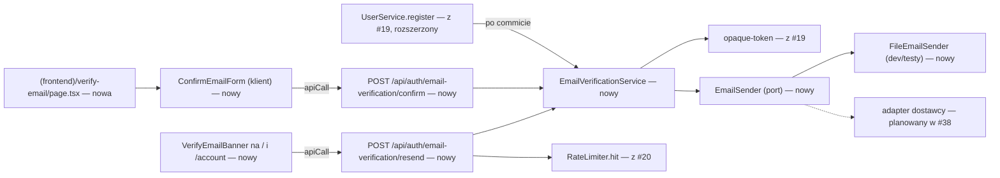
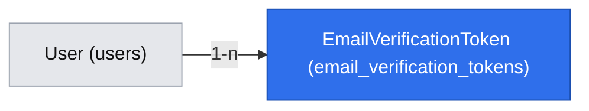

# Potwierdzenie adresu e-mail (E01-S03, #34)

> **Zmienione przez `2026-10-26-account-onboarding-simplification.md` (decyzje właściciela 2026-10-26, brief D-24…D-26, BR-26…BR-28).** Punkty poniżej są zastąpione; tekst niżej zostaje jako historia i jest oznaczony w miejscach zmian.
> - Potwierdzenie e-maila **nie blokuje gry** (BR-26): konto jest aktywne od rejestracji; baner (zamykalny, wraca po 7 dniach, pamięć w przeglądarce) tłumaczy, że bez potwierdzenia nie ma resetu hasła.
> - Q14 (7 dni, baner „zostanie usunięte”) zastąpione przez BR-28: niepotwierdzone konta bez żadnej partii kasowane po 14 dniach od założenia; konta z partią zostają.
> - Kryterium #34/K2 „gra odblokowana” odpada; zostaje „e-mail potwierdzony”. Zmienia się tytuł zgłoszenia #34 (Faza 4).
> - Q1/Q6/Q13 o dostawcy poczty: brak dostawcy nie wyłącza rejestracji ani gry (BR-26), tylko wysyłkę potwierdzeń i resetu.

> Status: **zatwierdzona** (`om-auto-write-spec`, 2026-10-24; założenia potwierdzone przez właściciela — Bartosz Wójcik, „a” — 2026-10-24).

## 📝 TLDR

Po #19 konto ma kolumnę `emailVerifiedAt`, ale nic jej nie ustawia — każdy nowy gracz z kontem jest zablokowany przed grą (BR-23), a jedynym wyjściem jest gra gościa z zaproszenia (BR-22). **[zastąpione 2026-10-26: gracz gra od razu, BR-26]**
Po wdrożeniu (zachowanie przyszłe): rejestracja wysyła wiadomość z linkiem; kliknięcie linku i potwierdzenie na stronie `/verify-email` ustawia `emailVerifiedAt`, co odblokowuje tworzenie partii, zaproszenia i lobby. Niepotwierdzony gracz może wysłać link ponownie z `/` lub `/account`. Wysyłka idzie przez wymienialny `EmailSender` — w dev i testach wiadomość trafia do pliku-skrzynki (`EMAIL_OUTBOX_PATH`), w produkcji do dostawcy wybranego w #38.

## Resolved assumptions (autonomous defaults)

| # | Pytanie | Zastosowane założenie | Dlaczego | Potwierdzenie |
|---|---|---|---|---|
| Q1 | Dostawca poczty jest nieustalony (Q-02, #38) — jak projektować wysyłkę i co, jeśli produkcja wystartuje bez niego? | Port `EmailSender` z dwiema implementacjami: `FileEmailSender` (`EMAIL_TRANSPORT=file`: dopisuje wiadomość jako linię JSON do pliku `EMAIL_OUTBOX_PATH`, ignorowanego przez git — testy i dev czytają z niego link) i adapter produkcyjny po decyzji w #38. `file` dozwolony w produkcji (`next start`) tylko przy `APP_ORIGIN` zaczynającym się od `http://` — jak przełącznik `SESSION_COOKIE_SECURE` w #19. **Brak skonfigurowanego dostawcy w produkcji nie przerywa startu** (nie blokuje rejestracji i logowania); wysyłka zwraca `502 EMAIL_SEND_FAILED`, a gracz może grać jako gość (BR-22). | #34 da się zaimplementować i przetestować bez dostawcy; przerwanie startu kontenera (wzorzec z #19) wyłączyłoby wszystkie route'y domenowe aż do #38. | ✅ potwierdzone przez właściciela 2026-10-24 — sprzężenie wdrożenia z #38 |
| Q2 | Ważność linku | 24 godziny od wysłania. | Typowa wartość; krótsza utrudnia graczom, dłuższa wydłuża okno nadużycia skrzynki. | odwracalne |
| Q3 | Czy otwarcie linku (GET) potwierdza od razu? | Nie: `GET /verify-email?token=…` pokazuje stronę z przyciskiem „Potwierdź e-mail”, a potwierdzenie to `POST` przez `apiHandler`. | Skanery bezpieczeństwa poczty otwierają linki z wiadomości — potwierdzenie przy GET zużyłoby token przed kliknięciem gracza; zmiana stanu tylko przez POST z ochroną CSRF (G2). | odwracalne |
| Q4 | Limit ponownego wysłania | 3 wysyłki na konto na godzinę i 10 na adres klienta na godzinę (klucze SHA-256 jak w #19/#20) → `429`. | Chroni darmowy limit dostawcy (D-20) i skrzynki ofiar przed zasypaniem. | odwracalne **[adnotacja 2026-10-29: ryzyko zaakceptowane do wyboru dostawcy (#38). Limit adresu (10/h) nie chroni dziennej puli `EMAIL_DAILY_LIMIT` przed zużyciem przez `resend` z jednego adresu: do 240 jednostek na dobę, a wystarczy jedno konto (3/h na konto zasila ten sam budżet weryfikacji). Przy małym limicie dziennym nowi gracze dostają wtedy `503 EMAIL_QUOTA_EXCEEDED` i nie potwierdzą e-maila. Do rozważenia później: niższy budżet dzienny dla `resend` niż dla rejestracji albo limit dobowy na konto. Dodatkowo (L2): konto założone na cudzy niepotwierdzony adres może wysłać do 72 wiadomości na dobę do tej skrzynki (limit 3/h na konto).]** |
| Q5 | Czy trzeba być zalogowanym, żeby potwierdzić? | Nie — wystarczy token z wiadomości (dowód dostępu do skrzynki); potwierdza konto, do którego należy token, niezależnie od zalogowanej sesji. Potwierdzenie **nie loguje** użytkownika. Wiadomość zawiera „Jeśli to nie Ty zakładałeś konto w Gomoku, zignoruj tę wiadomość” — chroni ofiarę przed potwierdzeniem konta założonego na jej adres przez kogoś innego. | Link otwierany zwykle na telefonie, gdzie gracz może nie być zalogowany; brak auto-logowania = brak nowej ścieżki uzyskania sesji z samego linku. | odwracalne |
| Q6 | Co, gdy wysyłka przy rejestracji się nie powiedzie? | Rejestracja i tak kończy się `201` (konto i sesja powstają); błąd wysyłki jest logowany bez adresu e-mail, a baner proponuje „Wyślij ponownie”. | Awaria dostawcy nie może blokować zakładania kont; gracz ma wyjście. | odwracalne |
| Q7 | Wiele wysłanych linków | Nowy link unieważnia wcześniejsze niewykorzystane tokeny tego konta — **dopiero po udanej wysyłce** (nieudana wysyłka zostawia poprzedni link ważny). | Ważny jest zawsze najnowszy dostarczony link. | odwracalne |
| Q9 | Ktoś założył konto na cudzy adres (zajęty e-mail daje jednolity komunikat, BR-16) — jak ofiara odzyska adres? | Reset hasła (#35) działa także dla **niepotwierdzonego** adresu: link resetu trafia na ten adres, więc jego ustawienie dowodzi dostępu do skrzynki — ustawia nowe hasło, unieważnia sesje (wypycha osobę, która założyła konto) i potwierdza e-mail. Zmienia propozycję BR-19 („tylko na potwierdzony e-mail”). | Bez tego właściciel adresu nie ma żadnej drogi do konta na swój e-mail. | ✅ potwierdzone przez właściciela 2026-10-24 — zmienia propozycję BR-19 (decyzja w specyfikacji #35) |
| Q10 | Ochrona darmowego limitu dostawcy (D-20) przed masową rejestracją z wielu adresów | Globalny dzienny limit wysyłek `EMAIL_DAILY_LIMIT` (wartość z planu dostawcy, ustalana w #38); po przekroczeniu `503 EMAIL_QUOTA_EXCEEDED` i licznik w logu (bez adresów). | Limity na konto i adres (Q4) nie zatrzymują rozproszonego zużycia limitu. | odwracalne **[adnotacja 2026-10-29: patrz Q4 — `resend` z jednego adresu może zużyć pulę dzienną (do 240/dobę); ryzyko zaakceptowane do #38.]** |
| Q8 | Język i forma wiadomości | Polski, tekst + prosty HTML, nadawca z `EMAIL_FROM` (np. „Gomoku”), link z `APP_ORIGIN`. | Teksty dla graczy po polsku (`AGENTS.md`); adres bazowy już jest w konfiguracji (G2). | odwracalne |

## 📝 Problem Statement

- **Kto:** zalogowany gracz z kontem i niepotwierdzonym e-mailem (BR-23) — założyciel partii, zapraszający, gracz lobby. Gość z zaproszenia nie jest objęty (BR-22). **[BR-23 zastąpione przez BR-26 (2026-10-26)]**
- **Dziś (po #19/#20):** `emailVerifiedAt = NULL` u wszystkich; komunikat „Potwierdź e-mail, aby grać” bez sposobu potwierdzenia. Grupa docelowa bez dowodu popytu (A-01); bariera potwierdzenia to niesprawdzone założenie A-03.
- **Kryteria z #34:** (1) po rejestracji wychodzi wiadomość z linkiem; (2) ważny link → e-mail potwierdzony, gra odblokowana; (3) link użyty lub wygasły → brak potwierdzenia, komunikat z możliwością ponownego wysłania; (4) ponowne wysłanie daje nowy link, liczba próśb ograniczona limitem.

## 📝 Proposed Solution

Token jednorazowy (wspólne `opaque-token.ts` z #19: 32 bajty z CSPRNG w linku, w bazie SHA-256) zapisany w nowej tabeli; wiadomość wysyłana przez `EmailSender` po zatwierdzeniu rejestracji; potwierdzenie przez stronę z przyciskiem (Q3) i `POST`; ponowne wysłanie z banera.

**Rozważone i odrzucone:**
- **Potwierdzenie przy samym GET** — zużycie tokenu przez skanery poczty (Q3).
- **Podpisany token bez tabeli (HMAC z `userId` i czasem)** — nie da się go unieważnić przy ponownym wysłaniu (Q7) ani wykorzystać jednorazowo; wymaga też nowego sekretu w env.
- **Kod liczbowy do przepisania zamiast linku** — więcej tarcia na telefonie (BR-20), a krótki kod wymaga dodatkowego limitu prób zgadywania.
- **Kolejka wysyłki / zadanie w tle** — standardy zabraniają workerów w tle dla poprawności; wysyłka w żądaniu po commicie wystarcza przy skali hobbystycznej, a awaria jest obsłużona (Q6).

**Poza zakresem:** wybór i konfiguracja dostawcy (#38), zmiana adresu e-mail (E05), reset hasła (#35 — użyje tego samego `EmailSender`), przypomnienia o niepotwierdzonym adresie, sprzątanie wygasłych tokenów (#39).

## 📝 Architecture

- **`EmailVerificationService`** (scoped, `{ em, emailSender, clock, rateLimiter }`): `issue(user)` (sprawdza dzienny limit Q10, tworzy token, wysyła, **po udanej wysyłce** unieważnia starsze tokeny), `confirm(token)` — jedno warunkowe `UPDATE email_verification_tokens SET used_at = now() WHERE token_hash = ? AND used_at IS NULL AND expires_at > now() RETURNING user_id` (przez `nativeUpdate`/query builder z parametrami) i w tej samej transakcji `users.emailVerifiedAt`; `resend(user)`.
- **`clock`** (`{ now(): Date }`, singleton) — nowy wpis w kontenerze; jeśli #19/#20 go nie dodały, dodaje go ten PR.
- **`EmailSender`** (singleton): `send({ to, subject, text, html })`. Wybór implementacji w `container.ts` z `EMAIL_TRANSPORT`: `file` (dev/testy, z guardem `http://` w produkcji, Q1), adapter dostawcy (#38), brak → `UnconfiguredEmailSender`, który zawsze rzuca błąd wysyłki (→ `502`). Logi nigdy nie zawierają tokenu ani adresu e-mail (standardy §Secrets) — dlatego dev/testy używają pliku, nie logu.
- **Szablon wiadomości:** czysta funkcja w `app/src/server/services/auth/email-verification-message.ts` (tekst i HTML z linkiem `APP_ORIGIN/verify-email?token=…&next=…`), testowana bez wysyłki.
- **Blokada gry (BR-23)** należy do route'ów gry (#21, #25, #26) — ta specyfikacja tylko ustawia `emailVerifiedAt`. **[zastąpione 2026-10-26: bramki nie ma, BR-26]**
- **`next`** z rejestracji (G8) przechodzi do linku i po potwierdzeniu prowadzi przez `safeNextPath`.

## 📝 Data Model

| Encja → tabela | Pola | Ograniczenia |
|---|---|---|
| `EmailVerificationToken` → `email_verification_tokens` | `id` uuid (PK), `user` → `users.id` (FK, `on delete cascade`), `tokenHash` char(64), `createdAt`, `expiresAt` timestamptz, `usedAt` timestamptz NULL | unique `token_hash`; indeks `user_id` |
| `User` → `users` (z #19) | bez zmian schematu; zapisywane `emailVerifiedAt` | — |

**Dane wrażliwe:** w bazie tylko hash tokenu; token i adres e-mail nie trafiają do logów. Plik-skrzynka (`EMAIL_OUTBOX_PATH`) zawiera pełne wiadomości — tylko dev/testy, ścieżka w `.gitignore`. Token jest w adresie strony: `/verify-email` ustawia `Referrer-Policy: no-referrer` i nie ładuje zasobów zewnętrznych; dostęp do logów proxy mikr.us (adresy z tokenem) jest poza naszą kontrolą — token jest jednorazowy i ważny 24 h. Usunięcie konta (#37) kasuje tokeny przez kaskadę (BR-17).

**Migracja:** jedna (`npm run db:migration:create`), jedna tabela; `down` ją usuwa; sprawdzenie w górę i w dół na PostgreSQL.

## 📝 API Contracts

Oba route'y przez `apiHandler` (nagłówki CSRF z #19: `X-Gomoku-Request: 1`, `Origin` = `APP_ORIGIN`).

`POST /api/auth/email-verification/confirm` — `{ "token": "<base64url>", "next": "<ścieżka z adresu strony, opcjonalnie>" }` (sesja niewymagana, Q5; `next` nie jest zapisywany, serwer przepuszcza go przez `safeNextPath`)

| Wynik | Status | Treść |
|---|---|---|
| Potwierdzono | `200` | `{ ok: true, data: { next: "<bezpieczna ścieżka>" } }` |
| Token nieznany, użyty (także drugie żądanie z tym samym tokenem), wygasły lub unieważniony | `400` | `code: "INVALID_TOKEN"`, jednolity komunikat „Link wygasł lub został już użyty.” |
| Zły kształt | `400` | `code: "VALIDATION"` |
| CSRF | `403` | `code: "FORBIDDEN"` |

`POST /api/auth/email-verification/resend` — bez treści (wymaga sesji, `requireSession` z #20)

| Wynik | Status | Treść |
|---|---|---|
| Wysłano | `200` | `{ ok: true, data: null }` |
| E-mail już potwierdzony | `409` | `code: "ALREADY_VERIFIED"` |
| Brak sesji | `401` | `code: "UNAUTHORIZED"` |
| Limit (Q4) | `429` | `code: "RATE_LIMITED"` + `Retry-After` |
| Błąd wysyłki lub brak dostawcy (Q1) | `502` | `code: "EMAIL_SEND_FAILED"`, „Nie udało się wysłać wiadomości. Spróbuj później.” (licznik limitu i tak rośnie; poprzedni link pozostaje ważny, Q7) |
| Wyczerpany dzienny limit wysyłek (Q10) | `503` | `code: "EMAIL_QUOTA_EXCEEDED"`, „Wysyłka wiadomości jest chwilowo niedostępna. Spróbuj jutro albo zagraj jako gość z zaproszenia.” |

Kontrakty addytywne; nowy adres strony `/verify-email` (link w wiadomościach — po wdrożeniu chroniony jak linki zaproszeń, `BACKWARD_COMPATIBILITY.md` §3).

## 📝 UI/UX

- **`/verify-email?token=…&next=…`**: nagłówek „Potwierdź adres e-mail”, przycisk „Potwierdź e-mail”; po sukcesie „Adres potwierdzony — możesz grać” i przejście do `next` (lub `/`); po błędzie komunikat z Q-tabeli i — dla zalogowanego — przycisk „Wyślij nowy link”, a dla niezalogowanego link „Zaloguj się, aby wysłać nowy link” (`/login?next=/account`). Bez tokenu w adresie: ten sam komunikat błędu.
- **`VerifyEmailBanner`** na `/` i `/account` przy `emailVerifiedAt = NULL`: „Potwierdź e-mail, aby grać. Link wysyłamy na {adres} — sprawdź też folder spam.” (bez twierdzenia „wysłaliśmy”, bo wysyłka mogła się nie udać, Q6) + przycisk „Wyślij ponownie” (stany: wysyłanie, „Wysłano”, limit z czasem, błąd wysyłki). Adres pokazywany tylko właścicielowi konta.
- Czysty Tailwind, komponenty z #19, działa na szerokości telefonu (BR-20), `role="status"` dla potwierdzeń i `role="alert"` dla błędów.

Mockupy: pominięte — repozytorium nie ma deskryptora środowiska testowego `om-prepare-test-env` (`.ai/scripts/` jest puste), więc ekranów nie dało się wyrenderować.

## 📝 Edge Cases & Failure Scenarios

| Sytuacja | Co widzi użytkownik |
|---|---|
| Skaner poczty otworzył link | Nic się nie dzieje (GET nie zmienia stanu, Q3); gracz potwierdza przyciskiem. |
| Dwa kliknięcia „Potwierdź” / dwie karty | Potwierdzenie atomowe; drugie żądanie z tym samym tokenem dostaje `INVALID_TOKEN` (Q11); UI po sukcesie blokuje przycisk. Zalogowany z już potwierdzonym kontem widzi „Adres jest już potwierdzony”. |
| Ponowne wysłanie, potem kliknięcie starego linku | `INVALID_TOKEN` (Q7) — komunikat i przycisk nowego linku. |
| Link po 24 h | `INVALID_TOKEN` (Q2). |
| Link otwarty na telefonie bez sesji | Potwierdzenie działa (Q5); gracz pozostaje niezalogowany, `next` prowadzi np. do logowania. |
| Zalogowany na inne konto | Potwierdzane jest konto z tokenu; komunikat nie ujawnia, które to konto. |
| Awaria dostawcy przy rejestracji | Konto powstaje, baner z „Wyślij ponownie” (Q6). |
| Wyczerpany darmowy limit dostawcy (D-20) albo nasz dzienny limit (Q10) | `502` / `503` z komunikatem; gracz może grać jako gość z zaproszenia (BR-22). |
| Konto założone na cudzy adres | Ofiara dostaje wiadomość z „zignoruj, jeśli to nie Ty”; odzyskuje adres resetem hasła (Q9, #35). |
| Konto usunięte przed kliknięciem | Token zniknął kaskadowo → `INVALID_TOKEN`. |
| Produkcja bez skonfigurowanego dostawcy | Aplikacja działa; potwierdzenie i ponowne wysłanie zwracają `502`; gra tylko jako gość z zaproszenia (Q1). |

## 📝 Risks & Impact Review

- **`risk-high`** (logowanie i sesje, migracja — `SDLC.md`): PR implementacji wymaga testów integracyjnych potwierdzenia, ponownego wysłania, limitu i CSRF oraz migracji w górę i w dół; review drugiej osoby; QA bez self-QA.
- **Zależność od #38.** Implementacja przechodzi CI na `FileEmailSender`; produkcja bez adaptera działa, ale nikt nie potwierdzi e-maila (Q1, potwierdzone).
- **Dostarczalność.** Wiadomości z darmowego planu mogą trafiać do spamu — tekst banera wspomina o folderze spam; bez pomiaru dostarczalności (A-03).
- **Kontrakty trudne do cofnięcia:** adres `/verify-email` i format linku (wysyłany poza aplikację).
- **Rollback:** revert PR + `db:migration:down` przed pierwszym wdrożeniem; po wdrożeniu — revert kodu bez cofania migracji (tabela nie przeszkadza staremu kodowi).

## 📝 Decisions in play

- **D-17** (potwierdzenie przed pierwszą grą), **BR-23** (konto bez potwierdzonego e-maila nie gra), **BR-22 / D-23** (gość z zaproszenia nie potwierdza e-maila), **D-20** (darmowy plan poczty), **Q-02** (dostawca — otwarte, #38), **BR-17** (usunięcie konta kasuje dane), **BR-20** (telefon). Właściciel wszystkich: Bartosz Wójcik. **[D-17 i BR-23 zastąpione przez D-24 i BR-26 (2026-10-26)]**
- Specyfikacje: #19 (G2 CSRF, G7 `opaque-token`, G8 `safeNextPath`), #20 (`requireSession`, `/account`, `RateLimiter.hit`).
- Żadna aktywna decyzja nie jest nadpisywana.

## 📋 Phasing

- **Faza 1 — Wysłanie i potwierdzenie.** Model, `EmailSender` + `FileEmailSender`, wysyłka po rejestracji, `POST …/confirm`, strona `/verify-email`.
- **Faza 2 — Ponowne wysłanie i baner.** `POST …/resend`, `VerifyEmailBanner` na `/` i `/account`.

Jeden PR implementacji (`Closes #34`), po #19 (PR A i B) i #20; produkcyjny adapter dostawcy w #38. Każdy krok zostawia działającą aplikację z zielonym `npm run check`.

## 📋 Implementation Plan

### Faza 1 — Wysłanie i potwierdzenie

1. **Encja i migracja** `db/src/entities/auth/email-verification-token.ts`, wpis w `entities/index.ts`, przejrzana migracja; weryfikacja up/down/up na PostgreSQL.
2. **`EmailSender`, `FileEmailSender`, `UnconfiguredEmailSender`, `clock`** + wybór w `container.ts` z `EMAIL_TRANSPORT`; `EMAIL_FROM`, `EMAIL_OUTBOX_PATH`, `EMAIL_DAILY_LIMIT` w `.env.example`, ścieżka skrzynki w `.gitignore`. Testy: zapis linii JSON, guard `file` przy `APP_ORIGIN` `https://`, `Unconfigured` rzuca błąd, brak tokenu i adresu w logach.
3. **Szablon wiadomości** (czysta funkcja). Testy: link z `APP_ORIGIN`, kodowanie `token` i `next`, polskie teksty, zdanie „zignoruj, jeśli to nie Ty” (Q5).
4. **`EmailVerificationService.issue/confirm`** i wywołanie `issue` po commicie w `UserService.register` (błąd wysyłki logowany, rejestracja `201`). Testy: unieważnienie starych tokenów tylko po udanej wysyłce, dzienny limit, ważność 24 h, warunkowe `UPDATE … RETURNING`, idempotencja, kaskada.
5. **Route `…/confirm` i strona `/verify-email`** (`searchParams` jako `Promise`, `await connection()`, `Referrer-Policy: no-referrer`). Testy integracyjne: `global-setup.ts` ustawia `EMAIL_TRANSPORT=file` i `EMAIL_OUTBOX_PATH` w katalogu testów; rejestracja → link czytany z pliku-skrzynki → GET strony nie zmienia stanu → przycisk → `emailVerifiedAt` ustawione; token użyty / obcy → `INVALID_TOKEN`; wygasły — przez bezpośredni `UPDATE expires_at` w bazie kontenera testowego; CSRF `403`.

### Faza 2 — Ponowne wysłanie i baner

6. **`resend` i route `…/resend`** z limitami Q4. Testy: `200`, `409 ALREADY_VERIFIED`, `401`, `429` (konto i adres), `502` przy błędzie wysyłki, stary link po ponownym wysłaniu nieważny.
7. **`VerifyEmailBanner`** na `/` i `/account`. Testy komponentów (stany; `jsdom` + `@testing-library/react` w `@gomoku/app`, jeśli #19 ich jeszcze nie dodał); test integracyjny agent-browser: baner po rejestracji → „Wyślij ponownie” → „Wysłano” → potwierdzenie → baner znika; układ na szerokości telefonu.
8. **Dokumentacja:** README (zmienne `EMAIL_TRANSPORT`, `EMAIL_FROM`, wdrożenie wymaga #38); komentarz w #38 o porcie `EmailSender`.

## 📝 Ustalenia z przesłuchania (grill-me, 2026-10-24)

Potwierdzone przez właściciela — Bartosza Wójcika.

| # | Ustalenie |
|---|---|
| Q11 | Zużyty token zawsze daje `400 INVALID_TOKEN` (bez wyjątku „potwierdzone tym tokenem”). Na stronie błędu zostaje „Wyślij nowy link”; zalogowany z potwierdzonym kontem widzi „Adres jest już potwierdzony”. |
| Q12 | Dzienny limit wysyłek (Q10) ma osobne liczniki: weryfikacja e-maila zużywa najwyżej 70% `EMAIL_DAILY_LIMIT`, reset hasła (#35) może użyć całości — rejestracja jest kanałem nadużyć, reset dotyczy istniejących graczy. |
| Q13 | Kolejność wdrożenia: #38 (spike SMTP) → #30 (spike adresu klienta) → #34 i #35 razem. Bez dostawcy poczty rejestracja kont jest wyłączona (warunek w README); Q1 nie zmienia startu aplikacji, ale produkcji bez dostawcy się nie wdraża. |
| Q14 | Konta z `emailVerifiedAt IS NULL` starsze niż 7 dni są usuwane przez #39; baner: „Niepotwierdzone konto zostanie usunięte po 7 dniach”. | **[zastąpione 2026-10-26: BR-28 (14 dni, tylko konta bez partii)]**
| Q15 | Limity „na adres klienta” działają tylko przy wiarygodnie ustalonym adresie (spike #30); bez niego zostają limity na konto. |
| Q16 | Plan implementacji dostaje krok: reguła sprzątania `email_verification_tokens` w `packages/db/src/cleanup/rules.ts` (#39). |
