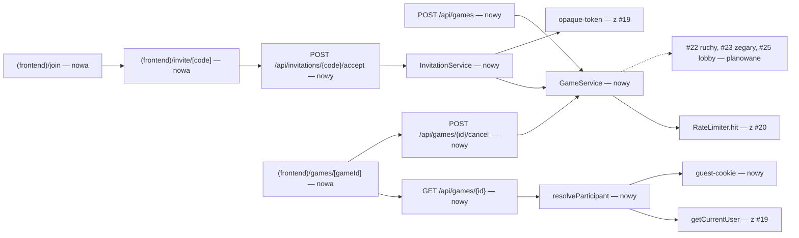
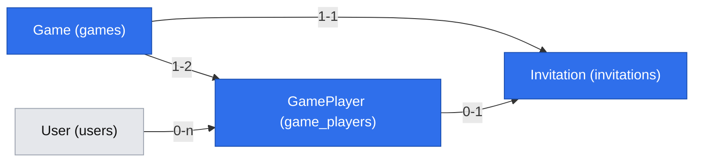

# Partia z zaproszenia: tworzenie, dołączanie, gość (E02-S01, #21)

> **Zmienione przez `2026-10-26-account-onboarding-simplification.md` (decyzje właściciela 2026-10-26, brief D-24…D-26, BR-26…BR-28).** Punkty poniżej są zastąpione; tekst niżej zostaje jako historia i jest oznaczony w miejscach zmian.
> - Nie ma stanu „zalogowany bez potwierdzenia”: tworzenie partii, przyjęcie zaproszenia jako on sam i lobby działają bez względu na `emailVerifiedAt`. `EMAIL_NOT_VERIFIED` i Q15 zastąpione (BR-26).
> - Q19: `as = guest` jest niedozwolone dla **każdego** zalogowanego (`409 GUEST_NOT_ALLOWED`); gość jest wyłącznie dla niezalogowanych (BR-22).
> - Strona `/invite/[code]` w mapie ekranów jako s07.

> Status: **zatwierdzona** (`om-auto-write-spec`, 2026-10-24; założenia Q4 i Q9 potwierdzone przez właściciela — Bartosz Wójcik, 2026-10-24; pozostałe odwracalne; Q3, Q6, Q13 i Q20–Q22 potwierdzone w sesji grill-me 2026-10-24). Źródło: issue #21, `.ai/specs/product-brief.md` (BR-01, BR-09, BR-11, BR-13, BR-22, BR-23, BR-24, D-07, D-10, D-21, D-23), specyfikacje #19 (G2, G5, G7, G8), #20 (`requireSession`, `RateLimiter.hit`, `activeGameCheck`), #37 (usunięcie konta), #39 (sprzątanie), standardy (`.ai/docs/2026-09-01-engineering-standards.md`, §Architecture).

## 📝 TLDR

Dziś nie ma partii: stałe `BOARD_SIZE`/`WIN_LENGTH` w `core` to jedyny kod domeny. Po wdrożeniu (zachowanie przyszłe): zalogowany użytkownik z potwierdzonym e-mailem tworzy partię i dostaje **jedno jednorazowe zaproszenie** — link `/invite/ABCD-EFGH` i ten sam kod do przepisania na `/join`. Zaproszony dołącza jako zalogowany gracz z potwierdzonym e-mailem albo — bez konta — jako **gość** z tokenem jednej partii w ciasteczku (BR-22). Partia ma dokładnie dwóch uczestników, trzecia osoba nie wejdzie, a użytkownik ma co najwyżej jedną partię (BR-13). Ruchy, zegary i wynik to #22/#23 — tu powstaje partia „gotowa do gry” i warstwa tożsamości uczestnika (konto albo gość), z której skorzystają kolejne route'y.

## Resolved assumptions (autonomous defaults)

| # | Pytanie | Zastosowane założenie | Dlaczego | Potwierdzenie |
|---|---|---|---|---|
| Q1 | Link i kod to dwa sekrety czy jeden? | **Jeden sekret** (`code`): link `APP_ORIGIN/invite/{code}`, ten sam kod wpisuje się na `/join`. | Kryterium „dostaje link i kod” nie wymaga dwóch mechanizmów; mniej powierzchni do pilnowania. | odwracalne |
| Q2 | Format kodu | 8 znaków z własnego alfabetu 31 znaków (cyfry i litery A–Z bez mylących się `0 O 1 I L`; to nie Crockford base32, który ma 32 znaki), losowane `crypto.randomInt`, wyświetlane jako `ABCD-EFGH`; wejście normalizowane (wielkość liter, myślnik, spacje). Brak dopasowania → jednolity błąd. | ~39,6 bita entropii (31^8) przy limicie prób (Q13) uniemożliwia zgadywanie, a kod da się podyktować przez telefon (BR-20). | odwracalne |
| Q3 | Ważność zaproszenia | 24 h (`INVITATION_TTL_MS`, nazwana stała); po upływie zaproszenie i oczekująca partia są nieważne (filtr przy odczycie, bez zadania w tle). | Znajomy może odpisać po kilku godzinach; krótsze okno zmusza do powtarzania; twórca może anulować w każdej chwili (Q5). | ✅ potwierdzone przez właściciela 2026-10-24 (sesja grill-me) |
| Q4 | Czy oczekująca partia (bez przeciwnika) zajmuje „jedyną aktywną partię” (BR-13)? | **Tak, zajmuje.** Użytkownik z oczekującą partią nie utworzy drugiej ani nie dołączy do cudzej, dopóki jej nie anuluje, nie wygaśnie albo ktoś nie dołączy. W bazie: `game_players.is_active` + częściowy unikalny indeks `(user_id) WHERE is_active`. **To nie to samo co „partia w toku” z #37 (Q9) i `hasActiveGame` (G5, wylogowanie):** te pytają o status `active`. | Bez tego jedno konto zasypuje bazę oczekującymi partiami i zaproszeniami; DB egzekwuje regułę (standardy: współbieżność w bazie). Brief mówi „aktywna partia” bez rozróżnienia — to interpretacja. | ✅ potwierdzone przez właściciela 2026-10-24 — interpretacja BR-13/D-10; narzuca kształt indeksu w #29 |
| Q5 | Czy twórca może anulować oczekującą partię? | Tak: `POST /api/games/{id}/cancel` (tylko twórca, tylko status `waiting`) → status `cancelled`, `is_active = false`, zaproszenie nieważne. | Bez tego Q4 zablokowałoby użytkownika na 24 h po pomyłce. | odwracalne |
| Q6 | Aktualizacja widoku twórcy po dołączeniu przeciwnika (transport czasu rzeczywistego to otwarte Q-01/#30) | Krótkie odpytywanie `GET /api/games/{id}` co 3 s, **tylko** w statusie `waiting`; po zmianie na `active` odpytywanie się kończy. Wymiana na transport z #30 nie zmienia kontraktu `GET`. | #21 nie może czekać na spike; odpytywanie wystarcza dla jednego zdarzenia „ktoś dołączył”. | ✅ potwierdzone przez właściciela 2026-10-24 (sesja grill-me) |
| Q7 | Zalogowany użytkownik, który ma już partię, otwiera link i wybiera „Graj jako gość” | Odmowa `409 ACTIVE_GAME_EXISTS` także dla gościa (serwer widzi sesję w ciasteczku) i dla przeglądarki z ważnym tokenem gościa innej trwającej partii. | Inaczej BR-13 obchodzi się jednym kliknięciem. | odwracalne |
| Q8 | Własne zaproszenie | Twórca nie dołączy do własnej partii (`409 OWN_INVITATION`); drugi uczestnik musi być inną tożsamością. Gość z innej przeglądarki tej samej osoby jest nie do wykrycia i nie jest blokowany. | Zapobiega pomyłce; nie obiecuje ochrony przed samograjem. | odwracalne |
| Q9 | Jak przechowywać kod zaproszenia? | **Jawnie** w `invitations.code` (unikalny indeks), nie jako hash. | Twórca musi móc zobaczyć link ponownie po odświeżeniu; zaproszenie jest krótkotrwałym, jednorazowym sekretem o niskiej wartości (daje miejsce w jednej partii), a odczyt bazy daje i tak dostęp do danych partii. Odstępstwo od wzorca „w bazie tylko SHA-256” (tokeny sesji, #34, #35) jest świadome. | ✅ potwierdzone przez właściciela 2026-10-24 — świadome odstępstwo od zasady hashowania tokenów |
| Q10 | Ciasteczko i token gościa | Token z `createOpaqueToken()` (#19, G7), w bazie SHA-256 w `game_players.guest_token_hash`; ciasteczko `__Host-gomoku_guest` (`httpOnly`, `secure`, `sameSite=lax`, `path=/`, `Max-Age` 2 h — zapas ponad partię ≤ ~20 min + 1 h); **o ważności decyduje serwer**: token działa, dopóki partia nie jest zakończona, i do 1 h po `finishedAt` (BR-22). W teście integracyjnym `SESSION_COOKIE_SECURE=false` zmienia nazwę jak sesja (#19). | Zgodne z BR-22 i G7; ciasteczko samo nie jest źródłem prawdy. | odwracalne |
| Q11 | Ostrzeżenie przed grą jako gość | UI pokazuje tekst „Grasz bez konta — nie zmieniaj przeglądarki w trakcie partii” **przed** przyciskiem „Rozumiem, graj jako gość”; serwer wymaga pola `acknowledgedGuestWarning: true` (inaczej `400`). | Kryterium wymaga ostrzeżenia; zgoda sprawdzana po stronie serwera, nie tylko w UI. | odwracalne |
| Q12 | Podglądy linków w komunikatorach | `GET /invite/{code}` **niczego nie zużywa ani nie dołącza**; dołączenie to `POST …/accept` z przycisku (jak potwierdzenie e-maila w #34, Q3). | Komunikatory i skanery otwierają linki automatycznie. | odwracalne |
| Q13 | Limity | Utworzenie partii: 10 na użytkownika na godzinę (chroni przed pętlą „utwórz, anuluj”; liczbę jednoczesnych oczekujących partii ogranicza już Q4). Nieudane wyszukania kodu — zarówno w `POST …/accept`, jak i przy wyświetlaniu strony `/invite/{code}` (`preview`) — liczą się do wspólnej puli: 20 na adres klienta w 15 min (klucz SHA-256, `RateLimiter.hit`). **Gdy adres klienta nie jest wiarygodnie ustalony (spike #30), zamiast limitu na adres działa globalny limit nieudanych wyszukań: 300 w 15 min dla całej aplikacji; po jego przekroczeniu każde wyszukanie kodu (także ważnego) dostaje `429` do końca okna** — brak odpowiedzi odróżniającej ważny kod od nieważnego pod presją. | Zgadywanie kodu (~39,6 bita) bez żadnej innej bariery byłoby jedyną ochroną; świadomie wybieramy chwilową niedostępność zaproszeń zamiast wyroczni. | ✅ potwierdzone przez właściciela 2026-10-24 (sesja grill-me) |
| Q14 | Kolory, kolejność ruchów, zegary | **Poza #21.** #21 ustawia status `active` i `startedAt` w chwili dołączenia i nadaje miejsca (`seat` 1 = twórca, 2 = dołączający); losowanie koloru i pierwszy ruch należą do #22, zegar do #23 — z wymaganiem Q20 (zegar rusza dopiero po `seen_at` obu graczy). | Granica zakresu z backlogu (E02-S02, E02-S03). | odwracalne |
| Q15 | Komunikat dla niepotwierdzonego e-maila przy linku | `403 ~~EMAIL_NOT_VERIFIED~~ (zastąpione 2026-10-26)`; strona zaproszenia pokazuje „Potwierdź e-mail, aby grać jako on sam” **i** drugą opcję „Graj jako gość” (BR-23). | Wynika wprost z BR-23. | odwracalne | **[zastąpione 2026-10-26: stan nie istnieje, BR-26]**
| Q16 | Wygasanie bez zadania w tle (BR-13 a wygasła oczekująca partia) | Wygasła oczekująca partia jest traktowana jako nieważna przy odczycie; **w tej samej transakcji przed wstawieniem** nowej partii lub dołączeniem serwis zamyka przeterminowane oczekujące partie użytkownika (`status = cancelled`, `is_active = false`). Sprzątanie fizyczne — reguły #39. | Standardy zabraniają workerów dla poprawności; indeks częściowy musi zobaczyć zwolnione miejsce. | odwracalne |
| Q17 | Partia w toku, której zegar wyczerpał się bez żadnego odczytu, a BR-13 | Jak Q16, ale dla statusu `active`: przed każdym sprawdzeniem BR-13 (`create`, `accept`, `occupiesSlot`) i przed ocenianiem ważności tokenu gościa serwis wywołuje wstrzykiwany port `timeoutSettler.settleFor(userId)` z #23, który leniwie finalizuje partie użytkownika z upłyniętym czasem (`finished`, `is_active = false`). Do czasu #23 implementacja jest no-op (jak `activeGameCheck` w #20). | Timeout jest wykrywany leniwie (standardy); bez tego martwa partia blokuje obu graczy i trzyma ważny token gościa do pierwszego odczytu. | odwracalne |
| Q18 | Użytkownik, który sam ma oczekującą partię, otwiera cudzy link (dwóch znajomych wysłało sobie linki nawzajem) | Odpowiedź `409 OWN_WAITING_GAME` (z `gameId`), a nie `ACTIVE_GAME_EXISTS`; `accept` przyjmuje opcjonalne `cancelOwnWaitingGame: true`, które w tej samej transakcji anuluje jego oczekującą partię (tylko `waiting`, nigdy `active`) i dołącza. UI pokazuje przycisk „Anuluj moją partię i dołącz”. | Inaczej obaj muszą najpierw ręcznie anulować i stracić link. | odwracalne |
| Q19 | `as = guest` dla zalogowanego z potwierdzonym e-mailem | Niedozwolone: `409 GUEST_NOT_ALLOWED`, UI nie pokazuje mu opcji gościa. Gość jest dla niezalogowanych i dla kont z niepotwierdzonym e-mailem (BR-23). | Zalogowany gracz z potwierdzonym kontem nie ukrywa tożsamości ani nie omija historii (BR-24). | odwracalne | **[zmienione 2026-10-26: `as = guest` niedozwolone dla każdego zalogowanego]**
| Q20 | Start zegara, gdy twórca odszedł od ekranu (zaproszenie ważne 24 h, odpytywanie w tle bywa wstrzymane, a zegar biegnie przy rozłączeniu — BR-06) | Status `active` ustawiany jest przy dołączeniu, ale **zegar pierwszego gracza rusza dopiero, gdy obaj uczestnicy mają `seen_at`**. `seen_at` uczestnika to moment pierwszego udanego `GET /api/games/{id}` (`getState`); dołączający ma `seen_at = joinedAt` od razu. Wymaganie wobec #23 i kolumna `game_players.seen_at` w #29. | Zaproszenie przyjęte bez wiedzy twórcy nie może kosztować go czasu na zegarze. | ✅ potwierdzone przez właściciela 2026-10-24 (sesja grill-me) |
| Q21 | Gracz nigdy nie otwiera strony partii | Po `READY_DEADLINE_MS` = 15 min od `started_at` partia `active`, w której któryś uczestnik nie ma `seen_at`, przechodzi leniwie w `cancelled` (`is_active = false`, token gościa nieważny), nie trafia do historii (nie została zagrana). Regułę wykonuje `GameService.cancelNotStarted(userId)` wołane razem z `timeoutSettler` (Q17), bez zadania w tle. | Inaczej partia bez zegara blokuje obu graczy (BR-13) i trzyma token gościa bez końca. | ✅ potwierdzone przez właściciela 2026-10-24 (sesja grill-me) |
| Q22 | Udostępnianie linku na telefonie (BR-20) | Oprócz „Kopiuj” przycisk „Udostępnij” z `navigator.share` (wstrzykiwane API; ukryty tam, gdzie go nie ma). | Zaproszenie najczęściej leci komunikatorem z telefonu. | ✅ potwierdzone przez właściciela 2026-10-24 (sesja grill-me) |

## 📝 Problem Statement

- **Kto:** zalogowany użytkownik z potwierdzonym e-mailem, który chce zagrać z konkretną osobą (BR-09 ścieżka a), oraz jego znajomy — z kontem albo bez niego (BR-22). Grupa docelowa bez dowodu popytu (A-01); wymóg potwierdzenia e-maila jest niesprawdzonym założeniem (A-03), dlatego gość istnieje.
- **Dziś:** brak encji partii, zaproszeń i uczestników; brak strażnika tożsamości uczestnika (konto/gość).
- **Kryteria z #21:** (1) utworzenie partii daje link i kod; (2) ważny link + inny zalogowany → drugi gracz, dokładnie dwóch uczestników (BR-01); (3) trzecia osoba nie dołączy (BR-11); (4) użytkownik z aktywną partią nie utworzy ani nie dołączy do drugiej (BR-13); (5) niepotwierdzony e-mail → serwer odrzuca, link proponuje grę gościa (BR-23); (6) gość po ostrzeżeniu dołącza bez konta i nazwy; (7) gość wraca w tej samej przeglądarce, w innej nie ma dostępu; (8) token gościa wygasa 1 h po końcu partii; (9) gość nie tworzy zaproszeń ani nie wchodzi do lobby.

## 📝 Proposed Solution

Trzy części: (1) **model i serwisy** — partia, uczestnik, zaproszenie; (2) **atomowe dołączenie** w jednej transakcji: blokada wiersza `games` (`SELECT … FOR UPDATE`), warunkowe `UPDATE … RETURNING` na zaproszeniu i warunkowe przejście `waiting → active`, z ograniczeniami w bazie jako ostatnią linią obrony; (3) **tożsamość uczestnika** — jeden strażnik `resolveParticipant(gameId)` rozpoznający konto (sesja) albo gościa (token), który użyje każdy kolejny route partii.

**Rozważone i odrzucone:**
- **Dwa osobne sekrety (długi link + krótki kod)** — podwaja powierzchnię i testy bez zysku (Q1).
- **Dołączenie przy samym `GET` linku** — komunikatory zużyłyby zaproszenie (Q12).
- **Gość jako wiersz w `users` (konto-widmo)** — zanieczyszcza unikalne indeksy i wymagałoby usuwania; BR-22 mówi: bez konta, bez nazwy, bez historii.
- **Gość w tabeli `sessions`** — G7 (#19) wprost oddziela token gościa od sesji kont; inny cykl życia (koniec partii + 1 h).
- **Zaproszenie bez limitu oczekujących partii** — zasypywanie bazy (Q4).
- **WebSocket już w #21** — blokuje na spike #30 (Q6).

**Poza zakresem:** ruchy, zegary, wynik (#22–#24), lobby (#25, #31, E03), historia (#27), przejęcie partii gościa po rejestracji (BR-22: nie ma), powiadomienia e-mail o zaproszeniu, trwała lista znajomych (BR-11).

## 📝 Architecture

- **`core/src/games/`** — czyste funkcje i stałe: `INVITATION_TTL_MS`, `GUEST_TOKEN_GRACE_MS` (1 h), `READY_DEADLINE_MS` (15 min, Q21), alfabet i `generateInvitationCode(random)` (przez wstrzykiwane źródło losowości — test deterministyczny), `normalizeInvitationCode`, typy `GameStatus` (`waiting | active | finished | cancelled`), `GameOrigin` (`invite | lobby`, D-21), `ParticipantKind` (`account | guest`). Walidatory `core/src/validators/games/` (`acceptInvitationSchema`: `{ as: "user" | "guest", acknowledgedGuestWarning?: boolean }`).
- **`GameService`** (scoped, `{ em, clock, rateLimiter, invitationCodes, timeoutSettler }`): `create(user)` — weryfikacja `emailVerifiedAt` (`403 ~~EMAIL_NOT_VERIFIED~~ (zastąpione 2026-10-26)`), limit (Q13), zamknięcie przeterminowanych oczekujących partii użytkownika (Q16), wstawienie `games` + `game_players` (seat 1, `is_active`) + `invitations`; naruszenie częściowego indeksu → `409 ACTIVE_GAME_EXISTS`. `cancel(user, gameId)` (blokada wiersza `games`, potem `UPDATE games SET status = 'cancelled' WHERE id = :id AND status = 'waiting' RETURNING`; 0 wierszy → `409 GAME_NOT_CANCELLABLE`; ustawia `is_active = false`), `getState(participant, gameId)` (przy pierwszym wywołaniu uczestnika ustawia jego `seen_at`, Q20), `cancelNotStarted(userId)` (Q21). Przed sprawdzeniem BR-13 woła `cancelNotStarted` i `timeoutSettler.settleFor(userId)` (Q17).
- **`InvitationService`** (scoped, `{ em, clock, rateLimiter, timeoutSettler }`): `preview(code, viewer)` (stan dla strony zaproszenia, bez zmiany stanu; nieudane wyszukanie liczy się do limitu z Q13), `accept(code, viewer, { as, acknowledged, cancelOwnWaitingGame })` w jednej transakcji: (1) widz już jest uczestnikiem tej partii → zwróć ją (powrót, kryterium 7); (1b) **kolejność blokad: najpierw wiersze `users` rosnąco po `id` (reguła z #37), potem wiersz `games`** (`SELECT … FOR UPDATE`) i odczyt zaproszenia; (2) po `timeoutSettler.settleFor` sprawdzenia: nie własne zaproszenie (Q8), BR-13 (Q7; własna oczekująca partia → `OWN_WAITING_GAME` albo, przy `cancelOwnWaitingGame`, anulowanie w tej transakcji — Q18), `as = user` wymaga potwierdzonego e-maila (Q15), `as = guest` niedozwolone dla zalogowanego z potwierdzonym e-mailem (Q19), `acknowledged` dla `as = guest` (Q11); (3) `UPDATE invitations SET consumed_at = :now WHERE code = :code AND consumed_at IS NULL AND expires_at > :now RETURNING game_id` oraz sprawdzenie pod blokadą, że `games.status = 'waiting'` — inaczej `INVALID_INVITATION` i rollback; (4) wstawienie uczestnika (seat 2, `seen_at = :now`; unikalny `(game_id, seat)` jako ostatnia linia obrony przed trzecim) i **warunkowe** `UPDATE games SET status = 'active', started_at = :now WHERE id = :gameId AND status = 'waiting'` — 0 wierszy → rollback, nigdy nadpisanie `cancelled`; (5) dla gościa: `createOpaqueToken()`, zapis hashu, ciasteczko po zatwierdzeniu transakcji.
- **`resolveParticipant(gameId)`** w `app/src/server/http/participant.ts` — kolejność: sesja konta (uczestnik z `user_id`), potem token gościa z ciasteczka (`hashOpaqueToken` → `guest_token_hash`, partia niezakończona lub `finished_at > now − 1 h`). Brak → `404` (nie `403`, żeby nie potwierdzać istnienia partii). **Kontrakt dla #22–#24.**
- **`activeGameCheck`** z #20 dostaje prawdziwą implementację: `hasActiveGame(userId)` = uczestnik partii o statusie `active`; nowa metoda `occupiesSlot(userId)` (status `waiting` lub `active`) służy BR-13. G5 (wyjątek wygaśnięcia sesji w trakcie partii) i wylogowanie pytają o `active`.
- **`timeoutSettler`** (port z #23, scoped): `settleFor(userId)` leniwie finalizuje partie `active` użytkownika z upłyniętym czasem (Q17); wołany przed każdym sprawdzeniem BR-13 i przed oceną ważności tokenu gościa. Do czasu #23 — no-op wstawiony do kontenera tym PR-em.
- **`GuestCookie`** (`app/src/server/http/guest-cookie.ts`) — zapis/odczyt/usunięcie ciasteczka, nazwa zależna od `SESSION_COOKIE_SECURE` jak sesja.
- **Kontener:** `gameService`, `invitationService` (scoped), `invitationCodes` (singleton, `randomInt`), `clock` (z #34/#19; jeśli brak, dodaje go ten PR).

## 📝 Data Model

Migrację dostarcza **#29** (E02-S01-T01, „partia, uczestnik, zaproszenie, ruch”); poniższy kształt jest **wymaganiem wobec #29**. Pole `moves` i kolumny zegara — poza tą specyfikacją (#22/#23).

| Encja → tabela | Pola | Ograniczenia |
|---|---|---|
| `Game` → `games` | `id` uuid (PK), `origin` (`invite`\|`lobby`, D-21), `status` (`waiting`\|`active`\|`finished`\|`cancelled`), `createdAt`, `startedAt` NULL, `finishedAt` NULL | indeks `(status, created_at)` pod sprzątanie (#39) |
| `GamePlayer` → `game_players` | `id` uuid, `game` → `games.id` (`on delete cascade`), `seat` smallint (1\|2), `kind` (`account`\|`guest`), `user` → `users.id` **NULL, `on delete set null`** (wymaganie #37, Q1), `guestTokenHash` char(64) NULL, `isActive` boolean, `joinedAt`, `seenAt` timestamptz NULL (Q20) | unique `(game_id, seat)`; unique `(game_id, user_id)` (NULL-e nie kolidują); unique `guest_token_hash`; **częściowy unique `(user_id) WHERE is_active`** (BR-13, Q4); `CHECK (kind = 'guest' → user_id IS NULL)`; `guest_token_hash` jest celowo nullowalny również dla gościa — NULL oznacza token wyczyszczony przez #39 po `finished_at + 1 h` i nie może być wymagany |
| `Invitation` → `invitations` | `id` uuid, `game` → `games.id` (`on delete cascade`, unique), `code` varchar(8) unique, `expiresAt`, `consumedAt` NULL, `consumedBy` → `game_players.id` NULL | unique `code`; indeks `expires_at` |

`kind = account` z `user_id = NULL` oznacza konto usunięte (#37) — historia pokazuje „Usunięty gracz”, `kind = guest` — „Zaproszony przez link” (BR-24). **`is_active`** jest ustawiany `true` przy utworzeniu partii (twórca) i dołączeniu (drugi gracz), a `false` przy `cancelled`, wygaśnięciu oczekującej partii (Q16) i `finished` (**wymaganie wobec #22/#23: kończąc partię ustawiają `is_active = false` obu uczestnikom w tej samej transakcji**).

**Dane wrażliwe:** kod zaproszenia jawnie (Q9, potwierdzone); token gościa tylko jako SHA-256; brak e-maila i nazwy gościa. Token i kod nie trafiają do logów. Strona zaproszenia ustawia `Referrer-Policy: no-referrer` i nie ładuje zasobów zewnętrznych (kod jest w adresie). Usunięcie konta (#37): oczekujące partie użytkownika są usuwane jawnie w transakcji usunięcia (`GameService.deleteWaitingGames(userId)`), uczestnik partii w toku/zakończonej dostaje `user_id = NULL`.

**Migracja:** w #29 (up/down na PostgreSQL); ta specyfikacja nie dodaje własnej. Jeśli #29 powstanie wcześniej bez `kind`, `is_active` lub indeksu częściowego, #21 dodaje je osobną migracją.

## 📝 API Contracts

Wszystkie route'y przez `apiHandler` (CSRF z #19: `X-Gomoku-Request: 1`, `Origin` = `APP_ORIGIN`), `await connection()`, `withRequestScope`.

`POST /api/games` — bez treści; `requireSession` (gość → `401`)

| Wynik | Status | Treść |
|---|---|---|
| Utworzono | `201` | `{ ok: true, data: { gameId, invitation: { code, url, expiresAt } } }` |
| Brak sesji lub gość | `401` | `UNAUTHORIZED` |
| E-mail niepotwierdzony (BR-23) | `403` | ~~`EMAIL_NOT_VERIFIED`~~ (zastąpione 2026-10-26: brak bramki, BR-26), „Potwierdź e-mail, aby grać.” |
| Użytkownik ma już partię (BR-13) | `409` | `ACTIVE_GAME_EXISTS`, „Masz już partię. Dokończ ją albo anuluj oczekującą.” |
| Limit (Q13) | `429` | `RATE_LIMITED` + `Retry-After` |

`POST /api/invitations/{code}/accept` — `{ "as": "user" | "guest", "acknowledgedGuestWarning": true, "cancelOwnWaitingGame": false }` (sesja potrzebna tylko dla `as = user`; dwa ostatnie pola opcjonalne)

| Wynik | Status | Treść |
|---|---|---|
| Dołączono (także powtórne wywołanie przez już dołączonego) | `200` | `{ ok: true, data: { gameId } }`; dla gościa `Set-Cookie` |
| Zaproszenie nieznane, użyte, wygasłe lub partia anulowana | `410` | `INVALID_INVITATION`, jednolity komunikat „To zaproszenie jest już nieważne.” (niepoprawny kształt kodu → ten sam wynik) |
| `as = user` bez sesji | `401` | `UNAUTHORIZED` |
| `as = user`, e-mail niepotwierdzony (Q15) | `403` | ~~`EMAIL_NOT_VERIFIED`~~ (zastąpione 2026-10-26: brak bramki, BR-26) |
| Własne zaproszenie (Q8) | `409` | `OWN_INVITATION` |
| Dołączający ma już partię w toku (Q7) | `409` | `ACTIVE_GAME_EXISTS` |
| Dołączający ma własną oczekującą partię, bez `cancelOwnWaitingGame` (Q18) | `409` | `OWN_WAITING_GAME`, `data: { gameId }` |
| `as = guest` przy sesji z potwierdzonym e-mailem (Q19) | `409` | `GUEST_NOT_ALLOWED` | **[zmienione 2026-10-26: dla każdego zalogowanego]**
| `as = guest` bez `acknowledgedGuestWarning` (Q11) | `400` | `VALIDATION`, `fieldErrors.acknowledgedGuestWarning` |
| Limit nieudanych wyszukań albo globalna blokada (Q13); dotyczy też strony `/invite/{code}` | `429` | `RATE_LIMITED` + `Retry-After` |

`POST /api/games/{id}/cancel` — bez treści; tylko twórca (seat 1), tylko `waiting` (atomowo, warunkowym `UPDATE`): `200` `{ ok: true, data: null }`; obcy lub brak partii `404`; inny status `409` `GAME_NOT_CANCELLABLE`.

`GET /api/games/{id}` — uczestnik (`resolveParticipant`, inaczej `404`): `{ status, you: { seat, kind }, players: [{ seat, kind, displayName | null, seen }], invitation?: { code, url, expiresAt } }` — `invitation` tylko dla twórcy w statusie `waiting`; `displayName` null dla gościa i konta usuniętego. Kontrakt rozszerzają #22/#23 (stan planszy, zegary) — addytywnie.

Strony `/invite/{code}`, `/join`, `/games/{id}`. Adres `/invite/{code}` i format kodu wysyłane poza aplikację — chronione od wdrożenia jak linki zaproszeń (`BACKWARD_COMPATIBILITY.md` §3).

## 📝 UI/UX

- **`/invite/[code]`** (czysty Tailwind, telefon od 360 px — BR-20; `searchParams`/`params` jako `Promise`, `await connection()`): na górze „{nazwa twórcy} zaprasza Cię do partii Gomoku”. Stany: *niezalogowany* — „Zaloguj się”, „Załóż konto” (oba z `?next=/invite/{code}`, G8) i „Graj jako gość”; *zalogowany z potwierdzonym e-mailem* — „Dołącz do partii”; *zalogowany bez potwierdzenia* — „Potwierdź e-mail, aby grać jako {nazwa}” + „Graj jako gość”; *już uczestnik* — przekierowanie do `/games/{id}`; *własne zaproszenie* — przekierowanie do `/games/{id}`; *ma inną partię w toku* — „Masz już partię” + link do niej; *ma własną oczekującą partię* — „Masz oczekującą partię” i przycisk „Anuluj moją partię i dołącz” (`cancelOwnWaitingGame: true`, Q18); *limit prób* — „Zbyt wiele prób — spróbuj za chwilę” (Q13); *nieważne* — „To zaproszenie jest już nieważne” (użyte, wygasłe, anulowane — bez rozróżnienia, Q12). „Graj jako gość” otwiera blok z ostrzeżeniem (Q11) i przyciskiem „Rozumiem, graj jako gość”.
- **`/join`**: pole „Kod zaproszenia” (`autocomplete="off"`, `inputmode="text"`, wielkość liter bez znaczenia, wklejenie z myślnikiem lub bez) → przejście na `/invite/{kod}`; błędny kształt: „Sprawdź kod — ma 8 znaków”. Link „Masz kod?” na `/`.
- **`/games/[gameId]`**: status `waiting` (twórca) — link z przyciskami „Kopiuj” i „Udostępnij” (Q22), kod `ABCD-EFGH` dużą czcionką, „Ważne do {godzina}”, przycisk „Anuluj zaproszenie”, `role="status"` „Czekamy na przeciwnika…” (odpytywanie co 3 s, Q6); po dołączeniu „Przeciwnik dołączył”; dopóki któryś gracz nie otworzył strony — „Czekamy, aż {nazwa} otworzy partię — zegar ruszy, gdy obaj będziecie na stronie (do 15 min)” (Q20, Q21); gdy obaj byli — „Partia gotowa” (plansza dopiero w #22). Gość i drugi gracz widzą ten sam ekran. Ostrzeżenie dla gościa trwale widoczne nad stanem: „Grasz bez konta — nie zmieniaj przeglądarki w trakcie partii”.
- Przycisk „Kopiuj” używa Clipboard API z awaryjnym zaznaczeniem tekstu; „Udostępnij” wywołuje `navigator.share` i jest ukryty bez tego API. Błędy w `role="alert"`, stany ładowania na przyciskach (`SubmitButton` z #19).
- Mockupy: pominięte — repozytorium nie ma deskryptora środowiska testowego `om-prepare-test-env` (`.ai/scripts/` jest puste), więc ekranów nie dało się wyrenderować.

## 📝 Edge Cases & Failure Scenarios

| Sytuacja | Skutek |
|---|---|
| Dwie osoby otwierają link i klikają „dołącz” jednocześnie | Warunkowy `UPDATE … RETURNING` przepuszcza jedną; druga dostaje `INVALID_INVITATION` („nieważne”). Unikalny `(game_id, seat)` jest zabezpieczeniem. |
| Komunikator otworzył link (podgląd) | Nic się nie zużywa (Q12). |
| Trzecia osoba | `INVALID_INVITATION` (kryterium 3). |
| Gość zamknął kartę i wraca w tej samej przeglądarce | Ciasteczko → `resolveParticipant` → ta sama partia; otwarcie linku przekierowuje do `/games/{id}`. |
| Gość w innej przeglądarce lub po wyczyszczeniu ciasteczek | `404` dla partii, link nieważny; zegar biegnie (BR-06), gość widział to ostrzeżenie. |
| 1 h po końcu partii | Token odrzucany przez serwer; ciasteczko wygasa i tak (Max-Age). #39 zeruje `guest_token_hash`. |
| Twórca anuluje, a przeciwnik właśnie klika „dołącz” | Obie operacje blokują wiersz `games` i zmieniają status warunkowo (`WHERE status = 'waiting'`); wygrywa pierwsza, druga dostaje rollback (`INVALID_INVITATION` / `GAME_NOT_CANCELLABLE`). Nie ma „półpartii” ani nadpisania `cancelled` przez `active`. |
| Twórca usuwa konto z oczekującą partią | Partia i zaproszenie usuwane (#37); link → „nieważne”. |
| Twórca otwiera własny link | Przekierowanie do `/games/{id}` (Q8). |
| Zalogowany z partią w toku otwiera link | „Masz już partię” (Q7), także dla gościa. |
| Wygasłe zaproszenie, twórca nadal „zajmuje miejsce” | Zwalnia się przy następnej akcji (Q16) lub widok pokazuje wygaśnięcie; `GET` w statusie `waiting` po `expiresAt` zwraca `cancelled`. |
| Dwóch znajomych wysłało sobie linki, obaj mają oczekujące partie | `409 OWN_WAITING_GAME`; przycisk „Anuluj moją partię i dołącz” (Q18) rozwiązuje to jednym kliknięciem. |
| Partia w toku z wyczerpanym zegarem, nikt jej nie czytał | `timeoutSettler` (Q17) finalizuje ją przed sprawdzeniem BR-13 i oceną tokenu gościa; do czasu #23 problem nie występuje, bo partia nie ma zegara. |
| Gość dołącza do drugiej partii w ciągu godziny od pierwszej (zakończonej) | Nowy token nadpisuje ciasteczko; dostęp do poprzedniej, zakończonej partii kończy się (gość nie ma historii, BR-24). Przy poprzedniej partii w toku — `ACTIVE_GAME_EXISTS` (Q7). |
| Adres klienta niewiarygodny (brak wyniku spike'a #30) | Zamiast limitu na adres działa globalny limit nieudanych wyszukań (Q13); skutkiem ataku jest chwilowa niedostępność zaproszeń, nie zgadnięty kod. |
| Twórca (albo gość) po dołączeniu nigdy nie otwiera strony partii | Po 15 min (Q21) partia → `cancelled`, miejsca zwolnione, brak wpisu w historii; zegar nie ruszył (Q20), nikt nie traci czasu. |
| Baza niedostępna | `500 INTERNAL`; transakcja nie zostawia półstanu (zaproszenie niezużyte, brak uczestnika). |
| Zgadywanie kodów | 20 nieudanych / 15 min na adres (gdy adres wiarygodny) albo 300 globalnie (Q13); ~39,6 bita entropii; dotyczy `accept` i strony `/invite/{code}`. |

## 📝 Risks & Impact Review

- **`risk-high`** (`SDLC.md`: logowanie i sesje, stan partii, wyścigi, migracje): PR implementacji wymaga testów integracyjnych każdego kryterium, wyścigu dwóch dołączeń, CSRF i migracji w górę i w dół; review drugiej osoby; QA bez self-QA.
- **Kontrakty trudne do cofnięcia:** adres `/invite/{code}` i format kodu (wysyłane poza aplikację), kształt `game_players`/`invitations` (wymaganie wobec #29), granica `is_active` vs `hasActiveGame` (Q4).
- **Wpływ na inne specyfikacje (wymagania trafiają do ich zgłoszeń przed startem kodu — krok 0 planu):** #29 — kształt tabel i indeksów; #37 — jawne usuwanie oczekujących partii i rozróżnienie „w toku” (`hasActiveGame`) od `occupiesSlot`; #39 — reguły: zerowanie `guest_token_hash` po `finished_at + 1 h`, usuwanie `cancelled` i wygasłych `waiting` starszych niż 24 h; #29 — także kolumna `seen_at`; #23 — zegar pierwszego gracza rusza po `seen_at` obu graczy (Q20); #22/#23 — ustawianie `is_active = false` przy zakończeniu, port `timeoutSettler.settleFor(userId)` (Q17), korzystanie z `resolveParticipant`.
- **Zależność od #30 (A):** brak — odpytywanie (Q6). Wymiana transportu to osobna zmiana.
- **Brak dowodu popytu (A-01)** i niesprawdzona bariera potwierdzenia e-maila (A-03) — gość łagodzi, ale jego ograniczenie do jednej przeglądarki (BR-22) może zniechęcać; bez pomiaru.
- **Rollback:** revert PR; migracja należy do #29 (down przed pierwszym wdrożeniem; po wdrożeniu — revert kodu bez cofania tabel).

## 📝 Decisions in play

- **BR-01, BR-09, BR-11, BR-13 / D-07, D-10, D-21, BR-22, BR-23, BR-24, D-23** (właściciel wszystkich: Bartosz Wójcik), **BR-20** (telefon), **BR-06/BR-07** (zegar biegnie dla gościa, który traci dostęp).
- Specyfikacje: #19 (G2 CSRF, G5, G7 `opaque-token`, G8 `safeNextPath`), #20 (`requireSession`, `RateLimiter.hit`, `activeGameCheck`), #34–#37 (wzorce: potwierdzenie przyciskiem, `used_at` warunkowe, wiarygodny adres klienta).
- **Interpretacja zatwierdzona przez właściciela (2026-10-24):** oczekująca partia zajmuje miejsce z BR-13 (Q4); kod zaproszenia jawnie w bazie (Q9). Żadna aktywna decyzja nie jest nadpisywana.

## 📋 Phasing

- **Faza 1 — Partia i dołączanie kontem.** Encje (z #29), `GameService.create/cancel/getState`, `InvitationService.accept(as=user)`, `resolveParticipant` (konto), `activeGameCheck`, route'y, testy współbieżności.
- **Faza 2 — Gość.** `accept(as=guest)`, token i ciasteczko, `resolveParticipant` (gość), wygasanie tokenu.
- **Faza 3 — Strony.** `/invite/[code]`, `/join`, `/games/[gameId]` z odpytywaniem.

Jeden PR implementacji (`Closes #21`, decyzja właściciela 2026-10-24) po #19, #20 i #29 (migracja z uzgodnionym kształtem — krok 0); każdy krok zostawia działającą aplikację z zielonym `npm run check`.

## 📋 Implementation Plan

### Krok 0 — Uzgodnienie z zależnościami (przed pierwszym commitem kodu)

0. **Wymagania do zgłoszeń zależnych:** komentarze w #29 (tabele, indeksy, `CHECK` bez wymogu tokenu, `is_active`, `seen_at`, częściowy indeks), #37 (jawne usuwanie oczekujących partii, `occupiesSlot` ≠ `hasActiveGame`, kolejność blokad `users` → `games`), #39 (`guest_token_hash` → NULL po `finished_at + 1 h`, usuwanie `cancelled` i wygasłych `waiting`), #22/#23 (`is_active = false` przy zakończeniu, `timeoutSettler`, start zegara po `seen_at` obu graczy, `resolveParticipant`). PR implementacji startuje po potwierdzeniu kształtu w #29; własna migracja #21 (krok 2) jest wyjątkiem, nie planem.

### Faza 1 — Partia i dołączanie kontem

1. **Domena w `core/src/games/`:** stałe, `generateInvitationCode`, `normalizeInvitationCode`, typy, `acceptInvitationSchema`. Testy jednostkowe 100%: alfabet bez znaków mylących, długość, normalizacja, deterministyczne źródło losowości.
2. **Encje i migracja (#29) — weryfikacja kształtu:** `game`, `game-player`, `invitation` w `packages/db/src/entities/games/` (`defineEntity`), wpis w `entities/index.ts`; sprawdzenie, że migracja z #29 ma `kind`, `is_active`, częściowy indeks i `CHECK`; brakujące — osobna migracja (up/down/up na PostgreSQL).
3. **`GameService.create/cancel/getState`** + `activeGameCheck` (`hasActiveGame`, `occupiesSlot`) + zamykanie przeterminowanych oczekujących partii (Q16). Testy na fałszywym `em`: e-mail niepotwierdzony, BR-13 przez naruszenie indeksu, limit, anulowanie przez obcego/nie-`waiting`, `getState` ukrywa zaproszenie przed nie-twórcą, `timeoutSettler.settleFor` wołany przed BR-13 (Q17), `cancel` warunkowy, `getState` ustawia `seen_at` tylko raz, `cancelNotStarted` po 15 min (granice).
4. **`InvitationService.accept(as=user)` i `preview`.** Testy: powrót już dołączonego, własne zaproszenie, BR-13, trzeci uczestnik, nieważne/wygasłe/anulowane, jednolity wynik, limit nieudanych także w `preview` i globalna blokada przy niewiarygodnym adresie (Q13), `OWN_WAITING_GAME` i `cancelOwnWaitingGame` (Q18), `GUEST_NOT_ALLOWED` (Q19), alfabet 31 znaków i entropia (Q2).
5. **`resolveParticipant` (konto) i route'y** `POST /api/games`, `POST /api/invitations/[code]/accept`, `POST /api/games/[id]/cancel`, `GET /api/games/[id]`. Testy integracyjne (`fetch`, użytkownicy z `emailVerifiedAt` ustawionym bezpośrednio w bazie kontenera): kryteria 1–5, **wyścig dwóch równoległych `accept`** (dokładnie jeden `200`), **wyścig `cancel` z `accept` (partia nigdy nie kończy jako `active` po `cancelled`)**, CSRF `403`, `404` dla obcego `GET`.

### Faza 2 — Gość

6. **`GuestCookie`, `accept(as=guest)`, `resolveParticipant` (gość).** Testy jednostkowe: nazwa ciasteczka zależna od `SESSION_COOKIE_SECURE`, wymóg `acknowledgedGuestWarning`, token tylko jako hash, BR-13 dla przeglądarki z sesją i z innym tokenem (Q7), ważność do `finishedAt + 1 h` na wstrzykiwanym `clock`, nadpisanie ciasteczka przy drugiej partii, `guest_token_hash` NULL po wyczyszczeniu nie łamie `CHECK`. Testy integracyjne: kryteria 6–9 (powrót w tej samej przeglądarce = to samo ciasteczko; „inna przeglądarka” = brak ciasteczka → `404`; wygaśnięcie przez ustawienie `finished_at` w bazie; gość bez dostępu do `POST /api/games`).

### Faza 3 — Strony

7. **`/invite/[code]`** (wszystkie stany z UI/UX, `Referrer-Policy: no-referrer`) i **`/join`**. Testy komponentów przez `renderToStaticMarkup` (każdy stan), formularz klienta z `jsdom` + `@testing-library/react` (ostrzeżenie gościa, normalizacja kodu).
8. **`/games/[gameId]`** z odpytywaniem co 3 s tylko w `waiting`, kopiowaniem i udostępnianiem linku (`navigator.share` — atrapa; bez API przycisk ukryty), anulowaniem, komunikatem oczekiwania na drugiego gracza. Testy: zatrzymanie odpytywania po `active`, obsługa błędu sieci. Test agent-browser na szerokości telefonu: twórca tworzy partię → drugi kontekst przeglądarki otwiera link jako gość (z ostrzeżeniem) → obaj widzą „partia gotowa”; trzeci kontekst dostaje „nieważne”.
9. **Dokumentacja:** README (nowe adresy `/invite`, `/join`, `/games`); lekcja w `.ai/lessons/`, jeśli przegląd wykaże korektę.
