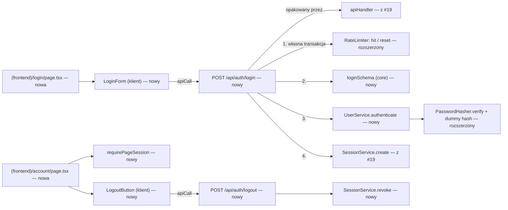

# Logowanie i wylogowanie (E01-S02, #20)

> Status: **zatwierdzona do implementacji** (po niezależnym przeglądzie, poprawki wprowadzone) — odpowiedzi właściciela z 2026-10-24: „zgoda na wszystkie” (Q1–Q4 zgodnie z
> rekomendacją). Źródło: issue #20 (`Backlog id: E01-S02`), `.ai/specs/product-brief.md`,
> `.ai/specs/2026-10-24-account-registration.md` (wspólna warstwa, decyzje G1–G8),
> `.ai/docs/2026-09-01-engineering-standards.md`. Zależy od implementacji #19 (PR A i PR B).

## 📝 TLDR

Po wdrożeniu #19 (zachowanie przyszłe) użytkownik może założyć konto i jest zalogowany przez 30 dni, ale nie może się wylogować ani zalogować ponownie — po wygaśnięciu sesji, na innym urządzeniu albo po wyczyszczeniu ciasteczek traci dostęp do konta.
Po wdrożeniu #20 (zachowanie przyszłe): strona `/login` (e-mail + hasło, powrót przez `?next=`), wylogowanie unieważniające bieżącą sesję, minimalna strona `/account` z przyciskiem wylogowania oraz `requireSession()` — strażnik stron i route'ów wymagających konta. Wszystko na warstwie z #19; rozszerzenia warstwy: atomowe `RateLimiter.hit`/`reset`, atrapowy hash w `PasswordHasher` i odczyt `searchParams.next`.

## ✅ Decyzje z bramki pytań (2026-10-24, właściciel: Bartosz Wójcik — „zgoda na wszystkie”)

| Pytanie | Decyzja |
|---|---|
| Q1 Zakres | Jedna specyfikacja i jedno zgłoszenie (#20), dwie fazy, **jeden PR** (mniejszy niż #19; `risk-high`). |
| Q2 Zgadywanie hasła | Limit prób **bez blokady konta**: 10 nieudanych prób na e-mail w 15 min oraz 30 prób (dowolnych) na adres klienta w godzinę → `429` + `Retry-After`. |
| Q3 Zakres wylogowania | Tylko bieżąca sesja. Unieważnienie wszystkich sesji robią zmiana hasła (#36) i reset (#35). |
| Q4 Wylogowanie w trakcie partii | Potwierdzenie „Trwa partia — po wylogowaniu zegar biegnie dalej. Wylogować?”. W #20 partii nie ma — strona `/account` podaje do `LogoutButton` prop `hasActiveGame` z wstrzykiwanej funkcji `activeGameCheck.hasActiveGame(userId)` (tu zawsze `false`; to inna funkcja niż w G5, która pyta o partię trwającą od przed `expiresAt`). |

## 📝 Problem Statement

- **Kto:** użytkownik z kontem (#20; brief: „Użytkownicy i scenariusze”). Grupa docelowa bez dowodu popytu (A-01).
- **Dziś (po #19):** sesja powstaje tylko przy rejestracji; nie ma `/login`, wylogowania ani strażnika (`requireSession` i `SessionService.revoke` celowo przeniesione z #19 do #20). Konto bez potwierdzonego e-maila jest zalogowane, ale nie gra (BR-23) — to samo po zalogowaniu.
- **Kryteria z #20 (bez zmian):** (1) poprawne dane → zalogowany; (2) błędne hasło → odmowa, komunikat nie zdradza istnienia konta; (3) po wylogowaniu strony wymagające logowania są niedostępne.

## 📝 Proposed Solution

Route handlery `POST /api/auth/login` i `POST /api/auth/logout` wołane z klienta przez `apiCall`, logika w serwisach z #19. Nowa minimalna strona `/account` (nazwa gracza, e-mail, stan potwierdzenia, przycisk „Wyloguj”) jest pierwszą stroną chronioną — bez niej kryterium 3 nie ma czego sprawdzić; z niej skorzystają zmiana hasła (#36) i usunięcie konta (#37).

**Rozważone i odrzucone:**
- **Blokada konta po N próbach** — odrzucona w Q2 (blokuje konto każdemu, kto zna e-mail ofiary).
- **Wylogowanie przez `GET /logout`** — link wylogowujący może wywołać każda strona (np. obrazek na sąsiedniej `*.byst.re`, G2); stan zmienia tylko `POST` przez `apiHandler` z obowiązkowym `Origin`.
- **Przycisk wylogowania w nagłówku każdej strony** — wspólnego nagłówka stron gracza jeszcze nie ma; przycisk na `/account` i link „Konto” na `/` wystarczą. Nagłówek powstanie z pierwszą stroną gry.

**Poza zakresem:** „wyloguj ze wszystkich urządzeń” (Q3), lista aktywnych sesji, „zapamiętaj mnie” (sesja i tak trwa 30 dni, G5), logowanie zewnętrzne (D-12), zmiana danych konta (#36, E05), usunięcie konta (#37).

## 📝 Architecture



- **`auth.ts` (rozszerzony):** `requireSession()` → aktualny użytkownik albo `UnauthorizedError` (route'y, `401`); `requirePageSession(path)` → aktualny użytkownik albo `redirect("/login?next=" + encodeURIComponent(path))` z `next/navigation` (strony). Obie oparte na `getCurrentUser()` z #19, więc dziedziczą fail closed i wyjątek G5. `redirect()` w Next 16 działa przez rzucenie wyjątku — wywołujemy go **poza** `try/catch` w `getCurrentUser` (`node_modules/next/dist/docs/01-app/03-api-reference/04-functions/redirect.md`). Server component nie zna własnej ścieżki — strona podaje ją jawnie (`requirePageSession("/account")`). Strony czytające sesję wołają najpierw `await connection()`.
- **`activeGameCheck`** (nowy wpis w kontenerze, scoped): `hasActiveGame(userId)` → `false` do czasu modelu partii (#21/#22), które podmienią implementację.
- **`RateLimiter` (rozszerzony):** `hit(key, limit, windowMs)` atomowo zwiększa licznik (jeden upsert we własnej, od razu zatwierdzonej transakcji) i zwraca `{ count, retryAfterSec }`; powyżej limitu rzuca `TooManyRequestsError` z `retryAfterSec` (dla `Retry-After`). `reset(key)` usuwa licznik. Istniejące `consume` z #19 = `hit`. **Limit na e-mail liczy tylko nieudane próby** (Q2) przez kompensację: licznik rośnie **przed** weryfikacją hasła (atomowo — równoległe żądania nie przejdą razem przez sprawdzenie w trakcie ~0,25 s bcrypt), a udane logowanie robi `reset` klucza e-maila.
- **`PasswordHasher` (rozszerzony):** atrapowy hash liczony raz przy tworzeniu singletonu (losowy ciąg, ten sam koszt) do porównania przy nieznanym e-mailu — czas odpowiedzi nie zdradza istnienia konta, także przy pierwszym takim żądaniu.
- **`UserService.authenticate(email, password)`** → użytkownik albo `null`; nigdy nie rozróżnia nieznanego e-maila od złego hasła na zewnątrz. Normalizacja e-maila ta sama co w rejestracji (`normalizeEmail` z `core/src/validators/auth/`, wydzielona z `registerSchema`).
- **Kontener:** bez nowych wpisów poza tym, co już jest z #19 (`userService`, `sessionService`, `rateLimiter`, `passwordHasher`); funkcja aktywnej partii (G5) ta sama.

## 📝 Data Model

Brak nowych encji i migracji. Używane z #19: `users`, `sessions` (wylogowanie usuwa wiersz sesji), `rate_limit_buckets` (nowe klucze `login:email:<sha256(e-mail po normalizacji)>` i `login:ip:<sha256(adres)>` — jak w #19: bez danych osobowych wprost, zawsze w `varchar(200)`). Diagram modelu danych pominięty (brak zmian encji).

## 📝 API Contracts

`POST /api/auth/login` (nagłówki z #19: `Content-Type: application/json`, `X-Gomoku-Request: 1`, `Origin` = `APP_ORIGIN`)

```json
{ "email": "ala@example.com", "password": "…" }
```

| Wynik | Status | Treść |
|---|---|---|
| Sukces | `200` | `{ "ok": true, "data": { "user": { "id": "<uuid>", "displayName": "Ala_7" } } }` (ten sam kształt `user` co w `201` rejestracji; stan potwierdzenia czyta strona z sesji) + `Set-Cookie` jak w #19 (G2, G5) |
| Nieznany e-mail lub złe hasło | `401` | `{ ok: false, error: { code: "INVALID_CREDENTIALS", message: "Nieprawidłowy e-mail lub hasło." } }` — identyczna treść i ten sam rząd czasu odpowiedzi |
| Zły kształt (brak pola, nie-e-mail, hasło > 1024 znaki) | `400` | `code: "VALIDATION"` + `fieldErrors` — **bez** reguł hasła z rejestracji (16 znaków, 72 bajty); górna granica 1024 znaków chroni tylko przed bardzo dużym wejściem |
| Brak `X-Gomoku-Request` / `Origin` ≠ `APP_ORIGIN` | `403` | `code: "FORBIDDEN"` |
| Już zalogowany (ważna sesja) | `409` | `code: "ALREADY_AUTHENTICATED"` |
| Limit na e-mail lub adres | `429` | `code: "RATE_LIMITED"` + `Retry-After` — ten sam komunikat dla obu limitów |
| Nieoczekiwany błąd | `500` | `code: "INTERNAL"` |

Kolejność w route: `hit(login:ip, 30, 1 h)` → sprawdzenie ważnej sesji (`409`) → parse → `hit(login:email, 10, 15 min)` → `authenticate` → przy porażce `401`; przy sukcesie `reset(login:email)` i nowa sesja. Ciasteczko z nieważną/wygasłą sesją nie blokuje logowania i jest nadpisywane (nowy token przy każdym logowaniu — brak session fixation).

`POST /api/auth/logout` (te same nagłówki CSRF)

| Wynik | Status | Treść |
|---|---|---|
| Wylogowano lub nie było sesji | `200` | `{ "ok": true, "data": null }` (koperta — `apiCall` nie przyjmuje pustych odpowiedzi); `Set-Cookie` usuwający ciasteczko — idempotentne |
| Baza niedostępna | `500` | `code: "INTERNAL"`, ale ciasteczko **i tak jest usuwane** (unieważnienie w bazie best effort; wiersz sesji wygaśnie sam) |
| Brak nagłówków CSRF | `403` | `code: "FORBIDDEN"` |

Usuwanie ciasteczka: `cookies().set(nazwa, "", { maxAge: 0, path: "/", secure, httpOnly, sameSite: "lax" })` — nie `delete(nazwa)`, które może pominąć `Secure`, a przeglądarka odrzuca wtedy zmianę ciasteczka `__Host-`.

Kontrakty są addytywne (`BACKWARD_COMPATIBILITY.md` §2). Nowe adresy stron `/login`, `/account` (§3 — chronione od pierwszego wdrożenia).

## 📝 UI/UX

**`/login`** (`(frontend)`, czysty Tailwind, komponenty z #19, teksty po polsku):
- pola „E-mail”, „Hasło”, przycisk „Zaloguj się”; link „Nie masz konta? Załóż konto” → `/register?next=<to samo next>`;
- stany jak w #19: przycisk zablokowany podczas wysyłania, błąd ogólny w `role="alert"` nad formularzem (także dla `401` — bez wskazywania pola), błędy kształtu przy polach, fokus na komunikat błędu;
- `next` czytany z `searchParams` (w Next 16 to `Promise` — `await props.searchParams`) i przekazywany do formularza;
- sukces → `router.replace(safeNextPath(next))`; zalogowany wchodzący na `/login` → przekierowanie na `safeNextPath(next)`;
- działa na szerokości telefonu od 360 px (BR-20); `data-testid` tylko dla formularza i komunikatu.

**`/account`** (chroniona, `requirePageSession("/account")`):
- nazwa gracza, e-mail, stan potwierdzenia („Potwierdź e-mail, aby grać” przy `emailVerifiedAt = NULL`, BR-23), przycisk „Wyloguj”;
- „Wyloguj” → przy `hasActiveGame` (prop ze strony, z `activeGameCheck`; w #20 zawsze `false`) okno potwierdzenia „Trwa partia — po wylogowaniu zegar biegnie dalej. Wylogować?” (Q4) → `POST /api/auth/logout` → `router.replace("/")`.

**`/`**: przy zalogowanym link „Konto” → `/account`; przy niezalogowanym linki „Zaloguj się” i „Załóż konto”.

## 📝 Edge Cases & Failure Scenarios

| Sytuacja | Co widzi użytkownik |
|---|---|
| E-mail z inną wielkością liter / spacjami | Normalizacja jak przy rejestracji → logowanie działa. |
| Nieznany e-mail | „Nieprawidłowy e-mail lub hasło.” — ta sama treść i czas co przy złym haśle (atrapowy hash). |
| 10 nieudanych prób na jeden e-mail w 15 min | `429` „Zbyt wiele prób. Spróbuj ponownie za {n} min.” — także dla właściciela konta z poprawnym hasłem do końca okna (świadomy koszt braku blokady konta; okno krótkie). |
| Atak rozproszony na jeden e-mail z wielu adresów | Zatrzymuje go limit na e-mail (niezależny od adresu). |
| Jeden adres próbuje wielu e-maili | Zatrzymuje go limit na adres (30/h). |
| Konto bez potwierdzonego e-maila | Logowanie się udaje; `/` i `/account` pokazują „Potwierdź e-mail, aby grać” (BR-23). |
| Wylogowanie na jednym urządzeniu | Inne urządzenia pozostają zalogowane (Q3). |
| Wylogowanie z wygasłą / nieznaną sesją albo podwójne kliknięcie | `200`, ciasteczko usunięte — bez błędu. |
| Wiele równoległych prób hasła na jeden e-mail | Licznik rośnie atomowo przed weryfikacją — po 10 kolejne dostają `429`, nawet w trakcie trwających weryfikacji. |
| Napastnik z wielu adresów IPv6 z jednej /64 | Liczony jako jeden adres (`clientKey`, /64). |
| Wejście na `/account` bez sesji lub po wylogowaniu | Przekierowanie na `/login?next=/account`; po zalogowaniu powrót na `/account`. |
| `next` wskazuje obcą stronę (`//evil.com`) | `safeNextPath` → `/`. |
| Baza niedostępna | Logowanie → `500 INTERNAL`; wylogowanie → `500`, ale ciasteczko usunięte; `/account` → przekierowanie na `/login` (fail closed `getCurrentUser`). |
| Sesja wygasa w trakcie aktywnej partii | Wyjątek G5 (partia dokończona) — logika z #19. |

## 📝 Risks & Impact Review

- **`risk-high`** (logowanie i sesje, `SDLC.md`): PR wymaga integracyjnych dowodów — odmowa bez nagłówków CSRF, `401` bez rozróżnienia nieznanego e-maila, `429` dla obu limitów, brak dostępu do `/account` po wylogowaniu; review drugiej osoby; QA bez self-QA.
- **Enumeracja przez czas odpowiedzi.** Atrapowy hash wyrównuje koszt bcrypt; pozostałe różnice (zapytanie do bazy) są małe wobec ~0,2–0,3 s bcrypt. Test sprawdza, że przy nieznanym e-mailu `verify` jest wywołany z atrapowym hashem.
- **Limit na e-mail może na chwilę zablokować prawowitego właściciela** (Q2, akceptowany koszt; okno 15 min).
- **Klucze limitu** są hashami (SHA-256) — bez e-maili i adresów wprost. Tabela rośnie o jeden wiersz na e-mail z nieudaną próbą do sprzątania (#39). SHA-256 bez soli da się odwrócić słownikiem dla znanych e-maili — akceptowalne, bo tabela jest techniczna i krótkotrwała.
- **Kontrakty trudne do cofnięcia:** adresy `/login` i `/account`, kod błędu `INVALID_CREDENTIALS`.
- **Rollback:** brak migracji — revert PR wystarcza; istniejące sesje zostają ważne.

## 📝 Decisions in play

- **D-23** (logowanie wymagane, wyjątek gościa) — realizowane dla kont; gość (BR-22) nie loguje się i nie jest objęty tą specyfikacją.
- **D-12** (własne uwierzytelnianie), **D-13 / BR-14** (e-mail jako login), **BR-23** (konto bez potwierdzonego e-maila nie gra), **BR-20** (telefon), **BR-16** i standardy §1 (komunikaty nie zdradzają istnienia konta).
- Specyfikacja #19: **G2** (CSRF, ciasteczko), **G5** (sesja 30 dni, wyjątek partii), **G8** (`safeNextPath`).
- Żadna aktywna decyzja nie jest nadpisywana.

## 📋 Phasing

- **Faza 1 — Logowanie.** `POST /api/auth/login` + strona `/login`. Sprawdzalne testami `fetch` i agent-browser.
- **Faza 2 — Wylogowanie i strażnik.** `POST /api/auth/logout`, `requireSession` / `requirePageSession`, strona `/account`, linki na `/`.

Jeden PR (Q1), `Closes #20`. Każdy krok zostawia działającą aplikację z zielonym `npm run check`.

## 📋 Implementation Plan

### Faza 1 — Logowanie

1. **`RateLimiter.hit` (atomowy, z `retryAfterSec`) i `reset`** (+ `consume` = `hit`). Testy jednostkowe: granice okna, `hit` we własnej transakcji, `retryAfterSec`, `reset`; testy z #19 przechodzą bez zmian.
2. **`normalizeEmail` i `loginSchema`** w `core/src/validators/auth/` (`registerSchema` korzysta z tej samej `normalizeEmail`). Testy: normalizacja, brak reguł hasła z rejestracji, granica 1024 znaków, kształt.
3. **Atrapowy hash i `UserService.authenticate`.** Testy: poprawne dane, złe hasło, nieznany e-mail (wywołanie `verify` z atrapą), atrapa liczona raz przy tworzeniu.
4. **Route `api/auth/login/route.ts`.** Testy integracyjne (`fetch`): `200` z ciasteczkiem; `401` z identyczną treścią dla nieznanego e-maila i złego hasła; `400`; `403` bez `X-Gomoku-Request` i z obcym `Origin`; `409` przy ważnej sesji; `429` po 10 nieudanych na e-mail (także z różnych `X-Forwarded-For`) i po 30 na adres; udane logowanie zeruje licznik e-maila; równoległe próby na jeden e-mail nie przekraczają limitu. Każdy scenariusz używa unikalnego e-maila i `X-Forwarded-For` (wspólna baza testów integracyjnych).
5. **Strona `/login` + `LoginForm`.** Testy komponentów (`next/navigation` zamockowane); test integracyjny agent-browser: rejestracja → nowy kontekst przeglądarki bez ciasteczek → logowanie z `?next=/` → powrót na `/`; błąd ogólny przy złym haśle; układ na szerokości telefonu.

### Faza 2 — Wylogowanie i strażnik

6. **`SessionService.revoke` i route `api/auth/logout/route.ts`.** Testy: unieważnienie bieżącej sesji (inne sesje tego użytkownika zostają), idempotencja, koperta `200`, usunięcie ciasteczka w obu trybach nazwy (`__Host-` / zwykła, przez `set` z `maxAge: 0`), usunięcie ciasteczka mimo błędu bazy, `403` bez nagłówków CSRF.
7. **`requireSession` / `requirePageSession`, `activeGameCheck`, strona `/account`, `LogoutButton`, linki na `/`.** Testy: `401` / przekierowanie z zakodowanym `next` (`redirect` poza `try/catch`), ostrzeżenie Q4 przy `hasActiveGame = true`, brak przy `false`. Test integracyjny agent-browser: wejście na `/account` bez sesji → `/login?next=%2Faccount` → logowanie → `/account` → „Wyloguj” → `/account` znów przekierowuje na logowanie.
8. **Dokumentacja.** README (logowanie, limity), sekcja „Where Code Goes” w standardach bez zmian; komentarz w #20 z linkiem do PR.
