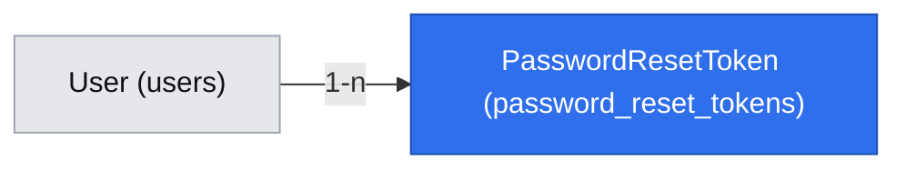

# Reset hasła przez e-mail (E01-S04, #35)

> **Zmienione przez `2026-10-26-account-onboarding-simplification.md` (decyzje właściciela 2026-10-26, brief D-24…D-26, BR-26…BR-28).** Punkty poniżej są zastąpione; tekst niżej zostaje jako historia i jest oznaczony w miejscach zmian.
> - Reset hasła tylko dla **potwierdzonego** e-maila (BR-27); dla niepotwierdzonego nic nie jest wysyłane, a odpowiedź ta sama (`200`). Q1 (reset na niepotwierdzony adres) i BR-25 zastąpione; `confirm` nie ustawia już `emailVerifiedAt`.
> - Komunikat po prośbie: „Jeśli konto z tym adresem istnieje i adres jest potwierdzony, wysłaliśmy link (ważny 1 godzinę). Sprawdź też folder spam.”
> - Hasło: `newPasswordSchema` 8–72 bajty (BR-28), nie 16.

> **Odstępstwa wdrożenia (2026-10-28):**
> - Pole hasła w `confirm` to `newPassword` (`fieldErrors.newPassword`), nie `password`.
> - Limit adresu klienta (10/h) w `request` jest sprawdzany przed walidacją kształtu: odpowiedź `400 VALIDATION` też zużywa limit.
> - `PasswordResetService.request` połyka błędy wysyłki i limity (zwraca `void`, błąd tylko w logu), a `after()` łapie resztę; klient zawsze dostaje `200`.
> - Limit 3/h na skrót e-maila zlicza próby wysyłki, także nieudane.
> - Po sukcesie `/reset-password` pokazuje komunikat „Hasło zmienione” z linkiem do `/login` (bez przekierowania).
> - Zalogowany wchodzący na `/forgot-password` jest przekierowany na `/account` (zmiana hasła po zalogowaniu: #36).

> Status: **zatwierdzona** (`om-auto-write-spec`, 2026-10-24; założenia potwierdzone przez właściciela — Bartosz Wójcik, „a” — 2026-10-24).

## 📝 TLDR

Dziś (po #19/#20) osoba, która zapomni hasła, traci konto. Po wdrożeniu (zachowanie przyszłe): na `/forgot-password` podaje e-mail i zawsze widzi ten sam komunikat; jeśli konto istnieje, dostaje jednorazowy link ważny 1 h; na `/reset-password` ustawia nowe hasło (reguła G3 zmieniona 2026-10-26: co najmniej 8 znaków, BR-28), wszystkie jej sesje są unieważniane, a niepotwierdzony e-mail staje się potwierdzony (spec #34, Q9; zastąpione 2026-10-26: reset tylko dla potwierdzonego e-maila, BR-27).

## Resolved assumptions (autonomous defaults)

| # | Pytanie | Zastosowane założenie | Dlaczego | Potwierdzenie |
|---|---|---|---|---|
| Q1 | Reset dla niepotwierdzonego adresu (BR-19 proponuje „tylko potwierdzony”) | **Dozwolony**; ustawienie hasła z linku potwierdza e-mail. Przyjęcie zmienia propozycję BR-19 — wymaga nowego wiersza w briefie za zgodą właściciela. | Jedyna droga właściciela adresu do konta założonego na jego e-mail przez kogoś innego (spec #34, Q9); link na adres jest dowodem dostępu do skrzynki. | ✅ potwierdzone przez właściciela 2026-10-24 | **[zastąpione 2026-10-26: BR-27, reset tylko po potwierdzeniu]**
| Q2 | Ważność linku | 1 godzina, jednorazowy; nowa prośba unieważnia poprzednie tokeny dopiero po udanej wysyłce. | Reset daje pełny dostęp do konta — krótsze okno niż potwierdzenie e-maila (24 h). | odwracalne |
| Q3 | Jak nie zdradzić istnienia konta? | `POST …/request` po walidacji i limitach od razu odpowiada `200` z tym samym komunikatem; **cała** praca zależna od konta (wyszukanie, zapis tokenu, wysyłka, unieważnienie starszych) dzieje się w `after()` z `next/server` we **własnym** `withRequestScope` (scope żądania nie jest gwarantowany po odpowiedzi), więc czas odpowiedzi nie zależy od istnienia konta. | Standardy §1 (komunikaty auth nie zdradzają kont), BR-16. | odwracalne |
| Q4 | Limity | Prośby: 3/h na `sha256(e-mail)`, 10/h na adres klienta; potwierdzenie z tokenem: 10/15 min na adres; dzienny limit wysyłek wspólny z #34 (`EMAIL_DAILY_LIMIT`). | Chroni skrzynki ofiar i darmowy plan (D-20). | odwracalne |
| Q5 | Logowanie po resecie | Brak auto-logowania — po sukcesie przekierowanie na `/login` z komunikatem „Hasło zmienione — zaloguj się”. | Mniej nowych ścieżek uzyskania sesji; menedżer haseł zapisuje nowe hasło przy logowaniu. | odwracalne |
| Q6 | Sesje po resecie | Unieważnione **wszystkie** sesje konta (także trwająca partia traci dostęp z tych sesji — wyjątek G5 nie chroni przed unieważnieniem). | Reset zakłada przejęcie konta; G5: unieważnienie działa natychmiast. | odwracalne |

## 📝 Problem Statement

- **Kto:** użytkownik z kontem, który nie pamięta hasła (D-15). Grupa docelowa bez dowodu popytu (A-01).
- **Kryteria z #35:** (1) konto → jednorazowy link; (2) odpowiedź taka sama niezależnie od istnienia konta; (3) ustawienie nowego hasła → stare nie działa, sesje unieważnione; (4) link wykorzystany / wygasły → hasło bez zmian. Kryterium 1 mówi o „potwierdzonym e-mailu” — Q1 rozszerza je na niepotwierdzony.

## 📝 Proposed Solution

Tabela tokenów jak w #34 (`opaque-token`, w bazie SHA-256), dwie strony i dwa route'y przez `apiHandler`, wysyłka przez `EmailSender` z #34. **Odrzucone:** kod liczbowy zamiast linku (zgadywanie, tarcie na telefonie), pytania pomocnicze (słabe bezpieczeństwo), reset bez e-maila (D-15 wymaga e-maila). **Poza zakresem:** zmiana hasła po zalogowaniu (#36), powiadomienie „Twoje hasło zostało zmienione” (wymaga decyzji o dodatkowych wysyłkach z darmowego limitu — możliwe później).

## 📝 Architecture

- **`PasswordResetService`** (scoped, `{ em, emailSender, passwordHasher, sessionService, clock }`): `request(email)` — wołane wyłącznie z `after()` (konto istnieje → token + wysyłka + po sukcesie unieważnienie starszych przez ustawienie `used_at`; nie istnieje → nic), `confirm(token, newPassword)` — warunkowe `UPDATE … SET used_at = now() WHERE token_hash = ? AND used_at IS NULL AND expires_at > now() RETURNING user_id`, potem w tej samej transakcji nowy hash (liczony bcryptem **przed** otwarciem transakcji), `emailVerifiedAt = coalesce(emailVerifiedAt, now())` (Q1), usunięcie wszystkich sesji konta i tokenów resetu.
- **Schemat hasła:** `newPasswordSchema` (G3: ≥ 8 znaków (zmienione 2026-10-26, BR-28), ≤ 72 bajty) wydzielony z `registerSchema` w `core/src/validators/auth/` — użyje go też #36.
- **Strony:** `(frontend)/forgot-password/page.tsx`, `(frontend)/reset-password/page.tsx` (`searchParams` jako `Promise`, `Referrer-Policy: no-referrer`, bez zasobów zewnętrznych); link „Nie pamiętasz hasła?” na `/login` (#20).

## 📝 Data Model

| Encja → tabela | Pola | Ograniczenia |
|---|---|---|
| `PasswordResetToken` → `password_reset_tokens` | `id` uuid (PK), `user` → `users.id` (FK, `on delete cascade`), `tokenHash` char(64), `createdAt`, `expiresAt`, `usedAt` NULL | unique `token_hash`; indeks `user_id` |

Jedna migracja (up/down na PostgreSQL). Token i adres e-mail nigdy w logach.

## 📝 API Contracts

`POST /api/auth/password-reset/request` — `{ "email": "…" }` → zawsze `200 { ok: true, data: null }` (także dla nieznanego e-maila i przy błędzie wysyłki, który jest tylko logowany bez adresu); `400 VALIDATION` dla złego kształtu; `429` po limicie (Q4); `403` CSRF.

`POST /api/auth/password-reset/confirm` — `{ "token": "…", "newPassword": "…" }` → `200 { ok: true, data: null }`; `400 INVALID_TOKEN` („Link wygasł lub został już użyty.”); `400 VALIDATION` (`fieldErrors.newPassword` — reguła G3); `429`; `403` CSRF.

Nowe adresy `/forgot-password` i `/reset-password` (ten drugi trafia do wiadomości — po wdrożeniu chroniony jak linki zaproszeń, `BACKWARD_COMPATIBILITY.md` §3).

## 📝 UI/UX

- `/forgot-password`: pole e-mail (`autocomplete="email"`), „Wyślij link”; po wysłaniu zawsze „Jeśli konto z tym adresem istnieje, wysłaliśmy link (ważny 1 godzinę). Sprawdź też folder spam.”
- `/reset-password?token=…`: `PasswordField` z „Pokaż hasło” (`autocomplete="new-password"`, H2), „Ustaw nowe hasło”; błąd tokenu z linkiem „Wyślij nowy link” → `/forgot-password`; sukces → `/login` z komunikatem.
- Wiadomość: polski tekst + HTML, „Jeśli to nie Ty prosiłeś o reset, zignoruj tę wiadomość — hasło się nie zmieni.”
- Telefon od 360 px (BR-20); `role="status"` / `role="alert"`.

Mockupy: pominięte — brak deskryptora środowiska testowego `om-prepare-test-env`.

## 📝 Edge Cases & Failure Scenarios

| Sytuacja | Co widzi użytkownik |
|---|---|
| Nieznany e-mail | Ten sam komunikat i czas co dla istniejącego (Q3). |
| Dwie prośby, kliknięcie starszego linku | `INVALID_TOKEN` (starszy unieważniony po udanej wysyłce nowego). |
| Link po 1 h / użyty drugi raz | `INVALID_TOKEN`, hasło bez zmian. |
| Dwa równoległe `confirm` z tym samym tokenem | Warunkowy `UPDATE` przepuszcza jedno; drugie `INVALID_TOKEN`. |
| Reset w trakcie partii | Wszystkie sesje unieważnione (Q6); partia z tych sesji traci dostęp — zegar biegnie (BR-06). |
| Brak dostawcy poczty (#38) / limit | `200` dla prośby (bez zdradzania); wiadomość nie dochodzi — log z kodem błędu; użytkownik może spróbować później. |
| Konto założone na cudzy adres | Właściciel adresu resetuje hasło, wypycha osobę z konta i potwierdza e-mail (Q1). |

## 📝 Risks & Impact Review

- **`risk-high`** (logowanie i sesje, migracja): testy integracyjne każdego kryterium, CSRF, limitów i warunkowego `UPDATE`; review drugiej osoby; QA bez self-QA.
- **Q1 zmienia propozycję BR-19** — wymaga decyzji właściciela i wiersza w briefie. **[zastąpione 2026-10-26: wraca BR-19 jako BR-27]**
- **`after()`**: wysyłka po odpowiedzi — błąd wysyłki niewidoczny dla użytkownika (świadomie, Q3); test jednostkowy sprawdza, że `request` nie czeka na wysyłkę.
- **Rollback:** revert + `db:migration:down` przed wdrożeniem; po wdrożeniu revert kodu bez cofania migracji.

## 📝 Decisions in play

D-15, BR-19 (*proposal* — Q1 proponuje zmianę), BR-16, BR-17 (kaskada przy usunięciu konta), BR-20, D-20; specyfikacje #19 (G3, G5, G7, G8), #20 (H1, H2), #34 (Q1, Q9, Q10). Właściciel: Bartosz Wójcik.

## 📋 Phasing

Jedna faza, jeden PR (`Closes #35`), po #19, #20 i #34.

## 📋 Implementation Plan

1. Encja i migracja `password-reset-token.ts` (up/down/up).
2. `newPasswordSchema` wydzielony z `registerSchema` (testy z #19 bez zmian) + `passwordResetRequestSchema`, `passwordResetConfirmSchema`.
3. `PasswordResetService` + szablon wiadomości. Testy: token tylko dla istniejącego konta, unieważnianie po udanej wysyłce, warunkowy `UPDATE`, nowy hash, unieważnienie sesji, potwierdzenie e-maila (Q1), kaskada.
4. Route'y `…/request` (z `after()`; testy jednostkowe mockują `after` z `next/server`) i `…/confirm`. Testy integracyjne: link z pliku-skrzynki (`EMAIL_TRANSPORT=file`, #34) czytany helperem odpytującym plik do skutku (wysyłka kończy się po odpowiedzi) → nowe hasło → stare nie działa → logowanie nowym; identyczna odpowiedź dla nieznanego e-maila; wygasły token (bezpośredni `UPDATE expires_at`); `429`; `403`.
5. Strony `/forgot-password`, `/reset-password`, link na `/login`. Test agent-browser całego przepływu na szerokości telefonu.
6. README (reset, limity).

## 📝 Ustalenia z przesłuchania (grill-me, 2026-10-24)

Potwierdzone przez właściciela — Bartosza Wójcika.

| # | Ustalenie |
|---|---|
| Q7 | Limit 3/h na `sha256(e-mail)` liczy wysyłki. Po jego przekroczeniu nie wysyłamy nowej wiadomości, a poprzedni link zostaje ważny do końca 1 h; odpowiedź dla klienta jest identyczna (`200`) — atakujący nie może zablokować cudzego resetu ani poznać stanu konta. |
| Q8 | Dzienny limit wysyłek ma osobną pulę dla resetu: weryfikacja e-maila (#34) zużywa najwyżej 70%, reset może użyć całości. **[adnotacja 2026-10-28 (decyzja właściciela, wariant b): pule dzienne są niezależne: weryfikacja używa najwyżej 70% `EMAIL_DAILY_LIMIT` (osobny licznik `email-daily:verification`), reset może użyć całości (osobny licznik `email-daily:reset`), więc łączny dzienny wolumen może sięgnąć 170% `EMAIL_DAILY_LIMIT`. Jeśli limit odzwierciedla limit dostawcy poczty (D-20/#38), ustaw `EMAIL_DAILY_LIMIT` ≤ limit dostawcy / 1,7, inaczej dostawca zablokuje wysyłkę wcześniej niż aplikacja.]** |
| Q9 | Sesje są unieważniane także w trakcie partii (Q6 bez wyjątku G5). |
| Q10 | Kolejność wdrożenia: #38 → #30 → #34 i #35 razem. Limity „na adres klienta” działają tylko przy wiarygodnie ustalonym adresie (spike #30); limity na konto i e-mail zostają zawsze. |
| Q11 | Plan implementacji dostaje krok: reguła sprzątania `password_reset_tokens` w `packages/db/src/cleanup/rules.ts` (#39). |
