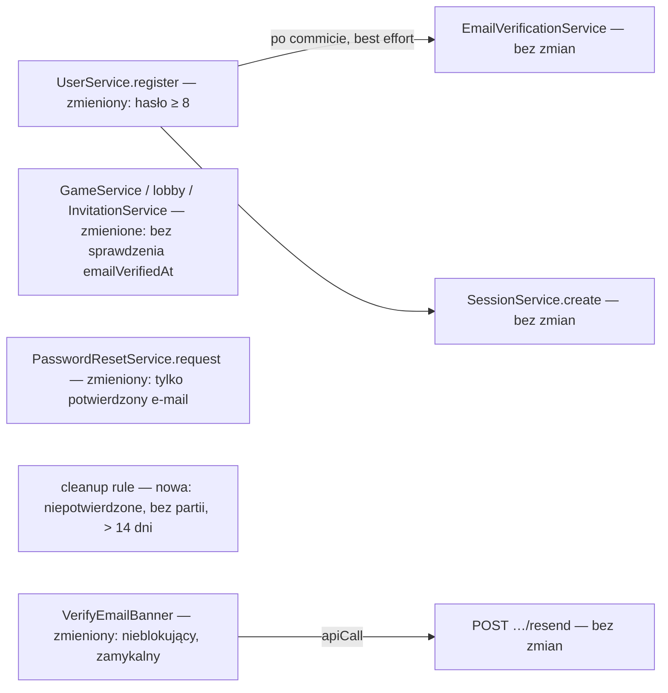

# Uproszczony start konta (hasło ≥ 8, aktywne konto, potwierdzenie asynchroniczne, wejście z zaproszenia)

> Status: **zatwierdzona do implementacji dokumentów** (decyzje właściciela z 2026-10-26, w tym Q1–Q6). Źródło: `.ai/specs/briefs/2026-10-26-account-onboarding-simplification.md` (osąd właściciela, Bartosz Wójcik, nie wynik badania). Forma: **delta**: opisuje docelowe zachowanie i nadpisuje punktowo specyfikacje z 2026-10-24 (`account-registration`, `email-verification`, `password-reset`, `password-change`, `expired-records-cleanup`, `game-invitations`); stare pliki dostają w PR 2 tylko adnotację „zmienione przez …”.

## 📝 TLDR

Dziś (według zatwierdzonych specyfikacji z 2026-10-24) nowy gracz zakłada konto z hasłem co najmniej 16 znaków i nie zagra, dopóki nie potwierdzi e-maila (D-17, BR-23, G3). W kodzie nie ma jeszcze żadnej z tych funkcji (`entities` puste, w `api/` tylko `health`), a zgłoszenie #19 jest zamknięte bez implementacji.
Po zmianie (zachowanie przyszłe): hasło ma minimum 8 znaków, konto jest aktywne od razu po rejestracji (zalogowany i grający), potwierdzenie e-maila jest osobną czynnością asynchroniczną bez żadnych blokad gry, z zamykalnym banerem tłumaczącym powód. Reset hasła działa tylko po potwierdzeniu, niepotwierdzone konta bez partii są kasowane po 14 dniach, a osoba z zaproszenia widzi jasny wybór: zaloguj się, załóż konto albo graj jako gość.
Powód: obniżyć koszt pierwszego startu, zanim cokolwiek z kont zostanie zaimplementowane. Zmiana nie wymaga migracji (schemat z `account-registration` wystarcza).

## ✅ Decyzje z bramki pytań (2026-10-26, właściciel)

| Pytanie | Decyzja |
|---|---|
| Q1 Podział | Jedna specyfikacja. „Ścieżka z zaproszenia” to zmiana istniejącej strony `/invite/[code]` z `game-invitations` (bez stanu „zalogowany bez potwierdzenia”), odwzorowana w mapie i prototypie jako **s07**. |
| Q2 Forma | Delta plus adnotacje w starych plikach (PR 2). |
| Q3 Limity prób | Bez zmian względem obecnych specyfikacji (rejestracja 5/h na adres klienta; reset 3/h na e-mail i 10/h na adres klienta; ponowne wysłanie 3/h na konto i 10/h na adres klienta; logowanie H1). |
| Q4 Reguła 14 dni | Kasujemy konto niepotwierdzone **i bez żadnej partii** po 14 dniach od założenia. Niepotwierdzone konto z partiami zostaje (partie w historii przeciwników). |
| Q5 Baner | Zamknięcie i powrót po 7 dniach pamiętane po stronie przeglądarki (localStorage), bez zmiany schematu. Na nowym urządzeniu baner pojawia się od nowa. |
| Q6 Zajęcie adresu | **Akceptujemy** bezterminowe zajęcie adresu przez osobę, która zagra jedną partię (ryzyko właściciela). Ścieżka dla właściciela adresu („To nie ja”) może stać się osobną historią później. |
| Z briefu | Hasło 8–72 bajty, bez listy popularnych haseł; konto aktywne od razu; potwierdzenie nie blokuje niczego; reset tylko po potwierdzeniu; OAuth, magic link i „tylko poprawa ekranów” odrzucone (powody w briefie). |

## 📝 Problem Statement

- **Kto:** gość, który chce zagrać: zaproszony znajomy (S2) i gracz z zewnątrz (S3).
- **Dziś:** 16 znaków, potwierdzenie e-maila przed pierwszą grą, ekran rejestracji bez zapowiedzi tego kroku, brak drogi dla zaproszonego bez konta poza ekranem zaproszenia z #21.
- **Dowód:** osąd właściciela i hipotezy panelu syntetycznego (`research/walkthroughs/2026-10-26-account-registration-session-001/report.md`: 4 persony z założeń, bez prawdziwego gracza). `[SYNTHETIC]` nie jest wymaganiem. Ta specyfikacja nie rozstrzyga popytu (A-01) ani wpływu potwierdzenia na rezygnacje (A-03, zostaje nieprzetestowane).
- **Ocena kierunku:** tańsze warianty (tylko hasło 8 i ekran zaproszenia, albo potwierdzenie nieblokujące wyłącznie dla zaproszonych) zostały rozważone i odrzucone przez właściciela (brief).

## 📝 Proposed Solution

Własne uwierzytelnianie zostaje (D-12, D-13), zmieniają się cztery reguły i jedna strona:

1. **Hasło:** `newPasswordSchema` (wspólny dla rejestracji, resetu i zmiany): co najmniej 8 **znaków** i najwyżej 72 **bajty** UTF-8 (nadmiar odrzucany, nie skracany); bez list popularnych haseł i kontroli wycieków.
2. **Konto aktywne od razu:** rejestracja kończy się sesją (jak dziś), a wszystkie akcje gry (tworzenie partii, przyjęcie zaproszenia jako on sam, lobby) są dostępne bez względu na `emailVerifiedAt`. Znika `EMAIL_NOT_VERIFIED`.
3. **Potwierdzenie e-maila asynchroniczne:** wysyłka po rejestracji jest „best effort” (jak w `email-verification` Q6); potwierdzenie linkiem (`/verify-email`) i ponowne wysłanie działają jak dziś, ale nic od nich nie zależy poza resetem hasła i sprzątaniem. Baner informuje o powodzie.
4. **Reset hasła tylko po potwierdzeniu:** `PasswordResetService.request` nie wysyła wiadomości dla konta z `emailVerifiedAt IS NULL` (odpowiedź dla klienta ta sama, `200`). Nadpisuje BR-25 (wraca BR-19) i `password-reset` Q1. `confirm` nie ustawia już `emailVerifiedAt`.
5. **Sprzątanie:** reguła w `packages/db/src/cleanup/rules.ts` (#39): usuń użytkownika, gdy `emailVerifiedAt IS NULL`, `createdAt` starsze niż 14 dni i brak wiersza w uczestnikach partii. Zastępuje Q14 (7 dni).
6. **Wejście z zaproszenia (s07):** strona `/invite/[code]` zostaje (stany i teksty z `game-invitations`), ale bez stanu „zalogowany bez potwierdzenia”, Q15 i Q19 uproszczone: zalogowany nigdy nie gra jako gość.

**Rozważone i odrzucone (szczegóły w briefie):** OAuth zamiast e-maila lub obok niego, link logujący bez hasła, sama poprawa ekranów bez zmiany polityki, „nie buduj nic”.

**Rynek (do sprawdzenia, nieweryfikowane w tym repo):** benchmark z 2026-10-20 pokazuje, że wszystkie trzy sprawdzone serwisy pozwalają grać bez logowania lub jako gość (PlayOK, papergames.io, DonkeyCat). To zachowanie konkurencji, nie dowód preferencji graczy. Z wiedzy ogólnej wiele serwisów z grami pozwala zacząć przed potwierdzeniem adresu, ale nie sprawdzano tego tutaj. Spec świadomie nie kopiuje ich złożoności (rankingi, boty, czat: poza zakresem).

## 📝 Architecture

Zmiany względem `account-registration` (#19), `email-verification` (#34), `password-reset` (#35), `password-change` (#36), `expired-records-cleanup` (#39), `game-invitations` (#21):

Nowe są: reguła sprzątania i zachowanie banera. Zmienione: wspólny schemat hasła, trzy serwisy gry i `PasswordResetService`. Reszta bez zmian. Wniosek: zmiana jest w całości odejmowaniem (mniej warunków w route'ach gry) plus jedna reguła czyszczenia; schemat i kontrakty sesji zostają.

- **Dostawca poczty (#38, Q-02) przestaje blokować rejestrację i grę.** Potrzebny jest tylko dla potwierdzenia i resetu (#34 i #35 idą razem, bez zmian kolejności wdrożenia z `email-verification` Q13 oprócz tego, że rejestracja nie jest „wyłączona bez dostawcy”; decyzja L03 nieaktualna).
- **Sesja i limity:** bez zmian (G2, G5, H1, G7, G8). Limiter w `password-reset/request` działa **przed** sprawdzeniem, czy konto jest potwierdzone, więc ani limity, ani czas odpowiedzi nie zdradzają stanu konta.
- **Zmiana adresu e-mail jest poza zakresem** (E05, później); gdyby powstała, musi zerować `emailVerifiedAt` i unieważniać tokeny resetu.
- **Standardy:** OD-2 pozostaje rozstrzygnięte (własne poświadczenia); w „Auth error messages” zmienia się tylko komunikat reguły hasła.

## 📝 Data Model

Bez zmian schematu i bez migracji: `users.emailVerifiedAt`, `email_verification_tokens`, `password_reset_tokens`, `sessions`, `rate_limit_buckets` wystarczają. Reguła sprzątania jest zapytaniem na `users` i tabeli uczestników partii (z #29, `E02-S01-T01`).
- Zmiana semantyki `emailVerifiedAt`: „adres potwierdzony”, bez wpływu na dostęp do gry; jedyne skutki: możliwość resetu hasła i wyłączenie z kasowania (reguła 14 dni).
- **Zależność kolejności:** reguła 14 dni wymaga tabeli uczestników z #29; do czasu jej powstania reguły nie ma (konta kasuje się dopiero po #29), więc backlog dostaje osobną pozycję w #39 zablokowaną przez #29 (zob. krok 5). Reguła ma testy jednostkowe na fałszywym `em` (próg 100%) i jeden test na prawdziwym PostgreSQL.
- Dane wrażliwe: jak dotąd (hash hasła, e-mail niewidoczny dla innych, tokeny jako SHA-256).

## 📝 API Contracts

| Endpoint / zachowanie | Zmiana |
|---|---|
| `POST /api/auth/register` | `400 VALIDATION` dla hasła krótszego niż 8 znaków lub dłuższego niż 72 bajty (`fieldErrors.password`). Reszta kontraktu (201, 409, 429, CSRF) bez zmian. |
| `POST /api/games`, wejście do lobby, `POST` przyjęcia zaproszenia z `as = user` | Odpada `403 EMAIL_NOT_VERIFIED`. |
| `POST` przyjęcia zaproszenia z `as = guest` przy ważnej sesji | `409 GUEST_NOT_ALLOWED` dla każdego zalogowanego (wcześniej tylko dla potwierdzonych). Gość jest wyłącznie dla niezalogowanych. Treść uproszczonych reguł z `game-invitations`: **Q15** (komunikat dla niepotwierdzonego) odpada w całości, bo taki stan nie istnieje; **Q19** brzmi: „`as = guest` jest niedozwolone dla każdego zalogowanego: `409 GUEST_NOT_ALLOWED`, UI nie pokazuje mu opcji gościa”. |
| `POST /api/auth/password-reset/request` | Dla konta z `emailVerifiedAt IS NULL` nic nie wysyła; `200` z tym samym komunikatem. Komunikat: „Jeśli konto z tym adresem istnieje i adres jest potwierdzony, wysłaliśmy link (ważny 1 godzinę). Sprawdź też folder spam.” |
| `POST /api/auth/password-reset/confirm` | Nie ustawia `emailVerifiedAt` (konto jest już potwierdzone); reszta bez zmian (unieważnia wszystkie sesje). |
| `POST /api/auth/email-verification/confirm`, `…/resend` | Bez zmian (w tym `ALREADY_VERIFIED`, `RATE_LIMITED`, `502`, `503`). |
| `POST /api/auth/password/change` (#36) | Nowe hasło podlega `newPasswordSchema` (8–72). |

Kontrakty są addytywnymi osłabieniami reguł (mniej odrzuceń); nic nie jest usuwane z odpowiedzi poza kodem `EMAIL_NOT_VERIFIED` (nie wdrożony). Zgodnie z `BACKWARD_COMPATIBILITY.md` brak wdrożonych konsumentów.

## 📝 UI/UX

Prototyp: obecny stan w `prototypes/konta-i-role/` (do zmiany w PR 3); mapa `lekcja-07/mapa-ekranow.md` (ID stałe; s07 nowy; wycofane stany nie są przenumerowywane).

- **s01 Rejestracja:** podpis hasła „Co najmniej 8 znaków”; błąd „Hasło musi mieć co najmniej 8 znaków.”; bez zapowiedzi potwierdzenia przed grą (nie ma czego zapowiadać). Stan s01.12 (rejestracja niedostępna bez poczty) wycofany. Po sukcesie `/` z banerem.
- **s04 Strona główna / s05 Konto:** baner (komponent VerifyEmailBanner) **nie blokuje**: akcje gry aktywne od razu. Tytuł „Potwierdź adres e-mail”, treść: „Bez potwierdzonego adresu nie odzyskasz konta, jeśli zapomnisz hasła. Link wysyłamy na {adres} — sprawdź też folder spam.” Przyciski „Wyślij ponownie” i „Zamknij”. Zamknięcie zapisuje czas w `localStorage` (`gomoku:verify-banner-closed-at`); baner wraca po 7 dniach (porównanie z zegarem klienta; zapis opcjonalny, błąd odczytu = baner widoczny). Stany wyniku wysłania jak w `email-verification` (idle, sending, sent, limited, failed; 503, 409, 401 jak w mapie). **Zmiana komponentu design systemu** (przycisk „Zamknij”, tekst nieblokujący): wymaga zgody właściciela (`packages/ui/docs/design-system.md`, „Zasady, których nie wolno złamać”, pkt 1) i wpisu o luce D02; zgoda jest warunkiem wstępnym kroku 10. Jeśli odczytany czas zamknięcia jest w przyszłości (zegar klienta cofnięty), traktować go jako wygasły i pokazać baner.
- **s03 Potwierdzenie e-maila:** po sukcesie „Adres potwierdzony.” bez „możesz grać” (gra była dostępna wcześniej). Strona, błędy i „Wyślij nowy link” bez zmian.
- **s02 Logowanie, forgot/reset:** `/forgot-password` używa komunikatu z kontraktu; nie ujawnia, czy konto istnieje ani czy jest potwierdzone.
- **s07 Wejście z zaproszenia (`/invite/[code]`):** stany z `game-invitations` bez „zalogowany bez potwierdzenia”: niezalogowany („Zaloguj się”, „Załóż konto”, „Graj jako gość”, każde z `?next=` gdzie ma sens, G8), blok gościa z ostrzeżeniem (Q11) i „Rozumiem, graj jako gość”, zalogowany („Dołącz do partii”), już uczestnik (przekierowanie), własne zaproszenie (przekierowanie), ma inną partię w toku, ma własną oczekującą, limit prób, nieważne. Układ i dostępność jak w mapie (telefon od 360 px, BR-20).
- Teksty po polsku (komponenty bez wbudowanych tekstów, DS).

## 📝 Edge Cases & Failure Scenarios

| Sytuacja | Co widzi użytkownik |
|---|---|
| Hasło 7 znaków, albo 73 bajty (np. emoji) | `400`, błąd przy polu hasła (8 znaków; „najwyżej 72 bajty” dla nadmiaru). |
| Dostawca poczty niedostępny przy rejestracji | Konto i sesja powstają, gra działa; baner z „Wyślij ponownie”. Przy ponowieniu: `502 EMAIL_SEND_FAILED` (błąd wysyłki lub brak dostawcy), `503 EMAIL_QUOTA_EXCEEDED` (dzienny limit), jak w `email-verification`. Nic nie jest zablokowane. |
| Literówka w adresie e-mail | Konto działa; potwierdzenie nigdy nie przyjdzie; baner mówi, że bez potwierdzenia nie ma odzyskiwania hasła; po 14 dniach bez partii konto jest kasowane. |
| Ktoś założył konto na cudzy adres | Wiadomość do właściciela adresu ma zdanie „zignoruj, jeśli to nie Ty”. Jeśli właściciel i tak kliknie „Potwierdź”, konto staje się potwierdzone i może on zresetować hasło (skutek uboczny, nie cel). Jeśli nie kliknie: właściciel nie założy własnego konta na ten adres (BR-14, BR-16) do czasu kasowania (14 dni bez partii); atakujący, który gra, utrzymuje konto (przyjęte ryzyko). |
| Zapomniane hasło na koncie niepotwierdzonym | Ten sam komunikat co zawsze, żadnej wiadomości. Odzyskanie niemożliwe (przyjęte ryzyko); konto bez partii zniknie po 14 dniach. |
| Konto niepotwierdzone z partiami, nieaktywne > 14 dni | Zostaje (Q4); partie są w historii przeciwników. |
| Baner zamknięty, potem „localStorage” niedostępny (tryb prywatny, blokada) | Baner widoczny przy każdym wejściu; nic nie psuje się. |
| Gracz potwierdzi e-mail w innej karcie | Baner znika po odświeżeniu; „Wyślij ponownie” daje `409 ALREADY_VERIFIED` (jak w `email-verification`). |
| Zalogowany otwiera zaproszenie jako gość | `409 GUEST_NOT_ALLOWED`, UI nie pokazuje opcji gościa. |
| Reguła 14 dni a partia w toku | Konto z partią (też trwającą) nie jest kasowane; kasowanie nie dotyka kont, które uczestniczą w jakiejkolwiek partii (zapytanie `NOT EXISTS`). |

## 📝 Risks & Impact Review

- **Decyzje trudne do cofnięcia:** brak wdrożenia, więc koszt zmiany dziś jest minimalny. Po wdrożeniu: zmiana zasad hasła i potwierdzenia dotknęłaby istniejące konta (nie ma ich jeszcze).
- **Zajęcie cudzego adresu i literówki:** patrz Edge Cases; ryzyko przyjęte przez właściciela. Mitygacje: limity prób (Q3, bez zmian), baner z powodem. **Kasowanie po 14 dniach (Q4) ogranicza ryzyko tylko dla kont bez partii: osoba, która zagra jedną partię, utrzymuje zajęty adres bezterminowo, a prawdziwy właściciel adresu nie założy konta ani nie zresetuje hasła.** Ryzyko zaakceptowane przez właściciela (Q6); ścieżka odzyskania adresu przez jego właściciela jest możliwą późniejszą historią.
- **Słabsze hasła:** 8 znaków bez listy popularnych haseł i kontroli wycieków (przyjęte). Górna granica 72 bajtów (bcrypt) i odrzucanie nadmiaru zostają. Limity H1 ograniczają zgadywanie.
- **Reset tylko po potwierdzeniu:** użytkownik, który nigdy nie potwierdził adresu, traci możliwość odzyskania hasła (świadomie; baner mówi to wprost).
- **Zmiana komponentu design systemu** (baner z „Zamknij”): wymaga zgody właściciela; do tego czasu prototyp robi najprostszą wersję z tokenów i oznacza ją `LUKA`.
- **Dowód:** decyzja jest osądem właściciela; kolejny panel syntetyczny nie może jej „potwierdzić” (A-01, A-03 pozostają nieprzetestowane).
- **Zgłoszenie #19** jest zamknięte bez implementacji i musi zostać uzgodnione ze stanem rzeczywistym przy edycji zgłoszeń (osobna pozycja).
- **`risk-high`** dla kodu, który to zrealizuje (logowanie, sesje, reset): wymagane dowody integracyjne i review drugiej osoby, jak w specyfikacjach źródłowych. Ta specyfikacja sama jest dokumentem.

## 📝 Decisions in play

Opiera się na: BR-14, BR-16, BR-20, BR-22, D-11, D-12, D-13, D-19, D-20, N-01…N-09 (bez zmian).
Proponuje nadpisać (właściciel Bartosz Wójcik, zatwierdzenie w PR 1): **D-17**, **BR-23**, **G3**, **BR-25** (wraca BR-19), **Q14**, **A-03** (zmiana statusu), **Q-02** (przestaje blokować rejestrację i grę); skutkuje to także L03, L06 i stanem s01.12 w mapie ekranów. Żadna inna aktywna decyzja nie jest nadpisywana.

## 📝 Słownik odwołań

`OD-2` (standardy): mechanizm uwierzytelniania; `D-19` gra darmowa dla graczy; `D-20` poczta tylko w darmowym planie dostawcy; `N-01…N-09` poza zakresem MVP (brief); `G2` CSRF i ciasteczko, `G5` sesja 30 dni, `G7` token gościa, `G8` powrót `?next=`, `H1` limity logowania (specyfikacje #19 i #20); `BR-19` reset na potwierdzony e-mail (wraca); `L03`, `L06`, `L17` — luki z mapy ekranów (rejestracja wymaga poczty, ukrycie Lobby i Historii dla niepotwierdzonego, akcje gry na stronie głównej prototypu).

## 📋 Phasing

Dostawa jest dokumentacyjna i wyprzedza implementację kodu kont (#20 i dalsze będą pisane już według zmienionych specyfikacji):
- **Faza 1 — decyzje (PR 1).** Brief: wiersze nadpisujące i status, wpis w `research/decisions/`, lekcja.
- **Faza 2 — specyfikacje i mapa (PR 2).** Adnotacje w sześciu specyfikacjach, `backlog.md`, standardy (komunikat), teksty w dokumentacji design systemu, mapa ekranów (s07, wycofane stany).
- **Faza 3 — prototypy (PR 3).** Szary prototyp (nowa rewizja), klikalny prototyp (zmiany ekranów i symulatora), nota przy raporcie panelu.
- **Faza 4 — zgłoszenia GitHub (osobna pozycja).** Edycje i zamknięcia zgłoszeń z odnośnikiem do następców. **Musi być zakończona przed rozpoczęciem implementacji #20, #21 i dalszych.**

## 📋 Implementation Plan

### Faza 1 — decyzje (PR 1)

1. **Brief.** W `product-brief.md` przekreślić (nie usuwać) D-17, BR-23, BR-25, Q14 i G3, dodać wiersze nadpisujące i status „osąd właściciela”; zaktualizować Zakres MVP, Kluczowy przepływ, Ryzykowne założenia (A-03), Pytania otwarte (Q-02). Przekreślenie to `~~…~~` z dopiskiem „zastąpione”. Sprawdzenie: `grep -n "16 znaków" .ai/specs/product-brief.md | grep -v '~~'` nie zwraca nic. Zmiana briefu odbywa się na wyraźną prośbę właściciela (ta rozmowa) i jest zatwierdzona przez niego w PR 1.
2. **Rejestr decyzji.** Nowy plik `research/decisions/2026-10-26-onboarding-simplification.md` z tabelą decyzji, odrzuconymi alternatywami i zaakceptowanymi ryzykami (z briefu).
3. **Lekcja.** `.ai/lessons/…` i linia w `.ai/lessons.md`: zmiana polityki zaczyna się od decyzji w briefie, dopiero potem specyfikacje i artefakty.

### Faza 2 — specyfikacje i mapa (PR 2)

4. **Adnotacje i skutki w specyfikacjach.** W każdej z sześciu specyfikacji nagłówek „Zmienione przez 2026-10-26-account-onboarding-simplification” z listą zmienionych punktów (hasło, `EMAIL_NOT_VERIFIED`, Q14, BR-25, Q15 i Q19); zaktualizować tabele kontraktów tam, gdzie zmiana jest bezpośrednia. Sprawdzenie: `grep -rn "EMAIL_NOT_VERIFIED" .ai/specs --include='*.md' | grep -v '2026-10-26-account-onboarding-simplification' | grep -vE '~~|zastąpion'` nie zwraca nic.
5. **Backlog.** `backlog.md`: kryteria i tytuły #34, #21, #25, #26 (bez bramki potwierdzenia), notatka przy #19 i #38; **nowa pozycja w ramach #39:** reguła 14 dni (`emailVerifiedAt IS NULL`, `createdAt` starsze niż now − 14 dni, `NOT EXISTS` wiersz uczestnika partii), zablokowana przez #29 (`E02-S01-T01`), z kryteriami: kasuje spełniające warunek konta wraz z sesjami i tokenami (kaskada), nie dotyka kont z partią.
6. **Standardy.** Komunikat reguły hasła w „Auth error messages”.
7. **Dokumentacja design systemu.** Teksty (podpis hasła, baner, wzorzec uprawnień, `czego-brakuje.mdx`, `konta.mdx`) i wpis o zmianie komponentu banera czekającej na zgodę.
8. **Mapa ekranów.** `lekcja-07/mapa-ekranow.md`: nowy ekran s07 i jego stany, wycofane s01.12 i bramka L06, zmiana s04.2, s03.3 i stanów banera; luki L03, L06 i L17 oznaczone jako nieaktualne.

### Faza 3 — prototypy (PR 3)

9. **Szary prototyp.** Nowa rewizja przez `om-mockup-prototype --refresh` (hasło 8, konto aktywne, baner nieblokujący, ścieżka z zaproszenia).
10. **Klikalny prototyp** (warunek wstępny: zgoda właściciela na zmianę komponentu banera, krok 7). `prototypes/konta-i-role/`: `sim.ts` (hasło 8, brak bramki, reset tylko po potwierdzeniu), ekrany s01–s06, nowy s07 i jego stany; scenariusze i testy nawigacji dostosowane. Sprawdzenie: `npx vitest run --config prototypes/konta-i-role/vitest.config.ts`, `checks/` w przeglądarce.
11. **Nota panelu.** Przy `report.md` panelu z 2026-10-26: „dotyczy poprzedniego modelu (potwierdzenie przed grą, hasło 16)”.

### Faza 4 — zgłoszenia GitHub (osobna pozycja, nie w PR)

12. **Zgłoszenia.** Edycja albo zamknięcie z odnośnikiem do następców dla #15, #19 (uzgodnić z rzeczywistością), #20, #21, #25, #26, #34–#39 (przez `om-auto-manage-issues` albo ręcznie).

## 📝 Stan realizacji (2026-10-31)

Specyfikacja **zostaje w `.ai/specs/`**: punkty 1–4 i 6 (hasło 8–72, konto aktywne od razu, potwierdzenie asynchroniczne z banerem, reset tylko po potwierdzeniu, wejście z zaproszenia) są wdrożone i opisane dowodami w sekcjach „Odstępstwa wdrożenia i dowody” w `implemented/2026-10-24-{account-registration,login-logout,email-verification,password-reset,password-change}.md` oraz `implemented/2026-10-24-game-invitations.md`; punkt 5 (reguła kasowania niepotwierdzonych kont bez partii po 14 dniach) **nie jest wdrożony** i dojdzie z #37 (krok 8 `2026-10-24-account-deletion.md`, `track.md` 9.4). Po jego wdrożeniu przenieść tę specyfikację do `implemented/`.
