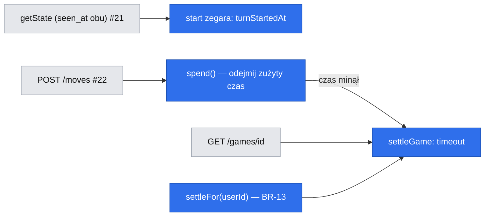

# Zegar partii: 10 minut na gracza liczone przez serwer i przegrana na czas (E02-S03, #23)

> Status: **szkic do przeglądu** (`om-spec-writing`, tryb interaktywny, 2026-10-26; Q1–Q4 rozstrzygnięte przez właściciela — Bartosz Wójcik). Źródło: zgłoszenie #23, `.ai/specs/product-brief.md` (BR-04, BR-05, BR-06, BR-07, BR-13, D-03), #21 (`seen_at`, Q20, Q21, `timeoutSettler.settleFor`), #22 (model `games`, `moves`, `moveNumber`, Q8, Q9), standardy (`.ai/docs/2026-09-01-engineering-standards.md`), mapa ekranów `lekcja-07/mapa-ekranow-partia.md`.

## 📝 TLDR

Po #22 partia ma ruchy, ale nie ma czasu: można ją trzymać bez końca, a BR-13 blokuje wtedy obu graczy. Po wdrożeniu (zachowanie przyszłe) każdy gracz ma 10:00, zegar maleje tylko graczowi na ruchu, a wyczerpanie czasu kończy partię jego przegraną (`endReason = timeout`). Serwer jest jedynym źródłem czasu: klient dostaje pozostały czas i tylko go odlicza do wyświetlenia. Przegrana na czas jest zapisywana leniwie, przy najbliższym odczycie, ruchu albo sprawdzeniu BR-13, bez zadania w tle.

## Resolved decisions

| # | Pytanie | Decyzja | Źródło |
|---|---|---|---|
| Q1 | „Mało czasu” (L07) | Próg **60 s**. Sygnał to **jaskrawy kolor** zegara, **bez tekstu** i bez dźwięku. Pozostaje dodatkowa wskazówka niebędąca tekstem (grubszy obrys), bo sam kolor nie spełnia WCAG 1.4.1 — zob. Risks. | właściciel, 2026-10-26 |
| Q2 | Opóźnienie sieci i odpytywanie | (a) **Bez rekompensaty.** Zegar gracza rusza w chwili przyjęcia ruchu przeciwnika przez serwer; do 2 s odpytywania (#22 Q5) idzie na jego konto. Przegląd po spike #30. | właściciel |
| Q3 | Rozstrzyganie | **Tylko leniwie** (odczyt, ruch, `settleFor`). Czas zakończenia w historii to moment upływu czasu, nie wykrycia. | właściciel |
| Q4 | Zakres | Zegar, przegrana na czas i implementacja portu `timeoutSettler`. Powrót po rozłączeniu (#24), poddanie i rewanż w osobnych specyfikacjach. | właściciel |
| Q5 | Start zegara | Gdy obaj uczestnicy mają `seen_at` (#21 Q20); ta decyzja zastępuje #22 Q8. | właściciel, 2026-10-26 |

Odwracalne założenia robocze: czas liczy wstrzykiwany `clock` aplikacji (nie zegar klienta ani PostgreSQL); brak przyrostu czasu na ruch (D-03); ruch przyjęty przed terminem ma pierwszeństwo, także gdy kończy partię piątką.

## 📝 Problem Statement

Bez zegara partia nie ma presji (BR-04, BR-05) i nie da się jej zakończyć, gdy gracz odejdzie: oba konta pozostają zajęte (BR-13), a rywal nie ma jak wygrać. Zegar musi być odporny na manipulację klienta (kryterium 4 w #23) i nie może wymagać procesu w tle, którego repozytorium nie ma.

## 📝 Proposed Solution

Model „zegara szachowego” zapisany w wierszu `games`: **pozostały czas po ostatnim ruchu każdego gracza** (`clockMs1`, `clockMs2`) i **moment rozpoczęcia bieżącej tury** (`turnStartedAt`). Pozostały czas gracza na ruchu to `clockMs[seat] − (now − turnStartedAt)`, liczony wyłącznie wstrzykiwanym `clock`. Ruch odejmuje zużyty czas w tej samej transakcji, w której zapisuje planszę (#22); przekroczenie terminu kończy partię przegraną gracza. Zegar jest funkcją czystą (`core`), serwis tylko ładuje i zapisuje.

**Rozważone i odrzucone:**

| Podejście | Dlaczego odpada |
|---|---|
| Znaczniki czasu każdego ruchu w osobnej tabeli lub kolumnie | Czas rośnie z partią; potrzebny tylko stan bieżący, nie historia czasów |
| Zadanie cykliczne kończące przeterminowane partie | Nowa infrastruktura; leniwe rozstrzyganie wystarcza, bo wynik jest widoczny dopiero przy odczycie (Q3) |
| Zegar liczony po stronie klienta, weryfikowany serwerem | Klient mógłby zgłosić inny czas (sprzeczne z kryterium 4); serwer i tak musiałby liczyć |
| Rekompensata opóźnienia (2 s na ruch) | Łamie D-03 i komplikuje model; Q2 (a) |

## 📝 Architecture

- **`core/src/games/clock.ts` — czyste funkcje, bez I/O:** stała `INITIAL_CLOCK_MS = 600_000`; `remainingMs(state, seat, nowMs)`; `spend(state, seat, nowMs): { clockMs, expired: boolean }`; `deadlineMs(state, seat)` (moment upływu, do `finishedAt`); `isLow(remainingMs)` z progiem `LOW_TIME_MS = 60_000`. Typy `ClockState { clockMs: [number, number]; turnStartedAtMs: number | null }`.
- **`GameMoveService` (#22):** po `settleGame` i sprawdzeniu kolejki woła `spend`; gdy `expired`, kończy partię (`timeout`) zamiast przyjmować ruch i zwraca `GAME_FINISHED`. Zapis ruchu aktualizuje `clockMs[seat]` i `turnStartedAt` w tym samym warunkowym `UPDATE`.
- **`timeoutSettler` (port z #21/#22, tu implementacja):** `settleGame(gameId)` — pod już założoną blokadą wiersza sprawdza termin i kończy partię; `settleFor(userId)` — dla partii `active` użytkownika z upłyniętym czasem, w kolejności blokad `users` → `games` z #21. Zakończenie to jeden warunkowy `UPDATE games … WHERE id = :id AND status = 'active' AND move_count = :expected`; 0 wierszy = ktoś był pierwszy, odpowiedź `409`/aktualny stan, nigdy `500`.
- **`GameService.getState` (#21):** ustawia `seen_at`; gdy to **drugi** brakujący `seen_at`, w tej samej transakcji uruchamia zegar (`UPDATE … SET turn_started_at = :now WHERE turn_started_at IS NULL`). Odczyt przeterminowanej partii woła `settleGame` (zapis w odczycie jest świadomy: stan musi być spójny dla obu graczy).
- **Klient:** `useGameClock({ remainingMs, running, receivedAt })` w `app/src/components/games/` — odlicza lokalnie co 1 s monotonicznym zegarem przeglądarki (`performance.now`, nie `Date.now`); każde odpytywanie (#22, co 2 s) nadpisuje stan wartością serwera. Wartość lokalna służy tylko do wyświetlenia i nigdy nie wraca na serwer.

Wniosek: jedyna ścieżka zakończenia przez czas to `settleGame`, wołana z trzech miejsc pod tą samą blokadą wiersza.

## 📝 Data Model

Migrację dostarcza **#29** albo, jeśli jej kształt nie ma tych pól, osobna migracja tej specyfikacji (krok 0 planu to weryfikuje).

| Encja → tabela | Pola | Ograniczenia |
|---|---|---|
| `Game` → `games` (rozszerzenie) | `clockMs1` integer NOT NULL DEFAULT 600000, `clockMs2` integer NOT NULL DEFAULT 600000, `turnStartedAt` timestamptz NULL; `endReason` dostaje wartość `timeout` | `CHECK (clock_ms_1 BETWEEN 0 AND 600000 AND clock_ms_2 BETWEEN 0 AND 600000)`; `CHECK (status <> 'active' OR turn_started_at IS NOT NULL OR (starting)` — jw. nie wymuszamy, bo `active` bez obu `seen_at` ma `turn_started_at IS NULL` (zegar jeszcze nie ruszył) |

`winnerSeat` przy `timeout` to drugie miejsce; `finishedAt` = `turnStartedAt + clockMs[seat]` (moment upływu, nie wykrycia). Dane wrażliwe: brak. Migracja up/down na prawdziwym PostgreSQL; istniejące partie `active` bez zegara dostają domyślne 600000 i `turn_started_at = started_at` tylko jeśli obaj mają `seen_at`, inaczej NULL.

**Inwarianty** (`assertClockConsistent`): `0 ≤ clockMs ≤ 600000`; dla `active` z `turnStartedAt` zegar gracza na ruchu maleje, drugiego jest stały; w `finished` z `timeout` przegrany ma `clockMs = 0`.

## 📝 API Contracts

Koperta jak w #21/#22. **Żadne żądanie nie niesie czasu klienta**: `moveCreateSchema` zostaje `{ x, y, moveNumber }`, więc kryterium 4 jest spełnione z konstrukcji (test sprawdza, że dodatkowe pole `elapsedMs` jest odrzucone lub zignorowane i nie zmienia wyniku).

`GET /api/games/{id}` i odpowiedź `POST …/moves` (addytywnie): `clock: { remainingMs: [n1, n2], running: 1 | 2 | null }` (po jednym czasie na miejsce, `running` = miejsce, którego zegar biegnie; `null` przed startem zegara i po końcu). `remainingMs` jest policzone w chwili odpowiedzi. Brak pola z czasem serwera: klient odlicza od momentu odbioru.

`result.reason` przyjmuje wartość `timeout`. Ruch po terminie zwraca `409 GAME_FINISHED` (partia właśnie zakończona przegraną); ruch tuż przed terminem jest przyjęty.

Kolejność sprawdzeń z #22 rozszerza się o punkt „(2a) termin”: po ponowieniu i statusie, przed kolejką — `spend` ocenia termin gracza na ruchu.

## 📝 UI/UX

Ekran `/games/[gameId]`, stany `active` i `finished`; komponent `PlayerClock` z `@gomoku/ui/game/player-clock` (nazwa gracza, `remainingMs`, `active`, `activeLabel`); pasek nad planszą (przeciwnik) i pod nią (Ty) — rezerwa z #22.

- Format `m:ss` (`formatClock`, zaokrąglanie w górę); `role="timer"` bez ogłaszania co sekundę.
- Bieg zegara oznaczony **słowem** („Twój ruch” / „Ruch przeciwnika”) i mocnym obrysem, nie tylko kolorem (zgodnie z DS).
- **Mało czasu (Q1):** poniżej 60 s cyfry i obrys przyjmują jaskrawy kolor ostrzegawczy z tokenu DS (nowy wariant `PlayerClock` bez `lowLabel`; tekst „Mało czasu” nie jest pokazywany) i grubszy obrys jako sygnał niebędący kolorem.
- Przed startem zegara (czekanie na otwarcie strony przez drugiego gracza, #21): oba zegary pokazują 10:00 i nie biegną; w stanie p04 nie ma aktywnego znacznika.
- Koniec przez czas: baner „Przegrałeś — skończył się Twój czas” / „Wygrałeś — przeciwnikowi skończył się czas”; plansza tylko do odczytu; zegary zamrożone.
- Gdy odpytywanie poprawi wartość o więcej niż 1 s, cyfry zmieniają się bez animacji.

Prototyp: brak (mapa ekranów `lekcja-07/mapa-ekranow-partia.md`, stany p05.1, p05.2, p05.3, p06.3).

## 📝 Edge Cases & Failure Scenarios

| Sytuacja | Zachowanie |
|---|---|
| Ruch dociera dokładnie w chwili upływu czasu | `remaining ≤ 0` → przegrana na czas; ruch nie jest przyjęty. Czas > 0 ms → przyjęty |
| Ruch kończący piątką po terminie | Przegrana na czas ma pierwszeństwo (ruch nie został przyjęty przed terminem) |
| Gracz, który nie wykonał żadnego ruchu | Jego zegar biegnie od startu; po 10 minutach przegrywa (bez specjalnego przypadku) |
| Ponowienie ruchu (idempotencja #22) po terminie | Ruch już przyjęty wcześniej → `200` z aktualnym stanem, nie `GAME_FINISHED` |
| Dwa równoległe odczyty przeterminowanej partii | Jeden warunkowy `UPDATE` wygrywa; drugi odczytuje już zakończoną partię |
| Przeciwnik zamknął kartę, nikt nie czyta partii | Partia pozostaje `active`, aż ktoś ją odczyta lub `settleFor` (BR-13) ją zamknie przy następnej akcji któregokolwiek gracza (Q3) |
| Zegar klienta przestawiony | Nie ma wpływu: serwer nie przyjmuje czasu klienta, wyświetlany czas jest korygowany co 2 s |
| Karta w tle, wstrzymane odpytywanie | Po powrocie pierwsze odpytywanie nadpisuje czas; lokalnie wyświetlany czas mógł zostać wstrzymany przez przeglądarkę (korekta po odczycie) |
| Różnica zegarów między instancjami aplikacji | Czas pochodzi z wstrzykiwanego `clock` aplikacji; przy wielu instancjach rozjazd zakłóca czas (zob. Risks) |
| Uszkodzony wiersz (`clockMs` spoza zakresu) | `CHECK` odrzuca zapis, `500` bez zapisu; partia nie jest naprawiana po cichu |
| Zakończenie przez czas i równoległy ruch kończący piątką | Jedna transakcja wygrywa; druga dostaje `409`; wynik ustawiany dokładnie raz |
| Zaproszenie anulowane przez Q21 (15 min bez `seen_at`) | Zegar nigdy nie ruszył; brak interakcji z tą specyfikacją |

## 📝 Risks & Impact Review

- **Kolor jako jedyny sygnał (Q1):** wymaganie właściciela „bez tekstu” oznacza, że ostrzeżenie opiera się na kolorze i grubości obrysu. WCAG 1.4.1 wymaga sygnału niebędącego kolorem — grubszy obrys go zapewnia wizualnie, ale nie dla czytników ekranu. **Zaakceptowane ryzyko właściciela**; do zbadania z prawdziwym użytkownikiem czytnika (nie ma dowodu).
- **Opóźnienie (Q2 a):** do 2 s z 600 s na ruch może zmienić wynik w końcówce. Przegląd po spike #30; bez pomiaru nie wiemy, jak często.
- **Rozjazd zegarów instancji:** zakładamy jedną instancję aplikacji albo zsynchronizowane zegary; przy skalowaniu poziomym przenieść źródło czasu do bazy (jedna zmiana wstrzykiwanego `clock`).
- **Zapis w odczycie:** `GET` zmienia stan przy upływie terminu; `settleGame` musi być idempotentny i bezpieczny przy wyścigach.
- **Kontrakty:** pole `clock` w `GET`/`POST` i wartość `timeout` w `reason` są trudne do cofnięcia po wdrożeniu klientów; dodawane addytywnie.
- **Wpływ na inne specyfikacje (komentarze do zgłoszeń przed kodem):** #22 Q8 (start zegara po `seen_at` obu), #29 (kolumny zegara), #27 (historia: wynik przez czas), #24 (powrót po rozłączeniu opiera się na tym modelu), #39 (brak zmian).
- **Rollback:** revert PR; kolumny z domyślnymi wartościami są nieszkodliwe po cofnięciu kodu.

## 📝 Decisions in play

BR-04, BR-05, BR-06, BR-07, BR-13, D-03 (właściciel: Bartosz Wójcik). Spec proponuje zastąpić #22 Q8 (moment startu zegara) zgodnie z #21 Q20; zatwierdza ten sam właściciel.

## 📋 Phasing

- **Faza 1 — Rdzeń (`core`):** `clock.ts` i testy. Nic nie zmienia aplikacji.
- **Faza 2 — Trwałość i serwer:** kolumny, start zegara w `getState`, `spend` w ruchu, `timeoutSettler`, `clock` w API.
- **Faza 3 — UI:** `useGameClock`, `PlayerClock`, wariant „mało czasu”, baner końca przez czas.
- **Wydanie:** razem z #22 (zob. #22 Risks), nie wcześniej.

## 📋 Implementation Plan

0. **Uzgodnienie z zależnościami:** komentarze w #22 (Q8), #29 (kolumny), #27; sprawdzić, co jest już wdrożone z #21 i #22.
1. **`core/src/games/clock.ts` + test (100%):** `remainingMs` (przed startem, w trakcie, po terminie), `spend` (dokładnie 0 ms, tuż przed i po terminie), `deadlineMs`, `isLow` na granicy 60 000, niemutowalność. Test właściwości: suma zużytego czasu nie przekracza 600 000.
2. **Migracja:** kolumny i `CHECK`-i; `db:migration:create`, przegląd, up/down/up na PostgreSQL; test odrzucenia wartości spoza zakresu.
3. **Start zegara w `GameService.getState`:** warunkowy `UPDATE`, gdy powstaje drugi `seen_at`. Testy: pierwszy i drugi `seen_at`, wyścig dwóch odczytów (zegar startuje raz).
4. **`spend` w `GameMoveService`:** ruch przed terminem aktualizuje `clockMs[seat]` i `turnStartedAt`; po terminie kończy partię (`timeout`, `winnerSeat`, `finishedAt = deadline`, `is_active = false` obu). Testy na fałszywym `em`: każda gałąź kolejności z §API.
5. **`timeoutSettler` (`settleGame`, `settleFor`):** implementacja i testy, w tym kolejność blokad `users` → `games` i brak podwójnego zakończenia (0 wierszy).
6. **`clock` w `GET`/`POST`:** rozszerzone handlery; test, że pole czasu z żądania jest niewidoczne dla wyniku.
7. **Testy integracyjne (`fetch`, PostgreSQL, wstrzykiwany zegar):** start po drugim `seen_at`; maleje tylko zegar gracza na ruchu; przegrana na czas przy ruchu po terminie; przegrana wykryta przez odczyt przeciwnika; zamknięcie przez `settleFor` przy próbie utworzenia nowej partii (BR-13); ponowienie ruchu po terminie → `200`.
8. **UI:** `useGameClock` (testy z fałszywym czasem), `PlayerClock` w wariancie bez tekstu „mało czasu”, baner końca przez czas; stories w Storybooku (oba motywy, `check:tokens`).
9. **Scenariusz przeglądarkowy** (agent-browser, 360 px): zegar rusza po obu wejściach, zmiana tury, jaskrawy kolor poniżej 60 s (przyspieszony czas), koniec przez czas.
10. **Dokumentacja i `npm run check`;** lekcja w `.ai/lessons/`, jeśli przegląd wykaże korektę; poprawka #22 Q8 w specyfikacji #22.
