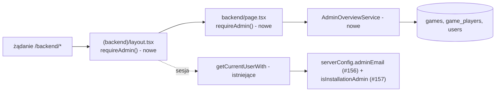

# Panel `/backend` dla administratora: liczniki partii i lista kont (tylko odczyt)

Status: draft (specyfikacja do zatwierdzenia). Zgłoszenie: E08-S02 (#158), epik E08 (#155).
Zależności: E08-S01 (#157, konto administratora; specyfikacja w draft PR #161, `.ai/specs/2026-10-31-installation-admin-account.md`), #156 (`ADMIN_EMAIL`), PR #154 (bramka doraźna `assertBackendEnabled()`, którą ta historyjka zastępuje), E06-S03 (#129, licznik wg pary typów, tylko jedna sekcja panelu).
Decyzje: D-32, BR-35, BR-37, BR-14 (wyjątek), D-22, N-12, A-10, Q-14. Źródło decyzji: `.ai/specs/research/decisions/2026-10-31-admin.md` (osąd i potrzeba właściciela, nie wynik badania).

## 📝 TLDR

Właściciel instancji (administrator instalacyjny) nie widzi z poziomu aplikacji ani liczników partii, ani listy kont; dziś `/backend` pokazuje tylko stan bazy i zasady gry i jest zamknięty w produkcji doraźnym `notFound()` (#154). Proponowane (przyszłe) zachowanie: `/backend` otwiera się wyłącznie po zalogowaniu na konto z `ADMIN_EMAIL` i pokazuje liczniki partii oraz stronicowaną listę kont (e-mail, potwierdzenie e-maila, data założenia, liczba partii, rola); każdy inny odwiedzający dostaje odpowiedź nieodróżnialną od nieistniejącej strony (404). Panel nie zmienia niczego w cudzych kontach. Prawdziwa bramka sesji i roli zastępuje bramkę doraźną, a test pilnuje jej w każdym pliku grupy `(backend)`.

## 📝 Problem Statement

- Liczniki istnieją tylko w bazie (D-32); właściciel: „dodałem liczniki, ale z poziomu aplikacji ich nie widać”. To potrzeba właściciela, bez danych o użyciu (A-10), więc zakres jest minimalny.
- Panel jest dziś osiągalny bez logowania poza produkcją, a w produkcji zamknięty tylko sprawdzeniem `NODE_ENV` (#152, #154). Wyświetlanie e-maili graczy wymaga bramki opartej na sesji i roli.
- Stan kodu (`origin/main` + gałąź #154, obserwowane): `(backend)/layout.tsx` i `backend/page.tsx` wołają `assertBackendEnabled()`; `getCurrentUserWith` (`server/http/auth.ts`) zwraca użytkownika z sesji i przy każdym błędzie (np. baza niedostępna) `null`, czyli zamyka dostęp; encja `User` nie ma pola roli (BR-35: rola z konfiguracji).

## 📝 Proposed Solution

1. **Bramka `requireAdmin()`** (`server/http/admin-gate.ts`): odczytuje sesję przez `getCurrentUserWith`, sprawdza rolę przy każdym żądaniu i przy braku sesji, braku roli albo niepotwierdzonym e-mailu woła `notFound()` (działa w komponentach, route handlerach i server actions). Rola = `isInstallationAdmin(user.email, serverConfig.adminEmail)`: znormalizowany e-mail równy `ADMIN_EMAIL` (BR-35); brak `ADMIN_EMAIL` w konfiguracji oznacza, że roli nie ma nikt.
2. **Zastąpienie bramki doraźnej**: usunięcie `server/backend-gate.ts` (`assertBackendEnabled`, `isBackendEnabled`); `requireAdmin()` w layoucie i w każdej stronie, route handlerze i pliku `"use server"` grupy `(backend)`. Layout nie wystarcza (nie renderuje się ponownie przy nawigacji klienckiej i nie osłania route handlerów), stąd powtórzenie w każdym punkcie wejścia.
3. **`AdminOverviewService`** (DI, `server/services/admin/admin-overview-service.ts`): trzy zapytania odczytu: liczniki partii, sumy kont, strona kont. Surowy SQL o statycznym tekście, parametry wiązane (wzorzec `game-history-service.ts`).
4. **Strona `/backend`**: karty liczników, tabela kont (shadcn `@gomoku/ui/components/*`), wyszukiwanie po nazwie i sortowanie przez parametry URL w formularzu GET (bez server actions i bez JavaScriptu klienckiego).
5. **Licznik wg pary typów (E06-S03, #129)**: panel tylko wyświetla wartości dostarczone przez usługę z #129 (patrz „Resolved assumptions”, Q2).

Odrzucone: redirect na `/login` zamiast 404 (ujawnia istnienie panelu, sprzeczne z BR-37); pole `role` w bazie (BR-35: rola z konfiguracji, migracja dopiero przy nadawaniu roli, BR-36); osobne API JSON panelu (zbędna powierzchnia ataku, panel renderuje się na serwerze); biblioteka tabel/wykresów (brak potrzeby, nowa zależność).

## 📝 Architecture



Wniosek: nowa jest bramka i jeden serwis odczytu; sesja, DI i komponenty shadcn są istniejące. Panel nie dodaje zależności między pakietami (`app → core, db, ui`).

- `packages/app`: bramka, serwis, strony. `packages/core`: tylko czysta funkcja roli (`isInstallationAdmin`), jeśli #157 jej jeszcze nie wprowadza (ta sama funkcja służy `admin:create`, rejestracji i `AccountService.delete`).
- Brak migracji w v1 (BR-35). Karta „Baza” (stan połączenia) i tabela zasad gry pozostają z obecnej strony. Kolumna roli ma w v1 dwie wartości (Administrator, Gracz): administratorem może być tylko konto z `ADMIN_EMAIL`, więc kolumna dokumentuje model i przyszłe role (BR-36). Brak nowych zmiennych środowiskowych poza `ADMIN_EMAIL` z #156.
- Bramka jest dynamiczna (czyta ciasteczko); `/backend` przestaje być prerenderowany jako statyczne 404 (obecny skutek #154 w buildzie produkcyjnym). Dalej `await connection()` przed zapytaniami do bazy.
- Kolejność w żądaniu: `requireAdmin()` zawsze przed jakimkolwiek zapytaniem o dane panelu.

## 📝 Data Model

Bez zmian schematu. Odczyt:

| Dane | Źródło | Uwagi |
|---|---|---|
| Partie wg statusu | `games` (`games_status_created_at_index`) | liczone z istniejących wierszy; sprzątanie (`db:cleanup`) usuwa m.in. anulowane, nieprzyjęte i zakończone partie bez konta po ok. 1 h, więc to stan „teraz”, nie suma historyczna |
| Zakończone wg `origin` i `end_reason` | `games` | `status = 'finished'` |
| Zakończone dziś (Europe/Warsaw) i w 7 dniach | `games.finished_at` | granica doby w SQL: `date_trunc('day', now() at time zone 'Europe/Warsaw')`, odporne na zmianę czasu (doba 23/25 h) |
| Sumy kont: wszystkie, potwierdzone, niepotwierdzone | `users` | jedno zapytanie z `count(*) filter (where ...)` |
| Strona kont | `users` | `id, email, display_name, email_verified_at, created_at` |
| Liczba partii konta | `game_players` ⨝ `games` | tylko dla `id` z bieżącej strony (`user_id = any(?)`, indeks `game_players_user_id_index`), `status = 'finished'`, jak w historii (#27) |
| Rola | `isInstallationAdmin(email, adminEmail)` w TS | nie jest czytana z bazy |
| Licznik wg pary typów | usługa z #129 | S02 niczego nie liczy samodzielnie |

Dane wrażliwe: e-mail (BR-14, D-22). Zasady: wiązany jako wynik, nigdy jako parametr zapytania ani część klucza cache; nie trafia do logów, metadanych strony, tytułu ani URL-i. Konta usunięte (BR-17) nie mają wiersza w `users`, więc nie występują na liście, a ich anonimowe partie nadal liczą się w licznikach partii. Konta niepotwierdzone występują z oznaczeniem (BR-26, BR-28: mogą zniknąć po sprzątaniu). Goście i agenci nie mają kont, więc nie ma ich na liście; występują wyłącznie w liczniku wg pary typów (`game_players.kind`, `join_channel` z E06-S01).

## 📝 API Contracts

Brak publicznego API ani server actions w v1 (tylko odczyt, N-12). Kontrakt strony `GET /backend`:

- Parametry: `page` (liczba całkowita ≥ 1, domyślnie 1; wartość spoza zakresu lub nie-liczba = 1), `q` (nazwa gracza, po `normalizeDisplayName`, 1–24 znaki po przycięciu; dłuższe ucinane; wyszukiwanie prefiksowe po `display_name_key`, wiązane parametrem), `sort` (`created` | `name`, domyślnie `created`) i `dir` (`asc` | `desc`, domyślnie dla `created` malejąco, dla `name` rosnąco). Nieznane wartości wracają do domyślnych (walidacja `zod` przy odczycie `searchParams`; nigdy błąd 500).
- Rozmiar strony 25, stały; sortowanie stabilne: `(klucz, id)`. Strona poza zakresem zwraca ostatnią istniejącą stronę.
- Odpowiedzi: 200 dla administratora, 404 dla każdego innego (identyczne ciało i status jak dla nieistniejącej ścieżki). Brak przekierowań, brak `Set-Cookie`, brak komunikatu „brak uprawnień”.
- Nagłówki: odpowiedź 200 z danymi niecache'owalna (`Cache-Control` z `no-store`, domyślne dla stron dynamicznych Next; test integracyjny to potwierdza, żeby proxy nie buforowało e-maili). Bez własnych nagłówków w `next.config.ts` dla `/backend`, żeby 404 nie różnił się od 404 nieistniejącej strony.
- Każdy przyszły `route.ts` lub plik `"use server"` w `(backend)` musi wołać `requireAdmin()` (test strażnik).

## 📝 UI/UX

Panel backendowy: shadcn/ui z `@gomoku/ui/components/*` i motyw `globals.css` (jasny i ciemny). Nie używać komponentów graczy (`@gomoku/ui/game/*`) ani `frontend.css`. Wszystkie teksty po polsku. Nowych komponentów shadcn nie dodajemy (istniejące: `Card`, `Badge`, `Table`; formularz wyszukiwania na natywnych `input`/`button` ze stylami z `globals.css`; gdyby `Input`/`Button` były potrzebne, dopisać je do `SHADCN_COMPONENTS` w `vitest.config.ts` zgodnie z `AGENTS.md`).

Makiet graficznych nie renderowano (brak potrzeby: kilka istniejących komponentów shadcn; zrzut obecnej strony nie zmienia decyzji). Szkic układu (1280 px, kolumny licznika w siatce 3, na 320 px jedna kolumna):

```
Panel administracyjny
[Konta: 12 | potwierdzone 10 | niepotwierdzone 2]  [Baza: Połączono]
[Partie w bazie teraz: oczekujące 0 | trwające 1 | zakończone 8 | anulowane 0]
[Zakończone: dziś 3 | 7 dni 8 | wg zaproszenia/lobby/rewanż 5/2/1 | wg zakończenia ...]
[Zakończone wg pary typów: konto-konto 4 | konto-gość 2 | konto-agent 1 ...]   (z #129)
Konta   [Szukaj po nazwie ____ (Szukaj)]
Tabela (caption "Konta graczy"): Nazwa | E-mail | E-mail potwierdzony | Założone | Partie | Rola
Strona 1 z 1  (Poprzednia | Następna)
```

Stany i dostępność:
- Tabela: `<caption>`, `<th scope="col">`, linki sortowania z `aria-sort` na aktywnej kolumnie, daty w `<time datetime>` (format `pl-PL`, strefa `Europe/Warsaw`), „potwierdzony” jako tekst „Tak”/„Nie” (nie sam kolor), rola jako tekst. Kontener tabeli przewijany poziomo na 320 px (dostępny z klawiatury, `tabIndex=0` z etykietą), bez poziomego przewijania całej strony.
- Pusty stan: „Brak kont pasujących do wyszukiwania.” oraz zero w licznikach; licznik pary typów bez partii: zera, nie ukryta sekcja.
- Ładowanie: `loading.tsx` segmentu panelu z komunikatem „Ładowanie…” (`role="status"`).
- Błąd odczytu (np. baza niedostępna w trakcie): strona łapie błąd serwisu, loguje po stronie serwera tylko `describeError` (bez e-maili i parametrów) i pokazuje neutralną kartę „Nie udało się wczytać danych. Sprawdź logi serwera.” bez szczegółów bazy (zgodnie z #154). Jeśli baza nie działa już przy sprawdzaniu sesji, administrator widzi 404 (bramka zamyka dostęp przy błędzie, patrz niżej).
- Sesja wygasła lub rola zniknęła (np. zmiana `ADMIN_EMAIL`): 404, nie przekierowanie. Administrator loguje się ręcznie przez `/login`.
- Przy panelu nie ma żadnej akcji zmieniającej konto, przycisku „wejdź jako” ani eksportu.

## 📝 Edge Cases & Failure Scenarios

| Sytuacja | Zachowanie |
|---|---|
| Brak sesji / sesja wygasła / unieważniona (np. po `admin:create`) | 404 (ciało jak dla nieistniejącej strony), bez przekierowania |
| Sesja gracza bez roli | 404; jego e-mail nie jest nigdzie zwracany |
| Administrator z niepotwierdzonym e-mailem | 404 (zacieśnienie ponad BR-35; `admin:create` potwierdza e-mail, więc nie dotyka prawidłowego konta) |
| `ADMIN_EMAIL` nieustawiony (dev) | nikt nie ma roli, panel zwraca 404 także w dev; produkcja wymaga zmiennej (#156) |
| Zmiana `ADMIN_EMAIL` | poprzedni administrator traci dostęp natychmiast (rola nie jest zapisana); los jego konta to Q-15, poza zakresem |
| Baza niedostępna przy sprawdzaniu sesji | `getCurrentUserWith` zwraca `null` → 404, błąd w logu serwera (`Session lookup failed`); fail closed |
| Baza pada po przejściu bramki | neutralna karta błędu, kod 200; w logu tylko opis błędu bez e-maili |
| Duże tabele | liczniki to zagregowane zapytania na indeksowanych kolumnach (`games_status_created_at_index`); lista kont stronicowana po 25, liczby partii tylko dla wierszy bieżącej strony; bez przybliżeń (`reltuples`) w v1 (dokładne liczby przy skali znajomych); próg ponownej oceny: ok. 100 tys. kont lub zapytanie panelu > 500 ms. Sortowanie po `created_at` nie ma indeksu (brak migracji w v1) |
| Wyszukiwanie | tylko po nazwie (`display_name_key`, unikalny indeks, prefiks); nie po e-mailu, bo wartość trafiłaby do URL, logów serwera/proxy i `Referer` |
| Strefa czasowa | granice „dziś/7 dni” i format dat w `Europe/Warsaw`, niezależnie od strefy serwera i przeglądarki |
| Partie gość–gość i gość–agent | znikają z bazy ok. 1 h po zakończeniu (`db:cleanup`, BR-24/BR-31), więc liczniki z `games` nie obejmują ich historycznie; dlatego licznik wg pary typów pochodzi z #129, a podpis kart mówi „w bazie teraz” |
| Agent (`kind = 'agent'`, `join_channel = 'mcp'`) | tylko w liczniku wg pary typów; „agent” znaczy „dołączył przez MCP”, nie dowód, że to LLM (E06) |
| Konto usunięte (BR-17/18) | brak na liście, partie nadal w licznikach (anonimowe); żadnej martwej referencji do e-maila |
| Nietypowy `page`, `q`, `sort` | wartości domyślne, nigdy 500 |
| Wyciek e-maili | e-maile tylko w HTML odpowiedzi 200 dla administratora; komponenty klienckie nie dostają danych kont (strona serwerowa, brak payloadu RSC dla klienta poza renderem); metadane i tytuł statyczne; brak e-maili w logach (test: błąd serwisu nie loguje e-maila); inne strony nie zawierają cudzych e-maili (BR-14) |
| Prefetch `<Link>` do kolejnych stron | wykonuje się z sesją administratora; ten sam 404 dla pozostałych |

## 📝 Risks & Impact Review

- **Wyjątek od BR-14 / rozszerzenie D-22 (e-mail graczy widoczny administratorowi) a RODO (Q-14, open):** wymagania prawne niesprawdzone; to nie jest porada prawna. Nie blokuje grona znajomych, blokuje udostępnienie osobom z zewnątrz (S3): strona o przetwarzaniu danych (D-22) ma opisać dostęp administratora.
- **Przejęcie hasła administratora ujawnia e-maile wszystkich graczy** (brak 2FA i ponownego uwierzytelnienia to przyjęte ryzyko właściciela, N-12). Łagodzą: rola z konfiguracji, bootstrap tylko `admin:create`, blokada rejestracji na `ADMIN_EMAIL` (#157), 404 zamiast komunikatów.
- **Zmiana zachowania `/backend` w dev i testach:** bez `ADMIN_EMAIL` i konta administratora panel jest niedostępny także lokalnie. Skutek dla `scripts/smoke.mjs`, `tests/integration/pages.test.ts`, globalnego setupu integracji: zakładają administratora (`admin:create` lub wywołanie usługi z #157) albo oczekują 404.
- **Zależność od licznika #129:** sekcja pary typów nie może powstać wcześniej niż jego źródło danych.
- **Odwracalność:** brak migracji; wycofanie to usunięcie stron i serwisu, a bramka `requireAdmin()` zostaje (fail closed).
- **Zgodność:** `/backend` nie jest chronionym kontraktem w `BACKWARD_COMPATIBILITY.md` poza opisem z #154; po wdrożeniu poprawić wzmianki o bramce doraźnej (README, `BACKWARD_COMPATIBILITY.md`).
- **Przyjęty koszt:** każde żądanie panelu robi odczyt sesji z bazy (jak inne strony); czas odpowiedzi 404 może się nieznacznie różnić (brak ochrony przed analizą czasową, poza zakresem v1).

## 📝 Decisions in play

D-32 (rola administratora, v1 najmniejszy zakres), BR-35 (rola z konfiguracji przy każdym żądaniu; brak administratora = panel odmawia wszystkim), BR-37 (odczyt, bramka w layoucie i w każdym handlerze/akcji, 404), BR-14 (wyjątek), D-22 / Q-14, N-12 (czego nie budujemy), A-10 (potrzeba bez danych), BR-17/18, BR-24, BR-31. Niczego nie nadpisujemy. Właściciel zatwierdzający: Bartosz Wójcik.

## Resolved assumptions (autonomous defaults)

| # | Pytanie | Przyjęta odpowiedź | Uzasadnienie | Potwierdzić? |
|---|---|---|---|---|
| Q1 | Nazwy kontraktów z #157/#156 | Używam `ServerConfig.adminEmail` i `isInstallationAdmin(email, adminEmail)` z `core`, zgodnie ze specyfikacją w PR #161 (jedyne miejsce porównania roli; `false` przy braku `adminEmail`) | wyrównane z PR #161; jeśli #161 zmieni nazwy, poprawić tu | odwracalne |
| Q2 | Licznik wg pary typów, gdy #129 nie jest wdrożone | S02 nie liczy par samodzielnie. Wdrożenie S02 po #129 wyświetla jego wartości; wcześniej karta pokazuje „Dostępne po wdrożeniu E06-S03”. Partie gość–gość i gość–agent znikają ok. 1 h po zakończeniu, więc zliczenie „po fakcie” z `games` byłoby błędne | najmniejszy zakres, brak podwójnego mechanizmu liczenia; kryterium akceptacji o parach spełnia dopiero #129. **Po wdrożeniu #129:** usługa to `FinishedGameStatsService.finishedByPair()` (DI, `app/src/server/services/games/finished-game-stats-service.ts`), zwraca `FinishedGameStats` z `@gomoku/core` (`total`, `today`, `last7Days`, `pairs[]`, doba `Europe/Warsaw`); `AdminOverviewService` ją wywołuje i niczego nie liczy sam | ⚠ NEEDS HUMAN CONFIRMATION |
| Q3 | Sesja wygasła lub brak roli: redirect czy 404 | 404 | BR-37 wymaga odpowiedzi nieodróżnialnej od nieistniejącej strony | odwracalne |
| Q4 | Administrator z niepotwierdzonym e-mailem | 404 | zacieśnienie (obrona w głąb); `admin:create` potwierdza e-mail | odwracalne |
| Q5 | Definicja „liczba partii” konta | partie zakończone (`finished`), jak w historii | spójność z #27; anulowane i oczekujące nie są rozegrane | odwracalne |
| Q6 | Wyszukiwanie i sortowanie | wyszukiwanie tylko po nazwie, sortowanie po dacie założenia lub nazwie, bez sortowania po liczbie partii | e-mail w URL ujawniałby dane; sort po liczbie wymaga agregatu na całej tabeli | odwracalne |
| Q7 | Indeksy / migracja pod panel | brak migracji w v1 | BR-35 (brak migracji w v1); skala znajomych; próg ponownej oceny w „Edge Cases” | odwracalne |
| Q8 | Liczniki: dokładne czy przybliżone | dokładne `count` | skala v1, prostota | odwracalne |
| Q9 | Dev/testy bez `ADMIN_EMAIL` | panel zwraca 404; smoke i integracja zakładają administratora | fail closed zgodnie z BR-35 | odwracalne |

## 📋 Phasing

Jedno zgłoszenie (#158), jeden PR implementacyjny (zasada „mniej, większych PR-ów”), fazy jako osobne commity; po fazie 1 aplikacja jest zamknięta poprawnie.

- **Faza 1: bramka sesji i roli** (zamyka #152 docelowo).
- **Faza 2: liczniki partii.**
- **Faza 3: lista kont.**
- **Faza 4: licznik wg pary typów (po #129) i dokumentacja.**

## 📋 Implementation Plan

Warunek wstępny: #156 i #157 scalone (`adminEmail`, `isInstallationAdmin`, `admin:create`); przeczytać `AGENTS.md`, standardy inżynierskie, dokumentację Next 16 w `node_modules/next/dist/docs/`.

**Faza 1: bramka**
1. `server/http/admin-gate.ts`: `getAdmin()` i `requireAdmin()` (sesja + `emailVerifiedAt` + `isInstallationAdmin`; `notFound()` w przeciwnym razie). Test jednostkowy 100%: brak sesji, brak roli, niepotwierdzony e-mail, brak `adminEmail`, administrator, błąd sesji.
2. Zastąpić `assertBackendEnabled()` przez `requireAdmin()` w `layout.tsx` i `backend/page.tsx`; usunąć `backend-gate.ts`, jego test i odwołania; strona czyta dane dopiero po `requireAdmin()`. Zaktualizować testy layoutu i strony.
3. Test strażnik `admin-gate.test.ts` (dawny `backend-gate.test.ts`): każdy `page|layout|route` i każdy plik `"use server"` w `(backend)` zawiera wywołanie `requireAdmin()` (komentarze wycięte); czysta funkcja `findUnguarded(files)` z testem negatywnym (plik bez bramki psuje test) i testem „znajduje layout i stronę”.
4. Integracja: globalny setup (`tests/integration/global-setup.ts` ustawia już `ADMIN_EMAIL` według #161) zakłada administratora przez `AdminAccountService`/`admin:create` z #157 i zwykłego gracza; scenariusze: anonim, gracz bez roli, sesja wygasła, administrator niepotwierdzony → 404, treść równa 404 nieistniejącej ścieżki; administrator → 200 i `Cache-Control` z `no-store`. Test przechodzi po trasach wyliczonych ze struktury `(backend)` (każda trasa panelu, nie lista ręczna). Zaktualizować `scripts/smoke.mjs` i `pages.test.ts`.

**Faza 2: liczniki**
5. `AdminOverviewService.gameCounters()` + rejestracja w `container.ts`; test z fałszywym `em` (100%), SQL na prawdziwym PostgreSQL w integracji (znany zestaw partii zgadza się z wynikiem, granica doby w `Europe/Warsaw`, w tym zmiana czasu).
6. Karty liczników na stronie, stan błędu odczytu (neutralny, log bez e-maili), test renderu.

**Faza 3: konta**
7. Parsowanie `searchParams` (`zod`), `AdminOverviewService.accountTotals()` i `accountPage()` (rola z TS, liczba partii tylko dla bieżącej strony); testy: paginacja, brzeg strony, wyszukiwanie, sortowanie, konto niepotwierdzone, brak e-mail w logach.
8. Tabela z `caption`, `scope`, `aria-sort`, `<time>`, stan pusty, `loading.tsx`; sprawdzić w `npm run dev` na 320 i 1280 px, w obu motywach.
9. Integracja: lista zawiera zasiane konta (w tym niepotwierdzone), e-mail innego gracza nie występuje na stronach gracza (`/history`, strona partii).

**Faza 4: para typów i dokumentacja**
10. Jeśli #129 wdrożone: karta pary typów czyta jego usługę (konto–konto, konto–gość, konto–agent i pozostałe niezerowe pary); w przeciwnym razie zostaje stan „Dostępne po wdrożeniu E06-S03” z testem.
11. Dokumentacja: README i `BACKWARD_COMPATIBILITY.md` (koniec bramki doraźnej), `.ai/specs/backlog.md` (stan E08-S02); przenieść specyfikację do `implemented/` po spełnieniu kryteriów.
12. `npm run check`; bez Dockera napisać wprost, że integracja nie była uruchomiona.

### Kryteria akceptacji (z #158)

- [ ] Brak sesji / brak roli → 404 dla `/backend`, każdej podstrony, route handlera i server action; test pilnuje każdego pliku.
- [ ] Administrator widzi liczniki partii; część „wg pary typów” spełniana dopiero po wdrożeniu #129 (Q2), do tego czasu karta stanu „Dostępne po wdrożeniu E06-S03”.
- [ ] Panel nie ma akcji zmieniających konto: brak server actions i route handlerów zapisu w `(backend)` (test strażnik wylicza pliki grupy; formularz wyszukiwania to GET).
- [ ] Lista kont: e-mail, potwierdzenie, data założenia, liczba partii, rola.
- [ ] Test integracyjny „gracz bez roli dostaje 404”; e-mail nie jest ujawniony innym graczom.
- [ ] Brak jakiejkolwiek akcji zmieniającej konto lub wejścia w sesję gracza.
- [ ] Bramka zastępuje doraźną z #154, a test strażnik nadal wymusza ją w każdym pliku `(backend)`.
