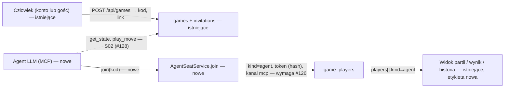

# Agent dołącza do partii prywatnej jako uczestnik „Agent” (E06-S01, #127)

> Status: **decyzje Q-09 zatwierdzone przez właściciela (Bartosz Wójcik, 2026-10-31) — specyfikacja gotowa do przeglądu**. Oparta na specyfikacji decyzyjnej #138 (`2026-10-31-mcp-agent-identity.md`, rekord `research/decisions/2026-10-31-mcp-agent-identity.md`, D-29). Zmiany względem szkicu: potwierdzone założenia R1–R8, R10, R11; osobna pula błędnych kodów dla agenta (R3); rezerwacja nazwy konta „Agent” jako krok tej specyfikacji (R9); nowe wymagania — opcjonalna deklarowana nazwa modelu agenta `agentName` (R12) i jednolite błędy MCP. Wartości liczbowe limitów pozostają **początkowe i konfigurowalne** (⚠). Merge #139 po scaleniu #138 (D-29/BR-31 w briefie).
>
> Źródło: zgłoszenie #127 (E06-S01), epik #124, `.ai/specs/product-brief.md` (D-28, BR-30, BR-29, BR-24, BR-22→BR-29, BR-13, BR-06, BR-04, N-10, A-04…A-06, Q-09), `.ai/specs/research/decisions/2026-10-31-agent-opponent.md`, specyfikacje wdrożone: `implemented/2026-10-24-game-invitations.md` (#21), `implemented/2026-10-30-guest-creates-game.md` (E02-S08), `implemented/2026-10-30-participant-nickname.md` (E02-S07), `implemented/2026-10-31-game-history.md` (E04-S01), `implemented/2026-10-29-game-rematch.md`.

## Zależności

| Zależność | Zgłoszenie | Stan | Co z niej bierze ta specyfikacja |
|---|---|---|---|
| **Decyzja Q-09: tożsamość klienta MCP, token, ważność, limity nadużyć** | #125 (E06-S01-T01) | **zatwierdzona 2026-10-31 (właściciel)**: PR #138 (D-29, BR-31) | tożsamość (`kind = 'agent'`, `agent_token_hash`, `join_channel = 'mcp'`), token jednej partii wydawany przez `join`, ważność jak token gościa, transport `POST /api/mcp`, limity (wartości początkowe, konfigurowalne), brak nazw graczy dla agenta (kierunek człowiek → agent), opcjonalna deklarowana nazwa modelu (kierunek agent → człowiek), rewanż niedostępny. Założenia R1–R11 poniżej są potwierdzone, o ile nie zaznaczono inaczej. |
| Migracja: typ uczestnika i kanał dołączenia | #126 (E06-S01-T02) | otwarte, zależy od #125 | `game_players.kind` dopuszcza `agent`, kolumna kanału dołączenia (`web`/`mcp`), kolumna skrótu tokenu agenta. Ta specyfikacja **nie zawiera migracji** — opisuje, czego od niej oczekuje (sekcja „Data Model”). |
| E02-S01 (#21) zaproszenia, E02-S08 (#95) gość tworzy partię | wdrożone | zamknięte | `InvitationService`, `game_players`, `GuestTokens`, czyszczenie. |
| E04-S01 (#27) historia | wdrożone (PR #134) | zamknięte | historia już zna `kind = 'agent'` (`OpponentKind`, `AGENT_LABEL`); ta specyfikacja tylko domyka zapis tego rodzaju uczestnika. |
| E06-S02 (#128) | po tej historyjce | otwarte | `get_state`, `play_move`, uwierzytelnianie agenta tokenem w odczycie/ruchu, zegar po stronie agenta. Tu: wyłącznie dołączenie i etykieta. |
| E06-S03 (#129) | po tej historyjce | otwarte | licznik wg pary typów; czyta `kind` i kanał dołączenia zapisane tutaj. |
| Luki DS #135, #136 | otwarte, niskiego priorytetu | niezależne | #135 (skracanie nicku gościa) nie dotyczy etykiety „Agent” (krótka, bez sufiksu); jego refaktor `PlayerLabel` musi zachować przypadek `kind = 'agent'`. #136 („Pokaż starsze”) nie dotyczy. |

Kolejność wdrożenia: **#125 zatwierdzone (2026-10-31) i scalone w #138 → #126 scalone → implementacja #127 w jednym PR-ze (kod + testy + dokumentacja, lekcja „Mało, ale pełnych PR-ów”), wewnętrznie w fazach poniżej.** **Jedna specyfikacja S01 w jednym PR-ze implementacji w fazach — potwierdzone przez właściciela 2026-10-31.** Rozważony podział na dwie specyfikacje (domena + etykieta / adapter MCP) odrzucony: dołączenie bez etykiety i etykieta bez dołączenia nie są wdrażalne osobno z punktu widzenia kryteriów #127; fazy służą kolejności prac, nie osobnym wydaniom.

## 📝 TLDR

Dziś do partii wchodzi tylko człowiek: konto albo gość z ciasteczkiem przeglądarki (BR-29). Właściciel chce zobaczyć, jak własny agent LLM gra na platformie (D-28), a agent nie ma przeglądarki ani ciasteczka. **Zachowanie przyszłe:** człowiek tworzy partię prywatną jak dotąd (zaproszenie: kod lub link) i przekazuje kod agentowi; agent dołącza przez MCP jako **osobny typ uczestnika „agent”** z własnym tokenem, partia przechodzi w `active`, a człowiek widzi przeciwnika jako **„Agent”** zamiast nicku — w partii, na ekranie końca i w historii konta. Agent może dodatkowo przedstawić się **deklarowaną, niezweryfikowaną nazwą swojego modelu** (np. „claude opus 5.5”), a człowiek widzi wtedy „Agent · claude opus 5.5 (deklarowane)”. Agent nie tworzy zaproszeń, nie wchodzi do lobby i nie ma historii ani konta (BR-30).

## Resolved assumptions (autonomous defaults)

„Potwierdzone 2026-10-31 (właściciel)” = zatwierdzone razem z decyzjami #125 (D-29) lub osobno. `⚠` zostaje tylko przy wartościach liczbowych limitów (początkowe, konfigurowalne, bez danych) i przy punktach wymienionych w „Pytaniach do właściciela”.

| # | Pytanie | Zastosowane założenie | Dlaczego | Potwierdzenie |
|---|---|---|---|---|
| R1 | Czym jest token agenta i kiedy powstaje? | **Jeden token na jedno dołączenie (jedną partię)**: `createOpaqueToken()` (32 bajty), zwracany w odpowiedzi `join` **raz**, w bazie tylko `hashOpaqueToken` (SHA-256). Klient podaje go jako argument kolejnych narzędzi (S02); bez OAuth i bez nagłówka `Authorization` w v1. Brak konta i trwałej tożsamości klienta. | Decyzja #138 (Q1–Q2, decyzje 1–2); najmniejsza powierzchnia, wzorzec tokenu gościa. | potwierdzone 2026-10-31 (właściciel) |
| R2 | Ważność tokenu | Jak token gościa: aktywna partia albo zakończona nie dawniej niż `GUEST_TOKEN_GRACE_MS` (1 h) temu; partia zamknięta bez gry (anulowana po dołączeniu, „nieotwarta” Q21) unieważnia token tym samym predykatem (`GUEST_TOKEN_VALID_SQL` uogólniony do `PARTICIPANT_TOKEN_VALID_SQL(kolumna)`); `db:cleanup` zeruje `agent_token_hash` po `finished_at + 1 h`, a partię bez końca usuwają istniejące reguły (`cancelledGames`, `guestOnly*`). Bez rotacji i ponownego wydania. | Spójność z BR-29; ta sama oś czasu. Cena: zgubiony token = utrata miejsca (zegar biegnie). | potwierdzone 2026-10-31 (właściciel) |
| R3 | Limity nadużyć dołączania | Wartości z #138 (Q5, **początkowe i konfigurowalne**): udane dołączenia agenta `mcp-join:ip:*` 10 / h, żądania na adres 300 / min (fail-closed w produkcji), ciało ≤ 8 KB, `code` ≤ 64 znaki, `agentName` ≤ 40 znaków. **Błędne kody zaproszeń agenta: osobna pula `agent-lookup:ip:*`** (20 / 15 min na adres, 300 globalnie, osobny licznik globalny; nie `invitation-lookup:*`) — klient automatyczny z tego samego adresu nie wyczerpa puli człowieka (lekcja `2026-10-24-grill-me-auth-specs-consistency`). Limit aktywnych partii agenta: brak (BR-13 chroni człowieka: jedna partia na konto/przeglądarkę gościa). Jednolite `INVALID_INVITATION` dla każdego nieważnego kodu. | Wartości wymyślone bez danych (A-04/A-06) — dlatego początkowe; osobna pula to decyzja właściciela. | osobna pula: potwierdzone 2026-10-31 (właściciel); wartości liczbowe: **⚠ początkowe, do korekty po danych** |
| R4 | Co dostarcza S01 z transportu MCP | Zgodnie z #138 (Q11): **szkielet `POST /api/mcp` + narzędzie `join`** (kontrola `Origin` → 403, ciało ≤ 8 KB → 413, `GET`/`DELETE` → 405, limity). `get_state`, `play_move`, `waitSeconds` to #128. Biblioteka MCP: `@modelcontextprotocol/server` 2.x **warunkowo** — zgoda właściciela na zależność jest udzielona pod warunkiem spike’u (API, licencja, utrzymanie, build, zgodność z Claude Code); **przy porażce spike’u ręczna obsługa JSON-RPC bez SDK** (ten sam kontrakt). Werdykt spike’u zapisać w PR implementacji. | Kryterium #127 mówi „przez MCP”; bez `join` nie jest sprawdzalne. | potwierdzone 2026-10-31 (właściciel); zależność warunkowa |
| R5 | Gdzie skrót tokenu agenta | **Osobna kolumna** `game_players.agent_token_hash` (`char(64)`, nullable, unikalna) i `join_channel` (`web`/`mcp`), CHECK `(kind = 'agent') = (join_channel <> 'web')`; nie `guest_token_hash`. Zakres migracji należy do #126 (kontrakt w #138). | Ciasteczko gościa i token agenta nie mogą się wzajemnie uwierzytelnić. | potwierdzone 2026-10-31 (właściciel; #138 Q1) |
| R6 | Co agent widzi o człowieku (tekst od człowieka = wektor prompt injection) | Bez zmian dla kierunku człowiek → agent: odpowiedź `join` ma `opponent: { kind: "account" \| "guest" }`, **bez nicku, nazwy konta, e-maila, `user_id`**; to samo w `get_state` (S02). Dla kierunku agent → człowiek patrz R12 (deklarowana nazwa modelu; nigdy nie wraca do agenta). | Nick (24 znaki: litery, spacje) i nazwa konta mieszczą polecenia dla modelu; agent ich nie potrzebuje. | potwierdzone 2026-10-31 (właściciel; #138 Q7) |
| R7 | Rewanż z agentem | **Niedozwolony w S01**: propozycja rewanżu w partii z agentem → `409 REMATCH_UNAVAILABLE` (istniejący komunikat „Przeciwnik nie jest już dostępny…”), panel rewanżu nie pokazuje przycisków, tylko podpowiedź „Aby zagrać z agentem jeszcze raz, utwórz nową partię i przekaż mu nowy kod.” | BR-30: agent dołącza tylko kodem/linkiem do partii utworzonej przez człowieka; rewanż tworzy partię `active` bez kodu i wymagałby przenoszenia tokenu między partiami (S02+). Nowa partia z nowym kodem działa już dziś. | potwierdzone 2026-10-31 (właściciel: brak rewanżu z agentem w S01) |
| R8 | Wygląd etykiety | Zwykły tekst **„Agent”** (bez sufiksu „(gość)”, bez ikony i plakietki), w tych samych miejscach, w których dziś jest nick/nazwa. | Najmniejsza zmiana; zgodne z BR-30 i z `AGENT_LABEL`/`opponentNameOf`, które historia już zna. | odwracalne |
| R9 | Konto o nazwie „Agent” udaje agenta | **Rezerwacja nazwy „Agent” przy rejestracji** jako krok tej specyfikacji (krok 0 planu, z testami): `"agent"` w `RESERVED_DISPLAY_NAMES` (`register-schema.ts`); porównanie po `normalizeDisplayName`, więc bez rozróżniania wielkości liter, z usuniętymi `_` i `-`, a białe znaki z brzegów przycina schemat (`.trim()`). Błąd: „Ta nazwa jest zastrzeżona.” (istniejący komunikat). Dotyczy tylko nowych rejestracji; istniejące konto o tej nazwie (jeśli jest) wymaga decyzji — patrz „Pytania do właściciela”. | Konto „Agent” wyglądałoby jak agent w etykiecie przeciwnika; zmiana jest jednowierszowa i objęta istniejącym mechanizmem rezerwacji (G4). | potwierdzone 2026-10-31 (właściciel) |
| R10 | Sprzątanie partii gość–agent | Warunek „partie wyłącznie gości” zmienia się z `p.kind <> 'guest'` na `p.kind not in ('guest','agent')` (jak w #138): partia bez uczestnika-konta nie ma historii (BR-24, BR-30), więc znika po oknie jak gość–gość; konto–agent zostaje; usunięte konto zachowuje `kind = 'account'`, więc partia z agentem pozostaje chroniona (BR-17). Istniejący test reguł (asercja na dosłowny SQL) jest aktualizowany. **Skutek dla #129:** licznik nie może czytać partii gość–agent „po fakcie” (znikają po godzinie, jak gość–gość) — uwaga zgłoszona dla S03. | Inaczej partia gość–agent nigdy by nie zniknęła. | odwracalne |
| R11 | Utracona odpowiedź `join` | Brak ponowienia: kolejne `join` tym kodem → jednolite `INVALID_INVITATION`; człowiek może poddać partię, agent dołącza do **nowej** partii z nowym kodem. Token nie jest wyprowadzany z kodu (każdy znający kod przejąłby miejsce). | Zgodne z #138 (decyzja 2); idempotencja po nonce klienta odłożona. | potwierdzone 2026-10-31 (właściciel: utrata odpowiedzi `join` bez ponowienia przyjęta) |
| R12 | Czy agent może się przedstawić | **Tak: opcjonalny `agentName` w `join`** — deklarowana, niezweryfikowana nazwa modelu LLM (np. „claude opus 5.5”). Walidacja (`normalizeAgentName` w `core`, decyzja 7 w #138): NFKC → odrzucenie znaków sterujących/niewidocznych i separatorów innych niż zwykła spacja → przycięcie i zwinięcie spacji → 1–40 punktów kodowych → alfabet: pismo łacińskie, cyfry ASCII, spacja i `. - _ / : ( ) +` → odrzucenie adresów (`://`, `www.`, kropka + co najmniej dwie litery). **Niepoprawna wartość jest odrzucana** (`INVALID_INPUT` bez echa), nie obcinana; walidacja jest przed zużyciem kodu zaproszenia. Pusty ciąg/same spacje = brak nazwy. Przechowywanie: `game_players.agent_name varchar(40)`. Wyświetlanie: „Agent · {nazwa} (deklarowane)”, zwykły tekst; bez nazwy samo „Agent”. Nazwa nie wraca do agenta ani do innych agentów i nie trafia do logów. | Nowy wymóg właściciela 2026-10-31; ryzyka (podszywanie się, treści obraźliwe, prompt injection, XSS/Unicode) i środki: #138, decyzja 7. | decyzja właściciela 2026-10-31; tryb „odrzuć” i alfabet: **⚠ propozycja szkicu** (odwracalna) |

## 📝 Problem Statement

- **Kto:** człowiek (konto albo gość, BR-29) z własnym agentem LLM; popyt bez dowodu (A-04), eksperyment właściciela (D-28).
- **Dziś:** partię tworzy człowiek (`POST /api/games` albo gość na `/play`), zaproszenie ma kod i link; dołączyć można tylko przez przeglądarkę — konto lub gość z ciasteczkiem (`InvitationService.accept`). `game_players.kind` ma wartości `account` i `guest`; kodu rozpoznającego agenta nie ma.
- **Kryteria #127:** (1) agent dołącza kodem/linkiem do partii prywatnej jako uczestnik „agent” z własnym tokenem, partia → `active`; (2) człowiek widzi „Agent” zamiast nicku (partia i ekran końca), z deklarowaną nazwą modelu, jeśli agent ją podał; (3) agent nie tworzy zaproszeń, nie wchodzi do lobby, nie wybiera z lobby (BR-30); (4) w historii konta przeciwnikiem jest „Agent”, a agent nie dostaje historii ani konta.
- **Poza zakresem:** narzędzia `get_state`/`play_move` i granie (#128); licznik (#129); CLI, agent w lobby, przeciwnik hostowany przez nas (N-10); rewanż z agentem; ogólna zmiana zasad nazw kont (poza rezerwacją nazwy „Agent”, R9); wskazówka „Jak podłączyć agenta” w UI (#140).

## 📝 Proposed Solution

1. **Nowy rodzaj uczestnika `agent`** w `@gomoku/core` (`PARTICIPANT_KINDS = ["account", "guest", "agent"]`). Kompilator wskaże wszystkie miejsca do uzupełnienia: `OpponentKind` w historii traci sens jako osobny alias (dziś `ParticipantKind | "agent"`, komentarz już zapowiada to przejście), a mapowania etykiet są wyczerpujące.
2. **`AgentSeatService.join(code, guard)`** (nazwa z #138): ta sama atomowa ścieżka co `InvitationService.accept` — wspólne kroki (blokada gry i konta twórcy, leniwe zamknięcia, `CONSUME_INVITATION_SQL`, `START_GAME_SQL`) wydzielone z `#join` do współdzielonego modułu, nie skopiowane — z innym wstawieniem uczestnika (`kind = 'agent'`, `agent_token_hash`, kanał `mcp`) i **bez** reguł dotyczących przeglądarki: BR-13 po stronie agenta (brak slotu), brak nicku, brak usuwania „szukam gry”. Wspólne kroki wydzielone do prywatnej metody, nie skopiowane.
3. **Etykieta „Agent”** wynika z `kind` (plus opcjonalna deklarowana nazwa modelu z `agent_name`, R12); jedno miejsce (`playerNameOf`) dla widoku partii, ekranu końca, komunikatów tekstowych, jedno (`opponentNameOf`) dla historii. API zwraca `displayName: null` dla agenta (kontrakt: „UI rozpoznaje rodzaj po `kind`, nigdy po `null`” — już obowiązuje).
4. **Adapter MCP `POST /api/mcp` z narzędziem `join(kod)`** (rekomendacja #138): parsuje kod lub link, woła serwis w `withRequestScope`, zwraca token raz. Jedyną powierzchnią agenta jest lista narzędzi MCP; brak narzędzi tworzenia zaproszeń i lobby jest kontraktem testowanym (BR-30).

**Odrzucone alternatywy:** agent jako zwykły gość z ciasteczkiem (klient MCP nie ma przeglądarki, licznik musiałby go zgadywać — odrzucone w decyzji D-28); token trwały klienta z rejestracją (więcej powierzchni, decyzja należy do #125, nie zakładamy); etykieta „Agent” przez nick specjalny w `nickname` (nick jest tylko dla gościa, CHECK, mieszałoby treść użytkownika z typem).

## 📝 Architecture

| Element | Zmiana | Pakiet |
|---|---|---|
| `PARTICIPANT_KINDS`, `ParticipantKind`, `OpponentKind` | + `agent`; usunięcie osobnego aliasu historii | `core` |
| `normalizeAgentName(input)` | czysta funkcja walidująca i normalizująca deklarowaną nazwę modelu (R12); wynik: nazwa lub `null` albo błąd walidacji | `core` |
| `RESERVED_DISPLAY_NAMES` | + `"agent"` (R9) | `core` |
| `extractInvitationCode(input)` | czysta funkcja: kod w dowolnej formie albo link `…/invite/ABCD-EFGH` → postać zapisana; nic nie pobiera z sieci (host linku ignorowany) | `core` |
| `AgentSeatService.join` + wspólny rdzeń dołączenia z `InvitationService` | nowy serwis (rejestracja w `container.ts`), uogólniony `PARTICIPANT_TOKEN_VALID_SQL`, `GameService.findParticipant` z wariantem po `agentTokenHash` | `app` |
| `GameService.stateOf` | `players[].kind` zawiera `agent`, `displayName: null`, `agentName: string \| null` (tylko dla agenta); typ `CreatorKind` (konto/gość) w podglądzie zaproszenia | `app` |
| `RematchService.offer/accept` | agent w partii → `rematchUnavailable()` | `app` |
| `cleanup/rules.ts` | `GUEST_ONLY_SQL` → „brak uczestnika `account`”; reguła zerowania `agent_token_hash` | `db` |
| `playerNameOf`, `opponentNameOf`, `PlayerLabel`, panel rewanżu | etykieta wg `kind`; podpowiedź zamiast rewanżu | `app` |
| `POST /api/mcp` + narzędzie `join` | szkielet transportu (rekomendacja #138), faza 2 | `app` |

Przepływ (istniejące / nowe / planowane):



Wniosek: ścieżka człowieka nie zmienia się; jedyna nowa ścieżka wejścia to `AgentSeatService.join`, a każda reguła partii (zegar, ruchy, wynik) pozostaje wspólna, bo agent jest zwykłym wierszem `game_players` z miejscem 2.

## 📝 Data Model

Zakres migracji należy do #126; oczekiwania tej specyfikacji (do uzgodnienia z #125):

- `game_players.kind` CHECK: `kind in ('account','guest','agent')`.
- `game_players.join_channel` `varchar(16)` `not null default 'web'`, CHECK `in ('web','mcp')`; istniejące wiersze (konta, goście, rewanże, lobby) = `web`; agent = `mcp`.
- `game_players.agent_token_hash` `char(64)` nullable, `unique`; CHECK `kind = 'agent' or agent_token_hash is null`.
- CHECK `kind <> 'agent' or user_id is null`; CHECK `kind <> 'agent' or seat = 2` (agent nigdy nie jest twórcą, BR-30 na poziomie bazy); istniejący `game_players_nickname_only_guest_check` już wyklucza nick agenta, `game_players_token_only_guest_check` zostaje (token gościa ≠ token agenta).
- `game_players.agent_name` `varchar(40)` nullable; CHECK `agent_name is null or kind = 'agent'`; CHECK `agent_name is null or char_length(agent_name) between 1 and 40` (R12). Zapisywana wartość po normalizacji; sprzątana razem z wierszem uczestnika (osobna reguła `db:cleanup` niepotrzebna).
- `isActive = true` od dołączenia do końca partii (jak gość); `game_players_user_id_active_unique` go nie dotyka (`user_id` NULL).
- Dane wrażliwe: w bazie wyłącznie skrót tokenu; token w plain tylko w jednej odpowiedzi `join`; nigdy w logach, URL-u ani komunikatach błędów.
- Sprzątanie (zmiana `packages/db/src/cleanup/rules.ts`): `GUEST_ONLY_SQL` = „nie istnieje uczestnik `kind = 'account'`” (konto usunięte nadal ma `kind = 'account'`, więc historia przeciwnika pozostaje chroniona); nowa reguła `agentTokens` zeruje `agent_token_hash` po `finished_at + 1 h`. Test strażnik reguł (`CLEANUP_RULES`) obejmuje nową regułę.

## 📝 API Contracts

Transport (`POST /api/mcp`, JSON-RPC, rewizja MCP 2026-07-28 wg #138) jest rekomendacją #138; poniżej kontrakt narzędzia `join` zgodny z jej sekcją „API Contracts”.

**Narzędzie `join`** — wejście: `{ "code": string, "agentName"?: string }`, `code` po `trim` 1–64 znaki (limit #138); `agentName` opcjonalny, reguły w R12 (opis narzędzia mówi wprost, że pole jest opcjonalne i niezweryfikowane); **dokładnie jedna z dwóch form**: kod (dowolna wielkość liter, z myślnikiem lub bez) albo link, którego ostatni segment ścieżki to kod (`…/invite/ABCD-EFGH`, parametry zapytania i fragment ignorowane). Tekst zawierający cokolwiek innego, w tym kilka kodów, jest odrzucany jako `VALIDATION`. Host linku ignorowany, nic nie jest pobierane (brak SSRF).

Wyjście przy sukcesie:

```json
{ "token": "opaque-base64url", "gameId": "uuid", "you": { "seat": 2, "color": "black|white" }, "status": "active", "opponent": { "kind": "account|guest" } }
```

Błędy narzędzia (`isError`, `structuredContent.error = { code, message, retryable, retryAfterMs? }` — jednolity kształt jak w #138, decyzja 8; kody jak w #138): `INVALID_INPUT` (zły kształt wejścia **lub niepoprawny `agentName`**, bez echa wartości; kod zaproszenia pozostaje ważny), `INVALID_INVITATION` (jednolicie: nieznany, zużyty, wygasły, anulowany, zły format kodu — brak wyroczni), `RATE_LIMITED`; poza narzędziem: `403` (zły `Origin`), `413`, `405`. Odpowiedź nie zawiera nicku, nazwy, e-maila ani `user_id` człowieka (R6) i **nie powtarza `agentName`** (R12).

Pozostałe powierzchnie:

- `POST /api/games`, `/api/lobby/*`, `/api/invitations/*/accept`, `/api/history` i pozostałe trasy gry **nie rozpoznają tokenu agenta** (czytają tylko sesję konta i ciasteczko gościa; token agenta nie jest ciasteczkiem ani nagłówkiem — to argument narzędzi MCP, #138 Q2). Trasa `/api/mcp` nigdy nie czyta ciasteczek ani sesji. Uwierzytelnienie agenta w odczycie i ruchu (`get_state`, `play_move`) to S02; w S01 powstaje tylko wariant `findParticipant` po `agentTokenHash` i uogólniony predykat ważności.
- Lista narzędzi MCP w S01 zawiera wyłącznie `join` (S02 dodaje `get_state`, `play_move`); test kontraktowy pilnuje, że nie ma narzędzi tworzących zaproszenia, wchodzących do lobby ani wybierających z lobby.
- `GET /api/games/[id]` dla człowieka: `players[i] = { seat, kind: "agent", displayName: null, agentName: string | null, seen }` (`agentName` tylko w tym polu i w historii konta; zmiana addytywna); `you.kind` człowieka bez zmian; ciasteczko gościa odświeżane tylko dla `you.kind === "guest"` (bez zmian).
- Propozycja rewanżu w partii z agentem: `409 REMATCH_UNAVAILABLE`.

Kolejność walidacji w `AgentSeatService.join`: kształt wejścia (`VALIDATION`) → **`agentName` (`normalizeAgentName`)** → rezerwacja próby w puli `agent-lookup` → atomowe dołączenie → zwrot próby, gdy kod był poprawny (wzorzec `#withAttempt`). Niepoprawny `agentName` nie rezerwuje próby i nie zużywa kodu.

## 📝 UI/UX

Zakres UI to **wyłącznie etykieta „Agent” i istniejący stan oczekiwania**; nowych ekranów, komponentów DS ani tokenów nie ma.

- **Oczekiwanie na agenta:** twórca widzi istniejący ekran „Partia czeka na przeciwnika” z kodem i linkiem (story `PartiaTworcaCzekaNaPrzeciwnika` w `docs/screens/partia.stories.tsx`); kod/link przekazuje agentowi sam. Tekst bez zmian (nie dodajemy copy specyficznego dla agenta — odwracalne).
- **Po dołączeniu:** alert „Agent dołączył do partii” (dziś `nameOf(other)`), potem „Czekamy, aż Agent otworzy partię” (stan `PartiaCzekamyAzPrzeciwnikOtworzyStrone`), gdy twórca otworzył ekran przed agentem — agent ma `seen_at` od dołączenia, więc zegar rusza, gdy twórca otworzy partię (reguła #21 Q20, bez zmian).
- **Partia i zegar:** etykieta „Agent” w `PlayerClock` przez `PlayerLabel` (bez sufiksu „(gość)”, `title` = pełny tekst). Gdy agent podał nazwę modelu: „Agent · claude opus 5.5 (deklarowane)” — oznaczenie „(deklarowane)” obowiązkowe, nazwa jako zwykły tekst (węzeł tekstowy; bez HTML, Markdownu i linkowania), przy 320 px skracana wielokropkiem z pełnym tekstem w `title`/`aria-label` (luka #135 dotyczy nicku gościa; ta etykieta ma własny przypadek w `PlayerLabel`).
- **Koniec partii:** banery wyniku są neutralne („Przeciwnik ułożył…”) — bez zmian; panel rewanżu dla partii z agentem: bez przycisków, podpowiedź z R7 (`role="status"`).
- **Historia (#27):** wiersz z przeciwnikiem „Agent” albo „Agent · {nazwa} (deklarowane)” — logika rodzaju już jest w `opponentNameOf`; dochodzi nazwa i brakujące story i test z agentem.
- **Stories do dodania** w `packages/ui/docs/` (nie w `src/`): `PartiaPrzeciwnikAgent` (ekran partii z przeciwnikiem „Agent”), wariant `HistoriaZAgentem` (wiersz „Agent” obok „Kasia (gość)”), warianty z nazwą modelu („Agent · claude opus 5.5 (deklarowane)”, nazwa 40 znaków przy 320 px), `PartiaKoniecZAgentem` (brak rewanżu + podpowiedź); strony MDX `epics/partia.mdx` i `epics/historia.mdx` uzupełnione. `npm run check:tokens` i `test:stories -w @gomoku/ui` w obu motywach.
- **Dostępność:** „Agent” czytany jak każda nazwa; kolor nie jest jedynym nośnikiem. 320 px: etykieta krótka, bez ryzyka z #135.
- **Makiety:** nie dołączone — zmiana to jedna etykieta tekstowa w istniejących ekranach, a środowisko przeglądarki nie było uruchamiane w tym przebiegu; weryfikacja wizualna w fazie 2 w działającej aplikacji i w Storybooku.

## 📝 Edge Cases & Failure Scenarios

| Sytuacja | Zachowanie |
|---|---|
| Kod już użyty (inny agent albo człowiek) | `410 INVALID_INVITATION`, jednolite; wyścig dwóch dołączeń rozstrzyga `CONSUME_INVITATION_SQL`: wygrywa jeden, drugi dostaje `410`. |
| Partia anulowana przez twórcę / zaproszenie wygasłe (24 h) / partia nieotwarta 15 min (Q21) | `410` jak wyżej. |
| Człowiek anuluje partię po dołączeniu agenta | Anulowanie dotyczy tylko `waiting` (`409 GAME_NOT_CANCELLABLE`); człowiek może poddać partię (istniejące). Anulowanie przed dołączeniem: agent dostaje `410`. Partia zamknięta jako „nieotwarta” — agent zobaczy `cancelled` w S02. |
| Agent „jako drugi gość” — BR-13 | Agent nie jest gościem: nie ma ciasteczka ani slotu przeglądarki. Dołączenie nie koliduje z BR-13 człowieka (jego slot to ta partia). Jeden token = jedna partia; ograniczenie liczby równoległych partii jednego klienta MCP nie jest nakładane (R3, do #125). |
| Dwóch agentów na jeden kod | Jak „kod już użyty”. |
| Ktoś używa własnego kodu przez MCP (twórca jako „agent”) | Dopuszczalne: posiadanie kodu daje prawo dołączenia (BR-11, #138); to ten sam scenariusz „człowiek + własny agent”, nie obejście reguł (miejsce 2, token tylko do tej partii). |
| Kod dotyczy partii lobby / rewanżu | Takie partie nie mają zaproszenia (powstają jako `active`) — kod nie istnieje, `INVALID_INVITATION`. |
| Człowiek-twórca ma konto z potwierdzonym/niepotwierdzonym e-mailem | Bez znaczenia (D-24, BR-26); agent dołącza do partii, nie do konta. |
| Twórca = gość z wygasłym ciasteczkiem | Agent może dołączyć (zaproszenie ważne), ale twórca traci dostęp do partii (BR-29); zegar biegnie (BR-06/BR-07). Bez zmian względem gość–gość. |
| Poddanie | Człowiek poddaje istniejącą trasą; agent poddaje w S02. |
| Prompt injection przez nick/nazwę człowieka | Agent nie otrzymuje żadnego tekstu pochodzącego od człowieka (R6). |
| `join` z niepoprawnym `agentName` | `INVALID_INPUT`; kod zaproszenia nietknięty, pula błędnych prób nietknięta; agent ponawia bez pola lub z poprawioną nazwą (R12). |
| Nazwa modelu nieprawdziwa lub obraźliwa | Jawne „(deklarowane)”; ograniczony alfabet i długość; widoczna tylko dla człowieka-przeciwnika i w jego historii; bez listy wulgaryzmów w v1 (R12). |
| Wyciek danych | Odpowiedź `join` i widoki bez e-maila, `user_id`, nicku; token w plain tylko raz; skrót tokenu nigdy w API; błędy bez tokenu. |
| Wymuszanie tworzenia zaproszenia / lobby / wyboru z lobby przez agenta | Brak narzędzi (kontrakt MCP: `tools/list` zwraca tylko `join`, po S02 trzy); trasy REST nie przyjmują tokenu agenta; CHECK `agent ⇒ seat = 2` i `user_id IS NULL` na poziomie bazy (lobby operuje na `user_id`). |
| Konto o nazwie „Agent” | Nowa rejestracja odrzucona (R9: „Ta nazwa jest zastrzeżona.”); istniejące konto o tej nazwie — patrz „Pytania do właściciela”. |
| Usunięcie konta człowieka w trakcie partii z agentem | Bez zmian: `user_id` → NULL, `kind` pozostaje `account`; partia z agentem jest traktowana jak każda partia usuniętego konta (BR-17). Weryfikowane na PostgreSQL. |
| Utracona odpowiedź `join` | R11. |
| Zamknięcie partii „nieotwartej” (Q21: twórca nie otworzył jej w 15 min) | Partia → `cancelled`; token agenta przestaje być ważny tym samym predykatem co token gościa (R2); agent zobaczy to w S02. |
| Brute-force kodów | Pula błędnych prób i limit dołączeń (R3), jednolity błąd dla każdego nieważnego kodu (brak wyroczni). |
| Awaria bazy w trakcie dołączenia | Transakcja cofa wszystko (zaproszenie niezużyte, brak wiersza uczestnika); agent dostaje 500 i może ponowić ten sam kod. |

## 📝 Risks & Impact Review

- **Trudne do odwrócenia:** wartość `agent` w CHECK i nazwa/kształt kolumn z #126; kontrakt odpowiedzi `join` (publiczny dla zewnętrznych klientów MCP — po wydaniu zmiany tylko addytywne); kształt tokenu. Dlatego implementacja czeka na zatwierdzenie #125, a powierzchnia zewnętrzna (krok 8) powstaje dopiero po kodzie domenowym.
- **Decyzje kierunkowe (nie defekty):** brak dowodu popytu (A-04) — funkcja może zostać demem właściciela; R6 (brak nicków dla agenta) i R7 (brak rewanżu) to wybór minimalnego zakresu.
- **Zgodność:** `BACKWARD_COMPATIBILITY.md` chroni kontrakty API; zmiany są addytywne (`kind` zyskuje wartość, `players[].kind` może mieć `agent`). Klienci traktujący `kind` jako `account|guest` muszą znać `agent` — jedynym klientem jest nasza aplikacja (kompilator wymusza).
- **Reguły repozytorium:** `core` bez zależności od Reacta/ORM (`extractInvitationCode` czysta); surowy SQL z `?` i datami liczonymi w SQL (lekcje `em.execute`); zapis w transakcji przez `tx`; nowa zależność MCP tylko za zgodą.
- **Nadużycia:** klient automatyczny zgaduje kody (pula R3); token 256 bitów, skrót SHA-256; brak tokenu w URL.
- **Powierzchnia tekstowa `agentName`:** jedyny niezaufany tekst od agenta do człowieka; analiza ryzyka (podszywanie się, treści obraźliwe, prompt injection, XSS/Unicode, logi, historia #27, licznik S03 #129) w #138, decyzja 7. Pomocnicze zestawienie wg deklarowanej nazwy w liczniku (#129) dopuszczalne, ale niezweryfikowane (nie dowód); partie gość–agent znikają po 1 h (R10), więc zestawienie ich nie obejmie.
- **Kolejność:** zmiana `GUEST_ONLY_SQL` dotyka sprzątania — migracja nie jest potrzebna, ale test na PostgreSQL jest obowiązkowy (partie konto–agent, gość–agent, gość–gość, usunięte konto–agent).

## 📝 Decisions in play

- D-28 (właściciel: Bartosz Wójcik) — MCP jedynym interfejsem, partie prywatne, agent jako osobny typ „Agent”.
- **D-29** (zatwierdzona 2026-10-31) — tożsamość, token, transport, limity początkowe, osobna pula błędnych kodów, deklarowana nazwa modelu, jednolity błąd `play_move`.
- **BR-31** (nadpisuje BR-30, 2026-10-31) — typ uczestnika, token własny, brak zaproszeń/lobby/historii/konta, etykieta „Agent” z opcjonalną deklarowaną nazwą modelu (wyjątek od BR-29), rezerwacja nazwy konta „Agent”, ten sam zegar.
- BR-29, BR-24 (historia tylko kont), BR-13, BR-06/BR-07/BR-04/D-05 (zegar bez wyjątków), N-10 (brak przeciwnika hostowanego), BR-17 (usunięty gracz).
- A-04…A-06 — bez danych; Q-09 (#125) zamknięte (D-29). Specyfikacja nie proponuje zmiany żadnej aktywnej decyzji.

## 📋 Phasing

- **Faza 0 (bramka):** #125 zatwierdzone przez właściciela (2026-10-31; D-29 w #138), #126 scalone (kolumny: `agent_token_hash`, `join_channel`, `agent_name`).
- **Faza 1 — domena i dołączenie (kolejność prac, bez powierzchni zewnętrznej):** typy w `core`, `AgentSeatService.join`, predykat tokenu, widok stanu, sprzątanie, rewanż.
- **Faza 2 — transport i etykieta:** szkielet `POST /api/mcp` z `join`, etykieta „Agent” w UI, stories, scenariusz integracyjny.

Fazy to kolejność commitów w **jednym PR-ze implementacji** (po jednym kroku na commit); żaden krok nie zostawia aplikacji zepsutej, a przed krokiem 8 funkcja jest nieosiągalna z zewnątrz.

## 📋 Implementation Plan

Każdy krok: testy jednostkowe razem z kodem (100% pokrycia na plik, bez `v8 ignore`), PostgreSQL tam, gdzie dotyka SQL.

**Faza 1**
0. `core` (rejestracja, R9): `"agent"` w `RESERVED_DISPLAY_NAMES`; testy w `register-schema.test.ts`: „Agent”, „agent”, „AGENT”, „ agent ” (po `trim`), „A_g-ent” → „Ta nazwa jest zastrzeżona.”; „Agentka” i „Agent1” nadal dozwolone; osobny commit. Przed wdrożeniem sprawdzić na bazie, czy istnieje konto o takiej nazwie.
1. `core`: `PARTICIPANT_KINDS` + `agent` (i `PARTICIPANT_JOIN_CHANNELS` jeśli #126 jeszcze ich nie dodało); usunięcie `OpponentKind`, naprawa wszystkich wyczerpujących mapowań (kompilator); `extractInvitationCode` i `normalizeAgentName` — testy `extractInvitationCode`: kod w dowolnej formie, link z myślnikiem, link z parametrami i fragmentem, link z obcym hostem, wiele kodów w tekście, śmieci, zbyt długie wejście, pusty.
2. `app`: typ `CreatorKind` (konto/gość) w `InvitationPreview`; `GameState.players[].kind` z `agent`, `displayName: null`.
3. Uogólnienie `GUEST_TOKEN_VALID_SQL` → `PARTICIPANT_TOKEN_VALID_SQL(kolumna)`; `GameService.findParticipant` z wariantem po `agentTokenHash`. Testy na PostgreSQL: granice 1 h, partia `cancelled` po dołączeniu unieważnia token, token gościa nie działa jako agenta i odwrotnie.
4. `normalizeAgentName` — testy (granice 0/1/40/41, typ, pusty = brak, kategorie odrzuconych znaków, cyrylica/greka, znaki łączące, adresy, przypadki przechodzące `gpt-4.5`, `claude opus 5.5`, `qwen2.5-coder`, `llama3.1:8b`, wrogie ciągi, NFKC pełnoszerokie). `AgentSeatService.join(code, agentName, guard)`: wspólny rdzeń z `InvitationService` (blokady, leniwe zamknięcia, konsumpcja, start), wstawienie `kind='agent'`, `agent_token_hash`, `agent_name`, `join_channel='mcp'`, miejsce 2, `seen_at`; osobna pula błędnych prób `agent-lookup` i limit dołączeń (R3); kolejność: kształt → `agentName` → próba → dołączenie (test: niepoprawna nazwa nie zużywa kodu ani próby); zwrot `{ token, gameId, you, status, opponent }`. Testy jednostkowe + **PostgreSQL**: wyścig agent–agent i agent–konto (dokładnie jedno wygrywa), kod nieważny w każdym wariancie → jednolity błąd, wycofanie transakcji, twórca-konto i twórca-gość, kod partii lobby/rewanżu nie istnieje, twórca dołączający własnym kodem.
5. `RematchService`: agent w partii → `rematchUnavailable()` bez zużycia próby (oferta i akceptacja); test.
6. `db`: `GUEST_ONLY_SQL` → `kind not in ('guest','agent')`, reguła `agentTokens`; **aktualizacja istniejącego testu reguł** (asercja na dosłowny SQL) i testu strażnika `CLEANUP_RULES`; PostgreSQL: konto–agent zostaje, gość–agent znika po godzinie, gość–gość bez zmian, usunięte konto–agent zostaje, hash zerowany po godzinie.
7. Test kontraktowy: `POST /api/games`, `/api/lobby/*`, `/api/history` i trasy partii nie rozpoznają tokenu agenta w żadnej formie (nagłówek, ciasteczko, ciało).

**Faza 2**
8. Spike: potwierdzić pakiet i wersję SDK MCP (zgoda właściciela na zależność, `npm run build`, `LOW_MEMORY=1`, `serverExternalPackages`), połączenie z Claude Code (`claude mcp add --transport http`); wynik zapisać w PR. Szkielet `app/api/mcp/route.ts` + `server/mcp/`: `Origin` → 403, ciało > 8 KB → 413, `GET`/`DELETE` → 405, limit adresu (`clientKey`, fail-closed), narzędzie `join`, rejestracja serwisu w `container.ts`; testy jednostkowe handlera i test kontraktowy `tools/list` (tylko `join`; brak narzędzi zaproszeń/lobby, BR-30).
9. Etykieta „Agent”: `playerNameOf` (`kind = 'agent'` → „Agent” albo „Agent · {nazwa} (deklarowane)”, bez sufiksu „(gość)”), `AGENT_LABEL` do wspólnego miejsca w `lib/games`, `opponentNameOf` z tej samej funkcji; testy (`renderToStaticMarkup`; w tym wrogi ciąg podany wprost z pominięciem walidacji — escaping; długa nazwa) zegara, alertu „Agent dołączył do partii”, komunikatu „Czekamy, aż Agent otworzy partię”, historii.
10. Panel rewanżu: brak przycisków i podpowiedź (R7) dla `other.kind === 'agent'`; test.
11. Stories i MDX w `packages/ui/docs/` (`PartiaPrzeciwnikAgent`, `HistoriaZAgentem`, `PartiaKoniecZAgentem`, `epics/partia.mdx`, `epics/historia.mdx`); `npm run check:tokens -w @gomoku/ui`, `npm run test:stories -w @gomoku/ui` (oba motywy); przegląd w Storybooku przy 320 px.
12. Test integracyjny (Testcontainers + agent-browser): gość tworzy partię → klient MCP (`tools/call join` przez `fetch`, z `agentName` i bez) → strona twórcy pokazuje „Agent dołączył do partii” i „Agent · {nazwa} (deklarowane)” przy zegarze, bez nicku; log serwera nie zawiera nazwy; po poddaniu brak rewanżu; konto-twórca widzi „Agent” w `/history`.
13. Weryfikacja: `npm run check` (z Dockerem), migracje w górę i w dół (#126), przegląd w działającej aplikacji (`npm run dev`), odhaczenie kryteriów #127 (tabela), lekcje w `.ai/lessons/`.

### Kryteria akceptacji #127 → kroki

| Kryterium | Kroki |
|---|---|
| 1. Dołączenie kodem/linkiem jako agent z własnym tokenem, partia `active` | 1, 3, 4, 8, 12 |
| 2. Człowiek widzi „Agent” (z deklarowaną nazwą modelu, jeśli podana) zamiast nicku (partia, ekran końca) | 4, 9, 10, 12 |
| 3. Odmowa tworzenia zaproszenia / lobby / wyboru z lobby | 7, 8 (+ CHECK w #126) |
| 4. Historia konta pokazuje „Agent”; agent bez historii i konta | 6, 9, 12 |
| Rezerwacja nazwy konta „Agent” (R9, decyzja właściciela) | 0 |

## Pytania do właściciela (nowe, niezablokujące)

1. **Istniejące konto o nazwie „Agent”** (jeśli baza je zawiera): zostawić (rezerwacja działa od teraz) czy wymusić zmianę nazwy? Domyślnie: zostawić.
2. **`agentName`: odrzucenie vs „obetnij do bezpiecznego”, alfabet łaciński, brak listy wulgaryzmów** (R12, #138 decyzja 7): domyślnie odrzucenie; odwracalne.
3. **Rozstrzygnięcie upływu czasu przy błędnym `play_move`** (dotyczy S02, #138 decyzja 8): domyślnie bez zmian.
