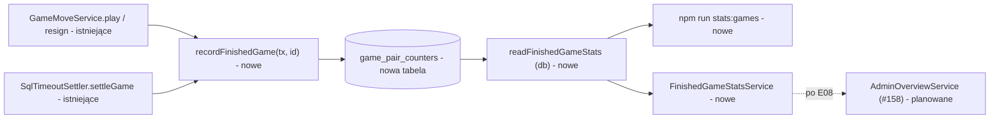

# Licznik zakończonych partii wg pary typów uczestników (trwałe agregaty, odczyt przez polecenie operatora)

Status: draft (specyfikacja do zatwierdzenia). Zgłoszenie: E06-S03 (#129), epik E06 (#124). Zależność: E06-S01 (#127, `game_players.kind`/`join_channel`, wdrożone).
Powiązane: E08-S02 (#158, panel `/backend`; specyfikacja `.ai/specs/2026-10-31-admin-panel-read-only.md`, PR #162): panel tylko wyświetla wartości z usługi odczytu zdefiniowanej tutaj.
Decyzje: D-28, BR-30/BR-31 (agent jako osobny typ uczestnika), BR-29, BR-24, BR-18, D-32/BR-37, A-04, Q-06 (próg „ma sens” nieustalony; tej specyfikacji nie dotyczy). Decyzja zakresowa właściciela 2026-10-31 (komentarz na #129, PR #162 Q2): licznik NIE jest liczony po fakcie z `games`.

## 📝 TLDR

Właściciel nie wie, czy ktokolwiek gra z agentami (A-04), a z bazy nie da się tego odczytać wstecz: `db:cleanup` usuwa partie gość–gość i gość–agent ok. 1 h po zakończeniu, więc zliczenie z `games` zaniżałoby wynik dokładnie tam, gdzie interesuje właściciela. Proponowane (przyszłe) zachowanie: w tej samej transakcji, w której partia przechodzi w `finished` (ruch kończący, remis, czas, poddanie, także rozliczenie leniwe), rośnie o 1 licznik w małej tabeli agregatów `game_pair_counters` (para typów uczestników × dzień, bez danych osobowych). Właściciel czyta wartości poleceniem tylko do odczytu `npm run stats:games` (w produkcji przez `docker exec`), a panel `/backend` (#158) pokaże te same liczby po wdrożeniu E08 przez wspólną usługę odczytu. Epik E06 kończy się więc bez czekania na panel.

## 📝 Problem Statement

- Brak pomiaru (A-04): bez licznika nie wiadomo, czy funkcja agenta ma sens; próg „ma sens” pozostaje nieustalony (Q-06), więc tu powstają wyłącznie liczby, bez oceny.
- Dziś (obserwowane w kodzie `origin/main`): `games` nie przechowuje typów uczestników, tylko `game_players.kind` (`account` | `guest` | `agent`); `db:cleanup` usuwa zakończone partie bez konta po 1 h (`guestOnlyFinishedGames`, `GUEST_ONLY_SQL` liczy `guest` i `agent` jako „bez konta”) oraz aktywne bez konta po upływie zegara (`guestOnlyActiveGames`). Zliczenie z `games` jest poprawne tylko dla par z kontem.
- Miejsca, w których `status` przechodzi w `finished` (obserwowane): `FINISHING_MOVE_SQL` (wygrana, remis) i `RESIGN_SQL` w `game-move-service.ts` oraz `finishSql` w `timeout-settler.ts` (czas; wołane z `settleFor`, `settleForGuest`, `settleExpired`, `settleGame`, także z poziomu `play`/`resign`). Każde to warunkowy `UPDATE ... where status = 'active'`, więc dokładnie jedna transakcja „wygrywa” zakończenie.
- „Agent” znaczy „dołączył przez MCP” (`join_channel = 'mcp'`), nie dowód, że po drugiej stronie jest LLM (BR-30).

## 📝 Proposed Solution

1. **Tabela agregatów `game_pair_counters`**: `day` (data w `Europe/Warsaw`), `kind_a`, `kind_b` (kanoniczna kolejność alfabetyczna), `finished_count`. Klucz główny `(day, kind_a, kind_b)`. Brak odniesień do `games`, `users`, `game_players` (brak kaskad, brak danych osobowych, sprzątanie partii i usuwanie kont jej nie dotykają).
2. **Zapis**: jedna funkcja `recordFinishedGame(tx, gameId)` (`packages/app/src/server/services/games/finished-game-counter.ts`), wołana po każdym z trzech `UPDATE`-ów kończących partię (pięć scenariuszy: pięć w linii, remis, czas, poddanie, rozliczenie leniwe) **bezpośrednio po** `UPDATE`, który zwrócił wiersz (czyli tylko przez transakcję, która faktycznie zmieniła `active → finished`), w tej samej transakcji. Jedno zapytanie `INSERT ... SELECT ... ON CONFLICT DO UPDATE SET finished_count = finished_count + 1`; pary liczone z `game_players` w SQL (`min(kind)`, `max(kind)`), dzień z `games.finished_at`. Cofnięcie transakcji cofa także licznik.
3. **Odczyt**: czysta funkcja kształtu w `@gomoku/core` (`buildFinishedGameStats`), zapytanie w `@gomoku/db` (`readFinishedGameStats(em, now)`), cienka usługa DI w aplikacji `FinishedGameStatsService.finishedByPair()`; ta sama funkcja zasila CLI i (po E08) panel.
4. **Polecenie operatora**: `npm run stats:games` (root) → `@gomoku/db` `stats:games` → `src/cli/stats-cli.ts`, tylko odczyt, jedna linia JSON na stdout (jak `db:status`). W produkcji: `docker exec gomoku_prod-app-1 npm run -s stats:games` (ten sam wzorzec co `db:cleanup`; obraz zawiera `tsx` i pakiet `db`).
5. **Backfill** w migracji: partie już zakończone i obecne w `games` są doliczane (patrz „Edge Cases”).

### Rozważone alternatywy

| Wariant | Ocena |
|---|---|
| Zliczenie z `games` po fakcie | Odrzucone decyzją właściciela: gość–gość i gość–agent znikają po ok. 1 h. |
| Wiersz na partię (tabela zdarzeń, klucz `game_id`, `ON CONFLICT DO NOTHING`) | Dałby idempotencję przez PK i brak gorącego wiersza, ale rośnie liniowo z liczbą partii; właściciel wybrał agregaty. Zostaje opcją, jeśli kontencja okaże się problemem. |
| Wyzwalacz (trigger) PostgreSQL na `games` | Obejmuje przyszłe ścieżki zakończenia automatycznie, ale ukrywa logikę poza TS (nie podlega progowi pokrycia 100%, trudniej przeglądać); wybrano jawną funkcję + test strażnik. |
| Odczyt: czekać na panel E08 | Sprzeczne z priorytetem właściciela („kończymy najpierw E06”). |
| Odczyt: endpoint HTTP z tokenem | Nowa powierzchnia ataku i sekret dla jednej liczby; odrzucone. |
| Odczyt: dopisać do wyniku `db:cleanup` | Miesza odczyt z poleceniem kasującym dane; odrzucone. |
| Odczyt: ręczne `psql` | Zostaje awaryjnie (tabela jest prosta), ale bez kontraktu i bez okien czasowych. |
| Dodatkowe zestawienie wg deklarowanej nazwy modelu (komentarz na #129, „dopuszczalne”) | Poza zakresem S03: wolny tekst w agregacie to nieograniczona liczność kluczy i normalizacja; wymaga osobnego pytania o retencję. Odłożone (można dodać kolumnę lub tabelę później). |

## 📝 Architecture



Wniosek: dochodzi jedna tabela, jedna funkcja zapisu wołana z trzech istniejących miejsc, jedno wspólne źródło odczytu dla CLI i panelu. Zależności pakietów bez zmian (`app → core, db`; `db → core`).

- **Rozmieszczenie** (zgodnie ze standardami): typy i budowa kształtu w `core` (bez ORM), zapytanie odczytu, encja i CLI w `db`, zapis i usługa DI w `app` (`container.ts`: jawne `asClass`, ścieżka zapisu to funkcja przyjmująca `tx`, bez globalnego `orm.em`).
- **Kształt danych odczytu** (kontrakt dla #158; nazwa usługi i metody uzgodniona z jego specyfikacją, `AdminOverviewService` ją wywołuje i niczego nie liczy sam):

```ts
type PairCounter = {
  pair: string;               // "account-account" | "account-agent" | "account-guest" | "agent-guest" | "guest-guest" | inny (przyszły typ)
  kinds: [string, string];    // kanoniczna kolejność alfabetyczna
  total: number;
  today: number;              // doba w Europe/Warsaw wg zegara aplikacji
  last7Days: number;          // dziś i 6 poprzednich dób
};
type FinishedGameStats = {
  timeZone: "Europe/Warsaw";
  total: number; today: number; last7Days: number;
  pairs: PairCounter[];       // zawsze pięć znanych par w stałej kolejności (także z zerem), potem nieznane pary alfabetycznie
};
```

  Pięć znanych par: konto–konto, konto–gość, konto–agent, gość–gość, gość–agent (agent–agent jest niemożliwy: agent zajmuje miejsce 2 i nie tworzy partii, BR-30; `game_players_agent_seat_check`). Etykiety po polsku buduje warstwa wyświetlająca (CLI wypisuje klucze, panel mapuje na teksty); „agent” w etykiecie panelu = „dołączył przez MCP”.
- **Transakcja**: `em.transactional(tx)`; zapis tylko przez przekazany `tx` (lekcja `2026-10-28-transactional-callback-uses-tx`), surowy SQL przez `tx.execute` ze znakami `?` (lekcja `...execute-binds-question-marks`).
- **Kolejność blokad**: najpierw wiersz partii (istniejąca blokada `for no key update`), potem wiersz licznika; spójne we wszystkich ścieżkach.

## 📝 Data Model

Nowa encja `GamePairCounter` (`defineEntity`, wpis w `entities/index.ts`) i migracja generowana `npm run db:migration:create`:

| Kolumna | Typ | Uwagi |
|---|---|---|
| `day` | `date` not null | doba w `Europe/Warsaw` z `games.finished_at`: `(finished_at at time zone 'Europe/Warsaw')::date` |
| `kind_a`, `kind_b` | `varchar(16)` not null | `min`/`max` z `game_players.kind`; CHECK `kind_a <= kind_b`; bez CHECK na wartości (patrz „nieznany typ”) |
| `finished_count` | `integer` not null default 0 | CHECK `finished_count >= 0` |

Klucz główny `(day, kind_a, kind_b)`. Brak indeksów dodatkowych (do ok. 5 par × 365 dni rocznie to kilkaset wierszy). Brak ref. do innych tabel, brak `expiresAt` (nie wchodzi do reguł `db:cleanup` ani `CLEANUP_EXEMPT_TABLES`; tabela jest trwała, rośnie o ≤ 5 wierszy na dobę).

**Migracja `up`**: `create table` + backfill jedną instrukcją `insert ... select` z `games` (`status = 'finished'`) i `game_players` (para, dzień, `count(*)`). **`down`**: `drop table`. Uwaga o odwracalności: `down` kasuje dane, których nie da się odtworzyć dla par gość–gość i gość–agent (partie już sprzątnięte); przed `down` na produkcji wykonać `pg_dump` tej tabeli. Czysty snapshot z `migration:create` zachować i przywrócić po `migration:up` (lekcje `2026-10-31-stale-migration-snapshot-adds-noise`, `...migration-up-rewrites-the-snapshot`); w diffie ma być tylko ta tabela.

Dane osobowe: brak (liczby, typy, dzień). Usunięcie konta (BR-17/18) nie zmienia licznika; `kind` konta usuniętego pozostaje `account` w `game_players`, a agregat nigdy nie zawierał tożsamości.

## 📝 API Contracts

Brak endpointu HTTP i server actions. Kontrakty:

- `recordFinishedGame(tx: EntityManager, gameId: string): Promise<void>`: wołana wyłącznie po `UPDATE` zwracającym wiersz; SQL ma `where g.status = 'finished'`, więc błędne wywołanie (partia nie jest zakończona albo nie istnieje) nie zwiększa licznika. Test strażnik wymusza użycie (patrz „Testy”).
- `readFinishedGameStats(em: Pick<EntityManager, "execute">, now: Date): Promise<FinishedGameStats>`: okna czasowe liczone w SQL z parametru `now` (`(?::timestamptz at time zone 'Europe/Warsaw')::date`; lekcja `...em-execute-timestamps-are-strings`: żadnych porównań dat w JS), `day` zwracany przez `to_char` jako tekst. Zapytanie: `select kind_a, kind_b, sum(finished_count), sum(...) filter (where day = today), sum(...) filter (where day >= today - 6) group by kind_a, kind_b`.
- CLI `npm run stats:games`: wyjście `0` i jedna linia JSON zgodna z `FinishedGameStats` (np. `{"timeZone":"Europe/Warsaw","total":9,"today":2,"last7Days":9,"pairs":[{"pair":"account-account","kinds":["account","account"],"total":4,"today":1,"last7Days":4}, ...]}`), błąd bazy: kod `1` i komunikat bez `DATABASE_URL` i sekretów (`maskSecrets` z `status.ts`). Ładowanie `.env*` jak `db:status` (`@next/env`, `forceReload`). Tylko `select`, nie zmienia danych, bezpieczne także na bazie dev.

## 📝 UI/UX

Brak ekranów w v1; wynikiem jest wyjście CLI. Makiet nie renderowano (brak UI). Panel administratora jest zakresem #158 (karta „Zakończone wg pary typów” czyta `FinishedGameStatsService`; do czasu wdrożenia S03 pokazuje „Dostępne po wdrożeniu E06-S03”). Dokumentacja dla właściciela: README (wiersz w tabeli komend, sekcja z przykładem `docker exec`, ograniczenia z „Edge Cases”, objaśnienie „agent = dołączył przez MCP”).

## 📝 Edge Cases & Failure Scenarios

| Sytuacja | Zachowanie |
|---|---|
| Idempotencja (partia kończy się dokładnie raz) | Licznik rośnie tylko w transakcji, w której `UPDATE ... where status = 'active'` zwrócił wiersz. Powtórzenie ruchu/poddania, drugi poller, drugi `settleFor` trafiają w `finished` i nie zapisują nic. Test z równoległością na PostgreSQL. |
| Wyścig: ruch wygrywający vs poddanie vs czas | Blokada wiersza partii (`for no key update`) szereguje; przegrany wyścigu dostaje `GAME_FINISHED`/`STALE_MOVE`, jego transakcja nie dotyka licznika. Zawsze +1 łącznie. |
| Rozliczenie leniwe (`settleFor`, `settleForGuest`, `settleExpired`, `settleGame` wołane z `play`/`resign`/odczytu) | Jedyna funkcja zapisu zakończenia czasem to `settleGame`, więc `recordFinishedGame` stoi tam; pozostałe ścieżki delegują. Dzień = dzień `finished_at` (moment upływu zegara, nie moment rozliczenia). |
| Błąd po zapisie licznika, przed commit | Cały `finished` + licznik wycofane razem (spójność: licznik nigdy nie wyprzedza ani nie pozostaje za statusem). Test rollbacku na PostgreSQL. |
| Partia anulowana / oczekująca / trwająca | Nie jest `finished`, nie liczy się. Zakończona przez usunięcie `db:cleanup` (aktywna gościnna po upływie zegara bez rozliczenia, `guestOnlyActiveGames`) też nigdy nie była `finished`, więc nie wchodzi. |
| Rewanż | Nowa partia (`origin = 'rematch'`); każda partia liczy się osobno, także gdy rewanż jest z agentem lub gościem. |
| Usunięcie konta | Bez wpływu na licznik (brak referencji, brak danych osobowych). |
| Strefa czasowa dnia | `Europe/Warsaw` (zgodnie z #158 i historią #27): „dziś” zgadza się z panelem i z intuicją właściciela. UTC byłoby prostsze w zapisie, ale rozjechałoby się z #158 i dzieliłoby polską dobę o 1–2 h. Zmiana strefy później wymaga przeliczenia już zapisanych dni (agregatów nie da się przesunąć wstecz) — to jest koszt decyzji, stąd potwierdzenie. DST: doba 23/25 h obsłużona przez rzutowanie `date`. |
| Nieznany typ w przyszłości | `kind` bez CHECK w agregacie: nowy typ uczestnika (po poluzowaniu CHECK w `game_players`) zapisuje własne pary bez awarii kończenia partii; odczyt dopisuje nieznane pary po pięciu znanych. Test: typ spoza listy trafia do `pairs`, a nie do wyjątku. |
| Backfill | Migracja doliczy `finished` obecne w `games`. Dokładne dla par z kontem (partie z kontem są trzymane bez limitu, BR-18; usunięte konta mają `kind = 'account'`). **Ograniczenie**: gość–gość i gość–agent zakończone i sprzątnięte przed wdrożeniem są nieodzyskiwalne, więc te dwie pary mają zaniżony stan do dnia wdrożenia; partie zakończone przez starą wersję aplikacji między migracją a startem nowej (okno sekund, `migrate` jest jednorazowym serwisem przed `app` w `compose.prod.yaml`) nie wejdą do żadnej pary. README mówi to wprost. |
| Gorący wiersz | Wszystkie zakończenia dnia tej samej pary aktualizują jeden wiersz; blokada trwa do commit krótkiej transakcji. Ryzyko zakleszczenia (transakcja kończąca kilka partii) jest zerowe w praktyce: konto ma jedno aktywne miejsce (BR-13), gość jedną partię na token, a `settleFor` rozlicza ≤ 1 partię; PostgreSQL i tak wykryje cykl (`40P01`) i przerwie jedną transakcję (jednorazowy błąd 500, bez uszkodzenia danych). Kryterium ponownej oceny: wariant „wiersz na partię” z tabeli alternatyw. |
| Wydajność | Jedno dodatkowe `INSERT ... ON CONFLICT` na koniec partii (raz na ~10–20 min gry); odczyt to agregat po kilkuset wierszach. |
| Baza niedostępna dla CLI | Kod wyjścia `1`, krótki komunikat bez sekretów. |
| Pusta tabela / brak partii | Pięć znanych par z zerami, `total: 0`. |
| Stan po wycofaniu aplikacji (stary kod, nowa tabela) | Stary kod nie zna tabeli i jej nie aktualizuje; licznik przestaje rosnąć (brak awarii). Ponowne wdrożenie nowego kodu wznawia zliczanie z luką za okres wycofania. |

## 📝 Risks & Impact Review

- **Nowy zapis w ścieżce krytycznej gry** (trzy miejsca): błąd tu psuje kończenie partii. Łagodzą: jedno zapytanie, ta sama transakcja, test integracyjny każdej ścieżki × każdej pary, test strażnik pilnujący, że każdy plik z `UPDATE ... status = 'finished'` woła `recordFinishedGame`.
- **Pominięte rozliczenie**: gościnna partia z upłynięciem zegara, do której nikt nie wróci w ciągu 1 h, jest usuwana przez `db:cleanup` bez rozliczenia (decyzja Q4 specyfikacji sprzątania) i nie wchodzi do licznika. To zaniża gość–gość i gość–agent o partie porzucone. Nie zmieniamy `db:cleanup` w S03 (poza zakresem; rozliczanie przed usunięciem to osobna decyzja), ograniczenie opisujemy w README.
- **Nieodwracalność danych**: `down` migracji kasuje agregaty, których nie da się odtworzyć (patrz wyżej); przed `down` kopia tabeli.
- **Strefa dnia** zapisana w danych (Warsaw); zmiana wymaga migracji przeliczającej.
- **Zgodność**: tabela addytywna, brak zmian publicznych kontraktów API ani MCP; nowa komenda `stats:games` dochodzi do tabeli komend README. Sprawdzić, czy `BACKWARD_COMPATIBILITY.md` wymaga wpisu (przewidywane: nie).
- **Interpretacja**: liczby to pomiar kanału (MCP), nie dowód użycia LLM i nie próg „ma sens” (Q-06 pozostaje otwarte); wynik CLI nie zawiera ocen ani celów.

## 📝 Decisions in play

D-28 (licznik wg pary typów jako pomiar), BR-30/BR-31 (agent jako osobny typ, „agent” = kanał MCP), BR-29, BR-24 i BR-18 (sprzątanie partii bez konta ogranicza źródło po fakcie), D-32/BR-37 (panel czyta ten sam odczyt; zależność #158 od tej usługi), A-04 (założenie weryfikowane licznikiem), Q-06 (nie ustalamy progu). Zmiana zakresu względem pierwotnej treści #129 (odczyt „po fakcie” z `games`) jest decyzją właściciela z 2026-10-31. Niczego nie nadpisujemy. Właściciel zatwierdzający: Bartosz Wójcik.

## Resolved assumptions (autonomous defaults)

| # | Pytanie | Przyjęta odpowiedź | Uzasadnienie | Potwierdzić? |
|---|---|---|---|---|
| Q1 | Jak właściciel czyta licznik w S03, skoro panel (E08) nie istnieje | Polecenie tylko do odczytu `npm run stats:games` (JSON, produkcja przez `docker exec`); panel #158 wyświetla te same wartości przez `FinishedGameStatsService` po wdrożeniu E08 | zgodne z priorytetem „kończymy najpierw E06”, zero nowej powierzchni HTTP, jedno źródło odczytu dla obu | ⚠ NEEDS HUMAN CONFIRMATION |
| Q2 | Strefa dnia w agregacie | `Europe/Warsaw` | spójnie z #158 („dziś”) i z historią #27; zmiana później wymaga przeliczenia danych | ⚠ NEEDS HUMAN CONFIRMATION |
| Q3 | Backfill z istniejących `games` | Tak, w migracji; dokładne dla par z kontem, zaniżone dla gość–gość i gość–agent sprzed wdrożenia (opis ograniczenia w README) | tanie, nie szkodzi; alternatywa „liczyć od wdrożenia” traci prawdziwe dane kont | ⚠ NEEDS HUMAN CONFIRMATION |
| Q4 | Partie gościnne porzucone po upływie zegara i usunięte przez `db:cleanup` bez rozliczenia | Nie liczą się; `db:cleanup` bez zmian | zmiana semantyki sprzątania poza zakresem S03 (Q4 specyfikacji sprzątania) | ⚠ NEEDS HUMAN CONFIRMATION |
| Q5 | Mechanizm zapisu: funkcja w TS czy trigger | Funkcja `recordFinishedGame` + test strażnik | jawna, objęta progiem pokrycia i przeglądem; trigger ukrywa logikę | odwracalne |
| Q6 | Agregat czy wiersz na partię | Agregat (decyzja właściciela), wiersz na partię jako opcja przy kontencji | zgodnie z decyzją; kontencja pomijalna przy skali znajomych | odwracalne |
| Q7 | Okna czasowe w odczycie | Razem, „dziś”, ostatnie 7 dób (dziś + 6) na parę | to samo okno pokaże #158 („dziś” i „7 dni”); nowe okna to zmiana addytywna | odwracalne |
| Q8 | Format wyjścia CLI | Jedna linia JSON | jak `db:status`; czytelna dla `jq`, bez nowego formatera tabel | odwracalne |
| Q9 | Zestawienie wg deklarowanej nazwy modelu agenta | Poza S03 | nieograniczona liczność wolnego tekstu, osobna retencja; komentarz na #129 mówi „dopuszczalne”, nie „wymagane” | odwracalne |
| Q10 | Typy w CHECK agregatu | Bez CHECK na wartość `kind`, CHECK tylko na kolejność | nowy typ uczestnika nie może zablokować kończenia partii | odwracalne |
| Q11 | Próg „ma sens” | Nie ustalamy (Q-06 otwarte); wynik bez oceny | brief | odwracalne |

## 📋 Phasing

Jedno zgłoszenie (#129), jeden PR implementacyjny (zasada „mniej, większych PR-ów”); fazy jako osobne commity, po każdej aplikacja działa. Znana luka wdrożenia: partie zakończone starym kodem między migracją (backfill) a startem nowego nie wejdą do licznika (okno sekund, patrz „Edge Cases”). Przegląd kodu `origin/main` nie znalazł innego miejsca przejścia w `finished` poza trzema `UPDATE`-ami; strażnik pilnuje przyszłych.

- **Faza 1: schemat i zapis.** Migracja + encja + backfill; funkcja `recordFinishedGame`; podpięcie trzech ścieżek; test strażnik.
- **Faza 2: odczyt i polecenie operatora.** Typy/budowa w `core`, zapytanie w `db`, usługa DI, CLI, skrypty `npm`.
- **Faza 3: dokumentacja i zgodność z #158.** README, backlog, uzgodnienie nazw ze specyfikacją #162.

## 📋 Implementation Plan

Warunek wstępny: przeczytać `AGENTS.md`, standardy inżynierskie, lekcje wymienione wyżej; po zmianie kodu `npm run build` przed `test:integration`.

**Faza 1**
1. `GamePairCounter` w `packages/db/src/entities/games/` + `entities/index.ts`; `npm run db:migration:create`, przegląd pliku; w nagłówku `down()` komentarz ostrzegający, że kasuje nieodtwarzalne dane (pg_dump przed użyciem) (tylko ta tabela), ręczne dopisanie backfillu w `up()`; zachować czysty snapshot. Test migracji up/down na PostgreSQL (wzór `game-schema.test.ts`): tabela istnieje po `up`, znika po `down`, backfill liczy znany zestaw (w tym partię `cancelled`, której nie liczy).
2. `finished-game-counter.ts` (`recordFinishedGame`) + test jednostkowy 100% z fałszywym `tx` (SQL statyczny, parametry `?`).
3. Wywołanie po `UPDATE` w `FINISHING_MOVE_SQL` (wygrana i remis), `RESIGN_SQL` i `settleGame`; testy jednostkowe: wywołane raz po udanym zapisie, niewywołane gdy `written.length === 0` (`STALE_MOVE`, `GAME_FINISHED`), niewywołane w ruchu nie kończącym.
4. Test strażnik `finished-game-counter.guard.test.ts`: czysta funkcja `findUnrecordedFinishers(files)` (każdy plik produkcyjny w `packages/app/src` i `packages/db/src` oraz skrypty w `scripts/` z przypisaniem `status = 'finished'` w SQL i bez `recordFinishedGame`), test pozytywny na repo i negatywny na przykładzie.

**Faza 2**
5. `core`: `FinishedGameStats`, `PairCounter`, `KNOWN_PAIRS`, `buildFinishedGameStats(rows)` (pięć znanych par z zerami, nieznane po nich, sumy); testy 100%.
6. `db`: `readFinishedGameStats(em, now)` w `src/stats/`, eksport z `index.ts`; test z fałszywym `em` (kształt SQL, parametry `now`), SQL na PostgreSQL w integracji.
7. `db`: `cli/stats-cli.ts` (ładowanie `.env*` jak `status-cli.ts`, fabryka ORM, JSON na stdout, błąd → kod 1 bez sekretów) + skrypt `stats:games` w `packages/db/package.json` i `"stats:games"` w root `package.json` (`--silent`); test jednostkowy jak `cleanup-cli.test.ts`.
8. `app`: `FinishedGameStatsService` (`finishedByPair()` woła `readFinishedGameStats(em, clock.now())`), rejestracja jawna w `container.ts`, test.

**Faza 3**
9. README: wiersz w tabeli komend, sekcja „Licznik zakończonych partii” (komenda lokalna i `docker exec gomoku_prod-app-1 npm run -s stats:games`, objaśnienie „agent = dołączył przez MCP”, ograniczenia: backfill, porzucone partie gościnne, brak progu Q-06, `pg_dump` przed `down`).
10. `.ai/specs/backlog.md`: status E06-S03; w specyfikacji #162 (Q2) wskazać nazwę `FinishedGameStatsService.finishedByPair()` i kształt `FinishedGameStats`; przenieść tę specyfikację do `implemented/` po spełnieniu kryteriów.
11. `npm run check`; bez Dockera napisać wprost, że integracja nie była uruchomiona.

### Testy

- **Jednostkowe 100%** (statements, branches, functions, lines, per plik) dla każdego nowego pliku; bez `v8 ignore`.
- **Integracyjne na PostgreSQL** (Testcontainers, `tests/integration/`): macierz ścieżka zakończenia × para typów, każda komórka zwiększa dokładnie jeden licznik o dokładnie 1: pięć w linii, remis, czas przez ruch/poddanie/odczyt (rozliczenie leniwe), czas przez `settleFor`/`settleForGuest`, poddanie; pary konto–konto, konto–gość, konto–agent, gość–gość, gość–agent (partie agenta zasiewane SQL z planszą tuż przed końcem, a ruchy i poddanie wykonuje człowiek przez API; po wdrożeniu `play_move` (#128) test używa prawdziwego agenta). Dodatkowo: wyścig ruch wygrywający / poddanie / czas równolegle → suma +1; rollback (wyjątek po zapisie licznika) → licznik bez zmiany; partie `cancelled`, `waiting`, `active` nie zmieniają licznika; po `db:cleanup` usuwającym partie gościnne licznik się nie zmniejsza; rewanż liczy się jako osobna partia; usunięcie konta nie zmienia licznika; granica doby `Europe/Warsaw` i zmiana czasu (zegar wstrzyknięty); nieznany `kind` zapisuje się i wraca w `pairs`; `npm run stats:games` na bazie z Testcontainers zwraca znany zestaw (zgodnie z kryterium „porównam licznik z danymi”); migracja up/down.

### Kryteria akceptacji (z #129)

- [ ] Zakończone partie różnych par typów: właściciel (CLI, a po E08 panel) widzi liczby osobno dla każdej pary: konto–konto, konto–gość, konto–agent, gość–gość, gość–agent.
- [ ] Partie nieskończone lub anulowane nie wchodzą do licznika (test integracyjny).
- [ ] Znany zestaw partii testowych daje wartości zgodne z danymi (test integracyjny porównuje wynik `stats:games` z zasianymi partiami).
- [ ] Licznik jest trwały: `db:cleanup` usuwający partie gość–gość i gość–agent nie zmniejsza wartości.
- [ ] Każda ścieżka zakończenia (5 w linii, remis, czas, także leniwie, poddanie) zwiększa licznik dokładnie raz, jednolicie dla trzech typów uczestników.
- [ ] Migracja up/down sprawdzona na PostgreSQL; README opisuje komendę i ograniczenia; nazwy uzgodnione z #158.
