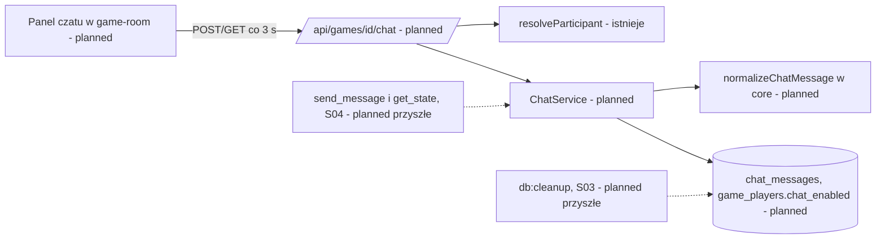
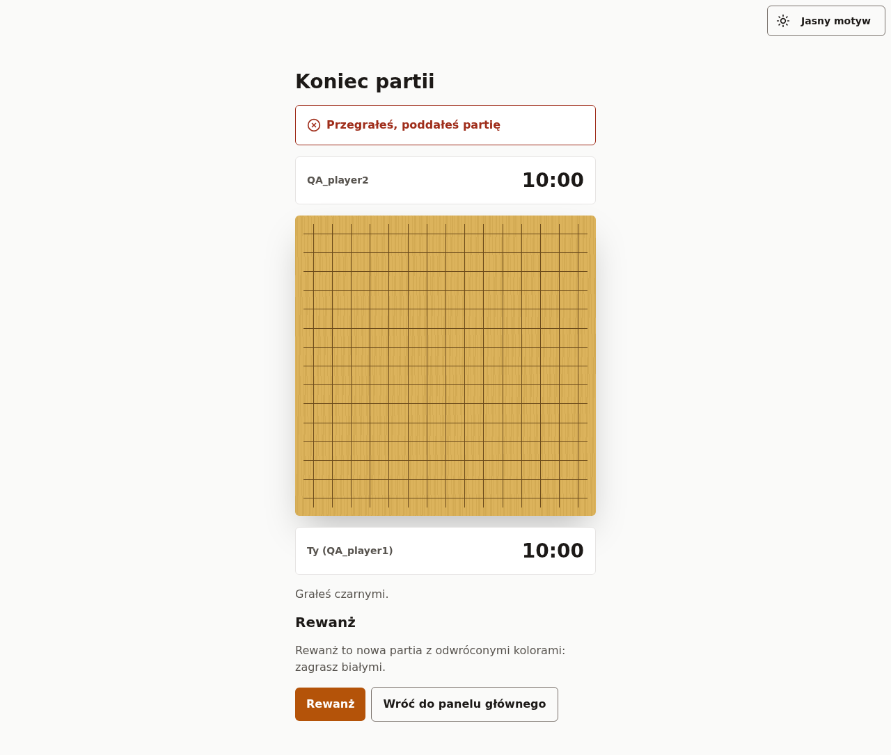
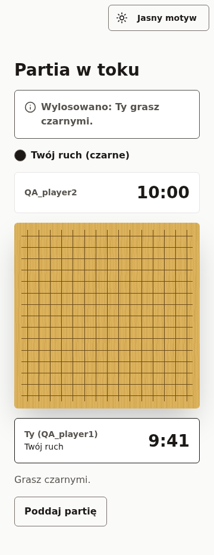
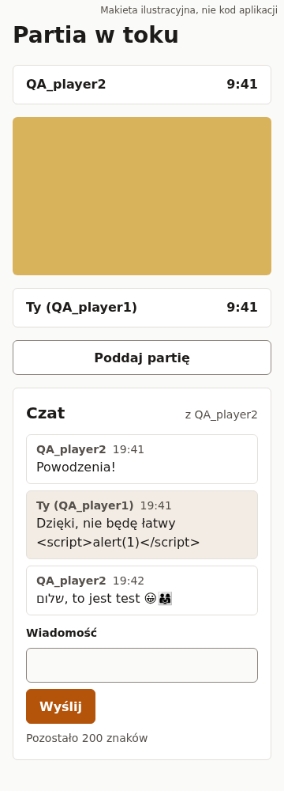
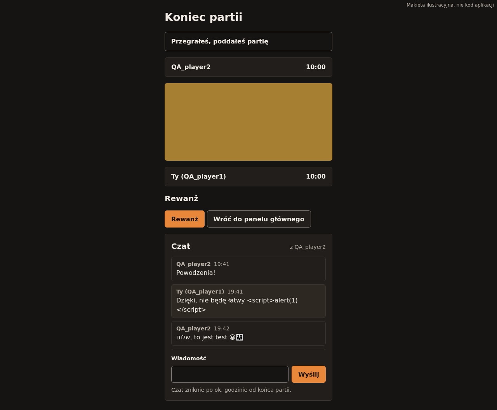
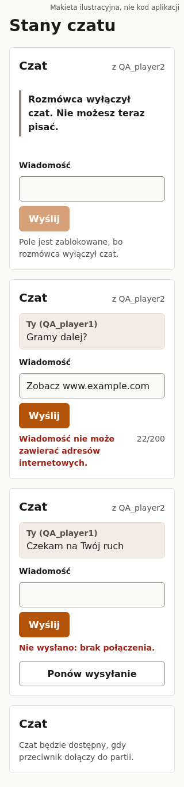

# Czat w partii: wysyłanie i czytanie wiadomości przeciwnika (E07-S01, #146; E07-S01-T01, #145)

> Status: **szkic autonomiczny (`om-auto-write-spec`), do przeglądu właściciela**. Dwa założenia wymagają potwierdzenia (R1, R2, oznaczone `⚠ NEEDS HUMAN CONFIRMATION`), więc PR pozostaje szkicem.
>
> Źródło: zgłoszenie #146 (E07-S01), zadanie #145 (migracja), epik #144; `.ai/specs/product-brief.md` na `origin/main` (917ef59): D-30, D-31, BR-32, BR-33, BR-34, BR-14, BR-29, BR-31, N-11, A-07…A-09, Q-10, Q-11, Q-12; `research/decisions/2026-10-31-chat.md`; kod: `GET /api/games/[id]`, `GameService.findParticipant/getState`, `game-room.tsx` (odpytywanie), `use-server-now.ts`, `PlayerLabel`, `playerNameOf`, `GUEST_TOKEN_VALID_SQL`, `db:cleanup` (`packages/db/src/cleanup/rules.ts`); specyfikacje E06: S01 `2026-10-31-agent-joins-private-game.md` (implementacja w PR #143, niescalona) i S02 w PR #142.
>
> Zakres tej specyfikacji: **S01 + T01 w jednym PR-ze implementacji** (tabela wiadomości, kolumna ustawienia, serwis, trasy HTTP, panel czatu w grze i na ekranie wyniku). S02 (#147 wyłączenie), S03 (#148 kasowanie) i S04 (#149 agent MCP) występują tu **wyłącznie jako kontrakty** (sekcja „Kontrakty dla S02, S03, S04”); ich implementacji tu nie ma.

## 📝 TLDR

Dziś uczestnicy partii (konto, gość, od E06 także agent) nie mogą się porozumieć bez wyjścia z aplikacji (D-30; przesłanka to osąd właściciela, nie obserwacja, A-07). **Zachowanie przyszłe:** w partii `active` oraz `finished` (do 1 h po zakończeniu) uczestnik wysyła krótkie wiadomości tekstowe i czyta wiadomości przeciwnika w panelu pod planszą, także na ekranie wyniku. Wiadomość to jedna linia zwykłego tekstu 1–200 znaków po NFKC, bez znaków sterujących, niewidocznych i adresów URL, ≤ 1 wiadomość na 2 s na uczestnika (wartości początkowe, konfigurowalne). Odczyt idzie osobnym endpointem z kursorem `after_id` co 3 s; zapis jest idempotentny dzięki `clientId`. Nadawca jest podpisany nazwą z istniejącego widoku partii (konto, „{nick} (gość)”, agent), bez e-maila i identyfikatora konta.

## Resolved assumptions (autonomous defaults)

Zatwierdzone decyzje D-30, D-31, BR-32…BR-34, N-11 nie są ponownie otwierane. Poniżej tylko luki, które brief zostawia implementacji.

| # | Pytanie | Zastosowane założenie | Dlaczego | Potwierdzenie |
|---|---|---|---|---|
| R1 | Czy wolno wydać S01 na produkcję bez S03 (kasowanie) i bez crona `db:cleanup` (Q-12)? | **Nie.** PR S01 może wejść do `main`, ale wdrożenie na Mikrusa idzie dopiero po S03 i po zaplanowaniu `db:cleanup`. W międzyczasie odczyt ukrywa wiadomości po 1 h od końca partii (R9), więc nic nie wycieka do UI, ale baza przechowuje treść dłużej niż obiecuje BR-34. | Obietnica „czat znika” jest świadomym wyjątkiem od BR-18; wdrożenie bez kasowania łamałoby ją po cichu. | ⚠ NEEDS HUMAN CONFIRMATION (właściciel decyduje o kolejności wdrożeń i o cronie, Q-12) |
| R2 | Co dzieje się z rozmówcą, gdy uczestnik wyłączył czat (BR-33: „rozmówca widzi »Rozmówca wyłączył czat«”)? | Rozmówca **nie może wysyłać** (`409 CHAT_DISABLED`, pole zablokowane z powodem obok), nie widzi nowych wiadomości wyłączającego (bo ich nie ma) i widzi stan `disabled_by_opponent`. Rozmówca nadal widzi całą dotychczasową rozmowę i komunikat o wyłączeniu. Wiadomości sprzed wyłączenia znikają z widoku **wyłączającego** na czas wyłączenia i wracają po ponownym włączeniu (S02). Dla agenta to samo mówi D-31 (`CHAT_DISABLED`); dla człowieka to rozszerzenie z analogii. | Pisanie „w próżnię” byłoby mylące; zgodne z D-31. Alternatywa (rozmówca pisze dalej, nikt nie czyta) odrzucona. | ⚠ NEEDS HUMAN CONFIRMATION (semantyka BR-33 dla człowieka, kontrakt dla S02) |
| R3 | Identyfikator wiadomości i kursor | `id` w API = **numer wiadomości w partii** (`seq`, 1, 2, 3…), nadawany pod blokadą doradczą partii, więc rośnie monotonicznie w kolejności zatwierdzenia i **kursor `after_id` nie gubi wiadomości**. Klucz główny wiersza to osobny `uuid`. | Tożsamościowy `bigint` przydzielany przy INSERT może zatwierdzić się poza kolejnością i kursor pominąłby wiadomość. Blokada na partii jest krótka. | odwracalne do wydania |
| R4 | Gdzie liczyć limit 1 wiadomość / 2 s | W bazie, pod tą samą blokadą: `now() - max(created_at) nadawcy < min_interval` → `429 RATE_LIMITED` z `retryAfterMs`. **Nie** przez `RateLimiter` (`rate_limit_buckets`). Czas bazy (`now()`), nie Node. | Dokładne, bez nowych kubełków, zgodne z lekcją o czasie serwera; osobne od puli D-29 (BR-32). | odwracalne |
| R5 | Limity człowieka i agenta | Dwie osobne konfiguracje (`human`, `agent`) o tych samych wartościach początkowych (200 znaków, 2000 ms); obie z env, z twardym sufitem w bazie (CHECK 1–1000). Agent ma dodatkowo limity transportu MCP z S04, osobne od D-29 (BR-32). | Brief wymaga „osobnych limitów”, nie różnych wartości. | wartości początkowe, bez danych (A-07) |
| R6 | Górny limit liczby wiadomości w partii | **500 wiadomości na partię** (stała, env), potem `409 CHAT_FULL`. | Ogranicza rozmiar tabeli i odpowiedzi przy 1 wiadomości / 2 s przez ponad godzinę (do ok. 1800 na uczestnika); nie ma go w briefie, więc to dodatek agenta. | odwracalne (wartość początkowa, do korekty po danych) |
| R7 | Idempotencja ponowienia | Klient generuje `clientId` (UUID v4) na próbę wysyłki; unikalność `(sender_id, client_id)`. Powtórka tego samego `clientId` zwraca istniejącą wiadomość (`200`, bez limitu i bez duplikatu), także po zmianie stanu czatu. Zmieniona treść = nowy `clientId`. | Błąd sieci po stronie odpowiedzi nie może dublować wiadomości; spójne z ruchami (powtórka tego samego ruchu). | odwracalne |
| R8 | Dopuszczone znaki | Po NFKC i `trim` (spacje ASCII; inne spacje zamienia NFKC): odrzucane są kategorie `Cc`, `Cf` (poza U+200D między dwoma znakami `Extended_Pictographic`), `Cs`, `Co`, `Cn`, `Zl`, `Zp`, selektory wariantów inne niż U+FE0F, U+034F, wypełniacze (U+115F, U+1160, U+3164, U+FFA0, U+2800), samotne surrogaty, ciąg > 4 znaków łączących z rzędu. Znaki RTL i emoji (także sekwencje ZWJ) przechodzą. **Jedna linia**: nowa linia to znak sterujący. Długość liczona w punktach kodowych po NFKC. | Wymóg BR-32 („bez sterujących i niewidocznych”) bez psucia emoji i hebrajskiego/arabskiego; samotny surrogat dałby błąd UTF-8 w PostgreSQL (500). NFKC zmienia część znaków (np. „™” → „TM”, „²” → „2”): świadome, zapisana jest wersja znormalizowana. | odwracalne |
| R9 | Okno czatu po zakończeniu | Czat jest `open` w partii `active` oraz w `finished` przez `GUEST_TOKEN_GRACE_MS` (1 h) od `finished_at`, dla **wszystkich** rodzajów uczestników (konto też; `finished_at` liczone w SQL). Potem `closed`: brak treści w odpowiedzi, nawet jeśli `db:cleanup` jeszcze jej nie usunął. `waiting` i `cancelled` = `unavailable`. | BR-32/BR-34 (do 1 h po zakończeniu); odczyt nie polega na cronie. | odwracalne |
| R10 | Wykrywanie URL | Odrzucane: schemat z `://`, `mailto:`/`javascript:`/`data:`/`file:`, `www.`, adres IPv4, nazwa domenowa z końcówką z krótkiej listy TLD (stała w `core`; kropka także U+3002 i pełnoszerokościowa po NFKC). Zdanie bez spacji po kropce („Dobra.Gramy”) przechodzi. **Obejścia (np. „h t t p”, „example [kropka] com”) nie są wykrywane**: to heurystyka, nie moderacja (Q-10). | Pełne wykrycie linków jest niemożliwe; false positive niszczy zwykłą rozmowę. Treść i tak jest tylko tekstem (nigdy `<a>`). | odwracalne (lista TLD początkowa) |
| R11 | Interfejs: nowy komponent DS czy kompozycja? | **Kompozycja** istniejących komponentów `@gomoku/ui/game/*` (Panel, Pole tekstowe, Przycisk, Alert, Pusty stan) w `packages/app/src/components/chat/`; luka DS „komponent czatu / lista komunikatów” wpisana do „Czego brakuje”. Brak pola wielowierszowego nie przeszkadza: wiadomość to jedna linia. | Zasada 1 DS: nowe komponenty tylko za zgodą właściciela. Luki #135/#136 (skracanie nicku) nie blokują; sygnatura w czacie używa `PlayerLabel`. | odwracalne (propozycja komponentu DS jako osobne zgłoszenie) |
| R12 | Odczyt: osobny endpoint czy pole w stanie partii | **Osobny endpoint** `GET /api/games/[id]/chat?after_id=` odpytywany co 3 s (AC #146), niezależnie od odpytywania stanu partii (2 s w grze, 3 s po wyniku). | Stan partii się nie zmienia, cache i retencja czatu są osobne, S04 używa tego samego serwisu. Koszt: drugie lekkie żądanie (R16). | odwracalne |
| R13 | Treść w logach | Żaden log aplikacji nie zawiera treści ani `clientId`: schemat walidacji nie echuje wejścia, `apiHandler` loguje tylko `describeError`, a **przy `DATABASE_DEBUG=true` zapytania czatu nie mogą wypisywać parametrów** (zapytania czatu idą przez `em.execute` z logowaniem wyłączonym dla tych instrukcji albo, jeśli to niewykonalne, `createOrmConfig` odmawia `debug: true` w produkcji). | BR-34 obiecuje brak treści w logach aplikacji; `DATABASE_DEBUG` loguje parametry zapytań (`packages/db/src/config.ts`). | odwracalne |
| R14 | Czat po rewanżu | Rewanż to nowa partia = nowe wiersze `game_players` z `chat_enabled = true`; stara partia zachowuje wiadomości do kasowania (1 h po jej końcu), ale UI nowej partii ich nie pokazuje. | BR-32: „rewanż startuje z pustym czatem i włączonym ustawieniem”; wynika ze schematu, bez kodu. | odwracalne |
| R15 | Powiadomienie o nowej wiadomości | Brak dźwięku i powiadomień systemowych. Zwinięty panel (≤ 360 px) pokazuje tekst „Czat (3 nowe)”, `aria-live` ogłasza dodane wiadomości. | N-11, mały zakres; kolor nie jest jedynym nośnikiem. | odwracalne |
| R16 | Koszt odpytywania | Odczyt = 1 zapytanie o stan i uprawnienie (jedno SQL z `game_players` + `games`) + 1 zapytanie o wiadomości `where game_id = ? and seq > ? order by seq limit ?`, indeks unikalny `(game_id, seq)`. `limit` domyślnie 50, maks. 100; pierwszy odczyt (bez `after_id`) zwraca **ostatnie** 50. Odpowiedź z `Cache-Control: no-store`. Bezczynny czat (60 s bez wiadomości) odpytuje co 10 s. | Ogranicza koszt i rozmiar; kursor wprost zwraca tylko nowe. | wartości początkowe |

## 📝 Problem Statement

- **Kto:** uczestnik partii (konto, gość, agent) grający ze znajomym lub obcym z lobby; właściciel, który chce, żeby „nie zmieniać aplikacji” (D-30).
- **Dziś:** w partii nie ma żadnego kanału poza ruchami; komunikacja idzie poza aplikację albo nie idzie wcale. Nie ma tabeli, endpointu ani komponentu czatu (sprawdzone w `packages/*` na `origin/main`).
- **Dowód:** brak. Przesłanka to osąd właściciela (A-07), niezweryfikowany. Wartości limitów to propozycje agenta bez danych. Spec nie sugeruje, że czat jest potrzebny; opisuje najmniejszy, odwracalny sposób sprawdzenia tego po S3.
- **Ryzyka przyjęte przez właściciela i opisane uczciwie niżej:** nękanie przez obcych z lobby (A-08), prompt injection do agenta (A-09), wymagania prawne (Q-11), kasowanie zależne od crona (Q-12).
- **Poza zakresem (N-11):** historia czatu, czat w lobby, wiadomości prywatne między partiami, załączniki, linki, obrazki, zgłaszanie nadużyć i moderacja, powiadomienia push, zapamiętane ustawienie czatu na koncie, edycja i usuwanie własnej wiadomości, statusy „pisze…”, „przeczytano”.

## 📝 Proposed Solution

1. **Tabela `chat_messages` i kolumna `game_players.chat_enabled`** (T01, #145): wiadomość należy do partii i do nadawcy (`game_players`), z numerem w partii, `clientId` i znacznikiem czasu bazy. Ustawienie wyłączenia jest kolumną uczestnika (domyślnie `true`), więc rewanż i nowi uczestnicy startują włączeni.
2. **`ChatService`** (`app/src/server/services/chat/chat-service.ts`, zakres `scoped`, konstruktor `({ em, clock, chatConfig }: Deps)`): `send(participant, gameId, { text, clientId })` i `read(participant, gameId, { afterId, limit })`. Jeden serwis dla przeglądarki (S01) i agenta (S04); transport nie zawiera reguł.
3. **Czysta walidacja w `core`** (`core/src/chat/message.ts`): `normalizeChatMessage(raw, limits)` zwraca `{ ok: true, text }` albo `{ ok: false, reason }` (`not_text`, `empty`, `too_long`, `control_char`, `invisible_char`, `combining_run`, `url`). Ten sam kod waliduje na serwerze i w formularzu (komunikat i licznik), bez duplikacji.
4. **Trasy** `GET` i `POST /api/games/[id]/chat` z `apiHandler`, `resolveParticipant` (nie-uczestnik i nieistniejąca partia dostają ten sam `404`) i `withRequestScope`. Zapis wymaga nagłówka CSRF (`apiCall`).
5. **Panel czatu** w `game-room.tsx` pod elementami sterującymi partii, także po wyniku (nad panelem rewanżu nie wchodzimy: czat jest osobną sekcją pod nim), z hookiem `useChat` (odpytywanie, scalanie po `id`, ponawianie).
6. **Alternatywy odrzucone:** (a) pole `chat` w `GET /api/games/[id]` (sprzęga cache i retencję, rozdyma stan o dane z innego okresu życia); (b) WebSocket/SSE (OD-1 nierozstrzygnięte, polling wystarcza; brief Q-01); (c) tożsamościowy `bigint` jako kursor (gubi wiadomości przy współbieżności, R3); (d) limit przez `RateLimiter` (kubełki, brak precyzji 2 s, R4); (e) HTML/Markdown w wiadomościach (N-11).

## 📝 Architecture

- **Nowe (`planned`):** `core/src/chat/{constants,message,types}.ts` (stałe: `CHAT_MAX_LENGTH`, `CHAT_MIN_INTERVAL_MS`, `CHAT_MAX_MESSAGES_PER_GAME`, `CHAT_PAGE_SIZE`, `CHAT_RETENTION_MS = GUEST_TOKEN_GRACE_MS`, `CHAT_BLOCKED_TLDS`); `core/src/validators/chat/chat-send-schema.ts`, `chat-read-query-schema.ts`; `db/src/entities/chat/chat-message.ts` (+ wpis w `entities/index.ts`) i migracja; `app/src/server/services/chat/chat-service.ts` (+ rejestracja w `container.ts`, typy `RequestCradle`), `app/src/app/api/games/[id]/chat/route.ts`; `app/src/components/chat/{chat-panel,chat-message-list,chat-composer,use-chat}.tsx|ts`; konfiguracja env w `server/config.ts` + `.env.example`.
- **Reużyte (istnieją):** `resolveParticipant`, `apiHandler`, `apiCall`, `withRequestScope`, `GameService.findParticipant`, `playerNameOf`/`PlayerLabel`, `usePageVisibility`, `POLL_TIMEOUT_MS` (wzorzec `AbortSignal.timeout`), `Clock`, `GUEST_TOKEN_GRACE_MS`, komponenty `@gomoku/ui/game/{panel,text-input,button,alert,empty-state}`.
- **Kierunek zależności** bez zmian (`app → core, db`); `core` bez Reacta/ORM; `ui` bez zmian.
- **Czego nie dotykamy:** `GameService.getState` i `GameView` (czat nie wchodzi do stanu partii), `GameMoveService`, historia (#27) — BR-34: wiadomości nie wchodzą do historii.
- **Wpływ na istniejących konsumentów:** zmiana wyłącznie addytywna (nowa tabela, nowa kolumna z domyślną wartością, nowa trasa). Panel doczepia się do `game-room.tsx` i `PlayField`; testy układu strony partii (`game-room.test.tsx`, integracja `game-*.test.ts`) mogą wymagać aktualizacji o nową sekcję.



Wniosek: reguły czatu żyją w jednym serwisie i jednej funkcji walidacji; przeglądarka i agent (S04) są tylko adapterami, a kasowanie (S03) działa na tej samej tabeli.

## 📝 Data Model

Migracja generowana przez `npm run db:migration:create` (przegląd pliku, usunięcie obcych instrukcji ze snapshotu, lekcja 2026-10-31), sprawdzona `up` i `down` na PostgreSQL.

- `chat_messages` (`defineEntity`, `db/src/entities/chat/chat-message.ts`): `id uuid pk default gen_random_uuid()`; `game_id uuid not null` → `games` `on delete cascade`; `seq integer not null` (CHECK `seq >= 1`); `sender_id uuid not null` → `game_players` `on delete cascade`; `client_id uuid not null`; `body varchar(1000) not null` (CHECK `char_length(body) between 1 and 1000` — twardy sufit techniczny; limit produktowy 200 stosuje serwis); `created_at timestamptz not null default now()`.
- Indeksy: `unique (game_id, seq)` (kursor, kolejność, pokrywa FK `game_id`); `unique (sender_id, client_id)` (idempotencja, pokrywa FK `sender_id`). Zapytanie o ostatnią wiadomość nadawcy (limit) używa `(game_id, seq desc)` z filtrem po `sender_id`; przy ≤ 500 wierszach na partię nie wymaga osobnego indeksu.
- `game_players.chat_enabled boolean not null default true` — ustawienie **uczestnika** (S02 je zmienia; w S01 czytane). Istniejące wiersze dostają `true`.
- Brak kolumny z adresem IP, agentem użytkownika, e-mailem lub `user_id`; odpowiedź zwraca `seat`, nie identyfikator.
- Wrażliwość: treść wiadomości to dane osobowe w rozumieniu RODO potencjalnie (Q-11). Retencja i kasowanie: S03. Wykluczenie danych tej tabeli z kopii `pg_dump` (`--exclude-table-data=chat_messages`) należy do S03/Q-12; tu tylko kontrakt.
- Usunięcie partii (istniejące reguły `db:cleanup`) kasuje wiadomości kaskadą; usunięcie konta **nie** usuwa wierszy `game_players` (ustawia `user_id = NULL`), więc kasowanie wiadomości przy usunięciu konta wymaga jawnego kodu w S03.

## 📝 API Contracts

Wszystkie odpowiedzi w kopercie `{ ok, data | error }` (`api-result.ts`). Kształt błędu i kody HTTP przez `AppError` i `apiHandler`.

**`GET /api/games/[id]/chat?after_id=N&limit=M`** (uczestnik; cookie sesji albo token gościa; agent w S04 przez serwis, nie przez tę trasę)

```
data: {
  state: "open" | "disabled_by_you" | "disabled_by_opponent" | "unavailable" | "closed",
  messages: [{ id: int, seat: 1|2, text: string, createdAt: ISO }],   // rosnąco po id
  lastId: int,                       // największe id w odpowiedzi albo przekazane after_id
  limits: { maxLength: int, minIntervalMs: int },
  retryAfterMs?: int                 // tylko gdy nadawca jest w odstępie
}
```

- `after_id`: liczba całkowita ≥ 0; brak = ostatnie `limit` wiadomości; z `after_id` = wiadomości z `id > after_id` (maks. `limit`). Wartość ponad zakres `integer` to `400` (walidacja semantyczna, nie `500`; lekcja „kursor: kształt to nie poprawność”). `after_id` większe niż największe `id` zwraca pustą listę.
- `state = unavailable` (partia `waiting` lub `cancelled`), `closed` (po 1 h od końca) i `disabled_by_you` zwracają `messages: []`. W `disabled_by_opponent` odczyt działa normalnie: rozmówca nadal widzi dotychczasową rozmowę i komunikat „Rozmówca wyłączył czat”; przestaje widzieć tylko wyłączający (BR-33), a wysyłanie jest zablokowane (R2).
- Klient po zmianie `state` na inny niż `open`/`disabled_by_opponent` czyści listę i zeruje kursor; po powrocie do `open` pobiera ostatnie 50 (nie gubi wiadomości napisanych tuż przed wyłączeniem).
- Nagłówki: `Cache-Control: no-store`. Nigdy `ETag` z treścią.

**`POST /api/games/[id]/chat`** — ciało `{ text: string, clientId: uuid }` (schemat Zod w `core`, nieznane pola odrzucane, surowy `text` ≤ 1000 jednostek UTF-16 przed NFKC, żeby ograniczyć koszt normalizacji i rozszerzenia znaków typu U+FDFA).

| Wynik | Kod | Uwagi |
|---|---|---|
| `201 { message: { id, seat, text, createdAt }, retryAfterMs }` | | nowa wiadomość |
| `200 { message, retryAfterMs }` | | powtórka tego samego `clientId`; bez limitu i bez duplikatu |
| `400 VALIDATION_ERROR` + `fieldErrors.text` | `reason` jedną z: `empty`, `too_long`, `control_char`, `invisible_char`, `combining_run`, `url`, `not_text` | komunikat po polsku, **bez echa treści** |
| `404` | | nie-uczestnik, nieistniejąca partia, wygasły token gościa (jednolicie, N-05) |
| `409 CHAT_UNAVAILABLE` | | `waiting`, `cancelled`, `closed` |
| `409 CHAT_DISABLED` | | wyłączył nadawca albo rozmówca (R2) |
| `409 CHAT_FULL` | | ≥ 500 wiadomości (R6) |
| `429 RATE_LIMITED` + `Retry-After` + `retryAfterMs` | | R4 |
| `403/400` CSRF | | jak pozostałe trasy zapisu |

Kolejność kontroli w `ChatService.send` (jedna transakcja, `tx`): rozpoznanie uczestnika (zrobione w trasie) → kształt wejścia → normalizacja → blokada doradcza partii (`pg_advisory_xact_lock(hashtextextended(game_id::text, 0))`) → odczyt stanu partii i uczestników w SQL (status, `finished_at`, `chat_enabled` obu) → **powtórka `clientId`** (zwrot istniejącej) → stan czatu → limit liczby wiadomości → odstęp → INSERT z `seq = coalesce(max(seq), 0) + 1`. Naruszenie klucza obcego (partia znikła pod czytającym przez `db:cleanup`) mapowane na `NotFoundError` aplikacji, nie `500` (lekcja `findOneOrFail`).

**Konfiguracja (env, wartości początkowe):** `CHAT_MAX_LENGTH=200`, `CHAT_MIN_INTERVAL_MS=2000` (osobno `CHAT_AGENT_MAX_LENGTH`, `CHAT_AGENT_MIN_INTERVAL_MS`), `CHAT_MAX_MESSAGES_PER_GAME=500`; walidacja przy starcie (całkowite, 1 ≤ długość ≤ 1000, odstęp ≥ 0); lista w `.env.example`.

## 📝 UI/UX

Prototype: `.ai/specs/assets/czat-w-partii/` (statyczne makiety ilustracyjne `mockup-01…03`, nie kod aplikacji; zrzuty bieżącej aplikacji `current-01…04`).

**Układ.** Ekran partii to jedna kolumna (ok. 432 px, wyśrodkowana także przy 1280 px; widać to na zrzutach `current-*`), więc panel czatu jest **sekcją pod planszą i przyciskami**, bez układu dwukolumnowego. Na ekranie wyniku panel jest pod blokiem „Rewanż” (kolejność: baner wyniku → zegary i plansza → rewanż → czat), żeby nie spychał głównej akcji.







**Elementy** (komponenty DS, R11): `Panel` z nagłówkiem „Czat” i podpisem „z {nazwa rozmówcy}”; lista `<ol role="log" aria-live="polite" aria-relevant="additions" aria-label="Wiadomości czatu">`, w każdej pozycji podpis (`PlayerLabel`: konto = nazwa, gość = „{nick} (gość)”, agent = „Agent · {nazwa} (deklarowane)” albo „Agent”), godzina w `<time>` i tekst jako **węzeł tekstowy Reacta** (nigdy `dangerouslySetInnerHTML`, nigdy `<a>`); własne wiadomości oznaczone słowem „Ty”, nie tylko tłem; `dir="auto"` i `unicode-bidi: isolate` na treści (RTL nie przestawia sąsiednich elementów); `overflow-wrap: anywhere` (200 znaków bez spacji). Formularz: etykieta „Wiadomość” (nie placeholder), `TextInput` bez `maxLength` UTF-16, licznik „Pozostało N znaków” liczony w punktach kodowych po NFKC, przycisk „Wyślij”, `enterkeyhint="send"`, `autocomplete="off"`. **Enter wysyła**, brak skrótów modyfikatorów; klawisze planszy działają tylko przy fokusie na planszy (test).

**Stany** (zasada 6 DS):
- ładowanie pierwszego odczytu: `Szkielet` listy; do pierwszego odczytu pole i przycisk „Wyślij” są zablokowane, z powodem napisanym obok („Wczytujemy czat…”);
- pusto: „Nikt jeszcze nic nie napisał. Napisz pierwszy.” (Pusty stan z następnym krokiem);
- `unavailable` w partii oczekującej: zdanie „Czat będzie dostępny, gdy przeciwnik dołączy do partii.” (bez pola); w anulowanej panel nie jest pokazywany;
- `closed`: panel zastąpiony zdaniem „Czat jest już zamknięty.” na ekranie wyniku po 1 h od końca (dla gościa strona i tak przestaje działać z wygasłym tokenem);
- `disabled_by_opponent`: komunikat „Rozmówca wyłączył czat. Nie możesz teraz pisać.” (`role="status"`), pole i przycisk zablokowane z powodem napisanym obok; `disabled_by_you` (S02) pokazuje „Wyłączyłeś czat” z miejscem na przycisk włączenia, którego S01 nie ma;
- błąd walidacji: błąd w polu (`aria-describedby`), tekst zostaje do poprawy; błąd URL: „Wiadomość nie może zawierać adresów internetowych.”; zbyt częste: „Poczekaj chwilę przed następną wiadomością.” z krótkim wyłączeniem przycisku zgodnym z `retryAfterMs`;
- błąd sieci przy wysyłce: wiadomość zostaje w polu, widoczny `Alert` „Nie wysłano: brak połączenia.” i przycisk „Ponów wysyłanie” używający **tego samego `clientId`** (R7); zmiana treści tworzy nowy `clientId`; po 3 nieudanych odczytach z rzędu alert „Nie udało się odświeżyć czatu” z ponowieniem (jak L02), nigdy toast;
- dużo wiadomości: lista przewijana (maks. ok. 240 px), automatyczne przewijanie na dół tylko gdy czytelnik jest przy dole; w przeciwnym razie przycisk „Nowe wiadomości” (tekstowy, `aria-live` ogłasza dodanie);
- szerokości 320, 360, 1280 px i oba motywy: zrzuty makiet w obu; test stories obu motywów (`npm run test:stories -w @gomoku/ui`) dla nowej strony stories `Ekrany/Partia` (warianty: pusty, rozmowa, wyłączony przez rozmówcę, błąd wysyłki, wynik z czatem, 320 px).

**Zwijanie przy 320–360 px.** Panel jest domyślnie rozwinięty w partii; użytkownik może go zwinąć (przycisk z `aria-expanded`, etykieta „Czat (3 nowe)” tekstem). Zwinięcie nie przerywa odpytywania. Jeśli zwijany panel okaże się zbędny, jest to zmiana odwracalna (R15).

**Dostępność.** `role="log"` ogłasza dodane wiadomości uprzejmie; własna wiadomość trafia na listę po potwierdzeniu serwera (bez podwójnego ogłoszenia: wersja „oczekująca” ma `aria-hidden` do czasu potwierdzenia); po wysłaniu fokus zostaje w polu; brak autofokusu przy wejściu na stronę (nie wolno ukraść fokusu planszy ani czytnikowi); kontrasty 4,5:1 i 3:1 z tokenów, status nie samym kolorem; cele 44 px. Lista kontrolna ręczna: czytnik ekranu (NVDA lub VoiceOver) czyta nadawcę i treść, nie czyta godziny przy każdej pozycji w trybie ogłaszania, klawiatura: Tab wchodzi do pola, Enter wysyła, Escape nie robi nic.

**Luki DS** (do wpisu w „Czego brakuje”): komponent czatu/dziennika komunikatów, pole wielowierszowe (niepotrzebne w v1), komponent „liczniki znaków”. Brak nowych komponentów DS w tym PR bez zgody właściciela.

## 📝 Edge Cases & Failure Scenarios

| Przypadek | Zachowanie |
|---|---|
| Ekran wyniku po wygranej, przegranej, remisie, upływie czasu lub poddaniu | Czat `open` do 1 h od `finished_at` dla obu stron; poddanie i upływ czasu kończą partię tak samo (`status = finished`). Czat nie wywołuje leniwego rozstrzygania (nie zmienia stanu partii); stan partii rozstrzyga odpytywanie partii. |
| Partia `active`, ale czas jednej strony już upłynął (nikt jeszcze nie odczytał) | Czat nadal `open` do chwili, gdy odczyt partii ją zakończy; wtedy `finished` i okno 1 h od `finished_at`. Nie ma dodatkowej poprawki. |
| Rewanż zaproponowany, przyjęty, odrzucony, wygasły | Panel zostaje pod panelem rewanżu. Przyjęcie przenosi gracza do nowej partii (nowy `gameId`, pusty czat, włączony). Odrzucenie i wygaśnięcie nie zamykają czatu. Rewanż z agentem niedostępny (E06), czat z agentem tak. |
| Partia `waiting` (twórca czeka) | `unavailable`, `409 CHAT_UNAVAILABLE`, komunikat o dostępności po dołączeniu przeciwnika. |
| Partia anulowana (przez twórcę, wygaśnięcie, nieotwarta w 15 min) | `unavailable`; panel niewidoczny; już zapisane wiadomości znikają wraz z partią lub regułą S03 (kontrakt). |
| Partia `active`, zegar jeszcze nie wystartował (nikt nie otworzył strony) | Czat `open` (partia `active`). |
| Dwie wiadomości równocześnie od dwóch nadawców | Serializacja blokadą doradczą partii: `seq` kolejno 1, 2 bez luk i bez duplikatów; test współbieżny na PostgreSQL. |
| Dwie wiadomości równocześnie od tego samego nadawcy (podwójny klik, dwie karty) | Pierwsza przechodzi, druga `429` albo — jeśli ten sam `clientId` — zwraca tę samą wiadomość. Klient: strażnik `useRef` w locie (lekcja), test dwóch `click()` w jednym `act`. |
| Ponowienie po błędzie sieci (odpowiedź zgubiona, zapis się udał) | Ten sam `clientId` → `200` z istniejącą wiadomością; brak duplikatu, brak zużycia limitu. |
| Ponowienie po zmianie stanu (czat wyłączony między próbami) | Powtórka istniejącej wiadomości nadal zwraca ją (idempotencja przed kontrolą stanu); nowa treść dostaje `409`. |
| Kursor: klient wraca po długiej przerwie | `after_id` starego `id` zwraca do `limit` nowszych; brak `after_id` zwraca ostatnie 50. Luka większa niż `limit`: klient dopyta aż `messages.length < limit`. |
| Kursor: wiadomości skasowane (S03) | `after_id` powyżej maksimum zwraca pusty wynik; klient nie traktuje tego jako błąd. |
| Wiadomość 200 znaków bez spacji, emoji, ZWJ, RTL, zalgo, NFKC-rozszerzenia (U+FDFA) | Zgodnie z R8: przechodzą emoji i RTL; zalgo > 4 znaków łączących odrzucone; rozszerzenie U+FDFA liczone po NFKC (18 punktów) i kończy się `too_long` przy przekroczeniu; surowy limit 1000 chroni normalizację. |
| `<script>`, ``, `javascript:`, `"><svg/onload=…>` | HTML zostaje **tekstem** i jest przyjęty (nie URL, o ile nie ma schematu z `://`; `javascript:` odrzucone przez R10); renderowany jako węzeł tekstowy; test XSS w komponencie i w przeglądarce. |
| Wstrzyknięcia SQL (`'; drop table …`) | Parametry wiązane (`em.execute` z `?`, lekcja o `?`), brak interpolacji; test z cudzysłowami i `\u0000` (Cc, odrzucone). |
| Bidi: U+202E, U+2066…U+2069, zero-width (U+200B…U+200D poza emoji), BOM | Odrzucone (`invisible_char`); RTL zwykłymi literami przechodzi. |
| Nick gościa o długości 24 znaków + „(gość)” w podpisie przy 320 px | `PlayerLabel` skraca nick wielokropkiem, „(gość)” zostaje (L30); luka #135 dotyczy innego miejsca i nie blokuje. |
| Usunięte konto nadawcy (`user_id = NULL`, `kind = account`) | Podpis jak w widoku partii („Usunięty gracz”); S03 kasuje wiadomości przy usunięciu konta. |
| Token gościa wygasł (1 h po końcu) | `404` jak cała partia; nic z czatu nie wycieka. |
| Wymuszone przejście partii pod czytającym przez `db:cleanup` | `NotFoundError` (nie `500`), klient pokazuje stan błędu partii jak dziś. |
| Nadawca spoza partii, cudza partia, nieznany UUID | Jednolity `404`. |
| Przeglądarka w tle | Odpytywanie wstrzymane (`usePageVisibility`), po powrocie natychmiastowy odczyt; timeout 8 s przez `AbortSignal.timeout` (test z wstrzykniętym sygnałem, lekcja o prawdziwym timerze). |
| Zapis podczas ładowania pierwszego odczytu | Przycisk zablokowany z powodem; po odczycie odblokowany. |

## 📝 Risks & Impact Review

- **A-08 (nękanie przez obcych z lobby), ryzyko przyjęte przez właściciela wbrew rekomendacji rozeznania.** Bez zgłaszania i moderacji jedyną ochroną jest wyłączenie czatu, **które działa dopiero po pierwszej wiadomości**: obcy może wysłać pierwszą, obraźliwą wiadomość zanim druga strona zdąży kliknąć. Ograniczenia z tej specyfikacji (200 znaków, bez URL, 1 wiadomość na 2 s, 500 na partię) zmniejszają skalę, ale nie zapobiegają treści obraźliwej. Wyzwalacz: pierwszy incydent lub zgłoszenie od gracza (Q-10), wtedy do rozważenia: frazy w lobby (wariant A z decyzji D-30), czat włączany po pierwszym ruchu albo zgodą obu stron, zgłaszanie. S01 tego nie rozwiązuje i nie udaje, że rozwiązuje.
- **A-09 (prompt injection do agenta)**: S01 nie wysyła niczego do agenta, ale tworzy źródło niezaufanego tekstu. Kontrakt dla S04: wiadomość człowieka trafia do agenta tylko przez `ChatService.read` w polu `chat`, oznaczona jako dane niezaufane; `chatStatus` jest polem systemowym. Testy adwersarialne (polecenia w wiadomości, próby wyciągnięcia tokenu) należą do S04, ale S01 dostarcza fixture’y (wiadomości z poleceniami) i gwarantuje, że serwis nigdy nie zwraca danych spoza partii (token, nazwa modelu przeciwnika).
- **A-07 (brak dowodu popytu):** koszt ochrony (limity, retencja, prawo) ponosimy zanim wiemy, czy ktokolwiek pisze. Po S3 licznik partii z ≥ 1 wiadomością, bez treści, jest niezatwierdzoną propozycją agenta (słaba miara); nie jest częścią S01.
- **Q-11 (wymagania prawne: DSA, RODO, wiek)** — nierozstrzygnięte; to nie jest porada prawna. Czat nie powinien być udostępniony osobom z zewnątrz przed sprawdzeniem i przed uzupełnieniem strony o przetwarzaniu danych (D-22) o treść czatu, retencję i brak moderacji.
- **Q-12 / R1:** kasowanie zależy od crona, którego dziś nie ma na Mikrusie; do czasu S03 + cron obietnica BR-34 nie jest spełniona na produkcji. Ukrycie po 1 h w odczycie (R9) łagodzi to wyłącznie po stronie UI.
- **Prywatność:** brak `user_id`/e-maila w odpowiedzi (test strukturalny: dokładny zestaw pól); brak treści w logach (R13, test: spy na `console` i `describeError`); `Cache-Control: no-store`; kopie `pg_dump` bez danych tabeli (kontrakt S03); logi infrastruktury i kopie hostingu poza obietnicą (BR-34).
- **Zgodność wsteczna:** zmiany addytywne (nowa tabela, nowa kolumna z domyślną wartością, nowa trasa). Pole `chat` nie trafia do `GET /api/games/[id]`, więc kontrakt tej trasy i klienci (`GameView`) zostają bez zmian; `BACKWARD_COMPATIBILITY.md` nie jest naruszone. Odwracalne: migracja `down` usuwa tabelę i kolumnę (utrata wiadomości jest oczekiwana, bo i tak są tymczasowe).
- **Wydajność:** dwa zapytania co 3 s na uczestnika, oba po indeksach, `LIMIT` ≤ 100; blokada doradcza trzymana tylko na czas jednego INSERT. Przy puli 10 połączeń i kilkudziesięciu graczach pomijalne; mierzone na PostgreSQL w teście integracyjnym (czas odczytu 500 wiadomości).
- **Autorytet kolejności:** brak `Date.now()` w logice czatu; czas zawsze z bazy (`now()`), klient pokazuje `createdAt` z odpowiedzi.

## Kontrakty dla S02, S03, S04

- **S02 (#147, wyłączenie):** zmienia `game_players.chat_enabled` uczestnika (`PUT /api/games/[id]/chat/settings` `{ enabled: boolean }`, 204/200 z `state`); serwis `ChatService.setEnabled(participant, gameId, enabled)`. Odczyt stanów `disabled_by_you`/`disabled_by_opponent` i blokada `send` są **świadomą częścią S01** (bez nich czat po zapisie z S02 byłby niespójny); dowodem w S01 jest fixture ustawiający kolumnę w teście, bo nie ma jeszcze zapisu, więc S02 dodaje tylko zapis, przycisk i testy. Agent nie ma narzędzia do zmiany (D-31). Brak zapamiętywania na koncie.
- **S03 (#148, kasowanie):** reguła `chatMessages` w `CLEANUP_RULES`: `delete from chat_messages where game_id in (select id from games where (status = 'finished' and finished_at < ?) or (status = 'cancelled' and created_at < ?) or (status = 'active' and <GAME_DEADLINE_SQL> < ?))` z `graceMs = HOUR_MS` i **stojąca przed regułami usuwającymi partie**, plus aktualizacja testu strażnika `CLEANUP_RULES` i budżetu czasu (liczba reguł rośnie; po PR #143 dochodzi jeszcze `agentTokens`, więc przy implementacji S03 liczy się stan faktyczny, nie „11” ani „12”); kasowanie wiadomości przy usunięciu konta (`delete from chat_messages where game_id in (select game_id from game_players where user_id = ?)` w transakcji usuwania konta); wygaśnięcie tokenu gościa lub agenta (po 1 h) pokrywa ta sama reguła; skrypt `pg_dump` z `--exclude-table-data=chat_messages`; cron (Q-12) jako warunek wdrożenia (R1). Test integracyjny kasowania na PostgreSQL.
- **S04 (#149, agent MCP):** `send_message` i pole `chat` w `get_state` wołają **ten sam** `ChatService` z uczestnikiem `kind = agent`. Widok dla agenta: `chat: [{ id, from: "opponent" | "you", text }]` (rola, bez nazw, zgodnie z D-31) i `chatStatus: "open" | "disabled_by_opponent" | "unavailable" | "closed"` (pole systemowe). `send_message` mapuje: `CHAT_DISABLED`, `CHAT_UNAVAILABLE`, `CHAT_FULL`, `RATE_LIMITED`, `INVALID_INPUT` (`reason` z `normalizeChatMessage`) na jednolity błąd narzędzi; ma własne limity transportu, osobne od D-29 (BR-32). Treść od człowieka jest zawsze oznaczona jako dane niezaufane. Konfiguracja agenta: `CHAT_AGENT_*` (R5). Podpis agenta u człowieka: `playerNameOf` po PR #143 („Agent · {nazwa} (deklarowane)” albo „Agent”); do tego czasu S01 działa dla konta i gościa.

## 📝 Decisions in play

D-30, D-31 (kontrakt dla S04), BR-32, BR-33 (R2), BR-34 (R1, R9, R13), BR-14, BR-29, BR-31, N-11, A-07…A-09, Q-10, Q-11, Q-12. **Żadna decyzja nie jest nadpisywana.** Uzupełnienia agenta, nieobecne w briefie (do przeglądu właściciela): limit 500 wiadomości na partię (R6), semantyka blokady rozmówcy (R2), okno 1 h także dla kont (R9), heurystyka URL (R10), reguły znaków (R8).

## 📋 Phasing

- **Faza 1 (T01, #145):** migracja i encja (`chat_messages`, `game_players.chat_enabled`), stałe i walidacja w `core`.
- **Faza 2 (S01 backend):** `ChatService`, trasy `GET`/`POST`, konfiguracja env, testy jednostkowe i na PostgreSQL (współbieżność, idempotencja, stany).
- **Faza 3 (S01 UI):** panel czatu, `useChat`, stories `Ekrany/Partia`, test integracyjny dwóch przeglądarek.
- **Bramka wydania (R1):** wdrożenie na produkcję dopiero po S03 i po zaplanowaniu `db:cleanup` (Q-12) oraz po sprawdzeniu Q-11 przed udostępnieniem osobom z zewnątrz. Wszystkie trzy fazy trafiają do **jednego PR-a implementacji** (T01 + S01, preferencja „mało, ale pełnych PR-ów”); jeśli recenzent uzna go za zbyt duży, naturalny podział to Faza 1+2 oraz Faza 3.

## 📋 Implementation Plan

Każdy krok zostawia aplikację działającą; `npm run check` po kroku 8 i na końcu.

1. `core/src/chat/constants.ts`, `types.ts`; eksport w `core/src/index.ts` (jeśli tak eksportują inne koncepty). Test: stałe (`CHAT_RETENTION_MS === GUEST_TOKEN_GRACE_MS`).
2. `core/src/chat/message.ts` — `normalizeChatMessage` + testy tabelaryczne (100%): długości 0/1/200/201 w punktach kodowych, NFKC (ligatury, pełnoszerokościowe, „™”, U+FDFA), `trim`, kategorie `Cc/Cf/Cs/Co/Cn/Zl/Zp`, bidi, zero-width, BOM, selektory wariantów, wypełniacze, braille blank, samotny surrogat, ciąg znaków łączących 4/5, emoji i ZWJ (dozwolone między pictogramami, odrzucone na brzegach), RTL, URL (`http://`, `www.`, IPv4, TLD, `javascript:`, U+3002, pełnoszerokościowa kropka, przypadki przechodzące: „Dobra.Gramy”, „1.5”, „ok…”), HTML jako tekst.
3. `core/src/validators/chat/*` (Zod: `clientId`, surowy `text` ≤ 1000, `after_id`, `limit`) + testy; błędy bez echa wejścia.
4. `db`: encja `ChatMessage` (`defineEntity`), kolumna `chatEnabled` w `GamePlayer`, wpis w `entities/index.ts`, migracja (`db:migration:create`, przegląd, usunięcie obcych instrukcji snapshotu, `up`/`down` na PostgreSQL); test strażnika encji; test schematu na PostgreSQL (CHECK-i, unikalności, kaskada z partii i z `game_players`).
5a. R13: test, że instrukcje czatu nie wypisują parametrów przy `DATABASE_DEBUG=true` (mock loggera ORM / odmowa `debug: true` w produkcji w `createOrmConfig`, `packages/db/src/config.ts`); to jedyna zmiana w `db` poza krokiem 4.
5. Konfiguracja: `server/config.ts` (`chat: { human, agent, maxMessagesPerGame }`), `.env.example`, walidacja, testy (zakresy, domyślne, błędne wartości).
6. `ChatService` + rejestracja w `container.ts` (typy cradle) — `read` i `send` jak w „API Contracts”; surowy SQL tylko przez `em.execute` w transakcji z `?` i czas w SQL (lekcje); testy z fałszywym `em` dla gałęzi, **testy na PostgreSQL** (integracyjne): współbieżne wysyłki, `seq` bez luk, idempotencja, limit odstępu, `CHAT_FULL`, każdy stan, granice 1 h (`finished_at` ± 1 s), FK po zniknięciu partii, cursor bez pominięć przy równoległym zatwierdzaniu.
7. Trasa `api/games/[id]/chat/route.ts` (`await connection()`, `apiHandler`, `resolveParticipant`, `withRequestScope`, `no-store`) + testy trasy (200/201/400/404/409/429, CSRF, brak ech w odpowiedzi i logach, dokładny zestaw pól bez `user_id`/e-maila).
8. `lib/games` lub `lib/chat`: klient (`apiCall`), stałe odpytywania (3 s, 10 s bezczynnie, 8 s timeout, próg 3 błędów), scalanie po `id`.
9. `use-chat.ts` + testy (jsdom, fałszywe timery z `shouldAdvanceTime`, wstrzyknięty `AbortSignal`): kursor, scalanie, wstrzymanie w tle, czyszczenie przy zmianie stanu, ponowienie z tym samym `clientId`, strażnik podwójnego kliknięcia.
10. Komponenty `chat-panel` (w tym zwijanie panelu przy ≤ 360 px i przycisk „Nowe wiadomości”), `chat-message-list`, `chat-composer`: kompozycja z `@gomoku/ui/game/*`, tylko tokeny (`npm run check:tokens -w @gomoku/ui`); testy renderowania (XSS jako tekst, `dir="auto"`, podpisy konto/gość/agent, `role="log"`, licznik w punktach kodowych, stany z „Edge Cases”).
11. Integracja z `game-room.tsx` (panel w partii i na ekranie wyniku, po panelu rewanżu; ukrycie dla `cancelled`; komunikat dla `waiting`) + aktualizacja testów strony.
12. Stories `Ekrany/Partia` (warianty z UI/UX) w `packages/ui/docs/` i wpis luk DS w „Czego brakuje”; `npm run test:stories -w @gomoku/ui` (oba motywy, a11y).
13. Test integracyjny (`tests/integration/chat.test.ts`, Testcontainers + `agent-browser`): dwie sesje (konto + gość) piszą do siebie w partii i na ekranie wyniku; rewanż zaczyna z pustym czatem; wiadomość z `<script>` i bidi wyświetla się jako tekst; 320/360/1280 px i oba motywy (zrzuty); `GET` bez uczestnictwa to `404`; brak treści w `server.log`; `Cache-Control: no-store`.
14. Dokumentacja: `README.md` (zmienne `CHAT_*`), aktualizacja `AGENTS.md` tylko jeśli powstaje nowa uniwersalna reguła; wpis lekcji, jeśli pojawi się korekta w trakcie. Weryfikacja ręczna w `npm run dev` z przypadkami brzegowymi; `npm run check`.

### Kryteria akceptacji #146 → kroki

| Kryterium | Kroki | Dowód |
|---|---|---|
| `active`/`finished` (do 1 h) piszą i widzą, także na wyniku; `waiting` nie działa | 6, 7, 11, 13 | test PostgreSQL granic, test integracyjny dwóch sesji |
| Zwykły tekst 1–200 po NFKC, bez sterujących/niewidocznych/URL; inna odrzucona z komunikatem | 2, 3, 7, 10 | testy tabelaryczne `core`, `400` z `fieldErrors.text` |
| Limit 1 / 2 s, wartości konfigurowalne | 5, 6, 7 | test odstępu na PostgreSQL, test konfiguracji |
| Podpis nadawcy: konto, „{nick} (gość)”, agent; e-mail nigdy | 7, 10 | test zestawu pól, test podpisów |
| Odpytywanie co 3 s (10 s po 60 s bezczynności, R16) z kursorem, tylko nowe | 6, 8, 9 | test kursora, test hooka |
| HTML/skrypt/bidi/zero-width jako zwykły tekst (XSS, Unicode) | 2, 10, 13 | testy komponentu i przeglądarki |

Kryteria zadania #145 (T01): migracja i encja z `up`/`down` na PostgreSQL (krok 4); ustawienie wyłączenia per uczestnik i domyślnie `true` dla rewanżu i nowych partii (krok 4, test rewanżu w kroku 13).
