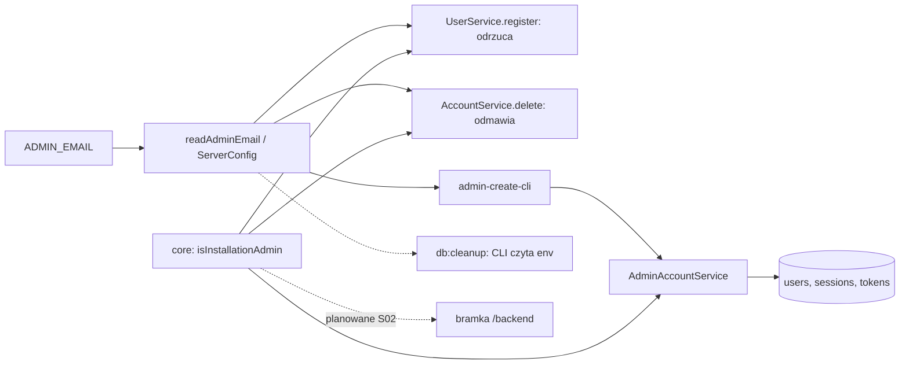

# Konto administratora instalacyjnego: `ADMIN_EMAIL` i `npm run admin:create` (E08-S01 #157, E08-S01-T01 #156)

> Status: **szkic autonomiczny** (`om-auto-write-spec`), czeka na zatwierdzenie właściciela. Epik E08 #155. Autorytet wymagań: `.ai/specs/product-brief.md` (D-32, BR-35) i `research/decisions/2026-10-31-admin.md`. Jedna specyfikacja, jeden PR implementacji, bo zadanie #156 (konfiguracja) nie ma sensu bez #157 (polecenie i reguły konta).

## 📝 TLDR

Dziś aplikacja nie zna pojęcia administratora, a panel `/backend` nie ma bramki (#152, doraźnie zamykany przez #154). Po wdrożeniu (zachowanie przyszłe) rola administratora instalacyjnego wynika z konfiguracji `ADMIN_EMAIL` (wymaganej w produkcji, fail closed), a konto powstaje **wyłącznie** poleceniem operatora `npm run admin:create`, które zakłada konto albo przejmuje istniejące (nowe hasło, potwierdzony e-mail, unieważnione sesje) w jednej transakcji. Rejestracja przez stronę na `ADMIN_EMAIL` jest odrzucana tym samym komunikatem co zajęty e-mail, a konta nie da się usunąć, zmienić mu e-maila ani skasować regułą `unverifiedUsers`. Powód: zamknięcie wektora przejęcia panelu, który pokaże e-maile wszystkich graczy (A-11). Bramka panelu to osobna historyjka (E08-S02 #158).

## Resolved assumptions (autonomous defaults)

Brief rozstrzyga rdzeń (D-32, BR-35). Poniżej to, czego nie rozstrzyga. Wiersze z `⚠` należą do właściciela. Żaden nie blokuje implementacji kodu: Q11 wpływa tylko na treść uwagi w `README.md`, Q12 jest przyjętym ryzykiem resztkowym, o ile właściciel nie zgłosi sprzeciwu przed scaleniem PR-a implementacji.

| # | Pytanie | Zastosowane założenie | Dlaczego | Potwierdzenie |
|---|---|---|---|---|
| Q1 | Gdzie żyje polecenie? | `packages/app/src/cli/admin-create-cli.ts` (wejście, wzorzec `db:cleanup`) + logika w `AdminAccountService` (`packages/app/src/server/services/auth/`). Skrypt `admin:create` w `packages/app/package.json` (`tsx`) i w rootowym `package.json` (`npm run admin:create -w @gomoku/app --silent`). CLI **nie** używa `container.ts` (`server-only`), składa własny, mały graf zależności. | Hasher, `SessionService`, `invalidateResetTokens` żyją w `app`; `db` nie może zależeć od `app`. Zakres zgłoszenia też wskazuje `packages/app`. | odwracalne |
| Q2 | Skąd hasło? | Tylko interaktywny monit bez echa (dwukrotnie) albo, bez TTY, jedna linia ze standardowego wejścia. **Brak** flagi `--password` i zmiennej środowiskowej na hasło. | Argument widać w `ps`, zmienną w `/proc/<pid>/environ` i `docker inspect`. | odwracalne |
| Q3 | Nazwa gracza | Flaga `--name` albo monit; używana **tylko przy zakładaniu**. Przy przejęciu nazwa konta zostaje (ostrzeżenie, gdy `--name` się różni). Walidacja jak rejestracja; zajęta nazwa = błąd operatora (wolno ją ujawnić). | Najmniejsza zmiana cudzego konta; `displayNameKey` jest unikalny. | odwracalne |
| Q4 | Potwierdzenie przejęcia | Gdy konto istnieje, CLI pokazuje jego nazwę i datę założenia i pyta `[t/N]`; `--yes` pomija pytanie. Bez TTY i bez `--yes` przejęcie kończy się błędem. | Przejęcie jest destrukcyjne (hasło, sesje); pytanie chroni przed pomyłką na bazie dev. | odwracalne |
| Q5 | Brak/zły `ADMIN_EMAIL` w CLI | Zawsze błąd (kod 1), także poza produkcją; walidacja tym samym `emailSchema` co rejestracja. | `admin:create` bez adresu nie ma celu; brak konfiguracji nie może „po cichu” założyć konta. | odwracalne |
| Q6 | Błąd konfiguracji w produkcji | Jak `APP_ORIGIN`: `readServerConfig` rzuca (trasy rozwiązujące `serverConfig` zwracają `500`, `/api/health` działa), a `compose.prod.yaml` dodatkowo odmawia startu (`${ADMIN_EMAIL:?…}`). Zgłoszenie mówi „błąd startu”: w tej aplikacji proces startuje, a błąd konfiguracji wychodzi przy pierwszym użyciu `serverConfig` (trasy `500`), natomiast start stosu produkcyjnego zatrzymuje dopiero `compose`. Kopiujemy to rozdzielenie. | Spójność z istniejącym wzorcem; brak własnej ścieżki wyjątku. | odwracalne |
| Q7 | Wpis o wykonaniu | Jedna linia JSON na stdout (`{"ok":true,"action":"created"\|"taken_over","userId":…,"revokedSessions":n}`), błędy na stderr; bez hasła, skrótu i adresu. Bez zapisu w bazie (dziennik audytowy to BR-38, poza v1). | Wzorzec `db:cleanup`; wpis trafia do terminala operatora. | odwracalne |
| Q8 | Zmiana e-maila konta administratora | Dziś nie istnieje żadna ścieżka zmiany `users.email`; kryterium spełnia brak takiej ścieżki, a **test strażnik** pilnuje, żeby żadna się nie pojawiła bez decyzji (patrz plan, krok 9). | Nie budujemy funkcji tylko po to, żeby ją zablokować. | odwracalne |
| Q9 | Dwa równoległe uruchomienia `admin:create` | Jedna próba ponowienia po `UniqueConstraintViolationException` (e-mail lub nazwa), potem błąd. | Rzadka sytuacja dwóch operatorów; ponowienie jest tanie. | odwracalne |
| Q10 | Zakres `unverifiedUsers` | `cleanupExpired` dostaje opcjonalną listę chronionych e-maili; CLI `db:cleanup` czyta z niej `ADMIN_EMAIL` (znormalizowany przez `normalizeEmail`). Reguła nie kasuje konta o takim e-mailu. | `db` zależy od `core`, nie od `app`; reguły są statycznym SQL, więc wyjątek to związany parametr. Po `admin:create` konto i tak jest potwierdzone, to druga warstwa obrony (np. ręczna zmiana w bazie). | odwracalne |
| Q11 | Los poprzedniego administratora po zmianie `ADMIN_EMAIL` (Q-15) | **Nie rozstrzygamy.** W v1 rola wynika wyłącznie z konfiguracji, więc stare konto po zmianie zmiennej staje się zwykłym graczem (traci też ochronę przed usunięciem), a nowy adres wymaga `admin:create` (przejmie konto, jeśli już istnieje). Reguła „rolę zachowuje tylko, jeśli nadana w bazie” z BR-35 jest propozycją agenta i nie ma zastosowania, dopóki nie ma pola `role`. | Q-15 jest otwartym pytaniem właściciela, nieblokującym v1, wymaganym przed nadawaniem roli (BR-36). | **⚠ NEEDS HUMAN CONFIRMATION** (właściciel: czy ta konsekwencja v1, w tym utrata ochrony starego konta, jest akceptowalna) |
| Q12 | Sesja założona równolegle z przejęciem | Przyjmujemy jako **ryzyko resztkowe** (sekcja Risks): logowanie weryfikuje stare hasło poza transakcją i tworzy sesję osobno, więc w milisekundowym oknie obca osoba znająca *stare* hasło mogłaby dostać sesję po `revokeAll`. Nie zmieniamy ścieżki logowania w tej historyjce. | Wymaga wcześniejszej znajomości hasła do istniejącego konta na adresie właściciela; domknięcie (np. warunek na skrót hasła przy tworzeniu sesji) to osobna zmiana we współdzielonym kodzie auth. | **⚠ NEEDS HUMAN CONFIRMATION** (właściciel: akceptacja ryzyka albo osobne zgłoszenie) |

## 📝 Problem Statement

- **Kto:** właściciel instancji (administrator instalacyjny) i operator z dostępem do serwera. To potrzeba właściciela (A-10), nie obserwacja graczy; dowodu popytu poza jego wypowiedzią nie ma.
- **Dziś:** brak `ADMIN_EMAIL`, brak polecenia, brak ochrony konta. `UserService.register` przyjmuje dowolny e-mail, a link potwierdzający trafia na skrzynkę tego adresu (A-11).
- **Zagrożenie, które to zamyka:** obca osoba rejestruje się na adres właściciela z własnym hasłem, właściciel klika link, konto atakującego ma potwierdzony e-mail i (po S02) panel z e-mailami graczy. Wariant „rola po potwierdzeniu e-maila” odrzucono właśnie dlatego (decyzja 2026-10-31).
- **Poza zakresem:** panel i jego bramka (S02 #158, zastąpi bramkę doraźną z #154), nadawanie roli i dziennik audytowy (BR-36, BR-38), pole `role` w bazie, 2FA (N-12), zmiana `ADMIN_EMAIL` jako funkcja (Q-15).

## 📝 Proposed Solution

Pięć elementów, wszystkie z konfiguracji i istniejących prymitywów:

1. **Konfiguracja (#156).** `ServerConfig.adminEmail?: string`. `readAdminEmail(env, production)` w `config.ts`: pusta wartość poza produkcją = `undefined` (nikt nie jest administratorem), w produkcji = błąd `ADMIN_EMAIL is required in production.`; wartość przechodzi przez `emailSchema` z `core` (błąd `ADMIN_EMAIL must be a valid e-mail address.`) i `normalizeEmail`. Tę samą funkcję wywołuje CLI.
2. **Reguła domenowa w `core`.** Czysta funkcja `isInstallationAdmin(email, adminEmail)` (normalizuje oba argumenty, `false` przy braku `adminEmail`) oraz stały komunikat odmowy usunięcia. To jedyne miejsce porównania; S02 użyje tej samej funkcji przy każdym żądaniu (rola z konfiguracji, nie z bazy).
3. **Polecenie `admin:create` (#157).** `AdminAccountService.provision({ email, displayName?, passwordHash })` w jednej transakcji z blokadą wiersza użytkownika (poniżej).
4. **Zamknięcie ścieżek.** `UserService.register` odrzuca `ADMIN_EMAIL`; `AccountService.delete` odmawia; `db:cleanup` omija konto.
5. **Wdrożenie.** `ADMIN_EMAIL` w `compose.prod.yaml` (`${ADMIN_EMAIL:?set ADMIN_EMAIL in .env.production}`), opis w `.env.example` i `.env.production.example` (plików `.env*` z wartościami nie czytamy ani nie commitujemy) oraz w `README.md`.

Odrzucone alternatywy: flaga `--password` (widoczna w `ps`); zmienna `ADMIN_PASSWORD` (widoczna w środowisku procesu); rola w polu bazy (punkt eskalacji, poza v1); `admin:create` jako endpoint HTTP (rozszerza powierzchnię ataku, wbrew A-11).

## 📝 Architecture

Istniejące: `register`, `delete`, `SessionService.revokeAll`, `invalidateResetTokens`, `PasswordHasher`, `createOrm`. Nowe: `readAdminEmail`, `isInstallationAdmin`, `AdminAccountService`, CLI, parametr czyszczenia. Planowane (S02): bramka sesji i roli w `(backend)`. Wniosek: cała reguła „kto jest administratorem” ma jedno źródło (konfiguracja) i jedną funkcję porównującą.

Graf zależności pakietów bez zmian: `app → core, db`; `db → core` (CLI `db:cleanup` używa `normalizeEmail` z `core`).

### `admin:create` krok po kroku

1. Wejście: `loadEnvConfig` z `forceReload` (lekcja 2026-10-28, tak jak `cleanup-cli.ts`); zmienne procesu wygrywają, więc `docker exec` widzi `DATABASE_URL` i `ADMIN_EMAIL` kontenera.
2. `readAdminEmail` (błąd = kod 1, komunikat na stderr). Na stderr wypisz cel bazy jako `host:port/nazwa` **bez danych logowania** (lekcja 2026-10-28: na bazie dev to świadoma operacja).
3. Parsowanie flag (`--name`, `--yes`); nieznana flaga = błąd.
4. Hasło (Q2), walidacja `newPasswordSchema` (BR-28: co najmniej 8 znaków, najwyżej 72 bajty UTF-8; błąd z czytelnym komunikatem i ponowny monit na TTY, kod 1 bez TTY). Skrót bcrypt liczony **przed** transakcją (lekcja: bcrypt nie trzyma połączenia), koszt z `PASSWORD_HASH_COST`/`readServerConfig`-owego parsera tak jak aplikacja.
5. `createOrm({ ensureDatabase: false, pool: { min: 0, max: 1 } })`, `em.fork()`, zawsze `orm.close()`.
6. Transakcja (`em.transactional`, zapisy tylko przez `tx`, surowy SQL przez `tx.execute` z `?`; porządek blokad users → … zgodny ze standardami, tu dotykamy tylko `users`, `sessions`, tokeny):
   - `select id, display_name, created_at from users where email = ? for no key update`;
   - brak wiersza: wstaw użytkownika (`email` znormalizowany, `displayName`, `displayNameKey = normalizeDisplayName`, `passwordHash`, `emailVerifiedAt = now`); wynik `created`;
   - jest wiersz: po potwierdzeniu (Q4) `update users set password_hash = ?, email_verified_at = coalesce(email_verified_at, ?) where id = ?`, `SessionService.revokeAll(userId, tx)`, `invalidateResetTokens(userId, tx)` oraz usunięcie nieużytych tokenów weryfikacji e-maila; wynik `taken_over`. Pytanie o potwierdzenie zadaje CLI **przed** transakcją na podstawie odczytu bez blokady, a transakcja i tak działa pod blokadą (odczyt może się zdezaktualizować; skutek jest ten sam, bo zapis jest idempotentny).
7. Wynik: linia JSON (Q7), kod 0. Każdy błąd: komunikat bez wartości wierszy i bez hasła, kod 1.

Idempotencja: powtórne uruchomienie to kolejne przejęcie (rotacja hasła i unieważnienie sesji); konto już będące administratorem nie jest błędem. To też ścieżka odzyskania dostępu (A-12).

### Uruchomienie w kontenerze produkcyjnym

Obraz zawiera `tsx` i kod pakietów (jak `db:cleanup`). Zalecane: `docker compose --env-file .env.production -f compose.prod.yaml exec -it app npm run -s admin:create -- --name "Nazwa"` (potrzebne `-it` dla monitu bez echa; kontener `app` musi działać). Alternatywa `docker compose run --rm -it app npm run -s admin:create` działa tylko, gdy `postgres` jest zdrowy i dziedziczy środowisko z `compose.prod.yaml`; `run` wymaga wartości `ADMIN_EMAIL` z `--env-file` (bez niej compose odmówi). Bez TTY: `printf '%s\n' "$HASLO" | docker compose … exec -T app npm run -s admin:create -- --name Nazwa --yes` (operator odpowiada za historię powłoki; README to mówi). Kopię polecenia opisujemy w `README.md` obok cron-a sprzątania.

## 📝 Data Model

Bez migracji i bez pola `role` (BR-35, v1). Używane kolumny `users`: `email` (unikalny, znormalizowany), `display_name`, `display_name_key`, `password_hash`, `email_verified_at`. Zapisywane dane wrażliwe: tylko skrót bcrypt; hasło żyje wyłącznie w pamięci procesu CLI i nie trafia do logów, wyjątków ani wyniku.

## 📝 API Contracts

Brak nowych endpointów. Zmiany zachowania istniejących:

- `POST /api/auth/register` z e-mailem równym `ADMIN_EMAIL` po `normalizeEmail`: ten sam wyjątek (kod, status, komunikat `EMAIL_TAKEN_MESSAGE`) co zajęty e-mail w `#conflictFor`. Skrót hasła jest liczony **przed** odrzuceniem (czas odpowiedzi nie zdradza decyzji), odrzucenie następuje przed transakcją, więc nie powstaje wiersz, sesja ani wiadomość weryfikacyjna. Limit prób rejestracji (5 / h na adres) zużywa się jak zwykle. Odrzucenie dotyczy też żądania z zajętą nazwą gracza: odpowiedź jest zawsze komunikatem o e-mailu.
- `DELETE` konta (`AccountService.delete`) dla administratora instalacyjnego: `ForbiddenError` (403, nowy kod `ADMIN_ACCOUNT_PROTECTED`, komunikat PL, np. „Tego konta nie można usunąć.”) rzucany po odczycie użytkownika, **przed** weryfikacją hasła i przed `settleFor`. Dodatkowo kontrola w transakcji po blokadzie wiersza (adres odczytany pod blokadą), żeby wyścig z `admin:create` nie przepuścił usunięcia. Kontrakt UI konta: formularz usuwania musi pokazać ten błąd (komunikat z odpowiedzi, `role="alert"` jak inne błędy formularza); nie ukrywamy przycisku, bo UI konta nie zna roli w tej historyjce.
- Reset hasła (BR-27) działa dla administratora jak dla każdego z potwierdzonym e-mailem (A-12); bez zmian kodu.

Zmiany kontraktów wewnętrznych: `ServerConfig` zyskuje `adminEmail`, `cleanupExpired` opcjonalny parametr chronionych e-maili (dodany opcjonalnie, więc wywołania z `db` i testy bez parametru działają bez zmian; `cleanupExpired` nie jest powierzchnią chronioną w `BACKWARD_COMPATIBILITY.md`, a format wyniku `db:cleanup` się nie zmienia); `UserService` i `AccountService` dostają `adminEmail` przez Deps (rejestrowane leniwie w `container.ts`, `asFunction` z `serverConfig`).

## 📝 UI/UX

Brak nowych ekranów. Jedyny komunikat widoczny dla graczy: istniejący `EMAIL_TAKEN_MESSAGE` (bez zmiany treści, żeby nie powstał oracle) oraz błąd odmowy usunięcia konta administratora w formularzu usuwania. CLI jest tekstowe po polsku: komunikaty kończą się kropką, błędy idą na stderr, bez kolorów i animacji (czytelne w czytnikach ekranu i w logach), a monit hasła wypisuje etykietę, nie pokazuje znaków i kończy wiersz po Enter.

## 📝 Edge Cases & Failure Scenarios

| Sytuacja | Zachowanie |
|---|---|
| Brak `ADMIN_EMAIL`, produkcja | `readServerConfig` rzuca; trasy z `serverConfig` dają `500`, `/api/health` działa; `compose.prod.yaml` odmawia startu. |
| Brak `ADMIN_EMAIL`, dev | Aplikacja działa, `isInstallationAdmin` zawsze `false`; rejestracja i usuwanie bez ograniczeń; `admin:create` kończy się błędem (Q5). |
| `ADMIN_EMAIL` z wielkimi literami i białymi znakami | Normalizacja jak `normalizeEmail`; po obu stronach porównania. Wartość nie-e-mail = błąd konfiguracji. |
| Rejestracja `  Admin@Example.COM ` | Odrzucona; schemat rejestracji też normalizuje, więc porównanie widzi `admin@example.com`. |
| Konto na `ADMIN_EMAIL` zajęte przez obcego (przejęcie) | Po potwierdzeniu: nowe hasło, e-mail potwierdzony, sesje i tokeny unieważnione; nazwa zostaje. |
| Konto już administrator | Kolejne przejęcie (rotacja hasła); bez błędu. |
| Hasło krótsze niż 8 znaków lub dłuższe niż 72 bajty | Odrzucone (BR-28), bez skracania; na TTY ponowny monit. |
| Dwa różne wpisy hasła na TTY | Błąd i ponowny monit (do 3 prób), potem kod 1. |
| Ctrl+C / koniec wejścia w monicie | Kod 130/1, tryb raw terminala przywrócony, nic nie zapisane. |
| Brak TTY i brak hasła na stdin | Kod 1 z komunikatem, bez zawieszenia. |
| Zajęta nazwa gracza przy zakładaniu | Błąd operatora z nazwą pola; nic nie zapisane. |
| Wyścig `admin:create` z samousunięciem | Blokada wiersza serializuje; usunięcie po przejęciu kończy się odmową (administrator) lub błędem hasła (zmieniony skrót), usunięcie przed przejęciem: `admin:create` zakłada konto od nowa. |
| Wyścig `admin:create` z rejestracją | Nie występuje na tym adresie, bo rejestracja jest odrzucana przed bazą; wyścig z inną rejestracją dotyczy tylko nazwy gracza (unikalność w bazie, Q9). |
| Wyścig z `changePassword` obcego konta | `UPDATE … WHERE password_hash = <stary>` nie trafia po zatwierdzeniu przejęcia: `INVALID_CURRENT_PASSWORD`. |
| `unverifiedUsers` a administrator | Konto o `ADMIN_EMAIL` nie jest kasowane, nawet z `email_verified_at is null`, bez partii i starsze niż 14 dni. |
| Awaria bazy / brak migracji | Komunikat zamaskowany jak w `db:cleanup` (`classifyError`), kod 1, bez parametrów połączenia. |
| Zmiana `ADMIN_EMAIL` po wdrożeniu | Patrz Q11: stare konto traci status, nowy adres wymaga `admin:create`. Bez dodatkowej logiki. |
| Awaria poczty (Q-02) | Administrator odzyskuje dostęp ponownym `admin:create` (A-12). |

## 📝 Risks & Impact Review

- **Wysokie (risk-high):** przejęcie konta i unieważnianie sesji; błąd w normalizacji otworzy wektor A-11. Łagodzenie: jedna funkcja porównująca, testy wariantów wielkości liter i białych znaków (przed implementacją), test integracyjny.
- **Ryzyko resztkowe (Q12 ⚠):** okno wyścigu logowania ze starym hasłem opisane wyżej.
- **Przyjęte przez właściciela:** brak 2FA i ponownego uwierzytelnienia; jedno konto z dostępem do e-maili graczy po S02.
- **Kompatybilność:** nowa wymagana zmienna produkcyjna to zmiana operacyjna; wdrożenie bez niej zatrzyma `docker compose up` (świadome, jak `APP_ORIGIN`). Przed aktualizacją operator musi dopisać `ADMIN_EMAIL` do `.env.production` (README i opis PR to mówią, `BACKWARD_COMPATIBILITY.md`: zmiana zmiennych wymaga aktualizacji `.env.example`, README, CI i `global-setup.ts` w tym samym PR). Wycofanie: usunięcie zmiennej wymaga cofnięcia kodu; brak zmian schematu, więc rollback to samo cofnięcie obrazu. Konta już założone z `ADMIN_EMAIL` przed wdrożeniem pozostają i są przejmowane przez `admin:create`.
- **Zależność od #154/S02:** bramka doraźna z #154 zostaje do czasu S02, który ją zastąpi; ta historyjka jej nie dotyka.
- **Reguły repozytorium:** CLI i serwis muszą trzymać 100% pokrycia na plik; kod trudny do testu (TTY) rozbijamy na wstrzykiwane strumienie, bez `v8 ignore`. Rzeczywiste działanie bez echa na prawdziwym terminalu jest sprawdzane ręcznie (patrz Validation limits).

## 📝 Decisions in play

D-32, BR-35 (konto wyłącznie przez `admin:create`, rola z konfiguracji), BR-14 (wyjątek widoczności e-maila dotyczy S02), BR-16 (jednolity komunikat), BR-26/BR-27 (potwierdzony e-mail umożliwia reset), BR-28 (hasło 8–72 bajty, reguła `unverifiedUsers`), N-12, A-10, A-11 (zamykane testem tu), A-12 (test resetu i ręczny `admin:create` na kopii konfiguracji), Q-13/Q-14 (poza zakresem), Q-15 (otwarte, Q11 powyżej). Nic z tej listy nie jest nadpisywane.

## 📋 Phasing

Jedna faza, jeden PR (reguła „jeden PR na funkcję”): zadanie #156 (krok 1, konfiguracja) i historyjka #157 (kroki 2–11; krok 2 to wspólna reguła `core`) razem. Testy A-11 powstają **przed** implementacją reguł (krok 3).

## 📋 Implementation Plan

Każdy krok zostawia aplikację działającą i zielone testy; wymagane 100% pokrycia na plik.

1. **Konfiguracja `ADMIN_EMAIL` (#156).** `readAdminEmail` i pole `ServerConfig.adminEmail` w `packages/app/src/server/config.ts`; testy w `config.test.ts`: wielkość liter i białe znaki, brak w dev, brak w produkcji (błąd), pusty łańcuch, nie-e-mail, `readServerConfig` przekazuje wartość. `compose.prod.yaml`, `.env.example`, `.env.production.example`, `tests/integration/global-setup.ts` (stała wartość `ADMIN_EMAIL` dla `next start` w produkcji; bez niej wszystkie testy integracyjne dostałyby `500`) i `README.md` (sekcja kont). Sprawdź `npm run setup` i job CI `setup` (dev bez zmiennej ma działać).
2. **Reguła domenowa w `core`.** `isInstallationAdmin` i stała komunikatu; eksport z `index.ts`; testy: normalizacja obu stron, `undefined`, pusty łańcuch.
3. **Testy A-11 przed regułą (ten sam commit co krok 4, żeby historia była zielona).** Najpierw napisz je i zobacz je czerwone lokalnie, potem krok 4. Jednostkowe `UserService.register`: warianty `Admin@X.com`, `  admin@x.com  `, `ADMIN@X.COM` odrzucone `EMAIL_TAKEN_MESSAGE`, bez zapisu, sesji i wiadomości; hasher wywołany; nazwa zajęta + `ADMIN_EMAIL` daje komunikat o e-mailu. Integracyjny `tests/integration/admin-account.test.ts` (HTTP): rejestracja na `ADMIN_EMAIL` w wariantach daje tę samą odpowiedź (status, kod, treść) co zajęty zwykły e-mail i nie tworzy wiersza.
4. **Rejestracja.** `adminEmail` w Deps `UserService` i `AccountService` (jedno miejsce: rejestracja `asFunction` z `serverConfig` w `container.ts` + test kontenera, wykonana tu raz, krok 5 tylko z niej korzysta); odrzucenie po haszowaniu, przed transakcją.
5. **Usuwanie konta.** `AccountService.delete`: `ForbiddenError` `ADMIN_ACCOUNT_PROTECTED` przed hasłem oraz kontrola pod blokadą w transakcji; testy: samousunięcie administratora odmówione (bez wywołania `verify` i bez zapisów), zwykły użytkownik bez zmian, brak `adminEmail`; formularz usuwania pokazuje błąd (`renderToStaticMarkup`/testing-library jak dotychczasowe testy strony konta) i integracja HTTP 403.
6. **`AdminAccountService`.** Tworzenie, przejęcie, idempotencja, unieważnienie sesji i tokenów, kolizja unikalności z jednym ponowieniem; testy jednostkowe z fałszywym `em` oraz **test na prawdziwym PostgreSQL** (lekcje: `tx`, `?` w `em.execute`, rollback, blokada): dwa równoległe `provision`, `provision` równolegle z `AccountService.delete`, błąd w połowie cofa zmianę hasła.
7. **CLI.** `admin-create-cli.ts` + wydzielone, wstrzykiwalne: `readSecret` (strumienie TTY i nie-TTY, backspace, Ctrl+C, brak echa), parser flag, `runAdminCreate({ env, stdin, stdout, stderr, createOrm, … })` w stylu `runCleanup`; skrypty w `package.json` (app i root), `tsx` w `devDependencies` aplikacji (obraz instaluje je przez `npm ci`); testy jednostkowe wszystkich gałęzi (brak e-maila, zły e-mail, walidacja hasła, potwierdzenie, `--yes`, brak TTY, błąd bazy zamaskowany, wynik bez hasła).
8. **Sprzątanie.** Parametr chronionych e-maili w `cleanupExpired`/`run-cleanup`, `cleanup-cli.ts` czyta `ADMIN_EMAIL`; test jednostkowy i scenariusz w `tests/integration/cleanup.test.ts`: niepotwierdzony administrator bez partii sprzed 15 dni zostaje, zwykły niepotwierdzony znika; sprawdzone na PostgreSQL.
9. **Test strażnik zmiany e-maila.** Zwykły plik testowy w `packages/app` (nie dodaje kodu produkcyjnego, więc pokrycia nie dotyczy) skanujący źródła bez testów w poszukiwaniu zapisów do `users.email` poza listą dozwolonych plików (`user-service.ts`, `admin-account-service.ts`); nowa ścieżka musi świadomie rozszerzyć listę i zająć się regułą administratora. Test jest heurystyką (może dać fałszywy alarm), dlatego uchylenie go jest odwracalne. Zapisz regułę w komentarzu encji `User`.
10. **Integracja i dokumentacja.** Test integracyjny uruchamiający prawdziwy proces `npm run admin:create` (hasło ze stdin, `--yes`, `DATABASE_URL` Testcontainers; **nigdy** inna baza): zakłada konto, loguje się nim zwykłym logowaniem (cookie sesji), potem przejmuje konto założone wcześniej przez obcego (sesje obcego dostają 401, stare hasło nie działa, e-mail potwierdzony), reset hasła administratora przez skrzynkę `file` (A-12), kolejne uruchomienie jest idempotentne. `README.md`: polecenie w kontenerze (`exec`/`run`), uwaga o historii powłoki, o bazie dev i o Q-15. Brief: odhacz A-11 (po zielonych testach) i A-12 w PR implementacji, nie w tym.
11. **Weryfikacja.** `npm run check` z Dockerem; ręcznie (czego nie pokrywa krok 10): monit bez echa na prawdziwym terminalu i `docker compose … exec -it app npm run -s admin:create` na kopii konfiguracji produkcyjnej; `git diff --stat` bez migracji i snapshotu.

## 🧪 Validation limits

Specyfikacja nie była uruchamiana: wnioski o kodzie pochodzą z odczytu `origin/main` (`config.ts`, `UserService`, `AccountService`, `SessionService`, reguły `db:cleanup`, `compose.prod.yaml`). Pliki `.env*` nie były czytane. Nie sprawdzono na prawdziwym terminalu zachowania monitu bez echa ani poleceń `docker compose exec/run` na serwerze produkcyjnym (A-12 wymaga ręcznej próby). Założenie A-11 pozostaje nieprzetestowane do czasu kroków 3 i 10. Wątek prawny dostępu administratora do e-maili (Q-14) dotyczy S02, nie tej historyjki.
