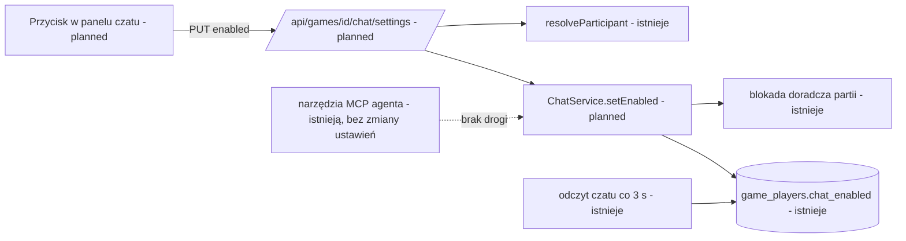
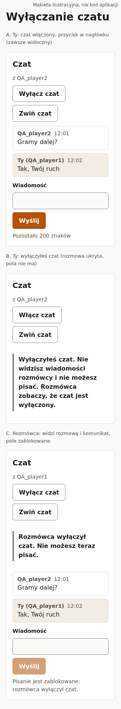
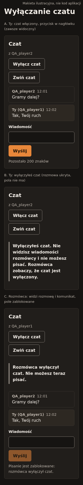

# Wyłączenie czatu w partii przez uczestnika (E07-S02, #147)

> Status: **do przeglądu; właściciel zatwierdził specyfikację z góry** (zakres S02, bez nowych ⚠).
>
> Źródło: zgłoszenie #147 (E07-S02), epik #144, zależność E07-S01 (#146, zaimplementowane w PR #169); `.ai/specs/product-brief.md` na `origin/main`: D-30, D-31, BR-32, BR-33, N-11, A-08, Q-10; `.ai/specs/2026-10-31-game-chat.md` (sekcje R2, R14, „Kontrakty dla S02, S03, S04”, „Adnotacje implementacji”); kod: `ChatService`, `deriveChatState`, `chat-panel.tsx`, `use-chat.ts`, `resolveParticipant`, `mcp-endpoint.test.ts`.
>
> Zakres: **tylko S02** (zapis ustawienia, trasa, przycisk, komunikaty, testy). Odczyt stanów `disabled_by_you` / `disabled_by_opponent`, blokadę `send` i kolumnę `game_players.chat_enabled` dostarczył S01; ta specyfikacja ich nie powtarza, tylko na nich buduje. S03 (kasowanie) i S04 (agent) bez zmian.

## 📝 TLDR

Dziś uczestnik partii nie ma jak się odciąć od rozmówcy: czat da się wyłączyć tylko ręczną zmianą kolumny w bazie (fixture testowy z S01). **Zachowanie przyszłe:** w panelu czatu pojawia się przycisk „Wyłącz czat” / „Włącz czat”. Wyłączenie dotyczy wyłącznie wyłączającego (nie widzi wiadomości i nie pisze), jest per partia, nie jest nigdzie zapamiętywane, a rozmówca widzi „Rozmówca wyłączył czat”, nie może pisać i nadal widzi dotychczasową rozmowę. Zapis to jedno nowe wywołanie `PUT /api/games/[id]/chat/settings` i metoda `ChatService.setEnabled`. Agent nie dostaje narzędzia do zmiany (D-31). To jedyna ochrona przed nękaniem w v1 (N-11, A-08); spec nie udaje, że rozwiązuje więcej.

## Resolved assumptions (autonomous defaults)

Zatwierdzone decyzje D-30, D-31, BR-32, BR-33, N-11 oraz założenia R2 i R14 ze specyfikacji S01 (wcześniej zaakceptowane przez właściciela) nie są otwierane ponownie. Poniżej tylko luki, które pozostawia zgłoszenie. **Brak wierszy ⚠ NEEDS HUMAN CONFIRMATION**: każde założenie jest odwracalne i mieści się w BR-33.

| # | Pytanie | Zastosowane założenie | Dlaczego | Potwierdzenie |
|---|---|---|---|---|
| S2-1 | Kiedy wolno zmienić ustawienie? | Gdy czat nie jest `unavailable` ani `closed` (partia `active` albo `finished` w oknie 1 h, ta sama reguła co zapis wiadomości). Inaczej `409 CHAT_UNAVAILABLE`. Przycisk jest od chwili, gdy panel pokazuje czat, **bez warunku „po pierwszej wiadomości”**. | Spójne z `deriveChatState`; A-08 mówi, że wyłączenie „działa dopiero po pierwszej wiadomości”, bo obcy pisze pierwszy, a nie dlatego, że przycisk jest zablokowany. Odcięcie się z wyprzedzeniem jest tanie i dozwolone. | odwracalne |
| S2-2 | Odpowiedź zapisu | `200 { state }` (stan czatu **po** zapisie, dla wywołującego), `Cache-Control: no-store`. Bez treści wiadomości. Powtórka tej samej wartości jest bez zapisu i też `200`. | Kontrakt S01 dopuszcza 204/200; stan pozwala klientowi zareagować bez dodatkowego odczytu i ujawnia tylko to, co ujawnia odczyt. Idempotencja = bezpieczne ponowienie po błędzie sieci. | odwracalne |
| S2-3 | Kolejność względem `send` | `setEnabled` bierze **tę samą blokadę doradczą partii** co `send`. Wiadomość rozmówcy zatwierdzona przed zapisem zostaje (wyłączający zobaczy ją po ponownym włączeniu, R2); po zapisie rozmówca dostaje `409 CHAT_DISABLED`. | Jedna kolejność zdarzeń zamiast wyścigu; blokada jest krótka i już istnieje. | odwracalne |
| S2-4 | Ograniczanie częstotliwości przełączania | **Brak** osobnego limitu. Powtórka tej samej wartości nic nie zapisuje; zmiana to jeden `UPDATE` jednego wiersza. Nadużycie (migotanie komunikatu u rozmówcy) jest kosmetyczne i ograniczone ogólnymi mechanizmami API. | N-11 (brak moderacji) i mały zakres; osobny kubełek to nowa powierzchnia. Sygnał do zmiany: skarga na migotanie (Q-10). | odwracalne |
| S2-5 | Szkic wiadomości przy wyłączeniu | Pole wiadomości znika wraz z wyłączeniem, więc **szkic jest tracony**. Po ponownym włączeniu pole jest puste. | Wyłączenie to świadoma decyzja „nie chcę pisać”; zachowanie szkicu wymagałoby trzymania pola w ukryciu, co komplikuje a11y. | odwracalne |
| S2-6 | Czy agent może wywołać zapis | **Nie, na trzech poziomach:** trasa `settings` rozpoznaje uczestnika przez `resolveParticipant` (sesja konta albo token gościa; token agenta jest innym mechanizmem i tej drogi nie ma), `ChatService.setEnabled` odrzuca `kind = agent` (`ForbiddenError`), a test ustala dokładną listę narzędzi MCP. | D-31, BR-33. Obrona w głąb jest tania i testowalna. | odwracalne |
| S2-7 | Potwierdzenie przed wyłączeniem | **Brak okna dialogowego.** Działanie jest w pełni odwracalne jednym kliknięciem, a okno spowolniłoby odcięcie się od nękania. | Zasada DS: potwierdzenie dla działań nieodwracalnych. | odwracalne |

## 📝 Problem Statement

- **Kto:** uczestnik partii (konto lub gość), który nie chce czatu z danym przeciwnikiem; rozmówca, który musi zrozumieć, że pisanie nie ma sensu (BR-33).
- **Dziś:** S01 czyta stan wyłączenia i blokuje `send`, ale nic nie potrafi go ustawić. Nękanie przez obcych z lobby (A-08) nie ma więc żadnej obrony poza zamknięciem karty.
- **Dowód:** brak; przesłanka i ryzyko to osąd właściciela (A-07, A-08). Spec opisuje najmniejszą wersję obrony, nie dowodzi, że wystarcza.
- **Poza zakresem (N-11):** zgłaszanie nadużyć, moderacja, blokowanie gracza między partiami, zapamiętane ustawienie na koncie, wyciszanie pojedynczych wiadomości, kasowanie własnych wiadomości.

## 📝 Proposed Solution

1. **`ChatService.setEnabled(participant, gameId, enabled)`** w istniejącym serwisie: jedna transakcja, blokada doradcza partii, odczyt kontekstu (`CONTEXT_SQL` z S01), sprawdzenie rodzaju uczestnika i stanu, `UPDATE game_players set chat_enabled = ? where id = ?` tylko gdy wartość się zmienia, zwrot stanu przez `deriveChatState` z nową wartością. Czas i kolejność jak w S01: z bazy i z blokady.
2. **Trasa `PUT /api/games/[id]/chat/settings`** (`apiHandler`, `resolveParticipant`, `withRequestScope`, `no-store`, nagłówek CSRF jak pozostałe zapisy). Ciało `{ enabled: boolean }`, schemat Zod w `core` (`chatSettingsSchema`, `.strict()`).
3. **Przycisk w nagłówku panelu czatu** (`chat-panel.tsx`) i metoda `setEnabled` w `useChat`.
4. **Komunikaty** po obu stronach z S01 (`disabled_by_you`, `disabled_by_opponent`), rozszerzony tekst dla wyłączającego.
5. **Alternatywy odrzucone:** (a) przełącznik (`switch`) zamiast przycisku: w DS nie ma komponentu, a nowe wymagają zgody właściciela (zasada 1 DS); przycisk ze zmienną etykietą spełnia to samo; (b) ustawienie na koncie lub w `localStorage`: zakazane przez BR-33; (c) wyłączenie przez `POST` na trasie czatu: miesza reguły wiadomości i ustawień, a `PUT` jest idempotentny z natury; (d) usuwanie wiadomości wyłączającego przy wyłączeniu: nieodwracalne i sprzeczne z R2; (e) osobny limit przełączania (S2-4).

## 📝 Architecture

- **Nowe (`planned`):** `core/src/validators/chat/chat-settings-schema.ts` (+ test), typ `ChatSettingsData = { state: ChatState }` w `core/src/chat/types.ts`; `ChatService.setEnabled` i stałe komunikatów w `chat-service.ts`; `app/src/app/api/games/[id]/chat/settings/route.ts` (+ test); `useChat.setEnabled`, przycisk i teksty w `chat-panel.tsx`; warianty stories w `packages/ui/docs/screens/chat-preview.tsx`.
- **Reużyte (istnieją):** `resolveParticipant`, `apiHandler`, `readJsonBody`, `apiCall` (metoda `PUT`), `withRequestScope`, `deriveChatState`, `CONTEXT_SQL`, `LOCK_GAME_SQL`, `Button` (`variant="secondary"`, `loading`), `Alert`, `Panel` z `@gomoku/ui/game/*`.
- **Bez migracji:** kolumna `game_players.chat_enabled boolean not null default true` istnieje (T01). Brak zmian w `db`, `ui` (poza stories w `docs/`) i w MCP.
- **Kierunek zależności** bez zmian. **Czego nie dotykamy:** `GameService`, `GameView`, `GET`/`POST /api/games/[id]/chat`, narzędzi MCP, `db:cleanup`.
- **Wpływ na istniejących konsumentów:** zmiana addytywna (nowa trasa, nowa metoda serwisu). Testy panelu czatu i strony partii wymagają aktualizacji o przycisk.

Wniosek: ustawienie to jedna kolumna zmieniana przez jeden serwis pod blokadą, którą już szanuje zapis wiadomości; rozmówca dowiaduje się z istniejącego odczytu, bez nowego kanału.

## 📝 Data Model

Bez zmian schematu. Ustawienie żyje wyłącznie w `game_players.chat_enabled` (per uczestnik, per partia). **Brak zapamiętywania (BR-33):** nie ma kolumny w `users`, ciasteczka, `localStorage` ani żadnej tabeli ustawień; nowa partia i rewanż to nowe wiersze `game_players` z domyślnym `true` (R14), więc stan nie przechodzi między partiami. Wyłączenie **nie kasuje** wiadomości (kasuje je S03 jak dotąd) i nie wpływa na wiadomości rozmówcy.

## 📝 API Contracts

Koperta `{ ok, data | error }` jak w S01.

**`PUT /api/games/[id]/chat/settings`** — ciało `{ "enabled": boolean }` (`chatSettingsSchema`, nieznane pola odrzucane, nie-boolean to `400`).

| Wynik | Kod | Uwagi |
|---|---|---|
| `200 { state }` | | stan po zapisie dla wywołującego: `open`, `disabled_by_you` albo `disabled_by_opponent`; powtórka tej samej wartości nie zapisuje |
| `400 VALIDATION` | | zły kształt ciała |
| `403` CSRF | | brak nagłówka, jak pozostałe zapisy |
| `404` | | nie-uczestnik, nieistniejąca partia, wygasły token gościa (jednolicie) |
| `403 FORBIDDEN` | | uczestnik `kind = agent` (obrona w głąb; trasa jest dla niego nieosiągalna) |
| `409 CHAT_UNAVAILABLE` | | `waiting`, `cancelled`, `closed` |

Macierz stanów `(moje, rozmówcy)` → stan dla mnie / dla rozmówcy (wynika z `deriveChatState`, bez zmian):

| mój | rozmówcy | ja widzę | rozmówca widzi |
|---|---|---|---|
| włączony | włączony | `open` | `open` |
| wyłączony | włączony | `disabled_by_you` (bez wiadomości) | `disabled_by_opponent` (rozmowa jest, pisać nie może) |
| włączony | wyłączony | `disabled_by_opponent` | `disabled_by_you` |
| wyłączony | wyłączony | `disabled_by_you` | `disabled_by_you` |

Wniosek z macierzy: wyłączający nie dowiaduje się, czy rozmówca też wyłączył, dopóki sam nie włączy; po włączeniu zobaczy `disabled_by_opponent`. Tak działa już odczyt z S01 i to jest zamierzone.

Kolejność kontroli w `setEnabled` (jedna transakcja, `tx`, zapisy tylko przez `tx`): blokada partii → `CONTEXT_SQL` → `kind = agent` → `ForbiddenError` → stan `unavailable`/`closed` → `ConflictError CHAT_UNAVAILABLE` → gdy `mine === enabled` zwrot stanu bez zapisu → `UPDATE` → stan. Naruszenie klucza obcego (partia znikła przez `db:cleanup`) to `NotFoundError`, jak w `send`. Zapytania z `?`, brak interpolacji; brak logowania; brak treści wiadomości w ścieżce.

## 📝 UI/UX

Makiety (ilustracyjne, nie kod aplikacji; wyłącznie propozycja): `.ai/specs/assets/chat-disable/mockup-01-wylaczenie-320-{light,dark}` (320 px, oba motywy). Zrzuty bieżącej aplikacji pominięte: panel czatu z S01 jest opisany makietami S01 (`assets/czat-w-partii/`), a uruchomienie stosu z bazą nie było potrzebne do tej zmiany.

**Umiejscowienie.** Przycisk jest w nagłówku panelu, obok „Zwiń czat”, więc jest osiągalny także przy zwiniętym panelu (kto chce uciec przed nękaniem, nie musi rozwijać rozmowy). Na 320–360 px przyciski zawijają się do drugiego wiersza (`flex-wrap`), każdy ma cel 44 px. Wariant `secondary`: wyłączenie nie jest główną akcją ekranu (zasada DS: jedna mocna akcja).

**Etykieta i nazwa dostępna.** Jeden element `<button>`, zmienna etykieta „Wyłącz czat” ↔ „Włącz czat” (bez `aria-pressed`, bo etykieta już niesie stan). Element nie jest odmontowywany przy zmianie, więc **fokus zostaje na przycisku**. Przy trwającym żądaniu `loading` (aria-busy, blokada drugiego kliknięcia; dodatkowo strażnik `useRef`, jak przy wysyłce).

**Stany** (zasada 6 DS):
- ładowanie pierwszego odczytu: przycisk zablokowany, powód „Wczytujemy czat…” (jak pole wiadomości);
- `open`: „Wyłącz czat”;
- `disabled_by_you`: „Włącz czat”; w miejscu rozmowy `role="status"`: „Wyłączyłeś czat. Nie widzisz wiadomości rozmówcy i nie możesz pisać. Rozmówca zobaczy, że czat jest wyłączony.” Brak listy i pola;
- `disabled_by_opponent`: komunikat z S01 „Rozmówca wyłączył czat. Nie możesz teraz pisać.”, rozmowa widoczna, pole zablokowane z powodem; **przycisk „Wyłącz czat” nadal dostępny** (można też odciąć się od widoku rozmowy);
- `unavailable` (partia oczekująca), `closed`, anulowana: **bez przycisku** (nic nie można zrobić; panel to zdanie albo go nie ma);
- błąd sieci: `Alert` „Nie udało się wyłączyć czatu. Spróbuj ponownie.” (analogicznie „włączyć”), stan bez zmian, przycisk znowu aktywny; ponowienie bezpieczne (`PUT` idempotentny); nigdy toast;
- `409 CHAT_UNAVAILABLE`: stan czytany od nowa, panel przechodzi w „zamknięty”/„niedostępny”;
- `404`: jak reszta czatu (`onGone`).

**Zachowanie danych w kliencie.** Po `200` klient stosuje `state` tak jak odczyt: dla `disabled_by_you` czyści listę i zeruje kursor; po powrocie do `open` albo `disabled_by_opponent` kursor jest pusty, więc następny odczyt (wywołany od razu) pobiera **ostatnie 50**, w tym wiadomości sprzed wyłączenia (R2). Odczyt rozpoczęty przed przełączeniem i kończący się po nim jest ignorowany (licznik „epoki” w `useChat`), a wynik `send` rozpoczętego przed wyłączeniem nie zmienia stanu ani listy (inaczej spóźniona odpowiedź ustawiłaby `open` na wyłączonym czacie).

**Rozmówca.** Dowiaduje się przy najbliższym odczycie: zwykle ≤ 3 s, w bezczynnym czacie (po 60 s bez wiadomości, R16) ≤ 10 s; próba wysyłki dostaje `409 CHAT_DISABLED` i wymusza natychmiastowy odczyt (już zrobione w S01). Wpisany szkic pozostaje w polu zablokowanym i wraca do użytku po ponownym włączeniu przez drugą stronę.

**Dostępność.** Przycisk z widoczną etykietą tekstową i celem 44 px; komunikaty w `role="status"` ogłaszają zmianę uprzejmie; stan nie jest przekazany samym kolorem ani ikoną; brak autofokusu. Ręcznie: czytnik ekranu czyta „Wyłącz czat, przycisk”, po aktywacji ogłasza „Wyłączyłeś czat…”, fokus zostaje na tym samym przycisku; klawiatura: Tab dociera do przycisku, Enter i spacja przełączają.

**Wygląd:** wyłącznie z komponentów i tokenów DS (`npm run check:tokens -w @gomoku/ui`); komponenty bez wbudowanych tekstów (teksty w `app`). Nowy komponent DS nie powstaje (alternatywa (a) w „Proposed Solution”). Stories `Ekrany/Partia`: dodać warianty „Czat wyłączony przez Ciebie”, „Czat wyłączony przez rozmówcę (z przyciskiem)”, „Błąd przełączenia”, 320 px; `npm run test:stories -w @gomoku/ui` w obu motywach.

## 📝 Edge Cases & Failure Scenarios

| Przypadek | Zachowanie |
|---|---|
| Wyłączenie przed pierwszą wiadomością | Dozwolone (S2-1); rozmówca widzi komunikat od razu przy odczycie, pierwsza wiadomość obcego nie powstaje (`409`). |
| Obcy zdążył wysłać pierwszą wiadomość (A-08) | Wyłączający ją widzi do chwili kliknięcia; po wyłączeniu znika z jego widoku (wraca po ponownym włączeniu). To znana, przyjęta luka, nie błąd. |
| Wiadomość rozmówcy i wyłączenie w tej samej chwili | Serializacja blokadą (S2-3): wiadomość przed zapisem zostaje zapisana, po zapisie `409 CHAT_DISABLED`. Test współbieżny na PostgreSQL. |
| Powtórka tego samego `PUT` (podwójny klik, ponowienie po błędzie sieci) | `200` z tym samym stanem, bez zapisu, bez błędu. |
| Dwie karty tego samego gracza | Ustawienie jest po stronie serwera; druga karta zobaczy stan przy najbliższym odczycie (≤ 3 s, ≤ 10 s w bezczynności). |
| Oboje wyłączyli, jedno włącza | Włączający widzi `disabled_by_opponent`; drugi nadal `disabled_by_you` (macierz). |
| Ponowne włączenie | Wiadomości sprzed wyłączenia wracają (ostatnie 50, R2); wiadomości z okresu wyłączenia nie istnieją, bo druga strona nie mogła pisać. |
| Przełączenie po zakończeniu partii | Dozwolone w oknie 1 h (czat `open` na ekranie wyniku); po oknie `409 CHAT_UNAVAILABLE`, panel „Czat jest już zamknięty.” |
| Partia `waiting` lub `cancelled` | Brak przycisku; wywołanie bezpośrednie `409 CHAT_UNAVAILABLE`. |
| Rewanż po wyłączeniu | Nowa partia: oba `chat_enabled = true`, czat pusty, bez śladu poprzedniego ustawienia (R14). |
| Odświeżenie strony / powrót do partii | Ustawienie pozostaje (jest per partia, po stronie serwera); znika wraz z partią. To nie jest „zapamiętywanie na koncie”. |
| Agent jako uczestnik | Brak narzędzia MCP, trasa nieosiągalna, serwis odrzuca; człowiek wyłączający widzi dla agenta `CHAT_DISABLED` z perspektywy S04 (`chatStatus: "disabled_by_opponent"`; agent nigdy nie ma `disabled_by_you`). |
| Gość z wygasłym tokenem | `404` jak cała partia. |
| Partia usunięta pod żądaniem (`db:cleanup`) | `NotFoundError`, nie `500`. |
| Zła wartość (`"false"`, `0`, brak pola, dodatkowe pole) | `400 VALIDATION`, ciało bez echa. |
| Przeglądarka w tle w chwili kliknięcia | Żądanie idzie normalnie; po powrocie odczyt natychmiastowy (`usePageVisibility`). |

## 📝 Risks & Impact Review

- **A-08 pozostaje.** Wyłączenie jest jedyną obroną i nie zapobiega pierwszej obraźliwej wiadomości; limity z S01 zmniejszają skalę. Wyzwalacz Q-10 (frazy w lobby, czat po pierwszym ruchu, zgłaszanie) bez zmian. Ten spec **nie udaje**, że rozwiązuje nękanie.
- **Zgodność wsteczna:** zmiana addytywna (nowa trasa, nowa metoda). Odpowiedź `GET /api/games/[id]/chat` i `GameView` bez zmian; `BACKWARD_COMPATIBILITY.md` nie jest naruszone. Odwracalne: usunięcie trasy i przycisku nie wymaga migracji.
- **Prywatność:** zapis nie przyjmuje ani nie zwraca treści; odpowiedź zawiera wyłącznie `state` wywołującego; brak logów z treścią i ustawieniem (nie ma tam nic poza identyfikatorami, a te są już w logach tras). Ustawienie nie jest daną profilową, bo nie przeżywa partii.
- **Migotanie / nadużycie przełącznika (S2-4):** rozmówca może zobaczyć naprzemiennie „wyłączył” i brak komunikatu. Skutek kosmetyczny; reakcja dopiero na zgłoszenie.
- **Wyścig odpowiedzi w kliencie:** spóźniony odczyt lub `send` mógłby nadpisać stan po przełączeniu; łagodzone licznikiem epoki (testy jednostkowe `useChat` z kontrolowanymi obietnicami).
- **Wydajność:** jedna transakcja z krótką blokadą, jeden odczyt kontekstu, co najwyżej jeden `UPDATE`; pomijalne.
- **Spójność dokumentów:** PR implementacji aktualizuje adnotacje w `2026-10-31-game-chat.md` (S02 wdrożone) i nie zmienia jego pozostałych treści.

## 📝 Decisions in play

D-30, D-31 (agent bez narzędzia zmiany), BR-32 (rewanż startuje z włączonym ustawieniem), BR-33 (cały zakres S02), N-11, A-08, Q-10; z S01: R2 (semantyka blokady rozmówcy), R14 (rewanż), R16 (odpytywanie). **Żadna decyzja nie jest nadpisywana.** Uzupełnienia agenta, nieobecne w briefie (do przeglądu właściciela, wszystkie odwracalne): S2-1…S2-7.

## 📋 Phasing

Jedna faza, jeden PR implementacji (preferencja „mało, ale pełnych PR-ów”): backend (schemat, serwis, trasa), klient (`useChat`, panel), stories, testy. Naturalny podział, gdyby recenzent uznał PR za zbyt duży: kroki 1–4 (backend) i 5–8 (UI). Wdrożenie na produkcję wg bramek S01 (R1, Q-11); ta zmiana ich nie zmienia.

## 📋 Implementation Plan

Każdy krok zostawia aplikację działającą; `npm run check` po kroku 8 i na końcu.

1. `core`: `chatSettingsSchema` (`{ enabled: boolean }`, `.strict()`), typ `ChatSettingsData`; eksport; testy (poprawne `true`/`false`, odrzucenie stringów, liczb, braku pola, dodatkowych pól; brak echa wejścia).
2. `ChatService.setEnabled` (blokada, kontekst, agent → `ForbiddenError`, `unavailable`/`closed` → `CHAT_UNAVAILABLE`, idempotencja bez zapisu, `UPDATE` przez `tx`, FK → `NotFoundError`); testy z fałszywym `em` dla każdej gałęzi (100%).
3. Testy na PostgreSQL (`tests/integration/chat-service.test.ts`): zapis i odczyt stanów w macierzy 2×2, idempotencja, wyścig `setEnabled` z `send` (kolejność i brak utraty wiadomości), `waiting`/`finished` w oknie i po oknie (`finished_at` ± 1 s), uczestnik `agent` odrzucony, brak zapisu przy powtórce, nowy wiersz po rewanżu ma `true`.
4. Trasa `api/games/[id]/chat/settings/route.ts` (`PUT`, `await connection()`, `apiHandler`, `resolveParticipant`, `withRequestScope`, `no-store`) + testy trasy (200/400/403 CSRF/404/409, odpowiedź zawiera wyłącznie `state`, brak ech).
5. `useChat.setEnabled` (strażnik `useRef`, `PUT` przez `apiCall`, zastosowanie `state`, licznik epoki dla odczytów i `send`, natychmiastowy odczyt po włączeniu); testy hooka (kontrolowane obietnice: spóźniony odczyt i spóźniony `send` po przełączeniu, podwójne kliknięcie, błąd sieci, `404` → `onGone`, `409`).
6. `chat-panel.tsx`: przycisk w nagłówku (etykieta zmienna, `loading`, zablokowany w ładowaniu z powodem, ukryty dla `unavailable`/`closed`/`waiting`/anulowanej), rozszerzony tekst `disabled_by_you`, `Alert` błędu; testy renderowania (`renderToStaticMarkup` i `@testing-library/react`: fokus zostaje na przycisku, teksty, brak przycisku w stanach bez akcji, brak `localStorage`).
7. Stories `Ekrany/Partia` (warianty z UI/UX) w `packages/ui/docs/screens/chat-preview.tsx`; `npm run test:stories -w @gomoku/ui` (oba motywy, a11y), `npm run check:tokens -w @gomoku/ui`.
8. Test strażnika MCP: `tools/list` pozostaje dokładną listą istniejących narzędzi (bez żadnego dotyczącego ustawień czatu); test, że `resolveParticipant` nie rozpoznaje tokenu agenta (jeśli jeszcze go nie ma). Test integracyjny w przeglądarce (`tests/integration/chat.test.ts`, dwie sesje): A wyłącza, B widzi „Rozmówca wyłączył czat” w czasie odpytywania, pole B zablokowane, rozmowa widoczna; A po wyłączeniu nie widzi rozmowy; A włącza i widzi wiadomości sprzed wyłączenia, B znowu pisze; oboje wyłączeni i jedno włącza (macierz); odświeżenie zachowuje ustawienie w tej partii; rewanż startuje włączony i pusty dla obu; 320/360/1280 px i oba motywy (zrzuty).
9. Dokumentacja: adnotacje w `2026-10-31-game-chat.md` (S02 wdrożone), `README.md` tylko jeśli opisuje czat; weryfikacja ręczna w `npm run dev` z przypadkami brzegowymi; `npm run check`; wpis lekcji, jeśli pojawi się korekta.

### Kryteria akceptacji #147 → kroki

| Kryterium | Kroki | Dowód |
|---|---|---|
| Wyłączenie dotyczy tylko wyłączającego (nie widzi i nie wysyła), per partia | 2, 3, 5, 6, 8 | test PostgreSQL macierzy stanów, test dwóch sesji |
| Rozmówca widzi „Rozmówca wyłączył czat” i nie może pisać | 2, 4, 6, 8 | `409 CHAT_DISABLED`, test komponentu i przeglądarki |
| Nowa partia i rewanż: czat włączony, pusty, bez zapamiętanego ustawienia | 3, 8 | test PostgreSQL i test integracyjny rewanżu; brak kolumny/magazynu |
| Agent nie ma narzędzia do wyłączania czatu (D-31) | 2, 8 | test serwisu (`ForbiddenError`) i listy narzędzi MCP |
