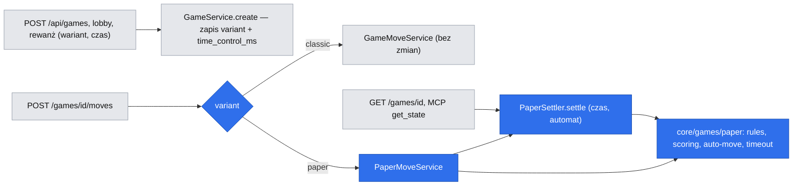
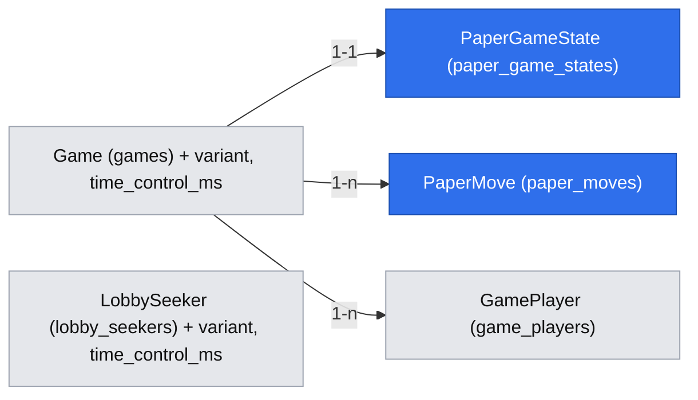

# Gomoku „papier i ołówek”: wariant z punktami za piątki, planszą 101×101 i zegarem 1/2/3/5 min

> Status: **szkic do przeglądu** (`om-spec-writing`, tryb interaktywny, 2026-11-02; bramka pytań Q1–Q10 zamknięta przez właściciela — Bartosz Wójcik). Źródła: `.ai/specs/product-brief.md` (D-34, BR-46…BR-51, N-14, A-16…A-18, Q-21), `research/decisions/2026-11-02-paper-pencil-variant.md`, mapa kodu (sesja 2026-11-02), wdrożone specyfikacje `2026-10-25-game-moves-win-detection.md`, `2026-10-26-game-clock.md`, `2026-11-01-mobile-game-view.md`, standardy `.ai/docs/2026-09-01-engineering-standards.md`.

## 📝 TLDR

Dziś jest jeden wariant: swobodne gomoku 15×15, pierwsza piątka wygrywa, 10 minut na gracza. **Po wdrożeniu (zachowanie przyszłe)** twórca partii może wybrać wariant „papier i ołówek”: plansza 101×101 przesuwana i powiększana jak kartka, kamień najwyżej 3 pola od innego, każda piątka daje punkt, zegar 1/2/3/5 minut na gracza, a po czasie prowadzącego jego kamienie stawia automat. Wariant ma **własny model stanu planszy** (`paper_game_states`, `paper_moves`) przy wspólnym nagłówku partii (`games`, uczestnicy, zaproszenia, czat, historia), więc klasyk i jego kontrakty zostają bez zmian.

## Resolved decisions

| # | Pytanie | Decyzja | Źródło |
|---|---|---|---|
| R1 | Odstęp kamieni | ≤ 3 pola (Chebyshev) od dowolnego kamienia; pierwszy kamień czarnych w środku | właściciel, BR-47 |
| R2 | Zegar | Na gracza, 1/2/3/5 min, domyślnie 3; tylko ten wariant | właściciel, BR-49 |
| R3 | Punkty | Liczone od nowa z bieżącego układu; rząd n → ⌊n/5⌋; krzyżowanie dozwolone; kamień w ≤ 2 kierunkach, pierwszeństwo wcześniejszej piątki | właściciel, BR-48 |
| R4 | Koniec czasu | Przegrywający/remisujący pierwszy bez czasu → koniec; prowadzący → automat do końca czasu przeciwnika, zegar przeciwnika biegnie bez przerwy | właściciel, BR-50 |
| R5 | Poddanie, domyślny wariant | Poddanie = przegrana bez względu na punkty; domyślnie klasyk | właściciel, Q-19, Q-20 |
| R6 | Plansza | 101×101, środek (50, 50) | właściciel (rekomendacja przyjęta), BR-47 |
| R7 | Kto wybiera | Twórca zaproszenia (konto, gość); w lobby szukający; rewanż kopiuje; agent MCP dołącza do ustawień twórcy | właściciel, BR-46 |
| R8 | Historia | Wariant i wynik punktowy w historii; liczniki par wspólne | właściciel, BR-51 |
| R9 | Model danych | Osobny model stanu planszy wariantu przy wspólnym nagłówku partii (zob. Proposed Solution) | sugestia właściciela 2026-11-02, zweryfikowana tutaj |
| R10 | Widok | Plansza przesuwana i powiększana; telefon 15–21 pól w poprzek | sugestia właściciela 2026-11-02, zweryfikowana w „UI/UX — studium” |
| R11 | Jeden PR | Jedna funkcja w fazach; brief i ta specyfikacja zatwierdzane przed kodem | właściciel (Q1, Q9) |

## 📝 Problem Statement

Brief nie zawiera dowodu popytu na wariant (A-01, A-16); to osąd właściciela (D-34). Problem techniczny jest konkretny: plansza 15×15 i zegar 10 minut są zaszyte w każdej warstwie — `bit(225)` i jeden bajt na ruch w `games` (indeks pola > 255 nie mieści się w bajcie), `CHECK`-i bazy (`move_count between 0 and 225`, `clock_ms_* between 0 and 600000`), `checkWin` kończący partię, `FINISH_SQL` zapisujący przegraną właściciela zegara, komponent `Board` bez rozmiaru (`BOARD_SIZE = 15` w `ui`), opisy narzędzi MCP („0–14”). Wariant musi to obejść bez ryzyka dla działającego klasyka.

## 📝 Proposed Solution

1. **Reguły jako czysty moduł `core/src/games/paper/`** (bez I/O): plansza, odstęp, punktacja, ruch automatu, rozstrzygnięcie czasu. Klasyczne `rules.ts`, `apply-move.ts`, `board.ts` bez zmian.
2. **Model danych: wspólny nagłówek, osobny stan planszy.** `games` dostaje `variant` i `time_control_ms`; wszystko, co specyficzne dla planszy wariantu (ruchy ze współrzędnymi, liczba ruchów, wyniki, faza automatu), leży w nowych tabelach `paper_game_states` (1:1) i `paper_moves` (1:n). Partie „papier” mają w `games` puste kolumny klasycznej planszy (`move_count = 0`, puste `bit(225)`), pilnowane `CHECK`-iem.
3. **Rozstrzyganie leniwe, jak zegar #23.** Upływ czasu, przejście w fazę automatu i ruchy automatu są wyliczane przy odczycie lub ruchu, pod blokadą wiersza `games`, wstrzykiwanym `clock` i wstrzykiwanym generatorem losowym. Bez zadania w tle.
4. **Nowy komponent DS `PaperBoard`** z oknem widoku (renderuje tylko widoczne pola), przesuwaniem, powiększaniem i kreską przez policzone piątki. Klasyczny `Board` bez zmian.

**Rozważone i odrzucone (model danych — weryfikacja sugestii R9):**

| Podejście | Za | Przeciw | Werdykt |
|---|---|---|---|
| **A. Wszystko osobno** (`paper_games`, własni uczestnicy, zaproszenia, czat, historia) | pełna izolacja od klasyka | ~10 serwisów do powielenia: zaproszenia, lobby, rewanż, czat i jego sprzątanie, partie publiczne (D-33), historia, liczniki par, `db:cleanup`, MCP, panel admina; dwie historie do scalania; BR-13 (jedna aktywna partia) musiałby patrzeć na dwie tabele | odrzucone — koszt i ryzyko rozjazdu wspólnych reguł |
| **B. Rozszerzyć kolumny `games`** (większy `bit`, dziennik 2 bajty/ruch) | jeden model | `bit(10201)` ×2 na każdym wierszu klasyka, zmiana kodeka i `CHECK`-ów działającego klasyka, migracja istniejących partii | odrzucone — narusza działający kontrakt klasyka |
| **C. Wspólny nagłówek + osobny stan planszy** | klasyk nietknięty; uczestnicy, zaproszenia, czat, publiczność, historia działają od razu; stan wariantu w osobnych tabelach | rozgałęzienie po `variant` w serwisach ruchu, stanu, rozstrzygania czasu | **wybrane** — spełnia sugestię „osobny model” tam, gdzie modele się różnią |

**Research (market leaders):** nie znaleziono serwisu ani projektu open source z tym wariantem online (wyszukiwanie 2026-11-02: „infinite gomoku / piškvorky nekonečná plocha / pan zoom”; trafienia to pojedyncze projekty, np. Gomoku-AI-WinForms z nieskończoną planszą na desktopie i gra HTML5 „Tic Bitballoon” z przesuwaniem i powiększaniem, bez gry online). Wzorce interakcji bierzemy więc z map i serwisów go: przeciąganie, szczypanie, przyciski +/−, „wyśrodkuj”. Benchmark brief (PlayOK, papergames, DonkeyCat) nie sprawdzał wariantów. Czego nie kopiujemy: swobodnego przybliżania w dowolnej skali (nasze poziomy są dyskretne, bo cel dotyku musi mieć znany rozmiar).

## 📝 Architecture

Wniosek: wariant wchodzi przez jedno rozgałęzienie w trzech miejscach (ruch, odczyt stanu, rozstrzyganie czasu); wszystko inne (uczestnicy, zaproszenia, czat, publiczność, rewanż, historia) działa na wspólnym nagłówku.

### Moduły `core/src/games/paper/` (czyste)

- `constants.ts`: `PAPER_BOARD_SIZE = 101`, `PAPER_CENTER = 50`, `PAPER_MAX_GAP = 3`, `PAPER_TIME_CONTROLS_MS = [60_000, 120_000, 180_000, 300_000]`, `PAPER_DEFAULT_TIME_MS = 180_000`, `AUTO_MOVE_DELAY_MS = 2_000`.
- `board.ts`: `PaperStone { x, y, seat, auto }`, `isOnBoard`, `isAllowed(stones, x, y)` — wolne, na planszy, przy `stones.length === 0` tylko środek, w przeciwnym razie istnieje kamień z `max(|dx|,|dy|) ≤ 3`. Indeks zajętości: `Map` po `y*101+x`.
- `scoring.ts`: `scoreGame(moves): { scores: [s1, s2], fives: Five[] }`, deterministyczny algorytm BR-48:
  1. Przechodzi ruchy w kolejności. Każdy kamień ma listę `dirs` (kierunki, w których jest „w piątce”, najwyżej 2, w kolejności dodania).
  2. Po ruchu `m` gracza P, dla kierunków w stałej kolejności (poziomo, pionowo, ukos ↘, ukos ↗): bierze maksymalny rząd R kamieni P przez `m` w tym kierunku; dzieli R na odcinki na kamieniach **pełnych** (`dirs.length === 2` i kierunek ∉ `dirs`); każdemu kamieniowi odcinka o długości ≥ 5 dopisuje kierunek do `dirs` (jeśli brak).
  3. Wynik gracza = suma po wszystkich jego rzędach i kierunkach ⌊długość odcinka / 5⌋, z podziałem na odcinkach według stanu `dirs` na końcu przebiegu.
  4. `fives` to odcinki punktujące pocięte na kolejne piątki (do rysowania kreski): `{ seat, from: {x,y}, to: {x,y} }`.

  Niezmienniki testowane własnościowo: wynik nie maleje po żadnym ruchu; ⌊n/5⌋ dla pojedynczego rzędu; żaden kamień nie ma więcej niż 2 kierunków. Złożoność: pełne przeliczenie przy każdym ruchu (≤ kilkaset ruchów × 4 kierunki) — pomijalne.
- `auto-move.ts`: `pickAutoMove(stones, around, random)` — pierścienie Chebysheva 1, 2, … wokół ostatniego kamienia przeciwnika, pierwsze wolne pola na planszy; wybór `floor(random() * n)` z listy w ustalonej kolejności. Pole w pierścieniu 1–3 jest zawsze dozwolone (BR-47); `null`, gdy plansza pełna (nieosiągalne w 5 min, test).
- `timeout.ts`: `resolvePaperClock(state, nowMs, random)` → lista zdarzeń `{ autoMoves[], finish? }` według BR-50 (tabela niżej).
- `clock.ts` (klasyczny): `stored()` przycina do **`timeControlMs` partii**, nie do `INITIAL_CLOCK_MS`; dla klasyka wartość 600 000, więc zachowanie bez zmian.

### Oś czasu BR-50 (jedyna ścieżka, `PaperSettler.settle` pod blokadą `games`)

| Faza | Stan | Zdarzenie | Skutek |
|---|---|---|---|
| zwykła | zegar biegnie graczowi S | `now ≥ T = turnStartedAt + clockMs[S]` | jeśli `score[S] ≤ score[O]`: `finished`, `end_reason = 'points'`, wygrywa wyższy lub remis (`winner_seat = NULL`), `finished_at = T`. W przeciwnym razie: `auto_seat = S`, `clockMs[S] = 0`, **ruch automatu z czasem T**, `turnStartedAt = T` dla O |
| automat | zegar O biegnie **bez przerwy** od T | O stawia kamień w chwili t | `pending_auto_at = t + 2 s`; O nie może ruszyć się przed ruchem automatu (`409 AUTO_MOVE_PENDING`) |
| automat | `now ≥ pending_auto_at` i `pending_auto_at < deadline O` | — | ruch automatu z czasem `pending_auto_at` (losowanie przez wstrzyknięty `random`) |
| automat | `now ≥ deadline O = T + clockMs[O](T)` | — | `finished`, `end_reason = 'points'`, wynik z punktów, `finished_at = deadline O` |
| dowolna | poddanie gracza | — | `end_reason = 'resignation'`, wygrywa drugi bez względu na punkty (Q-19) |

Zegar O w fazie automatu jest liczony od T: `remaining = clockMs[O](T) − (now − T)`; nie jest „wydawany” przy ruchach O, bo nie stoi. Ruchy automatu zapisują się w `paper_moves` z `is_auto = true` i czasem zdarzenia (nie wykrycia), więc odtwarzanie i historia są poprawne niezależnie od chwili odpytywania.

### Serwisy (`app/src/server/services/games/`)

- `PaperMoveService.play(gameId, seat, {x, y, moveNumber})`: blokada `games` → `PaperSettler.settle` → status, tura, `auto_seat`, `pending_auto_at`, numer ruchu → `isAllowed` → zapis ruchu, `scoreGame`, aktualizacja `paper_game_states` i zegara w jednej transakcji (`tx`). Kody: `MOVE_TOO_FAR`, `FIRST_MOVE_CENTER`, `CELL_OCCUPIED`, `NOT_YOUR_TURN`, `AUTO_MOVE_PENDING`, `GAME_FINISHED`, `MOVE_NUMBER_MISMATCH` (istniejące kody, gdzie są).
- `PaperSettler` (port obok `timeoutSettler`): `settle(gameId, tx, now)`; `SqlTimeoutSettler.settleFor/settleForGuest/settleExpired` wybierają ścieżkę po `variant` — klasyczny `FINISH_SQL` dostaje warunek `variant = 'classic'`, żeby nigdy nie zakończył partii „papier”.
- `GameService.create` / `#insertGame`, `LobbyService` (`INSERT_LOBBY_GAME_SQL`), `RematchService` (`INSERT_GAME_SQL`): zapis `variant`, `time_control_ms`, `clock_ms_1/2 = time_control_ms`, a dla „papier” wiersz `paper_game_states`.
- `GameService.getState/stateOf`: `ClockState` z `time_control_ms`; dla „papier” `PaperSettler.settle` (zamiast/obok `settleExpired`) i widok `paperView`.
- `GameHistoryService`, `recordFinishedGame`, `admin-overview-service`: `end_reason = 'points'` w etykietach i licznikach; historia czyta wynik z `paper_game_states`.
- Sprzątanie (`db:cleanup`): `paper_*` usuwane kaskadowo z `games` (FK `on delete cascade`).

### MCP (`mcp-server.ts`, `agent-view.ts`)

Kontrakt narzędzi bez zmian (właściciel: „bez zmiany kontraktu”); zmiany addytywne (propozycja agenta w briefie BR-46): `get_state` dla „papier” zwraca `variant`, `scores`, `autoSeat`, a planszę jako **wycinek** prostokąta zawierającego kamienie z marginesem 3 (`board` jak dziś `string[]`, plus `boardOrigin: {x, y}`), żeby nie wysyłać 101 wierszy; `play_move` przyjmuje 0–100. Opisy narzędzi zależne od wariantu partii nie są możliwe (lista narzędzi jest wspólna), więc opisy mówią o obu wariantach.

## 📝 Data Model

Migracja `Migration<ts>_paper_variant.ts` (przez `npm run db:migration:create`, przegląd snapshotu — lekcje 2026-10-31).

| Encja → tabela | Pola | Ograniczenia |
|---|---|---|
| `Game` → `games` (rozszerzenie) | `variant` text NOT NULL DEFAULT `'classic'`; `time_control_ms` integer NOT NULL DEFAULT 600000; `end_reason` dostaje wartość `points` | `games_variant_check`: `variant in ('classic','paper')`; `games_time_control_check`: `(variant='classic' and time_control_ms=600000) or (variant='paper' and time_control_ms in (60000,120000,180000,300000))`; `games_clock_ms_check` dochodzi `clock_ms_n <= time_control_ms`; `games_paper_board_empty_check`: `variant='classic' or move_count=0`; `end_reason in ('five_in_row','draw')` ⇒ `variant='classic'`; `end_reason='points'` ⇒ `variant='paper'`; `games_winner_required_check` dopuszcza `winner_seat IS NULL` dla `points` (remis) |
| `PaperGameState` → `paper_game_states` (nowa, 1:1) | `game_id` PK FK → `games` ON DELETE CASCADE; `move_count` int; `score_1`, `score_2` int; `auto_seat` smallint NULL; `pending_auto_at` timestamptz NULL; `last_move_at` timestamptz NULL | `move_count >= 0`, `score_n >= 0`, `auto_seat in (1,2)`, `pending_auto_at IS NULL OR auto_seat IS NOT NULL` |
| `PaperMove` → `paper_moves` (nowa, 1:n) | `game_id` FK → `games` ON DELETE CASCADE; `move_number` int; `x`, `y` smallint; `seat` smallint; `is_auto` boolean; `played_at` timestamptz | PK `(game_id, move_number)`; UNIQUE `(game_id, x, y)`; `x, y between 0 and 100`; `seat in (1,2)`; `move_number >= 1` |
| `LobbySeeker` → `lobby_seekers` (rozszerzenie) | `variant`, `time_control_ms` (jak w `games`) | ten sam `CHECK` co `games_time_control_check` |

Istniejące wiersze dostają `variant='classic'`, `time_control_ms=600000` (domyślne), więc klasyk działa bez zmian. `down()` usuwa nowe tabele i kolumny i przywraca poprzednie `CHECK`-i; przed `down` partie „papier” trzeba usunąć (migracja odmawia przy ich obecności — test). Dane wrażliwe: brak nowych. Kolor kamienia wynika z `seat` i `games.black_seat`; wynik i `fives` są pochodne (`scoreGame`), a `score_n` w stanie to cache dla historii, przeliczany przy każdym ruchu w tej samej transakcji.

## 📝 API Contracts

Koperta i nagłówki CSRF jak dziś. Wszystkie zmiany addytywne; klient klasyka bez zmian.

- **`POST /api/games`** — konto: opcjonalne ciało `{ variant?: 'classic' | 'paper', timeControlMs?: 60000 | 120000 | 180000 | 300000 }` (brak ciała = klasyk, jak dziś); gość: te same pola w `createGuestGameSchema`. `timeControlMs` przy `classic` → `400 VALIDATION`; brak przy `paper` → 180000. Schemat `createGameSettingsSchema` w `core/validators/games/`.
- **`POST /api/lobby/seeking`** — te same pola; lista lobby pokazuje wariant i czas; `pick` tworzy partię z ustawieniami szukającego.
- **Rewanż** — kopiuje `variant` i `time_control_ms`.
- **`GET /api/games/{id}`** — dochodzi `variant`, `timeControlMs`; dla `paper`: `paper: { moveCount, moves: [{ n, x, y, seat, auto, at }], scores: [s1, s2], fives: [{ seat, from, to }], autoSeat: 1 | 2 | null, autoMoveAt: ISO | null }` (`?after=n` działa po `n`); klasyczne `moves` puste. `clock.running` w fazie automatu = miejsce O. `result.reason` może być `points`, `result.scores` przy `points` i `resignation`.
- **`POST /api/games/{id}/moves`** — ciało bez zmian `{ x, y, moveNumber }`; schemat ma granice 0–100 i `moveNumber ≤ 10201`; klasyczny serwis odrzuca `x, y > 14` dotychczasowym kodem (lekcja 2026-10-31: zakres sprawdzany przed `cellOf`). Nowe kody: `MOVE_TOO_FAR` (400), `FIRST_MOVE_CENTER` (400), `AUTO_MOVE_PENDING` (409).
- **Historia** `GET /api/history` — wpis dostaje `variant` i `scores` (dla `paper`).

## 📝 UI/UX

### Tworzenie partii

Wybór „Wariant: Klasyczny | Papier i ołówek” (domyślnie Klasyczny) i — tylko przy „Papier i ołówek” — „Czas na gracza: 1 | 2 | 3 | 5 min” (domyślnie 3) jako grupy radiowe z DS (cel 44 px) przy: przycisku „Nowa partia” (strona główna, historia, ekran końca partii), formularzu gościa, „Szukam gry” w lobby. Lista lobby i ekran zaproszenia pokazują „Papier i ołówek · 3 min” zamiast „plansza 15×15 · 10 minut”.

### Plansza `PaperBoard` (`@gomoku/ui/game/paper-board`)

- **Okno widoku** N×N pól (renderowane tylko widoczne pola, ≤ 31² przycisków), środek okna `(cx, cy)`; współrzędne na ekranie **względem startu** (środek = 0, 0; osie −50…50), w API absolutne 0–100.
- **Powiększanie:** dyskretne poziomy N; telefon (`pointer: coarse` lub wąski kontener) **15, 17, 19, 21** (domyślnie 15); komputer 15–31 co 2 (domyślnie 21 — propozycja). Przyciski „+”/„−” (44 px), szczypanie dwoma palcami i Ctrl+kółko przełączają poziom; poziom zapamiętany w `localStorage` (wygoda, z `try/catch`).
- **Przesuwanie:** przeciąganie (próg 8 px odróżnia przeciągnięcie od stuknięcia), cztery przyciski strzałek przesuwające o ⌊N/3⌋, klawiatura (strzałki przenoszą fokus; na krawędzi okna okno przesuwa się o 1), przycisk „Wyśrodkuj na ostatnim ruchu”. Ruch przeciwnika poza oknem: znacznik kierunku na krawędzi („Ruch przeciwnika →”), bez samoczynnego skoku widoku (nie gubi zaznaczenia gracza); na starcie i po własnym ruchu okno centruje się na środku kamieni.
- **Pola dozwolone** (≤ 3 od kamienia) lekko wyróżnione tokenem; pole niedozwolone nieaktywne z opisem dla czytnika.
- **Piątki** — kreska „ołówkiem” (SVG, token) przez każdą policzoną piątkę; ostatni ruch i ruchy automatu oznaczone (automat: dodatkowy wskaźnik i `aria-live` „Automat postawił kamień za …”).
- **Krawędź planszy** (współrzędna ±50) widoczna jako koniec kratki.
- **Dotyk:** jak w klasyku (spec #181) — stuknięcie zaznacza, „Postaw kamień” stawia; dodatkowo przyciski „przesuń zaznaczenie” (4 × 44 px) przy zaznaczeniu.
- **Wynik i zegary:** licznik punktów przy każdym zegarze; w fazie automatu przy zegarze prowadzącego „Automat”, a w statusie „Automat stawia kamień…”. Baner końca: „Wygrana 7 : 5”, „Remis 4 : 4”, „Przegrana przez poddanie”.

### Studium rozmiaru pola na telefonie (weryfikacja sugestii R10)

Szerokość planszy = szerokość okna − 2 × 16 px (spec #181, R8); rozmiar pola = szerokość / N:

| okno | plansza | N=15 | N=17 | N=19 | N=21 |
|---|---|---|---|---|---|
| 320 | 288 px | 19,2 | 16,9 | 15,2 | 13,7 |
| 360 | 328 px | 21,9 | 19,3 | 17,3 | 15,6 |
| 390 | 358 px | 23,9 | 21,1 | 18,8 | 17,0 |
| 412 | 380 px | 25,3 | 22,4 | 20,0 | 18,1 |
| 430 | 398 px | 26,5 | 23,4 | 20,9 | 19,0 |

Wnioski:
- **N = 15 to parytet z klasykiem** (te same piksele na pole), więc domyślne 15 nie pogarsza dzisiejszej gry; spec #181 odrzucił pola < 19 px jako „regres dla palców”.
- WCAG 2.2 **SC 2.5.8 (AA)** wymaga celu ≥ 24×24 CSS px albo wyjątku; przylegające pola planszy nie spełniają wyjątku odstępu nawet przy N = 15 na większości telefonów (dotyczy też klasyka dziś). Spełniamy wyjątek **„Equivalent”**: tę samą funkcję (wybór pola) daje sterowanie ≥ 44 px — dwuetapowe stawianie z przyciskami „przesuń zaznaczenie”.
- **N = 19–21 przy 320–360 px daje pola 14–17 px** — da się grać tylko dzięki dwuetapowemu stawianiu; to poziom „przeglądu sytuacji”, nie domyślny. Zakres 15–21 (sugestia właściciela) zostaje, domyślnie 15.
- Nie ma danych o rzeczywistych urządzeniach graczy ani testu z palcem — kryterium akceptacji to zrzuty i test integracyjny na 320/360/390 px; do sprawdzenia w partiach testowych (A-17, A-18).

Prototype: brak (do decyzji przy przeglądzie; ekran można pokazać w Storybooku `docs/screens/`).

## 📝 Edge Cases & Failure Scenarios

| Przypadek | Zachowanie |
|---|---|
| Dwa żądania naraz (ruch O i odczyt materializujący automat) | blokada `games` → kolejność; ruch O po `pending_auto_at` najpierw materializuje automat, potem `moveNumber` się nie zgadza → `409`, klient odświeża |
| Odczyt po długiej przerwie (np. 5 min bez odpytywania) | `settle` odtwarza całą oś czasu: ruch automatu w T, kolejne nie mogą powstać bez ruchów O, koniec w `deadline O`; wynik identyczny jak przy ciągłym odpytywaniu |
| Prowadzący traci czas, a wynik równy | koniec, remis (BR-50: „remisujący”) |
| Przegrywający dogania w fazie automatu | gra trwa do końca czasu O; wynik z punktów (może wygrać O) |
| Zegar O kończy się w czasie 2 s oczekiwania | koniec w `deadline O`, ruch automatu nie powstaje |
| Automat przy krawędzi | pola spoza planszy pomijane w pierścieniu |
| Piątka w trzecim kierunku przez kamień pełny | odcinki dzielone na tym kamieniu (BR-48); test na przykładzie właściciela (13 kamieni w trzech kierunkach → 2 punkty) |
| Gracz celowo idzie do krawędzi | dozwolone; piątka nie może wyjść poza planszę (A-18) |
| Agent MCP z czasem 1 min | ryzyko przegranej na czas (A-06); opis narzędzia ostrzega; bez zmian reguł |
| Stary klient (cache) wysyła ruch do partii „papier” | ten sam endpoint, schemat 0–100, odpowiedź zawiera `variant` — klient klasyka bez `PaperBoard` pokazuje „Odśwież stronę” (sprawdzenie `variant` w `GameRoom`) |
| Losowość w testach | wstrzyknięty `random` (cradle `random: () => number`); testy integracyjne sprawdzają, że kamień automatu jest w najbliższym pierścieniu, nie konkretne pole |
| Migracja `down` z partiami „papier” | odmowa z czytelnym błędem; test na PostgreSQL |

## 📝 Risks & Impact Review

- **Wspólne `CHECK`-i i `FINISH_SQL` klasyka** — błąd w rozgałęzieniu mógłby zakończyć partię „papier” klasyczną przegraną na czas albo odwrotnie. Mitygacja: `variant = 'classic'` w SQL klasyka, `CHECK`-i rozdzielające `end_reason` po wariancie (błąd = `500` w teście, nie cichy zły wynik), testy integracyjne obu wariantów.
- **Kontrakty (`BACKWARD_COMPATIBILITY.md`)** — §2 API HTTP: tylko nowe pola opcjonalne i nowe kody błędów dla nowych sytuacji (dozwolone bez ograniczeń); §5 zasady gry w danych: `BOARD_SIZE`/`WIN_LENGTH` klasyka bez zmian, a parametry wariantu (`variant`, `time_control_ms`) zapisane w partii; MCP nie jest wymienione jako chroniona powierzchnia, ale zmiany i tak są addytywne. §1 API pakietów: nowe eksporty `@gomoku/core`/`@gomoku/ui`, żaden nie znika.
- **Migracja (§4)** — addytywna: nowe tabele, kolumny z domyślnymi, `CHECK`-i spełnione przez istniejące wiersze (DROP/ADD w transakcji); PR dostaje etykietę `risk-high` i plan wycofania w opisie (`SDLC.md`); `down` możliwy tylko bez partii „papier”.
- **Wydajność** — przeliczanie `scoreGame` i odtwarzanie planszy z `paper_moves` przy każdym ruchu: O(ruchy); ≤ ~600 ruchów w 5 min na gracza; host 2 GB (lekcja 2026-10-30) — pomijalne, sprawdzić pomiarem w teście integracyjnym (100 ruchów < 50 ms na ruch).
- **Kierunek produktu (nie defekt):** popyt niesprawdzony (A-16, Q-21); reguła automatu może nie zniechęcać do przeczekiwania (A-17); krawędź 101×101 osiągalna (A-18). Tańszy test przed budową: partie na papierze z zegarem (brief, „Następna niepewność”).

## 📝 Decisions in play

Opiera się na D-34, BR-46…BR-51, N-14 (Bartosz Wójcik, 2026-11-02). Zawęża do klasyka (bez nadpisania): BR-04, BR-07, BR-10, D-03, D-08. BR-05, BR-06 (zegar biegnie podczas rozłączenia — propozycja agenta w BR-49), BR-13 (jedna aktywna partia) obowiązują bez zmian. Nie dotyka D-33 (partie publiczne działają na wspólnym nagłówku — widz widzi `PaperBoard`).

## 📋 Phasing

1. **Reguły** — czysty `core/games/paper` z testami (bez wpływu na aplikację).
2. **Dane** — migracja, encje, `CHECK`-i; klasyk dalej działa.
3. **Rozgrywka** — tworzenie z ustawieniami (konto, gość), ruch, rozstrzyganie czasu i automat, stan, poddanie.
4. **Ekran** — `PaperBoard` w DS, wybór wariantu, ekran partii, wynik.
5. **Ścieżki dodatkowe** — lobby, rewanż, historia, panel admina, MCP.
6. **Domknięcie** — testy integracyjne end-to-end, dokumentacja, zrzuty.

Fazy 1–2 są niewidoczne dla graczy; od fazy 3 wariant jest dostępny tylko przez API, dopóki faza 4 nie doda wyboru w UI.

## 📋 Implementation Plan

**Faza 1 — reguły (`packages/core/src/games/paper/`)**
1. `constants.ts`, `board.ts` (`isOnBoard`, `isAllowed`, pierwszy ruch w środku) + testy (granice, odstęp 3 i 4, skosy).
2. `scoring.ts` + testy przykładów właściciela (6 → 1, 10 → 2, krzyż 9 → 2, trzy kierunki 13 → 2, rząd złożony z dwóch połówek) i testy własnościowe (losowe partie: wynik nie maleje, ≤ 2 kierunki na kamień).
3. `auto-move.ts` (pierścienie, krawędź, wstrzyknięty `random`) + testy.
4. `timeout.ts` (oś czasu BR-50, wszystkie wiersze tabeli) + `clock.ts`: przycinanie do `timeControlMs` (testy klasyka bez zmian).
5. Schematy: `createGameSettingsSchema`, granice `moveCreateSchema` (0–100), `agent-tool-schema`.

**Faza 2 — dane (`packages/db`)**
6. Encje `PaperGameState`, `PaperMove`, pola `Game.variant`, `Game.timeControlMs`, `LobbySeeker` + `CHECK`-i; migracja przez `db:migration:create`, przegląd snapshotu; `tests/integration/game-schema.test.ts`: każdy nowy `CHECK` na PostgreSQL, `up`/`down`.

**Faza 3 — rozgrywka (`packages/app/src/server`)**
7. `GameService.create` + `POST /api/games` (konto i gość) z ustawieniami; wiersz `paper_game_states`.
8. `PaperSettler` + rozgałęzienie w `SqlTimeoutSettler` (`variant = 'classic'` w SQL klasyka) + rejestracja w `container.ts` (`random`).
9. `PaperMoveService.play` + rozgałęzienie w `POST /moves`; `resign` dla „papier”.
10. `getState`/`stateOf`/`loadGameView`: `paperView`, `?after=`; test integracyjny API: pełna partia, upływ czasu przegrywającego, faza automatu, remis, poddanie (`game-paper-api.test.ts`, czas przez `turn_started_at` w bazie jak w `game-clock-api.test.ts`).

**Faza 4 — ekran (`packages/ui`, `packages/app`)**
11. `PaperBoard` w `packages/ui/src/game` (okno, przesuwanie, poziomy, kreski piątek, pola dozwolone, fokus/klawiatura), tokeny w `game-tokens.css`, stories i MDX w `packages/ui/docs/product/` (oba motywy, 320 px), `check:tokens`.
12. Wybór wariantu i czasu (strona główna, gość, ekran końca, historia — `CreateGameButton` z ustawieniami).
13. `PlayField`/`GameRoom`: rozgałęzienie po `variant`, wynik przy zegarach, faza automatu, baner końca (`outcomeOf`), dwuetapowe stawianie z „przesuń zaznaczenie”; test integracyjny przeglądarki (mysz i dotyk, 320/360/390 px: przycisk w oknie, przesuwanie, poziomy 15–21, brak poziomego przewijania).

**Faza 5 — ścieżki dodatkowe**
14. Lobby (`lobby_seekers`, lista, `pick`) + test integracyjny.
15. Rewanż (kopiowanie ustawień) + test.
16. Historia (`variant`, `scores`, `REASON_LABEL.points`), panel admina (etykieta, licznik `points`), liczniki par.
17. MCP: `agentGameView` dla „papier” (wycinek, `boardOrigin`, `scores`, `autoSeat`), zakres 0–100, opisy; `agent-play-api.test.ts` dla wariantu.

**Faza 6 — domknięcie**
18. Dokumentacja: `README.md` (zasady wariantu), `docs/architektura.md` (model danych), `packages/ui/docs/design-system.md` (`PaperBoard`), teksty „plansza 15×15 · 10 minut” warunkowe po wariancie.
19. `npm run check` (lint, typecheck, 100% pokrycia, build, integracja), zrzuty 320/360/390 × oba motywy, przeniesienie specyfikacji do `implemented/` po spełnieniu kryteriów.

### Kryteria akceptacji

- [ ] Klasyk: wszystkie istniejące testy jednostkowe i integracyjne zielone bez zmian oczekiwań.
- [ ] Twórca (konto, gość, lobby) wybiera wariant i czas; rewanż je kopiuje; domyślnie klasyk.
- [ ] Pierwszy kamień tylko w środku; kamień dalej niż 3 pola → `400 MOVE_TOO_FAR`.
- [ ] Punkty zgodne z przykładami właściciela (6 → 1, 10 → 2, krzyż 9 → 2) i nigdy nie maleją.
- [ ] Koniec czasu przegrywającego/remisującego kończy partię; prowadzącego — włącza automat (pierwszy ruch od razu, kolejne 2 s po ruchu przeciwnika, najbliższe pole, zegar przeciwnika biegnie), koniec po czasie przeciwnika, wynik z punktów.
- [ ] Poddanie = przegrana bez względu na punkty.
- [ ] Plansza przesuwana i powiększana; telefon 15–21 pól (domyślnie 15), „Postaw kamień” w oknie przy 320×568; brak poziomego przewijania.
- [ ] Historia pokazuje wariant i wynik; MCP gra w wariancie (wycinek planszy).
- [ ] Migracja `up`/`down` na PostgreSQL; `npm run check` zielone.
