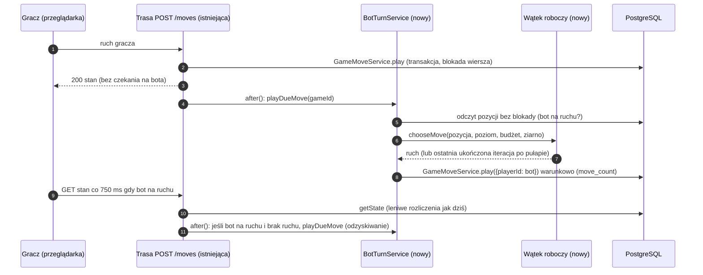
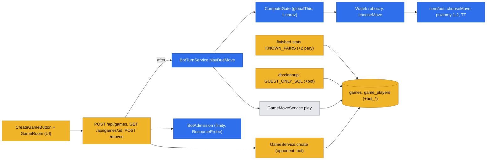
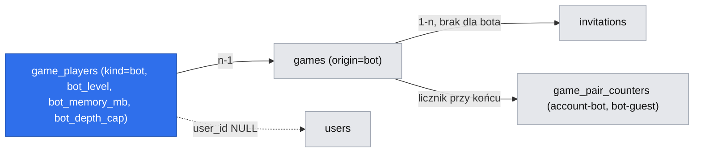

# Bot algorytmiczny hostowany przez nas: uczestnik „Bot”, ruch wywoływany po zatwierdzeniu ruchu gracza, silnik w `packages/core`, polityka zasobów dla hosta 2 GB

> Status: **zatwierdzona przez właściciela (2026-11-05)** w całości z rekomendacjami (R1…R22); przed zatwierdzeniem szkic autonomiczny (E13-S01, #256; `om-auto-write-spec`, tryb autonomiczny, 2026-11-05). Do `implemented/` przechodzi dopiero po wdrożeniu. Specyfikacja jest **wyłącznie projektowa** — nie zmienia kodu, briefu ani backlogu. Źródła wymagań: `.ai/specs/product-brief.md` (D-36, N-15, BR-54…BR-58, A-20…A-22, Q-23…Q-25), `.ai/specs/research/decisions/2026-11-05-hosted-bot.md`. Wszystko oznaczone `⚠ NEEDS HUMAN CONFIRMATION` to wartość domyślna przyjęta bez właściciela — patrz „Resolved assumptions (autonomous defaults)”.

## 📝 TLDR

Dziś każdy przeciwnik to człowiek albo agent LLM dołączający przez MCP; partia wymaga zaproszenia, a serwer nie ma timerów — zegar i koniec czasu rozlicza leniwie ten, kto dotknie partii. **Po wdrożeniu (zachowanie przyszłe)** gracz (konto albo gość) wybiera przy tworzeniu partii klasycznej „Zagraj z botem” i poziom 1 lub 2; partia startuje od razu, jest prywatna, a bot odpowiada ruchem policzonym po stronie serwera. Rozstrzygamy Q-23: (1) ruch bota **wywołuje serwer po zatwierdzeniu ruchu gracza** (`after()` z Next.js), a odzyskiwanie po restarcie jest **leniwe**: każdy odczyt partii, w której bot jest na ruchu i nie ma ruchu, wywołuje obliczenie jeszcze raz (dokładnie jak `pending_auto_at` w „papierze”, tylko bez kolumny, bo stan wynika z planszy); (2) bot to **nowy typ uczestnika `bot`** w `game_players`, nie klient miejsca agenta; (3) silnik to czysta funkcja `chooseMove` w `packages/core`, liczona w **`worker_threads` uruchamianym na jeden ruch**, z twardym pułapem czasu (`terminate()`); (4) siła poziomu 2 zależy od pamięci odczytanej **raz przy tworzeniu partii** (rozmiar tablicy transpozycji i limit głębokości), a miękki cel czasu i pułap bezpieczeństwa ograniczają każdy ruch niezależnie od RAM; wartości liczbowe są propozycją i wymagają pomiaru na hoście o parametrach Mikrusa (A-22) przed włączeniem funkcji.

## Resolved decisions (z briefu — niezmienne w tej specyfikacji)

| # | Decyzja | Źródło |
|---|---|---|
| B1 | Bot algorytmiczny, bez LLM i tokenów; silnik jako czysta funkcja w `packages/core`; poziom 1 = ocena wzorców z losowością wśród najlepszych; poziom 2 = negamax + alfa-beta + pogłębianie iteracyjne + kandydaci w promieniu 2 + wykrywanie wygranej i obowiązkowego bloku + ograniczona tablica transpozycji | D-36 (propozycja agenta, właściciel „ok”) |
| B2 | Typ uczestnika „Bot” z etykietą i nazwą poziomu, bez konta, tokenu i własnej historii; partia prywatna (bez zaproszenia, lobby, widzów, czatu); BR-13 bez zmian | BR-54, N-15 |
| B3 | Wydanie dopiero z dwoma poziomami; wybór poziomu widoczny od pierwszego wydania | BR-55 |
| B4 | v1 tylko klasyk 15×15, zegar 10 min; „papier i ołówek” poza zakresem | BR-56, Q-24 (otwarte) |
| B5 | Siła zależna od RAM, pokazana w nazwie, niezmienna w partii; równocześnie bezpieczny limit pamięci i czasu (miękki cel + jawny pułap); odczyt zasobów wstrzykiwany, tryb stały dla testów; obliczenia po stronie serwera, jedno naraz | BR-57 |
| B6 | Czas bota liczy się na jego zegarze; partie z botem w historii konta (BR-44) i w liczniku jako osobna para (D-32); gość bez historii (BR-24); sprzątanie gość–bot wg tej specyfikacji | BR-58 |
| B7 | Poza zakresem: bot LLM, rankingi/rating, odblokowywanie poziomów, uczenie z partii, bot w lobby/partiach publicznych/papierze, czat bota | N-15 |

## Resolved assumptions (autonomous defaults)

Status: zatwierdzone przez właściciela 2026-11-05 w całości z rekomendacjami (R1…R22); wartości liczbowe R6–R8 i R18 oraz flaga R19 pozostają wartościami startowymi do potwierdzenia pomiarem na Mikrusie (A-22)

Pytania Q-23 wymagają odpowiedzi, a właściciel nie był dostępny. Każda pozycja to najmniej odwracalnie kosztowna odpowiedź z uzasadnieniem w dalszych sekcjach; **zatwierdzenie tej specyfikacji przez właściciela potwierdza wszystkie pozycje** albo zastępuje je jego poprawkami. Wartości liczbowe są propozycją do pomiaru (A-21, A-22), nie zmierzonym faktem.

| # | Pytanie / punkt Q-23 | Przyjęty domyślnie | Dlaczego | Potwierdzenie |
|---|---|---|---|---|
| R1 | Kto i kiedy wywołuje ruch bota (brak timerów) | Po zatwierdzeniu ruchu gracza trasa HTTP planuje `after()` (Next 16) z `BotTurnService.playDueMove(gameId)`; ponadto każdy odczyt stanu partii, w której bot jest na ruchu, planuje to samo (leniwe odzyskiwanie). Bez kolejki w bazie, bez pętli w tle | Zero nowych procesów i tabel; ruch gracza nie czeka na obliczenie; restart/awaria obliczenia leczy się następnym odczytem (klient odpytuje co 2 s) | ⚠ NEEDS HUMAN CONFIRMATION |
| R2 | Model uczestnika | Nowy `kind = 'bot'` w `game_players` (zawsze miejsce 2), kolumny `bot_level`, `bot_memory_mb`, `bot_depth_cap`; wewnętrzny klient miejsca agenta odrzucony | Agent = token + kanał MCP + deklarowana nazwa (BR-31) i liczy się w parze „agent” (A-04); bot nie ma tokenu, a para musi być osobna (BR-58) | ⚠ NEEDS HUMAN CONFIRMATION |
| R3 | Miejsce i kolor | Bot zawsze w miejscu 2, czarne losuje istniejący `ColorDraw`; gracz nie wybiera koloru w v1 | Najmniejszy zakres; spójne z resztą gry (losowanie, bo pierwszy ruch daje przewagę) | ⚠ NEEDS HUMAN CONFIRMATION |
| R4 | Start partii | Partia powstaje od razu jako `active` (`origin = 'bot'`, bez zaproszenia, jak rewanż), `seen_at` bota ustawione, gracza puste: zegar rusza, gdy gracz pierwszy raz otworzy partię; nieotwarta w 15 min zamyka się leniwie (Q21) | Wykorzystuje istniejące reguły (`START_CLOCK_SQL`, `CANCEL_NOT_STARTED`) bez nowego kodu | odwracalne |
| R5 | Gdzie liczy silnik | `worker_threads` tworzony na każdy ruch, flaga stopu w `SharedArrayBuffer`, po pułapie `terminate()`; ruch awaryjny z ostatniej ukończonej iteracji; brak trybu „w głównym wątku” w produkcji (jest w testach) | A-22: pętla zdarzeń jednoprocesowego hosta nie może stanąć; tylko wątek da twardy pułap; start wątku (rząd dziesiątek ms) jest pomijalny wobec ≥ 1 s ruchu | ⚠ NEEDS HUMAN CONFIRMATION |
| R6 | Miękki cel czasu i pułap | Poziom 1: cel 50 ms, pułap 250 ms. Poziom 2: cel **1500 ms**, pułap **3000 ms**. Dodatkowo z zegara bota: cel ≤ pozostały czas/30, pułap ≤ pozostały czas/10, poniżej 1 s zegara — ruch poziomu 1 | Rząd wielkości z mikrobenchmarku (sekcja „Pomiar”): naiwny silnik 0,04–0,05 Mwęzłów/s dawał głębokość 5 w 0,5 s, 6 w 2 s; produkcyjny ma być szybszy, ale to nie jest zmierzone na Mikrusie | ⚠ NEEDS HUMAN CONFIRMATION |
| R7 | Tablica transpozycji i limity głębokości | Pamięć dostępna odczytana raz: < 256 MB → odmowa nowej partii z botem; 256–767 MB → TT 8 MB, głębokość ≤ 6; 768–1535 MB → 16 MB, ≤ 8; 1536–3071 MB → 32 MB, ≤ 10; ≥ 3072 MB → 64 MB, ≤ 12. Wpis TT 16 B | Zawsze mała część dostępnej pamięci (≤ ~3%), wątek ma `resourceLimits.maxOldGenerationSizeMb = 64` | ⚠ NEEDS HUMAN CONFIRMATION |
| R8 | Współbieżność | Jedno obliczenie naraz w procesie (bramka FIFO w singletonie na `globalThis`), najwyżej **3** aktywnych partii z botem (poza tym `503 BOT_UNAVAILABLE`) | Kolejka ma ograniczone najgorsze opóźnienie (≤ ~2 × pułap przed własnym ruchem); host ma 1 rdzeń | ⚠ NEEDS HUMAN CONFIRMATION |
| R9 | Nazwa pokazująca siłę | Poziom 1: `Bot · poziom 1`; poziom 2: `Bot · poziom 2 · {TT} MB` (np. `Bot · poziom 2 · 16 MB`); zapisane są parametry, nazwa jest wyliczana przy odczycie | Miara „wg RAM” (BR-57) dotyczy rozmiaru TT poziomu 2; poziom 1 nie używa RAM, więc nie udaje siły z niej | ⚠ NEEDS HUMAN CONFIRMATION |
| R10 | Odczyt RAM | Wstrzykiwany `ResourceProbe`: `process.availableMemory()` (cgroup-aware) → `os.freemem()`; `BOT_FIXED_MEMORY_MB` wymusza wartość (testy, operator); wynik zamrożony w `game_players` przy tworzeniu partii, więc restart go nie zmienia | BR-57: stała w trakcie partii; nie zweryfikowano zachowania w LXC Mikrusa | ⚠ NEEDS HUMAN CONFIRMATION |
| R11 | Sprzątanie (`db:cleanup`) i BR-24 | `bot` liczy się jak `guest`/`agent` w `GUEST_ONLY_SQL`: partia gość–bot znika 1 h po końcu (jak gość–gość); konto–bot zostaje w historii konta; po usunięciu konta rządzi reguła „osierocone” (bez zmian) | Jedna zasada: bez konta nie ma historii (BR-24); BR-58 | ⚠ NEEDS HUMAN CONFIRMATION |
| R12 | Licznik (D-32) | Dwie nowe znane pary w `KNOWN_PAIRS`: `account-bot`, `bot-guest` (kolejność alfabetyczna jak w tabeli `game_pair_counters`) | „Osobna para” z BR-58 to w praktyce dwie pary, bo licznik liczy pary typów | ⚠ NEEDS HUMAN CONFIRMATION |
| R13 | Rewanż | Brak rewanżu z botem w v1 (serwer odmawia), ekran końca oferuje „Zagraj ponownie z botem”, co tworzy nową partię z tym samym poziomem | Rewanż kopiowałby uczestników i parametry siły; nowa partia czyta zasoby od nowa (BR-57) | ⚠ NEEDS HUMAN CONFIRMATION |
| R14 | Poddanie, remis, czat | Bot się nie poddaje; poddanie gracza działa jak dziś; czat w partii z botem niedostępny (`CHAT_UNAVAILABLE`); partia nie może być publiczna (`isPublic` → 400) | N-15, BR-54 | odwracalne |
| R15 | Odpytywanie w UI | Gdy bot jest na ruchu, klient odpytuje co 750 ms zamiast co 2 s | Skraca widoczne opóźnienie ruchu bota o ~1,2 s przy kosztach pomijalnych (jeden gracz) | ⚠ NEEDS HUMAN CONFIRMATION |
| R16 | Determinizm | Ziarno losowości = hasz(`gameId`, numer ruchu); ponowne obliczenie po awarii daje ten sam ruch przy tym samym budżecie węzłów; testy używają limitu węzłów zamiast czasu | Powtarzalne testy i odzyskiwanie bez zmiany decyzji | odwracalne |
| R17 | Test „poziom 2 silniejszy niż poziom 1” | Bot–bot, **100 partii** (50 z poziomem 2 na czarnych, 50 na białych), ziarna 1…100, limit węzłów zamiast czasu; wynik poziomu 2 (remis = ½) **≥ 0,90**, na każdym kolorze **≥ 0,80**; dodatkowo informacyjnie: porównanie progów RAM (A-21) | Poziom 1 nie ma wyprzedzenia, więc poziom 2 ma wygrywać zdecydowanie; próg wysoki celowo | ⚠ NEEDS HUMAN CONFIRMATION |
| R18 | Progi akceptacji budżetów | Na hoście docelowym (pomiar właściciela): p95 ruchu poziomu 2 ≤ 1,2 × cel (1800 ms), maksimum ≤ pułap + 250 ms, p99 opóźnienia pętli zdarzeń głównego wątku w czasie obliczeń ≤ 50 ms, przyrost RSS ≤ 100 MB przy TT 16 MB, p95 odczytu stanu innej partii w czasie obliczeń ≤ 2 × bez obliczeń. „Akceptujemy / odrzucamy” = wszystkie spełnione | AC S01 wymaga progu wskazanego przez właściciela; to propozycja startowa | ⚠ NEEDS HUMAN CONFIRMATION |
| R19 | Wydanie | Flaga `BOT_ENABLED` (domyślnie wyłączona), włączana dopiero po S05 i po zaakceptowanym pomiarze A-21/A-22; wyłączenie nie przerywa trwających partii | Mały promień rażenia, brak deployu w ramach tej pracy | ⚠ NEEDS HUMAN CONFIRMATION |
| R20 | Limit tworzenia | Partia z botem liczy się do istniejącego `CREATE_GAME_LIMIT` (10/h na użytkownika lub adres); brak osobnej puli | Najmniej nowych wartości | odwracalne |
| R21 | Kanał dołączenia | Wiersz bota ma `join_channel = 'web'` (bez zmiany CHECK-ów kanału) | Unika zmiany kontraktu `(kind='agent') = (join_channel <> 'web')`; kanał nigdzie nie jest czytany dla bota | odwracalne |
| R22 | Q-24 i Q-25 | Q-24 (papier) zostaje otwarte; silnik przyjmuje abstrakcyjną pozycję klasyczną, a wariant papieru dostanie osobny silnik. Q-25: sygnał techniczny = R17 + R18; użycie przez graczy = licznik par (A-20), bez progu liczbowego | Zgodnie z N-15 i briefem | odwracalne |

## 📝 Problem Statement

Brief zostawia otwarte (Q-23) cztery rzeczy techniczne. Poniżej to, co **w kodzie** je ogranicza (odczytane z `origin/main`):

- **Brak timerów, rozliczanie leniwe.** `SqlTimeoutSettler` (`packages/app/src/server/services/games/timeout-settler.ts`) kończy partię „na czas” dopiero, gdy ktoś jej dotknie (`settleFor`, `settleForGuest`, `settleExpired` przy `getState`, `settleGame` w `GameMoveService.play`/`resign`). Wariant papieru (`PaperSettler.isDue/settle`, `paper_game_states.pending_auto_at`) liczy ruchy automatu tak samo leniwie, pod blokadą wiersza `games`. Nic nie działa w tle.
- **Zegar bota = zegar szachowy.** `GameMoveService.play` ładuje wiersz `for no key update of g` po `game_players.id` ruszającego, obciąża jego zegar różnicą `now − turn_started_at` (`spend`) i zapisuje ruch warunkowym `UPDATE … where move_count = ?`. Ruch bota przez tę samą metodę dostaje rozliczenie czasu, wykrycie wygranej, `recordFinishedGame` i zwolnienie slotów bez nowego kodu.
- **Autoryzacja ruchu** opiera się o `findParticipant(identity, gameId)` (konto → token gościa → token agenta). Wiersz bota nie ma `user_id` ani żadnego tokenu, więc **żaden klient HTTP/MCP nie może się nim posłużyć**; ruch bota wykona tylko serwer, znając `game_players.id`.
- **Zaproszenie nie jest konieczne do startu.** Rewanż (`RematchService`) wstawia partię od razu `active`, `origin = 'rematch'`, bez wiersza w `invitations`; `seen_at` zostaje puste i zegar rusza, gdy obaj otworzą stronę (Q20); `CANCEL_NOT_STARTED` zamyka partię nieotwartą w 15 min.
- **Typ uczestnika jest wszędzie.** `PARTICIPANT_KINDS = ['account','guest','agent']` (`packages/core/src/games/types.ts`); `game_players_kind_check` i CHECK-i `agent_*` (migracja `…_agent_participant`); `displayNameOf` w `game-service.ts` to wyczerpujący `switch`; `CreatorKind = Exclude<ParticipantKind, 'agent'>`; `KNOWN_PAIRS` w `finished-stats.ts` ma pięć par, a `recordFinishedGame` liczy `min(kind)`/`max(kind)`; `GUEST_ONLY_SQL` w `packages/db/src/cleanup/rules.ts` to `kind not in ('guest','agent')`; `ChatService` rozpoznaje `agent`; historia (`game-history-service.ts`) i przegląd (`game-review-service.ts`) rozróżniają `opponent_kind`.
- **Host.** `compose.prod.yaml`: PostgreSQL z `shared_buffers=64MB`, `max_connections=30`, pula aplikacji `DATABASE_POOL_MAX=5`; `docs/wdrozenie-i-utrzymanie.md` i lekcja `2026-10-30-next-build-on-a-small-vps-needs-one-worker`: 2 GB RAM, bez swapu, build produkcyjny zabija proces (`LOW_MEMORY=1`). Jeden rdzeń, jeden proces Node.
- **Dwie kopie modułów.** Lekcja `2026-10-27-next-layers-duplicate-modules`: strony i route handlery mają osobne kopie modułów, więc stan procesowy (bramka obliczeń, mapa „w locie”) musi leżeć na `globalThis`, jak singleton ORM.

Dowodu popytu nie ma (A-20): to upodobanie właściciela. Dlatego zakres jest najmniejszy i za flagą (R19).

## 📝 Proposed Solution

### 1. Kto i kiedy wywołuje ruch bota (Q-23, część 1)

**Wybór: wywołanie po zatwierdzeniu ruchu + leniwe odzyskiwanie przy każdym odczycie.**



Dlaczego tak:

- Żądanie gracza kończy się po jego ruchu; obliczenie nie trzyma transakcji ani blokady wiersza (blokada `games` na ~1,5 s zatrzymałaby też odczyty tej partii i zajęła połączenie z puli 5). Wynik jest zapisany krótką transakcją przez `GameMoveService.play`, której warunkowy `UPDATE … move_count = ?` czyni podwójne obliczenie nieszkodliwym (przegrywa `STALE_MOVE`).
- Pierwszy ruch bota (gdy bot gra czarnymi) wynika z tego samego mechanizmu: zegar rusza przy pierwszym `getState` gracza (`START_CLOCK_SQL`), a ten odczyt widzi „bot na ruchu”.
- **Restart/awaria w trakcie obliczenia:** ruch gracza jest już zatwierdzony, ruchu bota nie ma, nic nie jest „w drodze”. Stan „bot na ruchu” wynika wyłącznie z planszy (`move_count`, `black_seat`, miejsce bota), więc następny odczyt klienta (≤ 750 ms–2 s) planuje obliczenie od nowa (to samo ziarno, R16). Zegar bota biegł od `turn_started_at`, więc budżet jest ograniczony pozostałym zegarem (R6) i po długiej przerwie bot może przegrać na czas — jak gracz, który zniknął. Dla grzecznego zamknięcia: Next 16 wykonuje oczekujące `after()` przy `SIGTERM` (docs `self-hosting.md`), ale nie na tym polegamy.
- **Nikt nie odczytuje:** gracz zamknął kartę. Bot nie rusza (nie ma po co); zegar bota biegnie, a rozliczenie na czas robi istniejąca leniwa ścieżka lub `db:cleanup` (partie gość–bot, R11).

Rozważone i odrzucone:

| Opcja | Zalety | Wady | Werdykt |
|---|---|---|---|
| A. W tym samym żądaniu przed odpowiedzią | Najprostsza, odpowiedź zawiera ruch bota | Żądanie ≥ 1,5 s; anulowanie żądania przez klienta gubi obliczenie; blokada lub połączenie z puli zajęte; i tak potrzebuje odzyskiwania | odrzucona jako samodzielna |
| B. Kolejka/pętla w tle (tabela zadań, `setInterval`, worker poza Next) | Ruch bota niezależny od odczytów | Nowy proces/tabela/stan; `setInterval` ginie z procesem; sprzeczne z „brak timerów” i z AGENTS (bez nowych dróg); na 2 GB kolejny proces | odrzucona |
| C. Czysto leniwa (tylko odczyt wywołuje) | Najmniej kodu, jak `PaperSettler` | Ruch bota czeka na następne odpytywanie (do 2 s), słabe UX | zawiera się w wyborze jako odzyskiwanie |
| **D (wybrana).** `after()` po ruchu + leniwe odzyskiwanie | Brak czekania gracza, samonaprawa, bez nowego stanu | Zależność od `after()` (Next 16) i od odczytów klienta | **wybrana** |

Widoczne opóźnienie dla gracza: czas obliczenia (cel 1,5 s dla poziomu 2) + do 750 ms odpytywania (R15); poziom 1 ≈ odpytywanie. Ruch bota zapisuje się z czasem `now` (czas obliczeń idzie na zegar bota, BR-58).

### 2. Model uczestnika (Q-23, część 2) — nowy typ `bot`

Porównanie z „wewnętrznym klientem miejsca agenta”:

| Kryterium | Nowy `kind = 'bot'` | Klient miejsca agenta |
|---|---|---|
| `PARTICIPANT_KINDS` / typy | +1 wartość; wyczerpujące `switch` (`displayNameOf`, historia, przegląd) wskażą kompilator | bez zmian typu |
| `game_players` | CHECK `kind`, trzy kolumny `bot_*`, CHECK-i `bot_*` | wiersz `agent` z sztucznym tokenem; CHECK-i `agent_*` nie pasują (nazwa „deklarowana”, `join_channel = 'mcp'`) |
| Autoryzacja ruchu | brak tokenu i konta → nieosiągalny dla klientów; ruch tylko przez serwis | token istnieje w bazie → ryzyko użycia przez MCP, trzeba go nie wydawać i czyścić regułą `agentTokens` |
| `KNOWN_PAIRS` / D-32 | nowe pary `account-bot`, `bot-guest` | bot liczyłby się jako „agent (MCP)” i zniekształcił A-04/A-05 oraz cel BR-58 (osobna para) |
| Historia/replay (BR-44) | `opponent_kind = 'bot'` + parametry → nazwa z siłą | nazwa agenta jest „deklarowana”, nie może pokazać siły |
| Cleanup / BR-24 | jedna linia w `GUEST_ONLY_SQL` | zadziała „za darmo” (agent już jest), ale miesza semantykę |
| Czat | `ChatService` zna rodzaje; bot → niedostępny | agent ma czat (BR-32) — wymaga wyjątku |
| Koszt migracji | jedna migracja (CHECK + kolumny + origin) | brak, ale dług semantyczny |

**Rekomendacja: nowy typ `bot`** (R2). Wewnętrzny klient agenta „nie sprawdzony w kodzie” z briefu został sprawdzony: działałby technicznie, ale łamie BR-54 (osobny typ), BR-58 (osobna para) i izolację tokenów.

### 3. Silnik (Q-23 — algorytmy; D-36)

Czysta funkcja w nowym katalogu `packages/core/src/bot/` (bez I/O, bez `next`/`react`/`@mikro-orm`; czas i losowość wstrzykiwane):

```ts
type BotLevel = 1 | 2;
type BotPosition = { black: Bitboard; white: Bitboard; moveCount: number }; // kolor na ruchu z parzystości moveCount
type SearchBudget = {
  softMs: number;      // miękki cel: po nim kończymy bieżącą iterację tylko jeśli już jest wynik
  ceilingMs: number;   // pułap: nigdy nie przekraczany (wątek ubijany z zewnątrz, silnik sam sprawdza)
  maxDepth: number;    // limit głębokości (z progu RAM)
  ttBytes: number;     // rozmiar tablicy transpozycji (z progu RAM)
  maxNodes?: number;   // deterministyczny limit zamiast czasu (testy)
};
type MoveChoice = {
  cell: number; depth: number; nodes: number; score: number;
  reason: 'opening' | 'win' | 'block' | 'heuristic' | 'search';
  stoppedBy: 'completed' | 'soft' | 'ceiling' | 'nodes' | 'stop';
};
function chooseMove(input: {
  position: BotPosition; level: BotLevel; budget: SearchBudget;
  rng: () => number; now: () => number;
  shouldStop?: () => boolean;                 // flaga z SharedArrayBuffer w wątku
  onIteration?: (partial: MoveChoice) => void; // ostatnia ukończona iteracja trafia do ruchu awaryjnego
}): MoveChoice;
```

Reguły gry: swobodne gomoku — pięć **lub więcej** w linii wygrywa (zgodnie z `checkWin` w `rules.ts`), bez zakazów; silnik używa własnej szybkiej reprezentacji (tablica 225 + liczniki w oknach 5-polowych, aktualizowane przyrostowo), a poprawność ruchu i tak weryfikuje `applyMove` w `GameMoveService`. Silnik **nigdy nie zwraca zajętego pola**; gdy plansza jest pełna, serwis nie wywołuje silnika (remis kończy `applyMove`).

- **Poziom 1 (heurystyka, bez przeszukiwania).** Kandydaci: wolne pola w promieniu 2 od kamieni (pierwszy ruch: środek; białe: sąsiad środka). Najpierw natychmiastowa wygrana, potem blokada natychmiastowej wygranej przeciwnika, w przeciwnym razie ocena pola `własne_wzorce + 0,9 × wzorce_przeciwnika` (suma wag okien 5-polowych: 1/10/100/1000/zwycięstwo), wybór losowy (`rng`) wśród kandydatów w odległości ≤ 10% od najlepszej oceny. Koszt O(kandydaci × okna) = poniżej milisekundy.
- **Poziom 2 (negamax).** Negamax z cięciami alfa-beta i pogłębianiem iteracyjnym od 1 do `maxDepth`; kandydaci jak wyżej (promień 2), posortowani: ruch z TT, wygrana, blokada, ocena wzorców (opcjonalnie historia cięć), szerokość ograniczona do 12 na węzeł (20 w korzeniu); **wykrywanie wygranej i obowiązkowego bloku** na każdym węźle (wygrana w 1 → natychmiast; podwójna czwórka/otwarta trójka → rozszerzenie zamiast cięcia); ocena liściowa = różnica ocen wzorców z perspektywy gracza na ruchu; **tablica transpozycji** z kluczem Zobrista 64-bit (dwie liczby 32-bit; stała tablica losowa z ustalonego ziarna, niezależna od `rng`), wpis 16 B (klucz kontrolny, wynik, głębokość, typ granicy, najlepszy ruch), schemat zamiany „głębsza/nowsza”, **rozmiar ograniczony do `ttBytes`** (jedna alokacja `Int32Array` na ruch). Sprawdzanie `now()`/`shouldStop()` co 1024 węzły; po `softMs` kończymy po bieżącej iteracji, po `ceilingMs` natychmiast zwracamy ostatni ukończony wynik. Remisy w korzeniu rozstrzyga `rng`.
- **Zasada bezpieczeństwa:** jeśli żadna iteracja nie zdążyła się ukończyć (bardzo mały budżet), `chooseMove` zwraca ruch poziomu 1; jeśli silnik rzuci wyjątek, serwis użyje ruchu poziomu 1, a w ostateczności pierwszego legalnego kandydata. Bot **zawsze** wykonuje legalny ruch.
- **Dlaczego nie MCTS** (D-36): nieprzewidywalne zużycie CPU/pamięci. **Dlaczego nie w przeglądarce:** serwer nie może ufać ruchom „bota” od klienta.

**Wątek roboczy czy główny wątek (A-22).** Przeszukiwanie jest ciasną pętlą CPU: w głównym wątku zablokowałoby pętlę zdarzeń całej instancji (długie odpytywanie MCP, odczyty innych partii, zdrowie `/api/health`) na czas ruchu. Tylko wątek daje **twardy** pułap (`worker.terminate()`; w samym głównym wątku pętli CPU nie da się przerwać). Koszt wątku: baza około kilkunastu MB RSS (do zmierzenia) + TT (`ttMb`) + `resourceLimits: { maxOldGenerationSizeMb: 64, maxYoungGenerationSizeMb: 16 }`; rozruch kilkadziesiąt ms (do zmierzenia) — pomijalny wobec ≥ 1 s. Tworzony na każdy ruch (brak pamięci w spoczynku na hoście 2 GB; izolacja awarii), kosztem utraty TT między ruchami (akceptowane, odwracalne). Wątek wysyła po każdej ukończonej iteracji `{depth, cell, score}`; główny wątek zachowuje ostatni; po `softMs` ustawia flagę stopu (`Atomics.store`), po `ceilingMs` robi `terminate()` i gra ostatni ruch. **Nie zweryfikowano w kodzie**, że Turbopack (`next build`/`next start`) poprawnie pakuje `new Worker(new URL('./bot-worker.ts', import.meta.url))` w tym repo (dokumentacja Turbopacka wymienia `new Worker()` przy komentarzach magicznych); to **spike w S04 przed zbudowaniem czegokolwiek na wątku** — plan awaryjny: osobny skrypt `.mjs` w `packages/core` ładowany przez `createRequire`/ścieżkę bezpośrednią lub uruchomienie silnika w głównym wątku z ograniczeniem do 300 ms na iterację i `setImmediate` między iteracjami (słabsza ochrona; wtedy poziom 2 dostaje niższe progi głębokości). Zob. Ryzyka.

### 4. Polityka zasobów (BR-57, A-21, A-22)

- **Sonda zasobów.** `ResourceProbe { read(): { availableMb: number; source: 'fixed' | 'process' | 'os' } }` wstrzykiwana w `container.ts`. Kolejność: `BOT_FIXED_MEMORY_MB` (jeśli ustawione) → `process.availableMemory()` (Node 22; uwzględnia cgroup) → `os.freemem()`. W LXC/Dockerze limit i zużycie mogą być widoczne w `/sys/fs/cgroup/memory.max` + `memory.current` (cgroup v2) albo `memory/memory.limit_in_bytes` + `memory.usage_in_bytes` (v1), a `os.freemem()` w kontenerze często pokazuje wartość hosta albo `lxcfs`: **nie sprawdzono, co zwraca Mikrus** — stąd pomiar w S04 (krok „sonda na hoście”) i dopuszczenie ustawienia stałego `BOT_FIXED_MEMORY_MB`. RAM **tylko dobiera** rozmiar TT i limit głębokości (R7); czas ruchu ograniczają wyłącznie miękki cel i pułap (R6) — oba zawsze obowiązują, w tym w trybie stałym.
- **Moment odczytu:** raz, przy tworzeniu partii (po rate-limicie, przed transakcją), wynik trafia do `game_players.bot_memory_mb`/`bot_depth_cap`; restart i obliczenia po nim czytają to z bazy, więc „niezmienna w partii” (BR-57) jest spełnione także po restarcie.
- **Odmowa pod presją:** dostępna pamięć < 256 MB, `BOT_ENABLED` wyłączone albo już 3 aktywne partie z botem → `503` z kodem `BOT_UNAVAILABLE` i `Retry-After`; gracz widzi komunikat po polsku i może zaprosić człowieka. Aktywna partia = `status = 'active'` z terminem zegara w przyszłości (ta sama definicja terminu co `GAME_DEADLINE_SQL` w `cleanup/rules.ts`, wyniesiona do wspólnego miejsca), żeby porzucone partie nie blokowały limitu.
- **Bramka współbieżności:** FIFO z jednym stanowiskiem, singleton na `globalThis`. Kolejka dłuższa niż limit aktywnych partii nie powstaje.
- **Zegar bota:** `softMs = min(cel, pozostały/30)`, `ceilingMs = min(pułap, pozostały/10)`; poniżej 1 s zegara — ruch poziomu 1.

### 5. Pomiar kosztu ruchu (A-22) — rzędy wielkości i plan

**Mikrobenchmark lokalny (jednorazowy, nie wchodzi do repozytorium).** Naiwny prototyp w Node 22.23 na maszynie programisty (8 rdzeni, 16 GB RAM — **nie jest reprezentatywna dla Mikrusa**): przyrostowa ocena okien, negamax + alfa-beta + iteracyjne pogłębianie, kandydaci w promieniu 2, szerokość 12, TT jako `Map` (bez wykrywania wygranej), pozycja środkowej fazy (20 kamieni, ocena statyczna −5):

| Budżet | Osiągnięta głębokość | Węzły | Przepustowość | TT |
|---|---|---|---|---|
| 100 ms | 4 | ~6,1 tys. | ~0,05 Mwęzłów/s | 1,3 tys. wpisów |
| 500 ms | 5 | ~25,6 tys. | ~0,05 Mwęzłów/s | 5,2 tys. wpisów |
| 2000 ms | 6 | ~90 tys. | ~0,04 Mwęzłów/s | 20,6 tys. wpisów |

Sterta ~11 MB, RSS procesu ~69 MB. Wniosek tylko jakościowy: bez optymalizacji alokacji (zbiór kandydatów i sortowanie na węzeł) głębokość 5–6 mieści się w 0,5–2 s; produkcyjna implementacja (tablice typowane, przyrostowa lista kandydatów, brak alokacji na węzeł) ma być wielokrotnie szybsza, ale **to założenie, nie pomiar**. Nie wiemy, jak wypadnie jeden współdzielony rdzeń Mikrusa.

**Plan pomiaru na hoście o parametrach Mikrusa (wykonuje właściciel lub zespół po S04; nic nie dotyka produkcji w tej pracy):**

1. Skrypt `npm run bot:bench` (S04): 3 fazy gry (ruchy 10/30/60), 200 pozycji z partii bot–bot (ziarna stałe), poziom 2 z progami z R7; wynik JSON: czas ruchu (p50/p95/max), osiągnięta głębokość, węzły/s, RSS wątku, `monitorEventLoopDelay` głównego wątku (p50/p99/max), opóźnienie `GET /api/games/{id}` drugiej partii w czasie obliczeń.
2. Lokalnie: `docker run --cpus=1 --memory=2g --memory-swap=2g` na obrazie aplikacji z PostgreSQL ograniczonym jak w `compose.prod.yaml` — przybliżenie, nie dowód.
3. Na Mikrusie: ten sam skrypt w kontenerze aplikacji (`docker exec`), przy stosie uruchomionym normalnie i **bez równoległego builda** (build zabija aplikację: lekcja `2026-10-30-next-build-on-a-small-vps-needs-one-worker`). Właściciel decyduje, kiedy.
4. Decyzja „akceptujemy / odrzucamy” wg R18; przy odrzuceniu: obniżenie celu i progów TT/głębokości (konfiguracja, nie kod) i powtórzenie; przy ponownym odrzuceniu — zostaje tylko poziom 1 (BR-55 wymaga dwóch poziomów, więc to wymaga decyzji właściciela, nie cichego obejścia).

## 📝 Architecture



Wniosek: bot jest **kolejnym klientem istniejącego zapisu ruchu** (`GameMoveService.play`), a nowe są tylko: wywołanie (`BotTurnService`), obliczenie (silnik + wątek + bramka), przyjęcie (`BotAdmission`) i kolumny. Nic nie zmienia kontraktu MCP ani lobby.

Komponenty:

- `packages/core/src/bot/` (nowe): `choose-move.ts`, `level1.ts`, `level2.ts`, `patterns.ts`, `zobrist.ts`, `transposition-table.ts`, `budget.ts` (czyste: `budgetFor(level, availableMb, remainingClockMs)` i progi R7), `profile.ts` (`botDisplayName(level, memoryMb)`, stałe `BOT_LEVELS = [1, 2]`), `seed.ts` (hasz gameId+ruch → `rng`), `arena.ts` (pojedynek bot–bot do testów i skryptu). Eksporty przez `@gomoku/core`.
- `packages/app/src/server/services/games/` (nowe): `bot-turn-service.ts` (peek, bramka, budżet, wywołanie `GameMoveService.play`, obsługa błędów), `bot-admission.ts` (odczyt sondy, progi, limity, odmowa), `bot-engine-runner.ts` (uruchomienie wątku; `Worker` i URL wstrzykiwane — testowalne przez `vi.mock('node:worker_threads')`), `bot-worker.ts` (wątek: odbiera zlecenie, woła `chooseMove`, wysyła iteracje), `compute-gate.ts` (FIFO na `globalThis`), `resource-probe.ts`.
- Zmieniane: `game-service.ts` (opcja `opponent` w `GameCreator` i `#insertGame`: bez zaproszenia, `status = 'active'`, `origin = 'bot'`, miejsce 2 bota, `seen_at` bota; `displayNameOf` dla `bot`; `WatchableState.players[].kind`), `routes /api/games` (schema, odpowiedź), trasy stanu i ruchu (planowanie `after()` przez cienką funkcję pomocniczą w warstwie tras — serwisy nie importują `next/server`), `container.ts`, `config.ts` (`BOT_*`), `rematch-service.ts` (odmowa), `chat-service.ts` (niedostępny), `game-history-service.ts`, `game-review-service.ts`, `finished-stats.ts`, `cleanup/rules.ts`, etykiety `/backend`.
- Konfiguracja (`.env.example` i przekazanie w `compose.prod.yaml` jak `MCP_*`, puste = wartości domyślne): `BOT_ENABLED`, `BOT_MAX_ACTIVE_GAMES` (3), `BOT_MIN_AVAILABLE_MB` (256), `BOT_L1_SOFT_MS`/`BOT_L1_CEILING_MS`, `BOT_L2_SOFT_MS`/`BOT_L2_CEILING_MS`, `BOT_FIXED_MEMORY_MB`. Nazwy do zatwierdzenia w S04.

## 📝 Data Model

Jedna migracja (T01 w S02), `Migration…_bot_participant` (nazwa i znacznik czasu generuje `npm run db:migration:create`; wygenerowany plik przejrzeć i usunąć szum snapshotu — lekcje `2026-10-31-stale-migration-snapshot-adds-noise`, `2026-10-31-migration-up-rewrites-the-snapshot`):

- `games.origin`: CHECK `games_origin_check` → `origin in ('invite','lobby','rematch','bot')` (`GAME_ORIGINS` w `types.ts` dostaje `'bot'`).
- `game_players`:
  - CHECK `game_players_kind_check` → `kind in ('account','guest','agent','bot')`.
  - nowe kolumny: `bot_level smallint null`, `bot_memory_mb smallint null`, `bot_depth_cap smallint null`.
  - CHECK-i: `game_players_bot_level_check` (`bot_level is null or bot_level in (1, 2)`), `game_players_bot_kind_check` (`(kind = 'bot') = (bot_level is not null)`), `game_players_bot_params_check` (`bot_level is distinct from 2 or (bot_memory_mb is not null and bot_depth_cap is not null)` oraz `bot_level = 2 or (bot_memory_mb is null and bot_depth_cap is null)`), `game_players_bot_no_user_check` (`kind <> 'bot' or user_id is null`), `game_players_bot_seat_check` (`kind <> 'bot' or seat = 2`). Istniejące `*_token_only_guest_check` i `*_token_only_agent_check` już gwarantują brak tokenów u bota; `game_players_agent_channel_check` jest spełniony przez `join_channel = 'web'` (R21).
  - indeks częściowy `game_players_bot_active_index` na `(game_id)` `where kind = 'bot' and is_active` (liczenie aktywnych partii z botem i wyszukanie wiersza bota; tabela mała, indeks tani).
- Bez zmian: `invitations` (partia z botem nie ma wiersza), `game_pair_counters` (pary to dwa `varchar(16)`, `kind_a <= kind_b`: `account-bot`, `bot-guest` spełniają CHECK), `chat_messages`, `game_spectators`.
- `down`: odmawia, gdy istnieją wiersze `kind = 'bot'` (wzór z migracji agenta), inaczej usuwa CHECK-i, kolumny, indeks i przywraca stare CHECK-i.
- Dane wrażliwe: żadne; nazwa bota jest wyliczana, nie zawiera danych osobowych.



## 📝 API Contracts

- **`POST /api/games`** (konto: ciało opcjonalne jak dziś; gość: z `acknowledgedGuestWarning`). Nowe pola obu schematów (`createAccountGameSchema`, `createGuestGameSchema`): `opponent?: 'human' | 'bot'` (domyślnie `human`), `botLevel?: 1 | 2` (wymagane, gdy `opponent = 'bot'`). Walidacja (`superRefine`, kod `VALIDATION` z `fieldErrors`): `botLevel` bez `opponent: 'bot'` → 400; `opponent: 'bot'` z `variant: 'paper'` → 400 (`BOT_VARIANT_UNSUPPORTED`, BR-56); z `isPublic: true` → 400; z `timeControlMs` → 400 (klasyk ma stały zegar). Kolejność jak dziś (ciało → adres → serwis) + `BotAdmission` przed transakcją. Odpowiedź `201 { gameId, opponent: 'bot', bot: { level, name } }` — **bez** `invitation`; typ `CreatedGame` staje się unią. Błędy: `409 ACTIVE_GAME_EXISTS` i `429 RATE_LIMITED` bez zmian; `503 BOT_UNAVAILABLE` (R7/R8/R19) z `Retry-After`. Gość w nagłówku ostrzeżenia dostaje dodatkowo informację, że partia z botem nie zostaje w historii (BR-24).
- **`GET /api/games/{id}`** (stan): `players[].kind` może być `bot`; dla bota `displayName = botDisplayName(level, memoryMb)`, dodatkowo `bot: { level, memoryMb }` (analogicznie do `agentName`). Brak `invitation`, `audience`, `rematch`. Trasa planuje `after()` odzyskiwania, gdy bot jest na ruchu.
- **`POST /api/games/{id}/moves`**, **`/resign`**: bez zmian kontraktu; po ruchu gracza planowane `after()`. Człowiek nie może wykonać ruchu bota: `findParticipant` go nie zwróci.
- **Rewanż:** `POST …/rematch` w partii z botem → `409` istniejący kod niedostępności (`REMATCH_UNAVAILABLE`), bez nowych komunikatów poza polskim tekstem (R13). **Czat:** `CHAT_UNAVAILABLE`.
- **MCP:** brak zmian narzędzi. Agent nie może dołączyć do partii z botem (brak zaproszenia → jednolite `INVALID_INVITATION`). `opponent.kind` w odpowiedzi `join` pozostaje `CreatorKind` (bot nie jest twórcą).
- **Widzowie/lobby:** brak (partia zawsze prywatna, `is_public = false`; nie jest `seeker`).

## 📝 UI/UX

Zmiany minimalne; szczegóły wizualne wg `packages/ui/docs/design-system.md` (czytać na początku S02). Makiet i zrzutów nie dołączono: brak deskryptora środowiska testowego w `.ai/qa/` i zmiany sprowadzają się do jednej grupy opcji w istniejącym komponencie; ewentualne ekrany zleci się osobno (`om-ux-design`), nie jest to warunek tej specyfikacji.

- **Strona główna (`CreateGameButton`, `GameSettingsPicker`).** Dochodzi grupa „Przeciwnik”: „Osoba (zaproszenie)” / „Bot”. Po wyborze „Bot”: grupa „Poziom bota” (radio, cele 44 px) pokazywana, gdy `BOT_LEVELS.length > 1` — czyli od pierwszego wydania, a ukryta byłaby tylko, gdyby poziom był jeden (BR-55: wybór poziomu jest widoczny, bo są dwa); przycisk zmienia się na „Zagraj z botem”. Wybór „Papier i ołówek” wyłącza opcję „Bot” z podpisem „Bot gra tylko w klasyka” (BR-56). Gość widzi ostrzeżenie o braku historii jak dziś i potwierdza je. Odmowa `503` → komunikat „Bot jest teraz niedostępny. Spróbuj za chwilę albo zaproś osobę.” (rola `alert`).
- **Pokój partii.** Zamiast panelu zaproszenia — plansza od razu; przeciwnik: etykieta „Bot” i nazwa (`Bot · poziom 2 · 16 MB`, tekst z serwera, bez wbudowanych tekstów w komponentach DS). Brak panelu czatu, widowni, „udostępnij”. Gdy bot na ruchu: komunikat statusu „Bot myśli…” (`aria-live="polite"`) i odpytywanie co 750 ms (R15).
- **Koniec partii:** zamiast „Zaproponuj rewanż” — „Zagraj ponownie z botem” (nowa partia z tym samym poziomem; może zostać odmówiona jak każde tworzenie).
- **Historia i przegląd (BR-44):** przeciwnik `Bot · poziom 2 · 16 MB` z oznaczeniem „Bot”; przegląd ruchów działa bez zmian dla konta. **Panel `/backend`:** pary „konto – bot”, „bot – gość”; źródło „z botem” w podziale wg pochodzenia.
- Stany i dostępność: „Bot myśli…” ogłaszane uprzejmie; błąd sieci jak dziś (`POLL_FAILURES_BEFORE_BANNER`); zrzut przy 320 px jako część weryfikacji (lekcja `design-system-layout-and-class-merging`).

## 📝 Edge Cases & Failure Scenarios

| Sytuacja | Co się dzieje | Widoczne zachowanie |
|---|---|---|
| Bot przekroczył miękki cel | Silnik kończy bieżącą iterację tylko jeśli ma wynik; inaczej gra ostatni ukończony | Ruch po ~1,5–2 s, bez komunikatu |
| Bot dotknął pułapu | Flaga stopu, po pułapie `terminate()` wątku; ruch z ostatniej ukończonej iteracji lub poziomu 1 | Ruch po ≤ pułap + narzut; zdarzenie w logu (`bot_ceiling`) |
| Wątek padł / `exit` bez wyniku / błąd silnika | Wynik poziomu 1 inline (< 5 ms); powtarzające się awarie (3 w partii) → poziom 1 do końca partii; log `bot_engine_error` bez treści pozycji | Gracz nie widzi awarii; bot gra słabiej |
| Restart procesu w trakcie obliczenia | Obliczenie ginie; następny odczyt wykrywa „bot na ruchu” i liczy od nowa (to samo ziarno, R16) | Ruch bota opóźniony o czas restartu; jeśli zegar bota się skończył — wygrywa gracz na czas |
| Dwa odczyty naraz | Mapa „w locie” w singletonie (`globalThis`) zapobiega drugiemu obliczeniu; w razie wyścigu między procesami przegrywa warunkowy `UPDATE` (`STALE_MOVE`) i jest ignorowany | Brak |
| Gracz poddał się / partia skończona w trakcie obliczenia | `GameMoveService.play` zwraca `GAME_FINISHED`/`NOT_YOUR_TURN`; wynik silnika odrzucony, wątek i bramka zwolnione | Brak |
| Bot zabraknie czasu na zegarze | Rozliczenie leniwe jak dla gracza (`timeout`); przegrana bota | „Czas bota się skończył” jak dla człowieka |
| Presja pamięci / `BOT_ENABLED` wyłączone / limit partii | Odmowa nowej partii `503 BOT_UNAVAILABLE`; trwające partie kończą się normalnie | Komunikat i możliwość zaproszenia człowieka |
| Gracz nie otwiera partii | Brak `seen_at` → po 15 min leniwe zamknięcie (Q21), potem `cancelledGames`; partia gość–bot także `guestOnlyActiveGames` | Brak |
| Usunięcie konta gracza (#37) | Partia konto–bot: gracz zostaje osierocony → reguła „osierocone” usuwa ją 1 h po końcu | Brak historii |
| Gość z drugą kartą (BR-13) | Jedna aktywna partia na token: `409 ACTIVE_GAME_EXISTS` jak dziś | Jak dziś |
| Pełna plansza | `applyMove` kończy remisem, silnik nie jest wywoływany | Remis |
| Zmiana pamięci hosta w trakcie partii | Nie ma efektu: parametry zamrożone w wierszu bota (BR-57) | Brak |
| Brak `after()` (np. przerwanie procesu) | Odzyskiwanie leniwe | Opóźnienie do następnego odczytu |

## 📝 Risks & Impact Review

- **Schemat (trudny do cofnięcia):** CHECK `kind`/`origin` i kolumny `bot_*`; `down` odmawia przy istniejących botach — wymaga ręcznego usunięcia partii z botem. Wpływ: wszyscy gracze po `migration:up` (dodanie kolumn i zmiana CHECK-ów blokuje krótko tabelę; tabela mała).
- **A-22 (wysokie):** wątek roboczy w Next/Turbopack nie jest sprawdzony w tym repo; błąd tu zmusza do planu awaryjnego (silnik w głównym wątku z niższymi progami). Spike w S04 jest warunkiem dalszych kroków.
- **A-21:** RAM słabo przybliża koszt przeszukiwania; nazwa z „MB” może sugerować silniejszego bota niż jest (i odwrotnie na różnych hostach). Mitygacja: test informacyjny porównania progów w R17; jeśli RAM nie przekłada się na siłę, nazwa pokazuje poziom, a nie MB — decyzja właściciela po pomiarze.
- **Dwie kopie modułów w Next:** bramka i mapa „w locie” muszą być na `globalThis`; test integracyjny sprawdza, że dwa równoległe odczyty z różnych tras dają jedno obliczenie.
- **Wymóg 100% pokrycia** a kod wątku: `Worker` i URL wstrzykiwane, test mockuje `node:worker_threads`; pętlę roboczą `bot-worker.ts` testujemy przez wstrzyknięty port; rzeczywisty wątek sprawdza test integracyjny (zbudowana aplikacja).
- **Lock order:** `BotTurnService` nie trzyma blokad podczas obliczeń; zapis przez `GameMoveService.play` (kolejność users → games → game_players bez zmian).
- **Brak popytu (A-20):** koszt utrzymania poziomów 1–2 bez dowodu użycia; mitygacja — flaga i licznik par (D-32).
- **Rozjazd z briefem (do uwagi właściciela, nie defekt):** BR-57 mówi „siła zależy od RAM”, a poziom 1 jest od RAM niezależny; nazwa poziomu 1 nie pokazuje MB (R9).

## 📝 Decisions in play

D-36, N-15 (poza zakresem zostają: LLM, rating, bot w lobby/publicznych/papierze, czat bota; przestrzegamy), BR-54 (szczegóły modelu: tu), BR-55, BR-56, BR-57 (wartości: tu, jako propozycja do pomiaru), BR-58 (sprzątanie: R11, licznik: R12), BR-13 (bez zmian), BR-24 (gość bez historii: spełnione przez R11), BR-44 (przegląd historii: S05), D-32 (liczniki par: R12), A-20…A-22, Q-23 (zamykane tą specyfikacją po zatwierdzeniu), Q-24, Q-25 (technicznie R17/R18). Nie nadpisujemy żadnej aktywnej decyzji; właścicielem zatwierdzenia jest Bartosz Wójcik.

## 📋 Zamknięcie #256 i zmiany w briefie po zatwierdzeniu

- Ten PR używa `Refs #256`, **nie** `Closes`: scalenie specyfikacji nie zamyka historii.
- **#256 zamyka się dopiero, gdy** (1) właściciel zatwierdzi specyfikację (przegląd + wyraźne „zatwierdzam” lub poprawki do pozycji `⚠`) **i** (2) Q-23 zostanie zamknięte w `.ai/specs/product-brief.md`.
- Dopóki specyfikacja nie jest zatwierdzona, **żadna historia implementacyjna E13 (S02…S05) nie jest zgłaszana** (kryterium negatywne z #256); `om-backlog` uruchamia się z Phasing tej specyfikacji dopiero po zatwierdzeniu.
- Wiersze briefu do aktualizacji po zatwierdzeniu (nie w tym PR): **Q-23** → `closed` z odnośnikiem do tej specyfikacji; **BR-54** („szczegóły modelu uczestnika: specyfikacja” → nowy typ `bot`, R2); **BR-57** („wartości: Q-23” → wartości początkowe R6–R8 do pomiaru, A-22); **BR-58** (zasady sprzątania i pary: R11, R12); **D-36** (wiersz „Rozważone, nie sprawdzone w kodzie: wewnętrzny klient miejsca agenta” → sprawdzone i odrzucone, sekcja 2); **A-21/A-22** (mitygacja: plan pomiaru i testy R17/R18; status zostaje `untested` do pomiaru); **Q-25** (część techniczna → R17/R18); „Następne kroki” pkt 10 (pomiar po S04); opis zakresu E13 w `.ai/specs/backlog.md` (rozbicie S02…S05 zgodnie z Phasing).

## 📋 Phasing

Cztery historie (PR-y), każda zostawia działającą aplikację; funkcja pozostaje wyłączona (`BOT_ENABLED=false`) do zakończenia S05 i zaakceptowanego pomiaru.

- **S02 — uczestnik Bot i przebieg partii (+T01 migracja/model).** Migracja i typy; tworzenie partii z botem; `BotTurnService` z silnikiem-zaślepką (iniekcja `Engine`); odzyskiwanie; UI wyboru bota i pokoju partii; rewanż/czat/MCP/publiczność odrzucone.
- **S03 — silnik poziomów 1–2 w `packages/core`.** `chooseMove`, wzorce, TT, Zobrist, ziarna, arena bot–bot i test R17. Niezależny od S02 (można równolegle, jedna gałąź naraz zgodnie z zasadą pamięci).
- **S04 — siła, nazwa i polityka zasobów.** Sonda, progi R7, nazwa R9, wątek roboczy, bramka, `BotAdmission`, konfiguracja `BOT_*`, `compose.prod.yaml` i `docs/wdrozenie-i-utrzymanie.md`, skrypt `bot:bench`, spike wątku. Zależy od S02 i S03.
- **S05 — historia, licznik i sprzątanie.** Nazwa bota w historii i przeglądzie, `KNOWN_PAIRS` + etykiety `/backend`, `GUEST_ONLY_SQL`, testy `db:cleanup` na PostgreSQL. Zależy od S02. Włączenie flagi na produkcji dopiero po S02–S05 i pomiarze R18 (wdrożenie po epiku, zgodnie z decyzją właściciela).

## 📋 Implementation Plan

Każdy krok ma testy jednostkowe ze 100% pokryciem (statements, branches, functions, lines — osobno dla pliku, `AGENTS.md`), nie dodaje wyjątków ani `v8 ignore`, zostawia aplikację działającą. Kroki z bazą sprawdzamy na prawdziwym PostgreSQL (migracja w górę i w dół), zmiany UI w `npm run dev` łącznie z 320 px.

### Faza S02 — uczestnik Bot i przebieg partii (+T01)

> **Status (2026-11-06):** zaimplementowane w PR #268 (Closes #259, #261). Odstępstwa: silnik S03 liczy w głównym wątku ze stałym budżetem 250/500 ms zamiast zaślepki; `bot_memory_mb` poziomu 2 = stała 768 (TT 16 MB, głębokość 8) do S04 (kolumna `smallint` — S04 przycina odczyt sondy); błąd bota w papierze to `400 VALIDATION` z `fieldErrors.opponent`; `.env.example` bez `BOT_ENABLED` (dopisać w S04 z resztą `BOT_*`). Minimalny przypadek `bot` w historii (nazwa z siłą) wymusiła kompilacja.

1. **T01 migracja i model.** `PARTICIPANT_KINDS`, `GAME_ORIGINS`, `CreatorKind`, `BOT_LEVELS`, `botDisplayName` w `core`; encje `GamePlayer`/`Game` (`defineEntity`), migracja z sekcji „Data Model”, `down` z zabezpieczeniem. Testy: typy/`displayNameOf` dla `bot`, CHECK-i na PostgreSQL (wstawienie bota na miejscu 1, z użytkownikiem lub bez poziomu odrzucone), migracja up/down. Aplikacja: nic nie tworzy botów.
2. **Schematy i tworzenie.** Rozszerzenie `createAccountGameSchema`/`createGuestGameSchema` (R: sekcja API); `GameService.create` z `opponent` (partia `active`, `origin = 'bot'`, bot na miejscu 2, losowanie koloru, brak zaproszenia); trasa `POST /api/games` zwraca `201 { gameId, opponent, bot }`; `BOT_ENABLED` wyłączone → `503`. Testy: walidacje 400, konto i gość, BR-13, rate limit, odpowiedź bez `invitation`, brak sprawdzania poza flagą. Integracja: scenariusz tworzenia (flaga włączona w teście).
3. **`BotTurnService` z silnikiem-zaślepką.** Peek „bot na ruchu”, jedno obliczenie na partię (mapa na `globalThis`), wywołanie `GameMoveService.play({ playerId: bot })`, ignorowanie `STALE_MOVE`/`GAME_FINISHED`/`NOT_YOUR_TURN`, log błędów; zaślepka wybiera pierwsze wolne pole w promieniu 2. Funkcja pomocnicza `scheduleBotTurn` w warstwie tras (`after()` + `withRequestScope`) w trasach stanu i ruchu. Testy: wszystkie gałęzie, test negatywny autoryzacji (żaden token/konto nie rozwiąże `findParticipant` do bota), odzyskiwanie po „awarii” (obliczenie przerwane → następny odczyt gra ruch).
4. **Zasady partii z botem.** Rewanż odmawia (R13), `ChatService` zwraca `CHAT_UNAVAILABLE` dla partii z botem, publiczność/zaproszenie/MCP-join nie istnieją; zegar i poddanie bez zmian (test: bot przegrywa na czas, gracz się poddaje). Testy jednostkowe + integracyjne (poddanie, brak rewanżu).
5. **UI.** Grupa „Przeciwnik”/„Poziom bota” (z `BOT_LEVELS`), przycisk „Zagraj z botem”, stan „Bot myśli…”, odpytywanie 750 ms, „Zagraj ponownie z botem”; komponenty DS z `@gomoku/ui/game/*`, tokeny, `npm run check:tokens`. Testy: `renderToStaticMarkup` i komponenty klienckie (`@testing-library/react`), podwójne kliknięcie (ref). Scenariusz integracyjny w przeglądarce (agent-browser): utworzenie partii z botem, ruch gracza, ruch bota, koniec.

### Faza S03 — silnik poziomów 1–2 (`packages/core`)

1. **Szkielet i wzorce.** `BotPosition`, okna 5-polowe, przyrostowa ocena, generator kandydatów (promień 2), wykrywanie wygranej/bloku; `rng`/`now` wstrzykiwane. Testy: pozycje wzorcowe (wygrana w 1, blok, otwarta czwórka), zgodność wygranej z `checkWin` (≥ 5), zawsze wolne pole.
2. **Poziom 1.** Ocena, losowość wśród najlepszych; testy z ustalonym `rng` (powtarzalność), pierwszy ruch/białe.
3. **Poziom 2.** Negamax, alfa-beta, pogłębianie, sortowanie, Zobrist, TT (`Int32Array`, ograniczony `ttBytes`), limity (`maxNodes`, `softMs`, `ceilingMs`, `shouldStop`), `onIteration`. Testy: te same wyniki dla tego samego ziarna i limitu węzłów, taktyki (wygrana w 3, blok podwójnej czwórki), granice TT (zamiana wpisów), zatrzymanie po limicie, ruch awaryjny przy zerowym budżecie.
4. **Arena i test akceptacyjny R17.** `arena.ts` + skrypt `npm run bot:arena` (100 partii, ziarna 1…100, limit węzłów); krótki wariant (4 partie) w testach jednostkowych jako szybki test dymny; wynik pełnego biegu zapisany w `.ai/runs/`. Bramka: R17.

### Faza S04 — siła, nazwa i polityka zasobów

> **Status (2026-11-06):** zaimplementowane w PR dla #262/#263 (T02 #264 — pomiar lokalny; pomiar na hoście docelowym czeka na zgodę właściciela). **Spike (krok 3) udany:** `new Worker(new URL("./bot-worker.ts", import.meta.url))` w module serwerowym działa po `next build` + `next start` (Turbopack emituje fragment `[worker thread]`), także w obrazie produkcyjnym (`LOW_MEMORY=1`, `node:22-slim`, Node 22.23.4) uruchomionym z `--cpus=1 --memory=2g --memory-swap=2g`: rozruch wątku 39–84 ms, przyrost RSS procesu w czasie obliczenia +17…+34 MB przy TT 16 MB, sterta wątku ~10 MB; plan awaryjny niepotrzebny (lekcja `2026-11-06-worker-threads-under-turbopack`). W kontenerze `process.availableMemory()` = 1892 MB (limit cgroup), `os.freemem()` = pamięć hosta. Odstępstwa: flaga stopu ustawiana po `softMs` liczonym od startu wątku (silnik i tak sam kończy po celu, gdy ma wynik); po awarii wątku gra ostatnia ukończona iteracja, jeśli jest, inaczej poziom 1 inline; limit aktywnych partii sprawdzany przed transakcją (dwa równoczesne utworzenia mogą go przekroczyć o jeden — bramka nadal liczy po jednym); dodatkowe logi `bot_move` (każdy ruch) i `bot.refused` (odmowa). `.env.example` nie został uzupełniony w tym PR (plik niedostępny dla sesji agenta) — lista zmiennych w opisie PR i w `docs/wdrozenie-i-utrzymanie.md`.

1. **Sonda i progi.** `ResourceProbe` (wstrzykiwana; tryb `BOT_FIXED_MEMORY_MB`), `budgetFor` w `core` (progi R7 i zegar bota R6), `BotAdmission` z odmową (`BOT_UNAVAILABLE`), zamrożenie w `bot_memory_mb`/`bot_depth_cap`, nazwa R9. Testy: wszystkie progi i granice, sonda z fałszywymi źródłami (`process.availableMemory`/`os.freemem` zamockowane).
2. **Bramka współbieżności i limit partii.** `ComputeGate` (FIFO, `globalThis`), limit 3 aktywnych partii (wspólna definicja terminu zegara wyniesiona z `cleanup/rules.ts`). Testy: kolejność, zwalnianie po błędzie, limit; integracja: dwie partie jednocześnie.
3. **Spike wątku roboczego.** Weryfikacja `new Worker(new URL(…))` w `next build` + `next start` (obraz Dockera, `LOW_MEMORY=1`); wynik i decyzja (wątek albo plan awaryjny) zapisane w tej specyfikacji / lekcji. Jeśli wątek się nie sprawdzi — **stop i powrót do właściciela**, nie ciche przejście na główny wątek.
4. **Wątek roboczy i runner.** `bot-engine-runner.ts`, `bot-worker.ts`, flaga stopu `SharedArrayBuffer`, `terminate()` po pułapie, ruch awaryjny, `resourceLimits`. Testy: `vi.mock('node:worker_threads')`, scenariusze: wynik, iteracje częściowe, pułap, błąd, wyjście wątku; integracja: ruch bota policzony w wątku, `monitorEventLoopDelay` w teście.
5. **Konfiguracja i dokumentacja.** `BOT_*` w `config.ts`, `.env.example`, `compose.prod.yaml` (przekazanie jak `MCP_*`), `docs/wdrozenie-i-utrzymanie.md` (RAM, pomiar, flaga, wyłączanie), `docs/architektura.md`.
6. **Pomiar.** `npm run bot:bench` (JSON), uruchomienie lokalne (`--cpus=1 --memory=2g`) i — za zgodą właściciela — na hoście docelowym; zapis wyników w `.ai/runs/`; decyzja „akceptujemy / odrzucamy” wg R18. Wynik zmienia A-21/A-22 w briefie.

### Faza S05 — historia, licznik i sprzątanie

1. **Historia i przegląd.** `game-history-service`/`game-review-service`: `opponent_kind = 'bot'`, nazwa z parametrów, oznaczenie „Bot”; widok historii. Testy + integracja (przegląd ruchów partii konto–bot).
2. **Licznik.** `KNOWN_PAIRS` (+ `account-bot`, `bot-guest`), `KIND_LABELS` i `ORIGIN_LABELS` w `/backend`; test zgodności kolejności alfabetycznej z `recordFinishedGame`. Testy: `buildFinishedGameStats` i widok panelu.
3. **Sprzątanie.** `GUEST_ONLY_SQL` z `'bot'`, testy `db:cleanup` na PostgreSQL: gość–bot (znika 1 h po końcu i gdy porzucona), konto–bot (zostaje), konto usunięte (osierocone), brak wpływu na pary istniejące. Aktualizacja komentarzy reguł.
4. **Dokumentacja i gotowość do włączenia.** Aktualizacja `README.md`/`docs/architektura.md`, checklisty włączenia `BOT_ENABLED`; adnotacje w specyfikacji; brak wdrożenia (decyzja właściciela po epiku).

## Pokrycie kryteriów akceptacji S01 (#256)

| Kryterium | Gdzie |
|---|---|
| Kto i kiedy wywołuje ruch, restart procesu | „Proposed Solution”, sekcja 1; R1; tabela awarii |
| Typ uczestnika vs klient miejsca agenta (`PARTICIPANT_KINDS`, `game_players`, `KNOWN_PAIRS`, migracja) | sekcja 2, „Data Model”; R2, R12 |
| Wartości budżetów (miękki cel, pułap, TT) | R6, R7; „Polityka zasobów” |
| Kolizja z `db:cleanup` i BR-24 | R11; S05.3 |
| Odczyt RAM (wstrzykiwany, stały na partię), nazwa siły | R9, R10; „Polityka zasobów” |
| Pomiar kosztu ruchu poziomu 2 na hoście Mikrusa albo plan z progiem | sekcja 5, R18 (próg proponowany; pomiar na Mikrusie **niewykonany**) |
| Test „poziom 2 silniejszy niż poziom 1” | R17; S03.4 |
| Brak zgłaszania historii E13 przed zatwierdzeniem | „Zamknięcie #256” |
| Q-23 zamknięte w briefie po zatwierdzeniu | „Zamknięcie #256” |

## Czego nie zweryfikowano w kodzie lub na hoście

- Zachowanie `process.availableMemory()`/`os.freemem()` oraz plików cgroup w LXC Mikrusa (czy zwracają limit kontenera, czy hosta).
- ~~Pakowanie i start `worker_threads` w `next build`/`next start` z Turbopackiem w obrazie produkcyjnym (spike S04.3).~~ Sprawdzone 2026-11-06 (status fazy S04).
- Rzeczywista wydajność silnika na jednym współdzielonym rdzeniu Mikrusa; mikrobenchmark lokalny (16 GB, 8 rdzeni, naiwny prototyp) dał tylko rząd wielkości.
- ~~Narzut RSS wątku roboczego w obrazie `node:22-slim`; koszt rozruchu wątku.~~ Zmierzone lokalnie 2026-11-06 (status fazy S04); na mikr.us nie.
- Że `after()` w trasach działa w zbudowanym `next start` w kontenerze tak samo jak w dev (dokumentacja potwierdza obsługę przy `SIGTERM`).
- Zachowanie całego frontu (`GameRoom`, polling 750 ms) — dopiero w S02.5.
