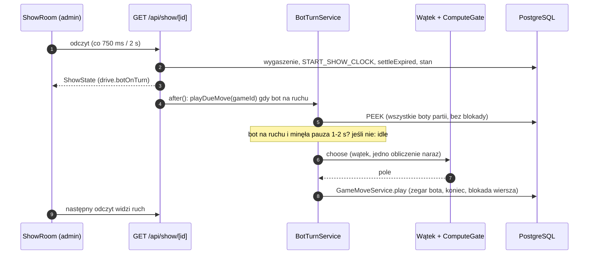

# Pokaz: prywatna partia bez miejsca człowieka (bot vs bot, bot vs agent), tylko administrator, podgląd na żywo, ruchy napędzane pollingiem widoku

> Status: **zatwierdzona przez właściciela (2026-11-09)** w całości — „P4 i P16 zatwierdzam, zatwierdzam spec”, po wcześniejszych rozstrzygnięciach tego dnia (Z1…Z5); przed zatwierdzeniem szkic autonomiczny (`om-auto-write-spec`, tryb autonomiczny, 2026-11-09; zgłoszenie #275, które zostaje otwarte jako zgłoszenie funkcji epiku E14). Do `implemented/` przechodzi dopiero po wdrożeniu. Specyfikacja jest **wyłącznie projektowa** — nie zmienia kodu ani backlogu; wiersze briefu produktu zmieniono razem z zatwierdzeniem (D-37, A-23, A-24, adnotacje BR-31, BR-54, BR-13, N-15, D-32/BR-37). Źródło wymagań: brief przekazania `.ai/specs/briefs/2026-11-09-show-mode.md` (rozstrzygnięcia właściciela z 2026-11-09 są **stałe**: sekcje „Agreed direction” i „Resolved unknowns” nie są tu otwierane ponownie), kontekst: `.ai/specs/product-brief.md` i `2026-11-05-hosted-bot.md` (R1…R22), zapis decyzji: `.ai/specs/research/decisions/2026-11-09-show-mode.md`. Pozycje „Resolved assumptions” oznaczone dawniej `⚠ NEEDS HUMAN CONFIRMATION` są zatwierdzone (patrz „Zatwierdzenia właściciela (2026-11-09)”). Numery linii odnoszą się do `origin/main` z 2026-11-09 (HEAD `16f26b5`).

## 📝 TLDR

Dziś bot gra tylko z człowiekiem-twórcą na miejscu 1 (BR-54, R3: bot zawsze miejsce 2), a agent LLM dołącza tylko do partii człowieka, który sam gra (BR-31). Właściciel chce na spotkaniu, z cudzego komputera i przez domenę produkcyjną, **pokazać na żywo partię botów** (głównie bot vs bot, dodatkowo bot vs agent), bez własnych urządzeń widowni. **Po wdrożeniu (zachowanie przyszłe)** administrator (konto z `ADMIN_EMAIL`, e-mail potwierdzony) otwiera `/show`, wybiera układ i poziomy botów, a serwer tworzy **prywatną partię bez miejsca człowieka** (`origin = 'show'`, dwa miejsca zajęte przez boty albo bot + agent dołączający kodem przez MCP). Partię ogląda tylko administrator, na stronie tylko do odczytu `(frontend)/show/[gameId]` (404 bez sesji administratora), na dużym ekranie. **Ruchy botów napędza polling tej strony** (`after()` jak w partii z botem, bez pętli w serwerze); w bot vs agent bot odpowiada też przy `get_state` agenta. Zegary, koniec przez czas, sprzątanie i prywatność są istniejące; pokaz nie trafia do historii, powtórki ani liczników. Ryzyko jest na CPU, nie w modelu: bot vs bot poziomu 2 zajmuje bramkę obliczeń w ok. połowie czasu na hoście, gdzie opóźnienie pętli zdarzeń (p99 59,7 ms przy progu 50 ms, A-22) jest już na granicy — dlatego bot vs bot poziomu 2 jest **chciany także za cenę wolniejszej gry** (decyzja właściciela 2026-11-09): za przełącznikiem domyślnie wyłączonym do czasu **strojenia tempa** (dłuższa pauza, niższy miękki budżet ruchu) i pomiaru, który nie jest już bramką „tak/nie”, tylko kryterium stopniowego strojenia (sekcja „Resource policy & tuning of level 2”). Widok na dużym ekranie (plansza w rozmiarze „pod projektor”) jest **osobno włączanym widokiem** (przełącznik + `?projektor=1`), nie domyślnym układem.

## Resolved decisions (z briefu — niezmienne w tej specyfikacji)

| # | Decyzja właściciela (2026-11-09) | Konsekwencja w projekcie |
|---|---|---|
| B1 | Partia prywatna **bez miejsca człowieka**, tworzona wyłącznie przez administratora (`requireAdmin`, e-mail potwierdzony), **jeden pokaz naraz** | `ShowService`, trasy `/api/show*`, strona `/show` |
| B2 | Miejsce = Bot (poziom 1 lub 2) albo Agent (kod zaproszenia, MCP jak dziś, BR-31); główny układ bot vs bot, dodatkowo bot vs agent; agent vs agent poza zakresem | dwa układy: `bot-bot`, `bot-agent` |
| B3 | Podgląd tylko do odczytu `(frontend)/show/[gameId]` pod `requireAdmin`, wyjątek zapisany w `AGENTS.md`, 404 bez sesji administratora; nowy serwis i trasa odczytu wydzielone z serwisu widza; prezentacyjna plansza użyta ponownie; **nie** flaga w stronie widza | `ShowService.read`, `GET /api/show/[id]`, `ShowRoom` |
| B4 | Napęd: polling widoku administratora (leniwy model repo, bez pętli serwera); widok **nie zatrzymuje pollingu w ukrytej karcie** i pokazuje wyraźny wskaźnik „napęd zatrzymany”; w bot vs agent bot gra także przy `get_state`/`play_move` agenta | sekcja „Driver” |
| B5 | Zegary: istniejące 10 min na stronę, koniec przez czas; pauza bota 1–2 s liczona z jego zegara | pauza w warunku `isDue`, zegar bez zmian |
| B6 | Bez historii, powtórki i licznika administratora (jeden warunek po `origin`); sprzątanie jak partie bez konta; czat wyłączony | `RECORD_SQL`, `GUEST_ONLY_SQL` bez zmian, `with_bot` |
| B7 | `origin = 'show'` (CHECK, migracja); bot na miejscu 1 **tylko** w pokazie; bez flagi publicznej, QR, widzów, Q-16 | sekcja „Data Model” |
| B8 | Bramka pomiarowa przed bot vs bot poziomu 2 na Mikrusie (dwa boty poziomu 2 ≥ 5 min przy zwykłym ruchu, p99 pętli ≤ 50 ms) — **zmienione przez właściciela 2026-11-09:** poziom 2 w bot vs bot jest chciany „nawet za cenę wolniejszego działania”; pomiar to kryterium **strojenia tempa**, nie rozstrzygnięcie „tylko poziom 1” | sekcja „Resource policy & tuning of level 2”, faza (d) |
| B9 | Wymagania operacyjne: test przedlotowy „czy pokaz wystartuje”, próba generalna z obcego komputera, wylogowanie po pokazie, zakaz wdrożeń w dniu pokazu, siła zamrożona z RAM przy tworzeniu i widoczna z nazwą bota | sekcje „UI/UX”, „Resource policy & tuning of level 2”, faza (d) |

## Resolved assumptions (autonomous defaults)

Brief rozstrzyga produktowo wszystko, co blokuje architekturę; poniżej to, co zostawia otwarte. Wybrano odpowiedź najmniej kosztowną do odwrócenia, najmniejszą powierzchnię i ponowne użycie istniejących prymitywów. **Zatwierdzenie tej specyfikacji przez właściciela potwierdza wszystkie pozycje** albo zastępuje je jego poprawkami. Wartości liczbowe to propozycje do pomiaru/próby, nie zmierzone fakty.

| # | Pytanie | Przyjęty domyślnie | Dlaczego | Potwierdzenie |
|---|---|---|---|---|
| P1 | Jedna specyfikacja czy rozbicie (dwie niezależnie wdrażalne możliwości: bot vs bot i bot vs agent)? | Jedna specyfikacja, cztery fazy; faza (c) (bot vs agent) i (d) (strojenie i pomiar, bot vs bot poziomu 2) są niezależnie wdrażalne po (a)+(b) | Wspólny model, jedna trasa odczytu i jeden widok; podział powielałby sekcje „Data Model”, „API Contracts”, „Driver” | odwracalne |
| P2 | Przełączniki wydania i tempo | Trzy flagi `.env`, domyślnie wyłączone: `SHOW_ENABLED` (cała funkcja), `SHOW_BOT_VS_BOT_ENABLED` (układ bot vs bot), `SHOW_BOT_LEVEL2_ENABLED` (poziom 2 w bot vs bot). `BOT_ENABLED` jest nadal warunkiem koniecznym. Wyłączenie nie przerywa trwającego pokazu. **Rewizja wg właściciela 2026-11-09:** `SHOW_BOT_LEVEL2_ENABLED` pozostaje przełącznikiem (domyślnie off do czasu strojenia i pomiaru), ale pomiar **nie jest już bramką, która może zablokować poziom 2** — o włączeniu decyduje procedura strojenia (pokrętła tempa `BOT_SHOW_PAUSE_MIN_MS`/`_MAX_MS` i `SHOW_BOT_L2_SOFT_MS`, tabela kroków w „Resource policy & tuning of level 2”); jeśli nie pomaga nawet najwolniejszy krok, decyduje właściciel jawnie (wyjątek albo ograniczenie do poziomu 1) | Fazy (a)–(c) wchodzą ciemno; poziom 2 w bot vs bot włącza się po strojeniu | zrewidowane wg właściciela 2026-11-09 |
| P3 | Gdzie formularz tworzenia | Strona `/show` w grupie `(frontend)` (formularz + konsola: wynik sprawdzenia przedlotowego, trwający pokaz), z **czysto statycznym linkiem** z panelu `/backend`; bez linku na stronie głównej. Nie w `(backend)` | `(backend)` jest tylko do odczytu (BR-37, `admin-gate.guard.test.ts:61-63` zabrania tam tras i akcji) i ma inny motyw; strona główna jest dla graczy; podgląd i tworzenie dzielą grupę, komponenty i motyw ekranu pokazywanego publiczności | odwracalne |
| P4 | Reprezentacja miejsc | bot vs bot: dwa wiersze `game_players` `kind = 'bot'` (miejsca 1 i 2), partia `active` od utworzenia; **brak wiersza twórcy**. Bot vs agent: wiersz bota na **miejscu 1**, partia `waiting` z wierszem `invitations` (wygasa po 30 min, P11); agent dołącza na miejsce 2 istniejącym `AgentSeatService.join`. Kolory losuje `ColorDraw` (przy tworzeniu albo przy dołączeniu agenta); poziom/pamięć/głębokość zamrożone w wierszach botów | Zero nowych tabel i kolumn; `READ_INVITATION_SQL` (`join-core.ts:48`) znajduje „twórcę” na miejscu 1 także gdy jest botem; zob. „Data Model” | zatwierdzone przez właściciela 2026-11-09 |
| P5 | Zmiana CHECK-a „bot tylko miejsce 2” | Migracja usuwa `game_players_bot_seat_check` (`game-player.ts:135`); niezmiennik „bot na miejscu 1 tylko w pokazie” pilnuje serwis tworzący + test integracyjny; bez wyzwalacza (CHECK nie widzi innej tabeli) | Wyzwalacz to nowy wzorzec w schemacie dla funkcji o niskim priorytecie | zatwierdzone przez właściciela 2026-11-09 |
| P6 | „Jeden pokaz naraz” | `pg_advisory_xact_lock` + zapytanie „czy jest `origin = 'show'` w `waiting`/`active`” w transakcji tworzenia, po leniwym rozliczeniu poprzedniego (zegar/wygaśnięcie); kolejny pokaz wolno po `finished`/`cancelled`. Bez unikalnego indeksu na wyrażeniu | Wzorzec z `ADVISORY_LOCK_SQL` w `game-service.ts:141`; indeks wyrażeniowy kłóci się z generowaniem migracji MikroORM (lekcja 2026-10-31 o snapshotach) | odwracalne |
| P7 | Zakończenie pokazu przez administratora | `POST /api/show/[id]/end`: `waiting`/`active` → `cancelled` + zwolnienie slotów; bez wyniku, bez licznika. Widok odróżnia „wygasł” od „zakończony przez administratora” po `started_at` (nie null = był w toku) | Brak nowego statusu/kolumny; agent widzi `cancelled` jak każdy zamknięty zegar | odwracalne |
| P8 | Tempo pollingu widoku | 750 ms, gdy na ruchu jest bot (jak `BOT_POLL_INTERVAL_MS`, `game-room.tsx:39`); 2000 ms w pozostałych stanach; „napęd zatrzymany”, gdy ostatni udany odczyt jest starszy niż 5 s albo kolejne 3 odczyty zawiodły albo serwer raportuje `drive.stalled` | Najkrótszy sensowny krok względem pauzy 1–2 s; koszt: ok. 1,3 żądania/s od jednego klienta | zatwierdzone przez właściciela 2026-11-09 (napęd wyłącznie pollingiem widoku administratora, wraz z wyjątkiem ukrytej karty, „napędem zatrzymanym”, Wake Lock i runbookiem „karta na wierzchu”) |
| P9 | Pauza bota (B5) | Deterministyczna z `hash(gameId, moveNumber)` w zakresie `BOT_SHOW_PAUSE_MIN_MS`…`BOT_SHOW_PAUSE_MAX_MS` (domyślnie 1000…2000; pokrętło strojenia poziomu 2, zob. „Resource policy & tuning of level 2”), liczona od `turn_started_at`; **przycięcie przy niskim zegarze:** efektywna pauza = `min(pauza, pozostały zegar bota / 4)` (czysta funkcja w `core`, obok `showPauseMs`), żeby pauza sama nie zjadła zegara; ruch jest „należny” dopiero po pauzie, a wyszukiwanie startuje po niej. Dotyczy każdego ruchu bota w pokazie (także vs agent); nie dotyczy zwykłych partii | Bez `sleep` w obsłudze żądania i bez zmiany logiki zegara: pauza to warunek w `isDue`; ruch po ponownym uruchomieniu wychodzi ten sam | odwracalne |
| P10 | Limit tworzenia pokazu | Pula `show-create:{userId}`: 10 na godzinę (`RateLimiter.hit`) | Najmniej nowych wartości (jak `CREATE_GAME_LIMIT`); chroni przed pętlą klienta | odwracalne |
| P11 | Wygasanie pokazu czekającego na agenta | Zaproszenie ważne **30 min** (`SHOW_WAITING_TTL_MS`, stała w `core`), wygaszane leniwie przy odczycie (`EXPIRE_WAITING_OF_GAME`), usuwane przez istniejące `waitingGames` 1 h po wygaśnięciu | Domyślne 24 h (`INVITATION_TTL_MS`) trzymałoby slot bota i partię dobę | odwracalne |
| P12 | Kod zaproszenia na ekranie widowni | Karta agenta pokazuje kod **zamaskowany** (`••••-••••`) z przyciskami „Pokaż” i „Kopiuj”; kod znika po dołączeniu agenta | Ekran jest wspólny dla widowni: ktoś z agentem mógłby odczytać kod i zająć miejsce przed agentem administratora | zatwierdzone przez właściciela 2026-11-09 |
| P13 | Dołączenie człowieka kodem pokazu | Przeglądarkowa ścieżka zaproszeń (`InvitationService`, strona `/invite/<kod>`) traktuje zaproszenie partii `origin = 'show'` jak nieistniejące (`INVALID_INVITATION`); dołączyć można tylko przez MCP | Bez tego człowiek mógłby zająć miejsce 2 i wejść w BR-13; zaproszenie jest „agentowe” z założenia | odwracalne |
| P14 | Napęd z MCP | `AgentGameService.getState` wywołuje `BotTurnService.playDueMove` na początku i w każdej rundzie oczekiwania `waitSeconds` — **tylko** dla partii `origin = 'show'` z botem; `play_move` go nie wywołuje (pauza i tak nie minęła) | Najmniejsza zmiana ścieżki MCP; bot odpowiada przy następnym `get_state`/pollingu | odwracalne; napęd z MCP zostaje częścią zatwierdzonej decyzji o napędzie (polling widoku + `get_state` agenta) |
| P15 | Liczniki panelu | Poza `RECORD_SQL` także `GAME_COUNTERS_SQL` (`admin-overview-service.ts:39-55`) pomija `origin = 'show'` | Brief wskazuje tylko `RECORD_SQL`, a panel liczy `games` wprost (status, `origin`, `end_reason`): pokaz zawyżyłby „w toku/zakończone” | odwracalne |
| P16 | Poziomy w bot vs agent | Poziom 1 i 2 dozwolone z samym `BOT_ENABLED` (przez `BotAdmission`); flaga `SHOW_BOT_LEVEL2_ENABLED` dotyczy tylko bot vs bot | Obciążenie ≈ zwykła partia człowiek–bot (agent odpowiada 10–30 s), już zaakceptowana wyjątkiem A-22; bramka pomiarowa B8 dotyczy ciągłego obciążenia | zatwierdzone przez właściciela 2026-11-09 |
| P17 | Kryteria strojenia poziomu 2 w bot vs bot (dawniej bramka B8) | `bot:bench --show` (faza d): ≥ **300 s** dwóch botów poziomu 2 z pauzą i miękkim budżetem z bieżącego kroku strojenia przy ruchu sondy **2 żądania/s** na stan innej partii; krok jest zaliczony, gdy spełnia wszystkie: p99 pętli zdarzeń ≤ **50 ms** (rozdzielczość 10 ms), p95 ruchu ≤ 1,2 × miękki budżet kroku, max ruchu ≤ pułap kroku + 250 ms, p95 odczytu sondy ≤ 2 × bez obliczeń i ≤ 300 ms, przyrost RSS ≤ 100 MB, brak `bot.turn_failed`. Kroki stosuje się po kolei, aż któryś przejdzie; **niezaliczenie nawet ostatniego kroku nie wyłącza poziomu 2 po cichu** — właściciel decyduje jawnie (udokumentowany wyjątek jak dla pojedynczego bota, #264/A-22, albo ograniczenie pokazu do poziomu 1) | Progi R18 z `2026-11-05-hosted-bot.md` + warunki ciągłego obciążenia; wynik i decyzja po przekroczeniu są decyzją właściciela | zrewidowane wg właściciela 2026-11-09 |
| P18 | Sprawdzenie silnika w teście przedlotowym | `POST /api/show/preflight` wykonuje próbny ruch bota poziomu 1 na pustej planszy (≤ 250 ms, za bramką); `GET /api/show` robi tylko tanie sprawdzenia bez obliczeń | Najczęstsza awaria w dniu pokazu to wątek roboczy, który się nie uruchamia | odwracalne |
| P19 | Ekran „zawsze włączony” | `navigator.wakeLock.request('screen')` jako dodatek (best effort, ponawiane po `visibilitychange`), bez obejścia gdy brak API | Uśpiony ekran = brak pollingu; to nie zastępuje wskaźnika „napęd zatrzymany” | odwracalne |
| P20 | Widok pod projektor | **Rewizja wg właściciela 2026-11-09 („osobno włączany widok pod projektor”).** Domyślny układ `/show/[gameId]` jest **normalny** (plansza w istniejącym `--layout-width-board: 448px`, normalne rozmiary czcionek). Administrator włącza **„Widok pod projektor”** przełącznikiem (Pole wyboru DS); dopiero w tym trybie używany jest jeden nowy token `--layout-width-board-show` w `game-tokens.css` (rząd `min(88vh, 960px)`, zakres do ustalenia przy mockupie) i większa typografia nazw/zegarów (istniejące tokeny rozmiarów, bez nowych). Stan trybu: **parametr URL `?projektor=1` jest źródłem prawdy** (przeżywa przeładowanie na cudzym komputerze); opcjonalnie lustro w `localStorage` (try/catch), używane tylko jako wartość domyślna, gdy parametru brak (`?projektor=0` wyłącza jawnie). Bez nowego komponentu, bez flagi serwera. **Interpretacja „osobno włączany” = przełącznik trybu w obrębie tego samego widoku (per widok), nie osobna trasa ani flaga funkcji** — do poprawienia przez właściciela | Zasady DS wymagają zgody właściciela na nowe tokeny; 448 px na projektorze jest nieczytelne, ale właściciel chce to jako tryb włączany, nie domyślny | zrewidowane wg właściciela 2026-11-09; interpretacja do potwierdzenia |
| P21 | Po zakończeniu | Widok pokazuje wynik, przyciski „Nowy pokaz” i „Wyloguj” (istniejące `POST /api/auth/logout`); partia znika z `db:cleanup` ok. 1 h po końcu (`guestOnlyFinishedGames`) | Wymóg „wylogować po pokazie” (B9) jako jedno kliknięcie; sesja trwa 30 dni (`session-service.ts:7`) | odwracalne |
| P22 | Numeracja epiku | Epik E14 „Pokaz”; fazy (a)…(d) = historie E14-S01…S04 | Następny wolny numer po E13 w `backlog.md` | odwracalne |

## Zatwierdzenia właściciela (2026-11-09)

Pięć rozstrzygnięć właściciela po przeglądzie szkicu; zastępują lub potwierdzają odpowiednie pozycje „Resolved assumptions”.

| # | Decyzja | Konsekwencje w projekcie |
|---|---|---|
| Z1 | **Poziom 2 w bot vs bot jest chciany także za cenę wolniejszego działania.** | Pomiar (P17) przestaje być bramką „tak/nie” i staje się **procedurą strojenia**: pokrętła tempa (`BOT_SHOW_PAUSE_MIN_MS`/`_MAX_MS`, `SHOW_BOT_L2_SOFT_MS`) i tabela kroków w „Resource policy & tuning of level 2”; `SHOW_BOT_LEVEL2_ENABLED` zostaje przełącznikiem (domyślnie off do czasu strojenia i pomiaru). Oczekiwanie „odrzucenie na Mikrusie” z szkicu usunięte. Brak zaliczenia ostatniego kroku = jawna decyzja właściciela (wyjątek albo poziom 1), nigdy po cichu. Faza (d) |
| Z2 | **P5 zatwierdzone:** usunięcie CHECK-a „bot tylko na miejscu 2” bez wyzwalacza. | Niezmiennik „bot na miejscu 1 tylko w pokazie” pilnuje serwis tworzący + test integracyjny (bez zmian względem szkicu). Faza (a) |
| Z3 | **Napęd wyłącznie pollingiem widoku administratora zatwierdzony** (P8/P14): wyjątek ukrytej karty, wskaźnik „napęd zatrzymany”, Wake Lock, runbook „karta na wierzchu”. | Bez zmian w projekcie; sekcja „Driver” staje się ustaloną decyzją (nadal zalecana niezależna recenzja, „Review limits”). Fazy (b), (c) |
| Z4 | **P12 zatwierdzone:** kod zaproszenia na ekranie pokazu maskowany. | Bez zmian w projekcie. Faza (c) |
| Z5 | **Widok pod projektor jest osobno włączany** (P20 zrewidowane). | Normalny układ domyślnie; przełącznik „Widok pod projektor” (`?projektor=1`, opcjonalnie `localStorage`); nowy token `--layout-width-board-show` i większa typografia tylko w tym trybie; wpisane do „UI/UX”, kryteriów fazy (a) i notatek DS. Interpretacja „per widok, nie osobna trasa ani flaga” jawnie w P20. Faza (a) |

**Zatwierdzenie specyfikacji jako całości (2026-11-09).** Właściciel: „P4 i P16 zatwierdzam, zatwierdzam spec”. Zatwierdzone zostały:

- **P4** (reprezentacja miejsc: bot–bot = dwa wiersze botów na miejscach 1 i 2, partia `active` od utworzenia; bot–agent = bot na miejscu 1 + partia `waiting` + zaproszenie) i **P16** (bot vs agent: poziomy 1 i 2 tylko z `BOT_ENABLED`) — ostatnie dwie pozycje, które były otwarte;
- **specyfikacja w całości**, w tym wartości projektowe wprowadzone w rewizji dla strojenia poziomu 2: **pułap pauzy 8 s**, **przycinanie pauzy do `min(pauza, zegar bota / 4)`**, **granulacja kroków strojenia (pauza min = max / 2)** oraz nazwy zmiennych **`BOT_SHOW_PAUSE_MIN_MS`/`BOT_SHOW_PAUSE_MAX_MS`** i **`SHOW_BOT_L2_SOFT_MS`**. Wartości liczbowe tabeli strojenia (T1…T3) i progów P17 pozostają propozycjami do pomiaru i strojenia (A-24), nie zmierzonymi faktami.

Skutek: wszystkie pozycje „Resolved assumptions” (P1…P22) są zatwierdzone lub odwracalne; sekcje „Decisions in play” weszły do `product-brief.md` (D-37, A-23, A-24, adnotacje BR-31, BR-54, BR-13, N-15, D-32/BR-37).

**Uwaga dla implementacji (właściciel zatwierdził bez tego kroku):** zalecana jest niezależna recenzja sekcji „Driver” i „Data Model” przed albo w trakcie E14-S01/S02 (recenzent w świeżym kontekście, odczyt kodu, nie tej specyfikacji); jej brak nie blokuje startu, ale wynik recenzji trzeba odnotować w PR-ze historii.

## 📝 Problem Statement

Pokazanie botów na spotkaniu przez serwer produkcyjny jest dziś niemożliwe, a każda z trzech istniejących dróg zawodzi w kodzie (odczytane z `origin/main`):

- **Bot ma tylko jedno miejsce i jedną rolę.** `game_players_bot_seat_check` (`packages/db/src/entities/games/game-player.ts:135`) wymusza `kind <> 'bot' or seat = 2`; `GameService.#insertGame` (`game-service.ts:591-638`) zawsze tworzy wiersz człowieka na miejscu 1 i bota na miejscu 2. Jedyna opcja „obejrzeć bota” to grać z nim.
- **Ruch bota wywołują tylko trasy gracza.** `scheduleBotTurn` (`http/bot-turn.ts:20`) woła `after()` z `GET /api/games/[id]` (`route.ts:33`) i `POST …/moves` (`route.ts:77`); odczyt bez uczestnika (widz) go nie woła. `PEEK_SQL` w `BotTurnService` (`bot-turn-service.ts:38-45`) łączy `game_players` po `kind = 'bot'` i bierze **pierwszy** wiersz (`[row]`, `:101`) — przy dwóch botach może trafić w bota, który nie jest na ruchu, a `isDue` (`:66`) zwróci `false` na zawsze: partia stoi.
- **Agent dołącza tylko do człowieka.** `READ_INVITATION_SQL` (`join-core.ts:41-50`) czyta „twórcę” z miejsca 1; `AgentSeatService` zwraca `opponent: { kind: CreatorKind }` (`agent-seat-service.ts:53`, `:162`), a `CreatorKind` wyklucza `agent` i `bot` (`packages/core/src/games/types.ts:47`). Miejsce agenta jest zaszyte jako 2 (`INSERT_AGENT_SQL`, `:56`; CHECK `game_players_agent_seat_check`).
- **Każdy odczyt zakłada uczestnika.** `GameService.stateOf` (`game-service.ts:800-861`) bierze `you` z `participant.playerId` (`:817`) i wymaga wiersza; `resolveParticipant` (`http/participant.ts:28-44`) daje 404 administratorowi bez miejsca. Odczyt widza (`spectator-service.ts:213-249`) odrzuca partię prywatną (`!game.isPublic` → `GoneError`, `:232`) i gubi `bot` (poziom, pamięć) w mapowaniu `:241-246`.
- **Brama administratora nie nadaje się do tras API.** `requireAdmin` (`http/admin-gate.ts:17-24`) kończy `notFound()`, czyli rzuca błąd spoza `AppError`; w `apiHandler` taki błąd kończy się `500` (`api-handler.ts:149`), nie 404. Test strażnik `admin-gate.guard.test.ts` skanuje wyłącznie `app/(backend)` (`ROOT`, `:8`) i **zabrania** tam tras i akcji.
- **Zegar nie rusza bez odwiedzin.** `START_CLOCK_SQL` (`game-service.ts:128-132`) uruchamia się tylko w `getState` uczestnika; w partii bez człowieka nikt go nie woła. Partia nieotwarta w 15 min jest zamykana (`CANCEL_NOT_STARTED`, `lazy-closing.ts`).
- **Pokaz zanieczyściłby dane produktu.** `RECORD_SQL` (`finished-game-counter.ts:6-16`) zlicza każdą zakończoną partię w `game_pair_counters` po `min(kind)/max(kind)`; panel liczy `games` wprost (`admin-overview-service.ts:39-55`). Para `bot-bot` nie istnieje w `KNOWN_PAIRS` (`finished-stats.ts:10-18`; nieznane pary są dopisywane do panelu, nie rzucają).

Popytu graczy nie ma (A-20): to osąd właściciela („ciekawość oraz możliwość pokazania tego na spotkaniu”). Zakres jest więc najmniejszy możliwy, za flagami i tylko dla administratora.

## 📝 Proposed Solution

### Rozważone alternatywy (rozstrzygnięte w briefie — dla zapisu)

| Opcja | Wynik | Powód |
|---|---|---|
| Nic nie budować, `npm run bot:arena` | odrzucone | brak planszy; właściciel nie ma komputera deweloperskiego (brief) |
| Widownia na telefonach (kod/QR, partia publiczna) | odrzucone | Q-16, BR-39…BR-45, ekspozycja prawna obcej widowni |
| Pętla ruchów w serwerze | odrzucone | nowy wzorzec startu i wznawiania; repo jest leniwe |
| Strona podglądu w `(backend)` | odrzucone | inny motyw, więcej pracy |
| **Partia bez człowieka + polling widoku administratora** | **wybrane** | reużywa partię, zegar, bota, MCP, `after()`; nowe tylko: serwis odczytu, strona, warunek `isDue` |

### Zasada projektu

Pokaz **jest zwykłą partią** (`games` + `game_players`, `GameMoveService.play`, `TimeoutSettler`, `BotTurnService`), z trzema różnicami: nie ma wiersza człowieka, `origin = 'show'` odcina go od historii i liczników, a czytają go tylko dedykowana trasa i strona pod `requireAdmin`. Żaden z istniejących odczytów (`GameService.getState`, `SpectatorService`) nie dostaje flagi „pokaz”; to wprost wymóg briefu i bezpieczniejsze: nowy kod nie może rozszerzyć kontraktu odczytu gracza ani widza.

## 📝 Architecture

```mermaid
flowchart LR
    subgraph przegladarka["Komputer pokazu (admin zalogowany)"]
        S["/show (formularz, test przedlotowy)"]
        V["/show/[gameId] ShowRoom (polling 750 ms / 2 s)"]
    end
    subgraph serwer["Serwer (jeden proces Node)"]
        A["requireAdmin / requireAdminApi (nowe)"]
        SS["ShowService (nowy): create, read, end, preflight"]
        BT["BotTurnService.playDueMove (zmiana PEEK_SQL i isDue)"]
        G["ComputeGate + worker_threads (bez zmian)"]
        GM["GameMoveService.play (bez zmian)"]
        MCP["AgentGameService.getState (nowe wywołanie napędu)"]
    end
    DB[("PostgreSQL: games origin=show, game_players")]
    AG["Agent LLM przez MCP (bot vs agent)"]
    S -->|POST /api/show| A --> SS --> DB
    V -->|GET /api/show/id| A --> SS --> DB
    SS -.->|after(): bot na ruchu| BT --> G
    BT --> GM --> DB
    AG -->|join / get_state / play_move| MCP -.->|bot na ruchu| BT
```

Wniosek: nowy jest serwis odczytu/tworzenia i bramka administratora dla tras API; **cała logika ruchu, zegara, końca partii i sprzątania jest istniejąca**, zmienia się tylko jej założenie „jeden bot na miejscu 2, ruch po akcji gracza”.

Reużywane: `watchableState` (`game-service.ts:326`; wspólny widok stanu, tak samo jak widz), `botOnTurn`/`scheduleBotTurn` (`http/bot-turn.ts`), `BotAdmission`, `ComputeGate`, `TimeoutSettler.settleExpired`, `AgentSeatService.join`, `useGameClock`, `PlayerLabel`, `mergeState/knownMoves`, `Board`, `GameResultBanner`, `TurnStatus` z `@gomoku/ui/game/*`. Nowe: `ShowService`, `requireAdminApi`, `show-config`, trasy `/api/show*`, strony `/show` i `/show/[gameId]`, `ShowRoom`, `useShowDrive`.

## 📝 Data Model

### Migracja `…_show_origin` (jedna, odwracalna)

1. `games_origin_check`: `origin in ('invite', 'lobby', 'rematch', 'bot', 'show')` (wzorzec: `Migration20261106071117_bot_participant.ts:8-9`); `GAME_ORIGINS` w `packages/core/src/games/types.ts:9` dostaje `'show'`; ten sam wyraz w `game.ts:79-80`.
2. `game_players_bot_seat_check` usunięty (P5); komentarz w `game-player.ts` zmieniony („bot na miejscu 1 tylko w pokazie, pilnuje serwis”). Pozostałe CHECK-i bota (`level`, `kind`, `params`, `no_user`) bez zmian: wiersze botów w pokazie są zgodne.
3. `down()`: odmawia, gdy istnieje partia `origin = 'show'` albo bot na miejscu 1 (jak migracja bota); inaczej odtwarza stare CHECK-i. Test na prawdziwym PostgreSQL: `up` → wstaw pokaz → `down` odmawia → usuń → `down`/`up` przechodzi. Po `migration:create` przeczytać plik i usunąć szum snapshotu (lekcje 2026-10-31).

Brak nowych tabel i kolumn. „Twórca pokazu” nie jest zapisywany (jedyny administrator, B1); log bezpieczeństwa zapisuje utworzenie i zakończenie (bez danych poza `gameId`).

### Reprezentacja partii

| Pole | bot vs bot | bot vs agent |
|---|---|---|
| `games.origin` | `show` | `show` |
| `games.status` | `active` od utworzenia, `started_at = now`, `black_seat` z `ColorDraw`, **`turn_started_at = now`** (zegar rusza od razu: nikt nie „otwiera” partii, B1) | `waiting` z `invitations` (wygasa `now + 30 min`, P11); po `join` agenta `active` przez `seatSecondPlayer` (`join-core.ts:93-111`) |
| miejsce 1 | bot A (`kind='bot'`, `bot_level`, `bot_memory_mb`, `bot_depth_cap`, `seen_at = now`, `is_active`) | bot (jak obok) |
| miejsce 2 | bot B (jw.) | agent (`kind='agent'`, `join_channel='mcp'`, `agent_token_hash`, `seen_at = now` w `INSERT_AGENT_SQL`) |
| `user_id` | `NULL` w obu | `NULL` w obu |
| `is_public` | `false` | `false` |
| wariant/zegar | `classic`, 10 min (`resolveGameSettings()`) | jw. |

Konsekwencje dla niezmienników:

- **BR-13 bez zmian (zapisane jawnie):** unikalny indeks `game_players_user_id_active_unique` (`game-player.ts:72`) dotyczy `user_id`; uczestnicy pokazu mają `user_id = NULL` (NULL-e się nie zderzają), więc pokaz nie zajmuje slotu administratora ani nikogo innego. Administrator może w trakcie pokazu założyć zwykłą partię.
- **Dwa wiersze botów w jednej partii** są dozwolone przez `UNIQUE (game_id, seat)`; indeks częściowy `game_players_bot_active_index` nie jest unikalny.
- **Zegar bot vs agent:** `START_CLOCK_SQL` czeka na `seen_at` wszystkich miejsc (`game-service.ts:128-132`); oba są ustawione, więc zegar ruszy przy pierwszym odczycie partii. Odczyt administratora wykonuje wariant tego zapytania **bez wykluczania wywołującego** (`START_SHOW_CLOCK_SQL`), dzięki czemu milczący agent, który nigdy nie zawoła `get_state`, też „dostaje” swój zegar i pokaz kończy się wynikiem „czas” (B5).
- **Brak wiersza twórcy:** kod zakładający człowieka na miejscu 1 jest nieosiągalny dla pokazu (sprawdzono: `cancel`, `closeAudience`, `RematchService`, `invite-qr-service`, `GameParticipation.currentGame`, czat wymagają uczestnika-konta/gościa przez `resolveParticipant`; administrator nim nie jest). Jedyna ścieżka czytająca „miejsce 1 jako twórcę” bez uczestnika to `READ_INVITATION_SQL` — i tu miejsce 1 jest botem (kolumny `creator_id`/`creator_name` puste, `creator_kind = 'bot'`).
- **Typy:** `AgentJoinResult.opponent.kind` i `InvitationRow.creator_kind` poszerzone z `CreatorKind` do `Exclude<ParticipantKind, 'agent'>` (nowy alias `OpponentOfAgentKind` w `core`); `CreatorKind` zostaje bez zmian (BR-30: nikt poza człowiekiem nie tworzy partii zwykłej).

### Sprzątanie (sprawdzone na regułach `cleanup/rules.ts`)

- `GUEST_ONLY_SQL` (`:20-21`) = „brak uczestnika spoza `guest/agent/bot`”: pokaz bot–bot i bot–agent mu odpowiada, więc `guestOnlyActiveGames` (`:176`, 1 h po terminie zegara) i `guestOnlyFinishedGames` (`:186`, 1 h po końcu) **działają bez zmian**; test jednostkowy z dwoma botami i z botem+agentem dopisany do `rules.test.ts`.
- Pokaz czekający na agenta: `waitingGames` (`:152`) usuwa 1 h po wygaśnięciu zaproszenia — z TTL 30 min to ≤ 1,5 h po utworzeniu (zamiast ≤ 25 h).
- Pokaz `cancelled` (zakończony przez administratora/wygasły): reguła `cancelledGames` (`:163`, 25 h) — akceptowane (jeden mały wiersz, bez danych osobowych), bez nowej reguły.

## 📝 API Contracts

Wszystkie trasy: `apiHandler` (CSRF dla `POST`, koperta `{ ok, data | error }`, `Cache-Control: private, no-store`; `api-routes.guard.test.ts` to wymusza), **`requireAdminApi()` jako pierwsza instrukcja** (przed odczytem czegokolwiek), `await connection()`.

**`requireAdminApi()`** (nowa, w `http/admin-gate.ts`): ta sama decyzja co `requireAdmin` (rola z `ADMIN_EMAIL` przy każdym żądaniu, e-mail potwierdzony, `logSecurityEvent("admin_denied")`), ale zamiast `notFound()` rzuca `NotFoundError(GAME_NOT_FOUND_MESSAGE)`, bo `apiHandler` zamieniłby `notFound()` na `500`. Wspólna funkcja pomocnicza `isAdminSession()` zasila obie bramki. Odpowiedź dla każdego nie-administratora (brak sesji, inny gracz, niepotwierdzony e-mail, baza niedostępna, `ADMIN_EMAIL` nieustawiony) jest **identyczna z nieistniejącą partią**: `404 NOT_FOUND`.

| Trasa | Metoda | Wejście | Sukces | Błędy |
|---|---|---|---|---|
| `/api/show` | GET | — | `200 { enabled, preflight: { ok, checks: Check[] }, current: { gameId, status, layout } \| null }`; `Check = { id, ok, detail }` | 404 |
| `/api/show/preflight` | POST | `{ layout, levels }` jak niżej | `200 { ok, checks }` z próbnym ruchem silnika (P18) | 404, 400 |
| `/api/show` | POST | `{ layout: 'bot-bot', levels: [1\|2, 1\|2] }` albo `{ layout: 'bot-agent', botLevel: 1\|2 }` | `201 { gameId, layout, bots: [{ seat, level, name }], invitation?: { code, url, mcpUrl, expiresAt } }` (`invitation` tylko bot vs agent) | 404; 400 `VALIDATION` (nieznany układ/poziom, nadmiarowe pola); 409 `SHOW_RUNNING` (`data.gameId`); 503 `SHOW_UNAVAILABLE` (flaga wyłączona, `data.reason`); 503 `BOT_UNAVAILABLE` (`data.reason`: `disabled`, `memory`, `busy`, `level2_not_allowed`); 429 `RATE_LIMITED` |
| `/api/show/[id]` | GET `?after=N` | `after` jak w `gameStateQuerySchema` | `200 ShowState` (niżej); w razie bota na ruchu planuje jego ruch (`scheduleBotTurn`) | 404 (brak/zły id/nie pokaz/nie admin); 400 `after` większe niż liczba ruchów |
| `/api/show/[id]/end` | POST | — | `200 ShowState` (`status: 'cancelled'`); powtórka bezpieczna (`200`) | 404; 409 `GAME_NOT_ACTIVE` (partia już `finished`) |

`ShowState = WatchableState` bez `seen` (`watchableState`, `game-service.ts:326`: status, plansza, ruchy po `after`, oba zegary, `players[].displayName`, `agentName`, `bot { level, memoryMb }`) plus:

- `layout: 'bot-bot' | 'bot-agent'`;
- `invitation?: { code, url, mcpUrl, expiresAt }` — **tylko gdy `waiting`** (kod jest tajemnicą do czasu dołączenia agenta; po dołączeniu znika);
- `closedReason?: 'expired' | 'ended'` — dla `cancelled`: `ended`, gdy `started_at` nie jest null (P7);
- `finishedAt?` — dla `finished`;
- `drive: { botOnTurn: boolean, stalled: boolean }` — `stalled` liczone w SQL: bot jest na ruchu, a od `turn_started_at` minęło więcej niż `BOT_SHOW_PAUSE_MAX_MS` + pułap poziomu bota + 5000 ms (silnik nie odpowiada: błąd wątku, pętla zablokowana);
- brak `you`, `audience`, `rematch`, `canCloseAudience`, `paper` (pokaz jest tylko klasykiem).

Nie wolno ujawnić: tokenów (agent ani gość nie mają ich w odczycie), e-maili, `seen`. Odczyt wykonuje, w jednej transakcji i w tej kolejności: wygaszenie `waiting` (`EXPIRE_WAITING_OF_GAME`), `START_SHOW_CLOCK_SQL`, `TimeoutSettler.settleExpired`, odczyt wiersza (`findOneOrFail` z `failHandler` → 404, lekcja 2026-10-31). Partia o `origin ≠ 'show'` zawsze daje 404 (wspólny warunek w zapytaniu, nie w UI): administrator **nie może** przez te trasy czytać cudzych partii.

**Tworzenie (`ShowService.create`)**, kolejność: 1) `requireAdminApi`; 2) flagi (`SHOW_ENABLED`, `SHOW_BOT_VS_BOT_ENABLED` dla `bot-bot`, `SHOW_BOT_LEVEL2_ENABLED` gdy `bot-bot` i któryś poziom = 2); 3) `rateLimiter.hit('show-create:{userId}', 10, 1 h)`; 4) `BotAdmission.admitShow(levels)` — nowa metoda obok `admit`: jeden odczyt pamięci dla obu botów, `botStrengthFor(level, availableMb)` dla każdego, jeden test limitu `BOT_MAX_ACTIVE_GAMES` (pokaz zajmuje **jeden** slot, bo liczy się partie z botem, `bot-admission.ts:18-24`); 5) transakcja: `pg_advisory_xact_lock('show')`, leniwe rozliczenie istniejącego pokazu (`settleExpired`/wygaszenie), odmowa `409 SHOW_RUNNING`, wstawienie partii i wierszy (`tx` z callbacka, lekcja 2026-10-28), dla `bot-agent` wiersz `invitations`. Kolizja z `ColorDraw`: `black_seat` losuje się przy tworzeniu (bot–bot) lub dołączeniu (bot–agent).

**MCP (zmiany kontraktu opisów, nie schematu):** `opponent.kind` w odpowiedzi `join` i `get_state` może mieć wartość `"bot"` (typ `ParticipantKind` w `agent-view.ts:21` już ją dopuszcza; zmienia się tylko `join`); `JOIN_DESCRIPTION` (`mcp-server.ts:53`) przestaje mówić „do której człowiek zaprosił Cię”: *„…do której zaprosił Cię człowiek albo administrator pokazu; przeciwnikiem może być bot”*. Chat dla agenta w pokazie jest `unavailable` bez zmian (`with_bot`, `chat-service.ts:40`, `:405`).

## 📝 Driver: kto woła `playDueMove` i kiedy



### Wariant bot vs bot — polling widoku

1. `GET /api/show/[id]` buduje stan i, gdy `botOnTurn(state)` (istniejąca funkcja przyjmuje `status`, `turnSeat`, `players`; stan pokazu je ma), wywołuje `scheduleBotTurn(gameId)` — **ta sama funkcja i `after()` co w partii z botem** (`http/bot-turn.ts:20`, Next 16: `after` w route handlerze, `cookies()` niepotrzebne; proces `next start` nie ma limitu czasu funkcji).
2. `BotTurnService.playDueMove` zostaje jedynym miejscem wykonania ruchu; **kontrakt `PEEK_SQL` (zmiana kontraktu):** zapytanie zwraca **wszystkie** wiersze botów partii (0–2), a wybór „bota na ruchu” robi kod: `rows.find(r => r.bot_seat === seatOnTurn(r.move_count, r.black_seat))`. Dodatkowe kolumny: `origin` i `elapsed_ms = floor(extract(epoch from (? - turn_started_at))*1000)`. `isDue` dostaje dla `origin = 'show'` warunek `elapsed_ms >= pauseMs(gameId, moveNumber)` (P9); dla pozostałych bez zmian. `moveNumber`/ziarno (R16) bez zmian, więc ponowne obliczenie po restarcie daje ten sam ruch.
3. Pętla „bot A → bot B → …” powstaje z **pollingu klienta**: każdy odczyt widzi nowy ruch, bot przeciwny jest na ruchu, odczyt planuje jego ruch. Ruch ląduje po `pauza + wyszukiwanie + ≤ 750 ms` (tempo pollingu). Pauza liczy się z zegara bota (`turn_started_at` nie jest zmieniane), a wyszukiwanie ma cel ≤ pozostały czas/30 (R6, bez zmian).
4. `after()` nie nakłada się: zbiór `botTurnsInFlight()` (`bot-turn-service.ts:61`) i `STALE_MOVE` odrzucają drugi ruch tej samej pozycji (dwie karty administratora, dwa procesy).

### Wariant bot vs agent — także MCP

- Admin-polling działa jak wyżej (bot na ruchu → `after()`).
- **Dodatkowo** `AgentGameService.getState` (`agent-game-service.ts:142`) woła `BotTurnService.playDueMove(gameId)` na początku i w każdej rundzie pętli oczekiwania (`:153`) — tylko gdy odczyt `PEEK_SQL` agenta (`:74`, rozszerzony o `origin` i `exists(bot)`) mówi, że to pokaz z botem na ruchu. Dzięki temu pokaz idzie także przy zamkniętej karcie administratora, a bot nie czeka na polling. `play_move` go nie wywołuje (P14: pauza i tak nie minęła; bot odpowie przy następnym `get_state` lub odczycie widoku).
- Zależność: `AgentGameService` dostaje `botTurnService` w destrukturyzacji `Deps` (Awilix `PROXY`, bez cykli: `BotTurnService` zależy od `GameMoveService`, nie od agenta).

### Dlaczego bez pętli serwerowej

Repo nie ma timerów ani procesów w tle (spec bota R1; „leniwy model”). Pętla wymagałaby miejsca startu (`instrumentation.ts`), wznawiania po restarcie, zabezpieczenia przed podwójnym startem w dwóch kopiach modułów (lekcja 2026-10-27) i własnej polityki zasobów. Polling widoku jest tańszy i ma naturalny wyłącznik: zamknięcie karty zatrzymuje napęd, a zegar kończy partię (nie ma „zombie” zjadającego CPU).

### Restart i wdrożenie w trakcie pokazu

Stan procesu to wyłącznie `botTurnsInFlight` i `ComputeGate` (obie na `globalThis`). Restart zabija trwające obliczenie; następny odczyt widoku widzi bota na ruchu i liczy ruch od nowa (to samo ziarno). Koszt: czas restartu (rząd 10–60 s) obciąża zegar bota (10 min) — pokaz przeżyje, ale **wdrożenia w dniu pokazu są zakazane** (B9). `drive.stalled` i wskaźnik „napęd zatrzymany” pokażą przerwę.

### Ukryta karta, uśpiony ekran

`ShowRoom` **nie** zatrzymuje pollingu przy `hidden` (inaczej niż `spectator-room.tsx:94-101`, gdzie `usePageVisibility` wyłącza polling); `usePageVisibility` służy tylko do ostrzeżenia i do natychmiastowego odczytu po powrocie. Przeglądarki dławią timery ukrytych kart (ok. 1 s, a po ~5 min „intensywne” ok. 1/min), więc pokaz w ukrytej karcie zwolni: wskaźnik „napęd zatrzymany/spowolniony” musi to mówić wprost, a runbook każe zostawić kartę na wierzchu (P19: `wakeLock`). Wskaźnik pochodzi z trzech źródeł (P8): wiek ostatniego udanego odczytu, kolejne błędy, `drive.stalled` z serwera.

## 📝 Resource policy (profil obciążenia i zasady)

Host docelowy: Mikrus, 1 rdzeń, 2 GB RAM bez swapu, jeden proces Node (`docs/wdrozenie-i-utrzymanie.md`). Dane wejściowe z pomiaru 2026-11-06 (`.ai/runs/2026-11-06-e13-s04-bot-bench.md`, A-21/A-22): poziom 2 daje na Mikrusie ok. 2 tys. węzłów/s (głębokość p50 3, max 6), p95 ruchu 1800 ms, max 2018 ms, **p99 pętli zdarzeń 59,7 ms przy progu 50 (max 136 ms)**, RSS +59 MB; właściciel zaakceptował ten wyjątek dla zwykłych partii z botem, a sonda RAM w LXC zwraca pamięć hosta (stąd `BOT_FIXED_MEMORY_MB=1024`).

**Profil obciążenia pokazu.** `ComputeGate` dopuszcza jedno obliczenie naraz w procesie (`compute-gate.ts:15`, `computeGate()` `:31`). W bot vs bot na przemian licząc: pauza 1–2 s (bez CPU) + wyszukiwanie ≤ cel poziomu (poziom 2: 1,5 s, pułap 3 s; poziom 1: 50 ms, pułap 250 ms). Poziom 2: ok. 1,5 s CPU na ok. 3 s cyklu, czyli **ok. 50% jednego rdzenia ciągle przez kilka minut** (zwykła partia człowiek–bot: kilkanaście sekund CPU na kilka minut). Poziom 1: pomijalne (< 5%). Bot vs agent: jak zwykła partia (agent odpowiada 10–30 s).

**Zasady (wartości domyślne, wszystkie z konfiguracji):**

| Zasada | Wartość |
|---|---|
| Pokaz liczy się do `BOT_MAX_ACTIVE_GAMES` (jeden slot na pokaz, niezależnie od liczby botów) | domyślnie 3; test przedlotowy pokazuje zajęte sloty |
| Najwyżej jeden pokaz naraz | blokada doradcza (P6) |
| Siła botów zamrożona przy tworzeniu z jednego odczytu RAM (`BotAdmission.admitShow`) i pokazana w nazwie | BR-57 bez zmian |
| Pauza bota w pokazie | `BOT_SHOW_PAUSE_MIN_MS`…`BOT_SHOW_PAUSE_MAX_MS`, domyślnie 1000–2000 ms (krok 1 strojenia), liczona z zegara bota (P9); walidacja przy starcie: min ≤ max ≤ **8000 ms** |
| Miękki budżet ruchu bota poziomu 2 w pokazie | `SHOW_BOT_L2_SOFT_MS`, domyślnie 1500 (jak `BOT_L2_SOFT_MS`); pułap = `min(BOT_L2_CEILING_MS, 2 × soft)`, więc nigdy ponad istniejący pułap bezpieczeństwa 3000 ms; dotyczy tylko `origin = 'show'` (PEEK już zwraca `origin`), zwykłe partie bez zmian |
| Bot vs bot poziomu 2 | tylko przy `SHOW_BOT_LEVEL2_ENABLED=true` (włączany po strojeniu); bez niego dozwolony poziom 1 vs poziom 1 |
| Bot vs agent poziomu 1 i 2 | tylko `BOT_ENABLED` (P16, ⚠ do potwierdzenia) |
| Tempo pollingu widoku | 750 ms/2 s (P8); od jednego klienta ≈ 1,3 żądania/s, odczyt jednego wiersza + graczy |

## 📝 Resource policy & tuning of level 2

**Decyzja właściciela (2026-11-09): poziom 2 w bot vs bot jest wymagany „nawet za cenę wolniejszego działania”.** Pomiar nie rozstrzyga więc, *czy* poziom 2 działa w pokazie, tylko *jak wolno* musi grać, żeby zmieścić się w progach. Szkic zakładał odrzucenie (poprzedni pomiar jednego bota: p99 59,7 ms) i pokaz tylko na poziomie 1 — to stanowisko jest wycofane.

**Pokrętła (konfiguracja, bez zmiany kodu między krokami):** `BOT_SHOW_PAUSE_MIN_MS`/`BOT_SHOW_PAUSE_MAX_MS` (pauza między ruchami botów, P9) i `SHOW_BOT_L2_SOFT_MS` (miękki budżet ruchu poziomu 2 tylko w pokazie; pułap = `min(3000, 2 × soft)`). Obniżenie budżetu osłabia wyszukiwanie (mniejsza głębokość), ale poziom, pamięć i `depthCap` zamrożone w wierszach botów (BR-57) i nazwa „poziom 2” nie zmieniają się; osłabienie dotyczy wyłącznie pokazu i jest jawną ceną decyzji.

**Tabela strojenia (kroki stosowane po kolei; pauza = min–max, losowana deterministycznie z `hash(gameId, moveNumber)`):**

| Krok | Pauza (min–max) | Miękki / pułap | Szacunkowe obciążenie bramki (soft ÷ (średnia pauza + soft)) | Średni czas jednego ruchu bota na zegarze | Najgorszy czas ruchu (pauza max + pułap) | Ruchów jednego bota zmieści się w 10 min (średnio / najgorzej) |
|---|---|---|---|---|---|---|
| T1 (domyślny) | 1–2 s | 1500 / 3000 ms | ok. 50% | 3,0 s | 5,0 s | 200 / 120 |
| T2 | 2–4 s | 1000 / 2000 ms | ok. 25% | 4,0 s | 6,0 s | 150 / 100 |
| T3 | 3–6 s | 700 / 1400 ms | ok. 13% | 5,2 s | 7,4 s | 115 / 81 |

Obciążenie to górne oszacowanie (wyszukiwanie często kończy się przed miękkim budżetem); wartości liczbowe to propozycje do pomiaru, nie zmierzone fakty.

**Arytmetyka zegarów (10 min = 600 s na stronę; pauza liczona z zegara bota, P9/B5).** Czas jednego ruchu bota na jego zegarze = pauza + wyszukiwanie. Przykład z zadania: 40 ruchów jednego bota × 6 s (pauza max w T3) = 240 s, czyli 40% zegara; z wyszukiwaniem (≤ 1,4 s pułapu) 40 × 7,4 s = 296 s < 600 s. Typowa partia 15×15 ma 40–60 ruchów łącznie (20–30 na bota), więc zegar zużywa się w 15–40%. Zegar zmieści najgorszy czas ruchu dla 60 ruchów jednego bota (120 łącznie) aż do pauzy max **8 s** (8 s + 1,4 s = 9,4 s × 60 = 564 s < 600 s) — to **maksymalna obsługiwana pauza** (walidacja konfiguracji; wyżej partia o 120 ruchach mogłaby skończyć się czasem). Skrajna partia do pełnej planszy (ok. 112 ruchów jednego bota) nie mieści się w najgorszym przypadku T3 (112 × 7,4 s ≈ 829 s): bot, któremu zabraknie zegara, przegrywa czasem — zgodnie z regułami zegara (B5), przy czym średni przypadek (112 × 5,2 s ≈ 582 s) mieści się na granicy; to przypadek ekstremalny, odnotowany w runbooku.

**Gdy zegar bota się kurczy (istniejące zasady, `budgetFor`, `packages/core/src/bot/budget.ts`):** miękki budżet = `min(cel, pozostały zegar / 30)`, pułap = `min(pułap, pozostały zegar / 10)`; poniżej `BOT_LOW_CLOCK_MS` = 1000 ms na zegarze bot gra ruch poziomu 1 (cel 50 ms) bez względu na poziom. Nowe (konsekwencja decyzji): **pauza jest przycinana** do `min(pauza, pozostały zegar / 4)`, więc przy niskim zegarze bot przestaje czekać i gra szybko; ostatnia sekunda zegara nie jest nigdy zjadana przez pauzę.

**Procedura strojenia (faza d).** Narzędzie: `npm run bot:bench -- --show` (z opcjami kroku: pauza, `--l2-soft`), uruchamiane w kontenerze aplikacji na hoście docelowym (`docker exec`, bez równoległego builda — lekcja 2026-10-30), z `--probe-url` na stan innej partii. Scenariusz: dwa boty poziomu 2 grają ze sobą kolejne partie z pauzą i budżetem danego kroku przez ≥ **300 s**, równolegle sonda czyta stan innej partii **2 razy na sekundę** (zwykły ruch). Krok jest zaliczony, gdy spełnia **wszystkie** progi:

| Metryka | Próg |
|---|---|
| p99 opóźnienia pętli zdarzeń głównego wątku (`monitorEventLoopDelay`, rozdzielczość 10 ms) | ≤ **50 ms** |
| p95 czasu ruchu bota poziomu 2 | ≤ 1,2 × miękki budżet kroku (T1 1800, T2 1200, T3 840 ms) |
| max czasu ruchu | ≤ pułap kroku + 250 ms (T1 3250, T2 2250, T3 1650 ms) |
| p95 odczytu sondy w czasie obliczeń | ≤ 2 × bez obliczeń i ≤ 300 ms |
| przyrost RSS po 300 s | ≤ 100 MB, bez stałego wzrostu w ostatnich 2 minutach |
| `bot.turn_failed` / przerwane ruchy | 0 |

Zaliczony krok → ustawić jego wartości w `.env` i włączyć `SHOW_BOT_LEVEL2_ENABLED=true`; niezaliczony → następny krok. **Jeśli nie przechodzi nawet T3, decyduje właściciel — jawnie, nigdy po cichu:** (1) udokumentowany wyjątek (jak dla pojedynczego bota, #264/A-22) z zapisem p99 i zaleceniem pokazu poza godzinami ruchu, albo (2) ograniczenie pokazu do poziomu 1. Kroki poza tabelą (np. pauza 8 s) dopuszcza tylko właściciel w granicy maksymalnej obsługiwanej pauzy. Wynik każdego kroku i decyzja trafiają do `.ai/runs/` i A-24. Zgoda na pomiar na produkcji należy do właściciela; do tego czasu produkcji nie dotykamy.

## 📝 UI/UX

Dla: administratora na cudzym komputerze, na ekranie widocznym dla widowni. Teksty po polsku, przez propsy (komponenty DS bez wbudowanych tekstów), tylko tokeny (`npm run check:tokens`). Przeczytać przed budową: `packages/ui/docs/design-system.md`.

### `/show` — konsola administratora (`requireAdmin`, `await connection()`, bez `loading.tsx`, `robots: noindex`)

- **Stan 1: wyłączone** (`SHOW_ENABLED` off): Pusty stan „Pokaz jest wyłączony” + powód i co zrobić (flaga w `.env`).
- **Stan 2: jest pokaz w toku** (`current`): karta „Trwa pokaz” z układem, statusem i przyciskami „Wróć do pokazu” (link do `/show/[id]`) i „Zakończ pokaz”. Formularz zablokowany z powodem napisanym obok (reguła DS 7).
- **Stan 3: formularz**: Pole wyboru układu (segmenty „Bot vs bot” / „Bot vs agent”), dla każdego bota Lista wyboru poziomu (1, 2; opcja „2” zablokowana z powodem, gdy bot vs bot i `SHOW_BOT_LEVEL2_ENABLED` wyłączone — powód: „Poziom 2 w bot vs bot czeka na strojenie tempa i pomiar na serwerze”), **Przycisk „Sprawdź, czy pokaz wystartuje”** (wynik jako lista kontroli: flaga, bot włączony, pamięć ≥ `BOT_MIN_AVAILABLE_MB`, wolny slot `BOT_MAX_ACTIVE_GAMES`, brak trwającego pokazu, silnik odpowiada) i główny Przycisk `size="large"` „Rozpocznij pokaz”. Błędy serwera jako Alert z kodem (`BOT_UNAVAILABLE` z `reason` zrozumiałym dla administratora), nigdy toast.
- Dostępność: etykiety pól, fokus na nagłówku strony po błędzie, 320 px bez poziomego przewijania; zrzuty w obu motywach.

### `/show/[gameId]` — podgląd (`ShowRoom`, `requireAdmin`, 404 dla pozostałych)

Ekran tylko do odczytu, przewidziany także dla projektora (rozdzielczość 1280×720…1920×1080 w widoku pod projektor):

- **Widok pod projektor (osobno włączany, P20 zrewidowane).** Domyślnie podgląd ma **normalny układ** (plansza w `--layout-width-board`, zwykła typografia, 320 px bez poziomego przewijania). Administrator włącza **„Widok pod projektor”** Polem wyboru DS (`@gomoku/ui/game/checkbox`, etykieta przez props) nad planszą; w tym trybie plansza dostaje jedyny nowy token `--layout-width-board-show` (rząd `min(88vh, 960px)`), a nazwy i zegary większą typografię z istniejących tokenów. Stan trybu: **`?projektor=1` w URL jest źródłem prawdy** (strona czyta `searchParams`; przełącznik robi `router.replace` bez przeładowania), więc przeładowanie na cudzym komputerze go zachowuje; opcjonalne lustro w `localStorage` (każdy dostęp w try/catch) działa tylko jako wartość domyślna, gdy parametru brak, a `?projektor=0` wyłącza jawnie. Bez nowego komponentu i bez flagi serwera. Dostępność: natywny checkbox (Spacja, fokus widoczny), stan ogłaszany przez rolę i `aria-checked`, a zmiana układu przez wpis w regionie `aria-live="polite"` („Włączono widok pod projektor”); przełącznik nie znika w trybie projektora. **Interpretacja:** „osobno włączany” = przełącznik trybu w obrębie tego samego widoku, nie osobna trasa ani flaga funkcji (do poprawienia przez właściciela).
- **Plansza** (`Board` z `readOnly`, `lastMove`, `winLine`; etykiety komórek jak w innych widokach), wysoko-kontrastowa; szerokość zależy od trybu powyżej.
- **Dwa duże zegary** (`GameClock` + `useGameClock`; odliczanie względem `clock.now` serwera), przy każdym: **nazwa z siłą i kolor** — dla bota `Bot · poziom 2 · 16 MB` (`displayNameOf` → `botDisplayName`, zamrożone przy tworzeniu), dla agenta „Agent · {nazwa} (deklarowane)” jako zwykły tekst (`PlayerLabel`), plus słowny kolor („czarne”/„białe”; kolor nie jest jedynym nośnikiem znaczenia). Czyja kolej: `TurnStatus`.
- **Stan partii**: „W toku”, „Czeka na agenta (jeszcze mm:ss)”, wynik (`GameResultBanner` w wersji neutralnej: `neutralOutcomeOf`, bez „wygrałeś/przegrałeś”; powód „czas”/„piątka”/„remis”), „Pokaz zakończony przez administratora”, „Pokaz wygasł (agent nie dołączył)”.
- **Wskaźnik napędu** (stały, nad planszą): „Napęd działa” (cicho) vs Alert `danger` **„Napęd zatrzymany”** z powodem („Karta w tle”, „Brak odpowiedzi serwera od N s”, „Bot nie odpowiada”) i przyciskiem „Sprawdź teraz”; w trakcie spowolnienia stan pośredni. Zatrzymanie nie kończy pokazu — zegar nadal biegnie i partia skończy się czasem.
- **Karta agenta** (tylko `waiting`): „Wklej kod do swojego agenta”, kod zamaskowany z „Pokaż”/„Kopiuj” (P12), adres MCP (`mcpUrl`), odliczanie wygaśnięcia; po dołączeniu karta znika.
- **Przycisk „Zakończ pokaz”** (Dialog potwierdzenia, bo nieodwracalne) i po końcu „Nowy pokaz” oraz „Wyloguj” (P21).
- Stany: ładowanie (Szkielet), brak (404 jak każda nieistniejąca partia), błąd odczytu (Stan błędu z ponowieniem), `cancelled`, dane częściowe (partia czeka na agenta, brak ruchów), bardzo długie nazwy agenta (obcinanie `TruncatedName`).

Prototyp: brak zaakceptowanego (makiet nie dołączono, zob. „Review limits”).

## 📝 Edge Cases & Failure Scenarios

| Sytuacja | Zachowanie |
|---|---|
| Agent nigdy nie dołącza | `waiting` wygasa po 30 min (leniwie przy odczycie; jeśli nikt nie czyta — `waitingGames` kasuje 1 h później); widok: „Pokaz wygasł”; slot nie jest zajęty (partia `waiting` nie liczy się do `BOT_MAX_ACTIVE_GAMES`) |
| Agent dołączył i milczy | zegar startuje przy odczycie administratora (`START_SHOW_CLOCK_SQL`); po 10 min `settleExpired` kończy partię wynikiem „czas”, wygrywa bot (B5); agent po `get_state` widzi koniec |
| Agent wolny (10–30 s/ruch, A-23) | partia może skończyć się czasem agenta; dlatego bot vs bot jest głównym pokazem, a próba generalna z obcego komputera jest wymagana (B9) |
| Administrator zamyka kartę | bot vs bot: ruchy ustają, zegar bota biegnie, partia kończy się czasem (≤ 10 min), potem sprzątanie; bot vs agent: napęd z MCP trwa dopóki agent pyta; powrót na `/show/[id]` wznawia |
| Dwie karty/dwóch „administratorów” | jeden administrator instalacyjny; dwie sesje czytają ten sam stan; podwójny `after()` odpada na `botTurnsInFlight` i `STALE_MOVE` (`LOST_RACE`) — tylko zbędne odczyty |
| Bot odrzucony przy tworzeniu | `503 BOT_UNAVAILABLE` z `data.reason` (administrator może znać powód; zwykły gracz tej trasy nie widzi); nic nie zapisano; test przedlotowy ostrzega wcześniej |
| Pokaz już trwa | `409 SHOW_RUNNING` z `data.gameId`, UI linkuje do trwającego; partie `finished`/`cancelled` nie blokują |
| Bot na ruchu, wątek padł | `bot.turn_failed` w logu (istniejące), `playDueMove` zwraca `failed`; następny odczyt próbuje ponownie; po `pauza_max + pułap + 5 s` `drive.stalled` → „Bot nie odpowiada” |
| Bot przekracza zegar w trakcie wyszukiwania | `play` kończy partię przez czas (`SETTLED_BY_TIME`), `playDueMove` → `lost`; zwykła ścieżka |
| Restart procesu | sekcja „Restart i wdrożenie”; stan w bazie wystarcza |
| Brak pamięci/ciśnienie | `BotAdmission` odmawia nowych; trwający pokaz kończy się normalnie; `bot.refused` w logu jak dotąd |
| Dwie szybkie próby utworzenia | blokada doradcza + `SHOW_RUNNING`; limit 10/h |
| Błędne `after` | 400 jak w stanie gracza (`AFTER_MESSAGE`) |
| Sesja administratora wygasła w trakcie | odczyt daje 404 (komunikat „oglądanie wygasło”, bez sugestii, że pokaz istnieje) — bot vs bot: napęd ustaje; admin loguje się ponownie (`/login?next=/show/…`) |
| Człowiek próbuje kodu pokazu w przeglądarce | `INVALID_INVITATION` (P13), nie zajmuje miejsca |
| Nietypowy stan: pokaz `active` bez klika, a administrator zwykłej partii | bez wpływu (BR-13 nietknięte) |

## 📝 Security

- **Brama:** `requireAdmin` (strony) i `requireAdminApi` (trasy) czytają rolę z konfiguracji przy każdym żądaniu, wymagają potwierdzonego e-maila (BR-35, BR-37) i dają **ten sam 404** każdemu innemu; nowy test strażnik (jak `admin-gate.guard.test.ts`) skanuje `app/(frontend)/show/**` i `app/api/show/**` i wymaga wywołania bramki w każdym `page.tsx`, `layout.tsx`, `route.ts` i akcji. Test integracyjny: brak sesji, sesja zwykłego gracza, administrator z niepotwierdzonym e-mailem → 404 na każdej trasie i stronie; administrator → 200.
- **Wyjątek od „część dla graczy” w `AGENTS.md`:** zasada „`(frontend)` — strony dla graczy” dostaje wpis: `show/` w `(frontend)` jest wyłącznie dla administratora (404 dla pozostałych), używa komponentów DS graczy, nie shadcn, i jest jedynym miejscem, gdzie administrator **zapisuje** (tworzy/kończy pokaz); panel `/backend` pozostaje tylko do odczytu (BR-37).
- **Powierzchnia zapisu administratora:** D-32 mówił „tylko odczyt”; nowa decyzja (D-37) dopuszcza dokładnie dwie operacje: utworzenie i zakończenie pokazu. CSRF jak w `apiHandler` (`Origin` = `APP_ORIGIN` + nagłówek).
- **Cudzy komputer:** sesja trwa 30 dni (`session-service.ts:7`); po pokazie obowiązkowe „Wyloguj” (P21, runbook); logowanie przez HTTPS (`__Host-` ciasteczko). Zalecenie w runbooku: okno prywatne/profil gościa, bez zapamiętywania hasła.
- **Wycieki:** stan pokazu nie zawiera tokenów, e-maili ani `seen`; kod zaproszenia tylko administratorowi i tylko do dołączenia agenta (maskowany, P12); tokeny agenta nie istnieją po stronie przeglądarki. Dla zwykłych graczy powierzchnia się nie zmienia: nowe trasy niedostępne (404), `INVALID_INVITATION` dla kodu pokazu w przeglądarce, MCP `join` działa jak dotąd z limitami D-29.
- **Aktualizacja modelu zagrożeń:** `docs/security/threat-model.md` + `.mmd` dostają nową granicę zaufania „administrator zapisuje” i napęd botów z MCP (faza (a), krok o dokumentacji).

## 📝 Risks & Impact Review

| Ryzyko | Skutek | Środek |
|---|---|---|
| **p99 pętli zdarzeń już ponad progiem** (59,7 ms vs 50, A-22; wyjątek właściciela dla pojedynczego bota) | Bot vs bot poziomu 2 zajmuje `ComputeGate` w ok. 50% czasu (wyszukiwanie ~1,5 s co ~3 s przy pauzie 1–2 s) → zwykłe partie z botem czekają dłużej, a wspólne opóźnienie pętli rośnie | Poziom 2 w bot vs bot jest chciany (decyzja 2026-11-09): **stopniowe strojenie tempa** (pauza 2→4→6 s, miękki budżet 1500→1000→700 ms: obciążenie bramki ok. 50% → 25% → 13%) do zaliczenia progów P17, `SHOW_BOT_LEVEL2_ENABLED` włączany po strojeniu; gdy nawet T3 nie przechodzi — jawna decyzja właściciela (wyjątek albo poziom 1); poziom 1 (cel 50 ms) dopuszczony zawsze; zalecenie: pokaz poza godzinami ruchu |
| `BOT_MAX_ACTIVE_GAMES` (3) liczy pokazy | Pokaz może zostać odmówiony przez trzy partie graczy albo zająć trzeci slot | Test przedlotowy mówi o tym przed pokazem; operator może na czas pokazu podnieść limit |
| Pamięć hosta 2 GB bez swapu; sonda w LXC zwraca pamięć hosta, nie limit (A-21) | OOM zabija proces | Istniejące `BOT_FIXED_MEMORY_MB=1024`, wątek z `resourceLimits`; pokaz dodaje maksymalnie jeden równoległy wątek (gate) |
| Zależność od aktywnej karty | Napęd staje przy uśpieniu/ukryciu | wskaźnik, `wakeLock`, runbook (karta na wierzchu, zasilanie, brak wygaszacza) |
| Opóźnienie agenta LLM (nieznane, A-23) | Bot vs agent kończy się czasem | bot vs bot jako główny; próba generalna z obcego komputera |
| CHECK bota na miejscu 1 usunięty (P5) | Przyszły kod mógłby wstawić bota na miejsce 1 poza pokazem | Test integracyjny + serwis jako jedyny wstawiający; wiersz w briefie (R3) opisuje wyjątek |
| Utrudnione cofnięcie | Migracja zmienia dwa CHECK-i | `down` odmawia przy istniejącym pokazie (jak migracja bota); funkcja za flagami, wyłączenie nie przerywa trwającego pokazu; cofnięcie = flaga off + `db:cleanup` |
| Rozszerzenie MCP (typ `opponent.kind`, opis `join`) | Klienci agentów mogą założyć „człowieka” | zmiana addytywna (wartość `"bot"` już należy do `ParticipantKind`), opis zaktualizowany; kontrakt `BACKWARD_COMPATIBILITY.md` — sprawdzić pozycję MCP przy implementacji |
| Wolniejsza gra poziomu 2 w pokazie | Dłuższa pauza i niższy miękki budżet osłabiają pokaz i wydłużają czas partii; pauza jest liczona z zegara bota, więc skrajnie długa partia (ok. 112 ruchów jednego bota przy T3) mogłaby skończyć się czasem | Maksymalna obsługiwana pauza 8 s (walidacja), przycinanie pauzy przy niskim zegarze, `budgetFor` przycina wyszukiwanie; arytmetyka w „Resource policy & tuning of level 2”; ostatni krok niezaliczony = decyzja właściciela |
| Przełącznik „Widok pod projektor” (P20) | Zapomniany tryb na cudzym komputerze albo przeładowanie gubiące stan | URL `?projektor=1` jako źródło prawdy (przeżywa przeładowanie), `localStorage` tylko jako wygoda w try/catch; runbook: włączyć przy próbie generalnej |
| Nowa konfiguracja | Sześć zmiennych (`SHOW_ENABLED`, `SHOW_BOT_VS_BOT_ENABLED`, `SHOW_BOT_LEVEL2_ENABLED`, `BOT_SHOW_PAUSE_MIN_MS`, `BOT_SHOW_PAUSE_MAX_MS`, `SHOW_BOT_L2_SOFT_MS`) | tylko wartości domyślne (T1) + `.env.example` + runbook (faza d) |

Rozróżnienie: wybory kierunku (pokaz w `(frontend)`, polling zamiast pętli, układy) to decyzje właściciela z briefu; naruszeń reguł repozytorium nie stwierdzono poza koniecznością wyjątku w `AGENTS.md` i nowego tokenu DS (P20).

## 📝 Decisions in play

Wiersze `product-brief.md`, na które projekt się powołuje albo które proponuje zmienić (właściciel: Bartosz Wójcik; zmiana wchodzi po zatwierdzeniu tej specyfikacji):

| Id | Dziś | Propozycja po zatwierdzeniu |
|---|---|---|
| BR-31 | agent dołącza wyłącznie do partii prywatnej utworzonej przez człowieka | dopisek: także do pokazu administratora, którego „twórcą” jest bot (agent nadal nie tworzy zaproszeń) |
| BR-54, R3 (`2026-11-05-hosted-bot.md`) | bot zawsze miejsce 2, partia człowiek–bot | wyjątek: w pokazie bot może zająć miejsce 1 (oba w bot vs bot); w zwykłej partii bez zmian |
| BR-13 | jedna aktywna partia na użytkownika | **bez zmian**, zapisane jawnie: uczestnicy pokazu nie mają konta, więc nie zajmują slotu |
| N-15 | poza zakresem: bot LLM, rating, bot w lobby/publicznych/papierze, czat bota | dopisek: bot w prywatnym pokazie administratora jest w zakresie; pozostałe zakazy bez zmian |
| D-32 / BR-37 | administrator tylko do odczytu | rozszerzenie: administrator **tworzy i kończy** pokaz (jedyny zapis) na stronie poza panelem; panel `/backend` nadal tylko odczyt |
| D-37 (nowa) | — | Pokaz: prywatna partia bez miejsca człowieka, `origin = 'show'`, napęd pollingiem widoku, układy bot–bot i bot–agent, administrator jako jedyny twórca i widz; odrzucone alternatywy z briefu |
| A-23 (nowe) | — | Agent MCP z obcego komputera działa i odpowiada dość szybko, by nie przegrać czasem (do próby generalnej) |
| A-24 (nowe) | — | Dwa boty poziomu 2 grające ze sobą, **z tempem dostrojonym wg tabeli strojenia** (pauza, miękki budżet), nie zepsują p99 pętli zdarzeń na Mikrusie ponad próg (pomiar fazy (d), `bot:bench --show`); gdy nie — decyzja właściciela |
| BR-44, BR-24, BR-58, D-35, Q-16 | historia, powtórka, licznik par, kod QR, widownia | **nietknięte**: pokaz nie ma historii, powtórki, licznika ani QR; prywatna partia nieosiągalna przez przegląd po kodzie (BR-44 wymaga `is_public`) |

## 📋 Phasing

- **Faza (a) — partia pokazu bez miejsca człowieka, odczyt administratora, ciemno za flagą:** migracja, tworzenie bot vs bot, trasy i strona odczytu (z przełącznikiem „Widok pod projektor”), wykluczenia z liczników, bramki i testy strażnicy. Bez napędu: partia „stoi” i kończy się czasem; `SHOW_ENABLED` wyłączone.
- **Faza (b) — napęd botów:** poprawka `PEEK_SQL` dla dwóch botów, pauza, polling widoku z wskaźnikiem „napęd zatrzymany”, restart. Po niej poziom 1 bot vs bot działa end-to-end za flagami.
- **Faza (c) — bot vs agent:** partia `waiting` z botem na miejscu 1, zaproszenie, agent na miejscu 2, blokada przeglądarkowego dołączenia, napęd z MCP, karta kodu, wygaszanie.
- **Faza (d) — bot vs bot poziomu 2 za przełącznikiem, strojenie tempa, pomiar i runbook:** pokrętła tempa (`SHOW_BOT_L2_SOFT_MS`, pauza), `bot:bench --show` i tabela strojenia, test przedlotowy z próbnym ruchem, flaga poziomu 2, dokumentacja operacyjna, próba generalna.

Każda faza zostawia aplikację działającą (nowe trasy dla administratora, wszystko za domyślnie wyłączonymi flagami) i jest osobnym PR-em z kodem, testami i dokumentacją (zasada „mało, ale pełnych PR-ów”). (c) i (d) są niezależne po (a)+(b).

## 📋 Implementation Plan

Testy: 100% pokrycia na plik (`AGENTS.md`); SQL na prawdziwym PostgreSQL (lekcje: `?` zamiast `$n`, daty w SQL, `tx` w transakcji); integracja przez `tests/integration/*.test.ts` z buildem; zmiany UI obejrzeć w `npm run dev` (zrzuty 1280×720 i 1920×1080, 320 px, oba motywy, `npm run test:stories`, `check:tokens`). `.ai/lessons.md` przeczytać na starcie każdej historii.

### E14-S01 — Faza (a): partia pokazu bez miejsca człowieka i odczyt administratora

1. **Migracja i typy.** `GAME_ORIGINS` + `'show'` (`core/types.ts:9`), CHECK-i w `game.ts`/`game-player.ts`, migracja (`up`/`down` z odmową), alias `OpponentOfAgentKind`. Test: `core` (stała), `db` (CHECK-i), migracja na PostgreSQL w górę i w dół (z partią pokazu: `down` odmawia).
2. **Konfiguracja.** `serverConfig.show` (`enabled`, `botVsBotEnabled`, `botLevel2Enabled`, `pauseMinMs`, `pauseMaxMs`) w `config.ts` (parser jak `parseBotEnabled`, `:196-201`), `.env.example` (nie czytać pliku w tej specyfikacji; uzupełnić przy implementacji), stała `SHOW_WAITING_TTL_MS` w `core`. Test: parsery, wartości domyślne, błędy.

> **Status kroków 1–2 (2026-11-10):** zaimplementowane w PR dla #281 (E14-S01-T01). Migracja `Migration20261110190343_show_origin` (z `migration:create`; snapshot bez szumu) dodaje `'show'` do `games_origin_check` i usuwa `game_players_bot_seat_check`; `down()` odmawia, gdy istnieje partia `origin = 'show'` albo bot na miejscu 1 (także w partii innego pochodzenia). Sprawdzone na PostgreSQL ręcznie i w `tests/integration/game-show-migration.test.ts` (`up` → pokaz z dwoma botami → `down` odmawia → usunięcie → `down`/`up`); `game-schema.test.ts`: bot na miejscu 1 w pokazie przyjęty, bot bez poziomu i bot z kontem nadal odrzucane. `serverConfig.show` czyta `SHOW_ENABLED`, `SHOW_BOT_VS_BOT_ENABLED`, `SHOW_BOT_LEVEL2_ENABLED` (wspólny `parseFlag`, z niego `parseBotEnabled`) oraz `BOT_SHOW_PAUSE_MIN_MS`/`_MAX_MS` (0…8000, min ≤ max; nieustawione min przy max < 1000 przyjmuje wartość max, jak pułap bota). Alias `OpponentOfAgentKind` jest w `core`; poszerzenie `AgentJoinResult.opponent.kind`/`InvitationRow.creator_kind` zostaje dla fazy (c), gdzie bot pierwszy raz siedzi na miejscu 1 partii z agentem. **Odstępstwo:** `.env.example` nieuzupełniony (plik niedostępny dla sesji agenta, jak w E13) — lista zmiennych w opisie PR.
3. **Wykluczenia z danych produktu.** `RECORD_SQL`: `… where g.id = ? and g.status = 'finished' and g.origin <> 'show'`; `GAME_COUNTERS_SQL`: `where origin <> 'show'`. Testy: `finished-game-counter.test.ts` (nie liczy pokazu, liczy resztę), `admin-overview-service.test.ts`, istniejący `finished-game-counter.guard.test.ts` zielony (czterech wołających `recordFinishedGame` nie zmieniamy); test integracyjny: zakończony pokaz nie zmienia `game_pair_counters` ani liczników panelu.
4. **Sprzątanie.** Testy `rules.test.ts`/integracyjny: pokaz `bot`+`bot` i `bot`+`agent` jest usuwany przez `guestOnlyActiveGames` i `guestOnlyFinishedGames`; waiting-show z TTL 30 min przez `waitingGames`. Bez zmian reguł.
5. **Brama.** `isAdminSession()` + `requireAdminApi()` w `admin-gate.ts` (`requireAdmin` bez zmiany zachowania). Test jednostkowy każdej gałęzi (brak sesji, zły e-mail, niepotwierdzony, błąd bazy); nowy strażnik `show-routes.guard.test.ts` (wywołanie bramki w każdym wejściu `app/(frontend)/show/**` i `app/api/show/**`, pomocnik `findUnguarded` jak w `admin-gate.guard.test.ts`).
6. **`BotAdmission.admitShow(levels)`** (jeden odczyt pamięci, jeden test limitu, `reason` w wyjątku jako `data`). Testy: wszystkie odmowy i sukces, dwa poziomy.
7. **`ShowService`** (`services/games/show-service.ts`, `asClass(...).scoped()` w `container.ts:205-206`): `create` (bot–bot), `read` (wygaszenie, `START_SHOW_CLOCK_SQL`, `settleExpired`, `watchableState`, `drive`), `end`, `current`, `preflight` (tanie kontrole). `origin <> 'show'` → `NotFoundError`. Testy jednostkowe z fałszywym `em`; **SQL i blokadę „jeden pokaz naraz” sprawdzić współbieżnie na PostgreSQL** (dwa równoległe `create`; `SHOW_RUNNING`).
8. **Trasy** `GET/POST /api/show`, `POST /api/show/preflight` (bez próbnego ruchu w tej fazie: kontrola `engine` = „niesprawdzone”), `GET /api/show/[id]`, `POST /api/show/[id]/end` przez `apiHandler`; schematy Zod w `packages/core` (`showCreateSchema`: ścisłe, bez nadmiarowych pól). Testy tras (kolejność: bramka → CSRF → wejście → serwis) i `api-routes.guard`.
9. **Strony** `/show` (konsola, formularz bot–bot, stany 1–3) i `/show/[gameId]` (`ShowRoom` bez napędu: odczyt jednorazowy + przycisk „Odśwież”, plansza/zegary/nazwy/wynik/„Zakończ pokaz”). **Przełącznik „Widok pod projektor”** (P20): Pole wyboru DS + `?projektor=1` jako źródło prawdy (`searchParams` → prop, `router.replace`), `localStorage` w try/catch jako wartość domyślna, region `aria-live`; token `--layout-width-board-show` używany tylko w tym trybie. **Kryteria akceptacji fazy (a) dla widoku:** (i) bez parametru układ normalny (plansza `--layout-width-board`); (ii) `?projektor=1` daje plansze w rozmiarze „pod projektor” i większe nazwy/zegary; (iii) przeładowanie zachowuje tryb, także przy pustym `localStorage`; (iv) `?projektor=0` wyłącza mimo `localStorage`; (v) przełącznik działa klawiaturą, stan jest ogłaszany; (vi) brak nowego komponentu i flagi serwera; (vii) `check:tokens` zielony, zrzuty 1280×720 i 1920×1080 w obu trybach i obu motywach, 320 px bez poziomego przewijania w trybie normalnym. Notatki DS: nowy token wpisać do `packages/ui/docs/design-system.md` (sekcja tokenów) z adnotacją „tylko widok pod projektor”. Testy: `renderToStaticMarkup`, komponent klienta przez `@testing-library/react`; stories/MDX w `packages/ui/docs/` tylko jeśli powstaje nowy element DS.
10. **Integracja.** Scenariusze: 404 na stronie i w API bez sesji, dla zwykłego gracza i dla administratora z niepotwierdzonym e-mailem; administrator tworzy pokaz bot–bot (flagi włączone w środowisku testowym) i czyta stan; `409 SHOW_RUNNING`; zakończenie; kod pokazu nie otwiera się w `/invite`; licznik nietknięty.
11. **Dokumentacja.** `AGENTS.md` (wyjątek „część dla graczy”, jedna linia w „Route groups”), `docs/architektura.md` (sekcja „Pokaz”), `docs/security/threat-model.md` + `.mmd`, adnotacje w tej specyfikacji; wiersze briefu produktu po zatwierdzeniu (sekcja „Decisions in play”).

> **Status kroków 3–11 (2026-11-10, #280):** zaimplementowane w PR dla E14-S01 (bot vs bot, bez napędu). Odstępstwa i doprecyzowania: (1) bramka tras to `apiHandler(fn, { gate: requireAdminApi })` — działa **przed** CSRF (kolejność „bramka → CSRF → wejście → serwis”), więc obcy dostaje 404 także na żądanie z innej strony; strażnik `show-routes.guard.test.ts` liczy `gate: requireAdminApi` na każde `apiHandler(` w trasie; (2) `POST /api/show` przyjmuje w tej fazie tylko `layout: "bot-bot"` (`bot-agent` → `400 VALIDATION` do fazy c); `GET /api/show` zwraca dodatkowo `botVsBotEnabled` i `level2Enabled` (formularz); kontrola `engine` w teście przedlotowym ma `ok: null` („niesprawdzone”, próbny ruch w fazie d); (3) pole `drive` i planowanie ruchu w `GET /api/show/[id]` zostają dla fazy b (krok S02-3), widok fazy (a) mówi wprost, że boty jeszcze nie ruszają; (4) `bot` w stanie pokazu to `{ level, memoryMb, tableMb }` (`botStrengthOf`, I14), nazwy botów składa UI z katalogu `show`; (5) strony `/show*` nie mają własnego tytułu (404 dla innych nie może zdradzać pokazu); (6) token `--layout-width-board-show` ma wartość `min(80vh, 960px)` (przy 88vh plansza wychodziła poza ekran 1080p nad nagłówkiem); w trybie projektora reszta widoku stoi obok planszy, a drzewo komponentu się nie zmienia, więc przełącznik zachowuje fokus; (7) P13 (kod pokazu w przeglądarce = `INVALID_INVITATION`) wdrożone już teraz w `InvitationService.#find` (`READ_INVITATION_SQL` dopisuje `g.origin`); (8) statyczny link „Pokaz partii botów” w panelu `/backend` (P3). Kryteria widoku (i)–(vii) sprawdzone w `show-room.test.tsx` i `tests/integration/show-pages.test.ts` (1280×720, 1920×1080, 320 px w obu motywach i czterech językach). Test współbieżny tworzenia: `tests/integration/show-api.test.ts` (bez blokady doradczej daje `[201, 201]`, z nią `[201, 409]` i jeden pokaz). Niezależna recenzja „Driver”/„Data Model” (świeży kontekst, odczyt kodu, 2026-11-10): **bez blokerów**; model pokazu jest bezpieczny dla wszystkich istniejących odczytów (leniwe zamykanie, zegar, liczniki, historia, przegląd, widzowie, czat, BR-13, sprzątanie), sekcja „Driver” zgadza się z kodem (do zmiany w fazie b tylko kontrakt `PEEK_SQL`/wybór wiersza, `isDue` z pauzą). Jedna uwaga wdrożona: trwający pokaz jest sprawdzany przed limitem i `admitShow`, więc administrator dostaje `409 SHOW_RUNNING`, a nie `503 busy` (pokaz sam zajmuje slot bota), a odmowa nie zużywa puli 10/h.

### E14-S02 — Faza (b): napęd botów pollingiem widoku

1. **Kontrakt `PEEK_SQL`:** zwraca wszystkie boty partii + `origin` + `elapsed_ms`; `playDueMove` wybiera bota na ruchu; `isDue(rows)` z warunkiem pauzy dla `show`. Testy jednostkowe (**to jest zmiana kontraktu**, `bot-turn-service.test.ts`): bot vs bot — każdy z dwóch kolorów i obie pozycje wiersza w wyniku (lekcja 2026-11-03: oba miejsca w obu pozycjach), bot na miejscu 1 vs agent, partia z jednym botem bez zmian, pauza (przed/po), `elapsed_ms` NULL przed startem zegara, brak bota → `idle`. SQL na PostgreSQL.
2. **Funkcja pauzy** `showPauseMs(gameId, moveNumber, {min, max})` w `core` (czysta, deterministyczna z `hash`; testy zakresu i determinizmu).
3. **Trasa odczytu planuje ruch:** `GET /api/show/[id]` woła `botOnTurn` + `scheduleBotTurn`; `drive` w stanie (`botOnTurn`, `stalled` w SQL). Test trasy z mockiem `next/server`/`after`.
4. **`ShowRoom` z napędem:** hook `useShowDrive` (tempo 750 ms/2 s po odpowiedzi — lekcja 2026-11-02, bez pauzy w ukrytej karcie, `AbortSignal` z wstrzykniętym sygnałem w teście — lekcja 2026-10-31, `wakeLock` best effort, wskaźnik „napęd zatrzymany” z trzech źródeł). Testy: fałszywe timery (`shouldAdvanceTime`, `userEvent.setup({ delay: null })`), karta ukryta nadal odpytuje, wskaźnik po 5 s bez odpowiedzi i po 3 błędach, powrót do karty czyta od razu.
5. **Integracja:** bot vs bot poziomu 1 gra do końca przez polling (agent-browser lub `fetch` w pętli); restart `next start` w trakcie (kontrola, że partia wznawia); zamknięcie „karty” kończy partię czasem (skrócony zegar przez wstrzyknięcie czasu w teście lub sprawdzenie, że ruchy ustały).
6. **Dokumentacja:** sekcja „Napęd pokazu” w `docs/architektura.md`.

> **Status kroków 1–6 (2026-11-11, #282):** zaimplementowane w PR dla E14-S02 (napęd bot vs bot pollingiem widoku). Odstępstwa i doprecyzowania: (1) `PEEK_SQL` łączy tylko wiersze botów (`join … p.kind = 'bot'`), więc partia bez bota daje zero wierszy → `idle`; wybór bota na ruchu (`rows.find`) robi kod, a `elapsed_ms` jest `NULL` przed startem zegara (wtedy pokaz nie gra); (2) pauza `showPauseMs` ma własną sól hasha (`show-pause:{gameId}`), więc nie powtarza ziarna wyszukiwania (R16), a zwykłe partie z botem grają bez pauzy jak dotąd; (3) `drive.stalled` liczy osobne zapytanie (`STALLED_SQL`) tylko wtedy, gdy bot jest na ruchu: próg = `BOT_SHOW_PAUSE_MAX_MS` + `BOT_L{poziom}_CEILING_MS` + 5000 ms (`SHOW_STALL_GRACE_MS`); (4) widok nie ma już przycisku „Odśwież” ani komunikatu „Boty jeszcze nie ruszają” — zastąpił je wskaźnik napędu: „Napęd działa”, stan pośredni „Napęd zwalnia” (1–2 błędy), Alert „Napęd zatrzymany: {powód}” z podpowiedzią, pozostałym zegarem strony na ruchu („jeszcze m:ss”, cyfry przez `Intl.NumberFormat`) i „Sprawdź teraz”; „Brak odpowiedzi serwera od N sekund” ma formy liczby mnogiej (`Intl.PluralRules`) w PL/EN/FR, DE szkieletem; odliczanie „Czeka na agenta (jeszcze mm:ss)” należy do karty agenta (S03); (5) pętla odczytów siedzi w klasie `DriveLoop` w `use-show-drive.ts` (jeden odczyt naraz, kolejny po odpowiedzi, limit 8 s na odczyt, sygnał limitu wstrzykiwany w testach); (6) przycinanie pauzy `min(pauza, zegar / 4)` i `SHOW_BOT_L2_SOFT_MS` zostają w S04 (krok 0), zgodnie z planem — kryterium „niski zegar bota” z #282 nie jest tu sprawdzane; (7) restart sprawdzony prawdziwym zabiciem procesu: `tests/integration/show-drive.test.ts` startuje drugi `next start` (pauzy 100–200 ms) na tej samej bazie, zabija go (`SIGKILL` grupy procesów) w trakcie partii i startuje ponownie — partia gra dalej i kończy się wynikiem; „zamknięta karta” = brak odczytów: ruchy ustają (najwyżej jeden zaplanowany wcześniej), a po skróceniu zegarów w bazie następny odczyt kończy partię czasem; (8) `.ai/scripts/test-env-up.sh` przyjmuje `TEST_ENV_EXTRA_ENV` (tylko `SHOW_*`/`BOT_*`) dla QA pokazu. Niezweryfikowane: dławienie timerów ukrytej karty w przeglądarce projektora i skuteczność `wakeLock` na urządzeniu pokazu.

### E14-S03 — Faza (c): bot vs agent

1. **Tworzenie `bot-agent`:** `ShowService.create` zapisuje partię `waiting`, bot na miejscu 1 (`seen_at`, `is_active`), `invitations` z TTL 30 min; odpowiedź `invitation`.
2. **Dołączenie agenta:** `READ_INVITATION_SQL` dopisuje `g.origin`; `AgentSeatService` bez zmiany logiki (miejsce 2, `lockForJoin` z pustym `creator_id`), typ `opponent.kind` poszerzony; `JOIN_DESCRIPTION` zmieniony. Testy: dołączenie do pokazu z botem, `opponent.kind === 'bot'`, kolory z `ColorDraw`, trzeci gracz → `INVALID_INVITATION`, wygasłe zaproszenie.
3. **Blokada człowieka:** `InvitationService.#find` (`invitation-service.ts:487`) zwraca `undefined` dla `origin = 'show'` (jedna ścieżka dla podglądu `/invite/<kod>` i `accept`). Testy: lookup, accept, spójny `INVALID_INVITATION`; test, że agent nadal dołącza.
4. **Napęd z MCP:** `AgentGameService` + `botTurnService`, rozszerzony `PEEK_SQL` agenta (`origin`, `exists(bot)`); wywołanie na początku i w rundach oczekiwania tylko dla pokazu z botem. Testy: pokaz → woła, zwykła partia (agent vs człowiek) → nie woła, `waitSeconds` z botem na ruchu, `play_move` nie woła.
5. **Karta kodu w `ShowRoom`** (maska, „Pokaż”/„Kopiuj”, odliczanie), stany „czeka na agenta”, „wygasł”. Wygaszanie leniwie w `ShowService.read`.
6. **Integracja:** administrator tworzy bot vs agent, klient MCP (`fetch` na `/api/mcp`) dołącza kodem i gra kilka ruchów, bot odpowiada przy `get_state` bez otwartej karty, milczący agent → koniec czasem (zegar skrócony wstrzyknięciem), czat `unavailable`.
7. **Dokumentacja:** `docs/` (podłączenie agenta do pokazu), opis narzędzi MCP.

> **Status kroków 1–7 (2026-11-11, #283):** zaimplementowane w PR dla E14-S03 (bot vs agent). Odstępstwa i doprecyzowania: (1) `showCreateSchema` to unia rozróżniana po `layout` (`{ layout: "bot-bot", levels }` | `{ layout: "bot-agent", botLevel }`, obie ścisłe), `showLevels()` w `core` daje poziomy dla `admitShow`; test przedlotowy bot vs agent pomija kontrole `bot_vs_bot_enabled`/`level2_enabled` (P16); (2) **zegar pokazu rusza przy dołączeniu agenta** (`AgentSeatService`, `update games set turn_started_at … where origin = 'show'` w tej samej transakcji) — bez tego pierwsze `get_state` z `waitSeconds` przy bocie czarnym czekałoby całe `waitSeconds`, bo pętla oczekiwania biegnie przed `GameService.getState` (`START_CLOCK_SQL`); `START_SHOW_CLOCK_SQL` w odczycie administratora zostaje; (3) napęd z MCP rozpoznaje pokaz po `g.origin` dołożonym do `FIND_BY_TOKEN_SQL` (zamiast rozszerzać `PEEK_SQL` agenta o `exists(bot)`): zwykła partia agenta nie wykonuje żadnego dodatkowego zapytania, a o „bot na ruchu i po pauzie” decyduje `playDueMove` (jeden odczyt bez blokady, zero wierszy bota → `idle`); wywołanie na początku i w każdej rundzie `waitSeconds`, `play_move` bez wywołania; (4) zakończenie czekającego pokazu przez administratora unieważnia kod (`consumed_at`), a `closedReason` partii, która nie wystartowała, wynika z tego pola (`ended` vs `expired`) — bez tego zakończony czekający pokaz wyglądałby jak wygasły; zakończenie pokazu, który wystartował, zapisuje `finished_at`, a `PARTICIPANT_TOKEN_VALID_SQL` liczy godzinę ważności tokenu od `finished_at`, gdy jest ustawione — agent czyta wtedy `cancelled` zamiast `INVALID_TOKEN` (usterka z QA); (5) karta agenta to kompozycja istniejących komponentów DS (`Panel`, `TurnStatus`, `Button`), bez nowego komponentu; „Pokaż” jest przełącznikiem (`aria-pressed`, „Ukryj”), „Kopiuj” kopiuje bez odsłaniania; odliczanie względem `clock.now` serwera + `performance.now()` (lekcja 2026-10-30), po zerze natychmiastowy odczyt; (6) w konsoli `/show` wybór układu to `ChoiceGroup` („Bot vs bot” / „Bot vs agent”), przy wyłączonym `SHOW_BOT_VS_BOT_ENABLED` domyślnie „Bot vs agent”; (7) **teksty narzędzi MCP zostają po polsku (I20)** — to nie jest brakujące tłumaczenie; klucze karty i stanów („czeka na agenta”, „wygasł (agent nie dołączył)”) są w przestrzeni `show` PL/EN/FR, DE szkieletem; (8) `BACKWARD_COMPATIBILITY.md` nie miał pozycji MCP — dopisana w „API HTTP” wraz z notą o addytywnym `opponent.kind = "bot"`. Integracja: `tests/integration/show-agent.test.ts`. Niezweryfikowane: agent LLM z obcego komputera (A-23, próba generalna S04).

### E14-S04 — Faza (d): bot vs bot poziomu 2 za przełącznikiem, strojenie tempa, pomiar i runbook

0. **Pokrętła tempa:** `serverConfig.show.botL2SoftMs` (`SHOW_BOT_L2_SOFT_MS`, pułap `min(BOT_L2_CEILING_MS, 2 × soft)`), stosowane w `BotTurnService` wyłącznie dla `origin = 'show'`; walidacja pauzy (min ≤ max ≤ 8000 ms); czysta funkcja przycinania pauzy `min(pauza, zegar / 4)` w `core`. Testy: parsery, wartości domyślne, granice, przycięcie przy niskim zegarze, zwykła partia bez zmian.
1. **`bot:bench --show`** (`bot-bench-cli.ts`, `bot-bench.ts`): dwa boty poziomu 2 grają ze sobą partie z pauzą i budżetem kroku strojenia (opcje `--pause-min/--pause-max/--l2-soft`) przez ≥ 300 s (opcja `--duration`), sonda 2 żądania/s na stan innej partii, `monitorEventLoopDelay`, RSS co minutę; wynik JSON z werdyktem kroku wg P17 (progi względne wobec kroku) i kodem wyjścia; opcja `--tuning` przechodzi T1→T2→T3 do pierwszego zaliczonego. Testy: logika werdyktu na wstrzykniętych źródłach (bez prawdziwych wątków), jak `bot-bench.test.ts`.
2. **Test przedlotowy pełny:** `POST /api/show/preflight` z próbnym ruchem poziomu 1 za `ComputeGate`; kontrole pamięci/limitu/flag/silnika w jednym wyniku.
3. **Przełącznik poziomu 2** (włączany po strojeniu): `SHOW_BOT_LEVEL2_ENABLED` egzekwowany w `create` i w formularzu (opcja zablokowana z powodem). Testy: wszystkie kombinacje poziomów × flagi.
4. **Runbook** w `docs/wdrozenie-i-utrzymanie.md`: checklista przed pokazem (flagi, `BOT_ENABLED`, pamięć, `BOT_MAX_ACTIVE_GAMES`, brak builda w tle — lekcja 2026-10-30, zakaz wdrożeń w dniu pokazu), próba generalna z obcego komputera (logowanie administratora, kod, agent, wskaźnik napędu), karta na wierzchu i zasilanie, wylogowanie po pokazie, wycofanie (flagi off), sprzątanie. Do runbooka: tabela strojenia i maksymalna pauza, włączenie „Widoku pod projektor” na próbie generalnej, uwaga o skrajnie długiej partii. Wynik każdego kroku strojenia zapisać w `.ai/runs/` i w A-24.
5. **Strojenie i pomiar na Mikrusie (zgoda właściciela, poza tą specyfikacją):** wykonuje je właściciel albo wykonawca na wyraźne polecenie, `docker exec` w kontenerze aplikacji bez równoległego builda; bez zgody właściciela produkcja nie jest dotykana. Pierwszy zaliczony krok T1→T3 ustawia wartości i pozwala włączyć `SHOW_BOT_LEVEL2_ENABLED`; jeśli nie przechodzi nawet T3, **wykonawca zatrzymuje się i pyta właściciela** (wyjątek albo poziom 1) — nie wyłącza poziomu 2 po cichu.

Kolejność: (a) → (b) → (c)/(d) w dowolnej kolejności. Każdy PR zawiera kod, testy, dokumentację i adnotacje w tej specyfikacji; scalanie i wdrożenie po epiku (zasada właściciela: wdrożenie na koniec epiku, nie na PR).

## 📝 Verification & Review limits

**Zweryfikowane w kodzie** (odczytane z `origin/main`, HEAD `16f26b5`, 2026-11-09): wszystkie odwołania `plik:linia` w tej specyfikacji — `bot-turn-service.ts` (`PEEK_SQL`, `isDue`, `[row]`), `http/bot-turn.ts` i dwóch wołających tras, `agent-game-service.ts` (`PEEK_SQL`, pętla `waitSeconds`, `#ready`), `agent-seat-service.ts` (miejsce 2, `CreatorKind`), `join-core.ts` (`READ_INVITATION_SQL`, `seatSecondPlayer`), `game-service.ts` (`create`, `#insertGame`, `START_CLOCK_SQL`, `stateOf`, `watchableState`, `displayNameOf`), `spectator-service.ts`, `http/participant.ts`, `http/admin-gate.ts` i `admin-gate.guard.test.ts`, `api-handler.ts` (500 dla `notFound()`), `bot-admission.ts`, `compute-gate.ts`, `finished-game-counter.ts` i jego strażnik, `finished-stats.ts`, `admin-overview-service.ts`, `packages/db` (`games_origin_check`, `game_players_bot_seat_check`, indeks BR-13, `cleanup/rules.ts`, `game-deadline-sql.ts`), `chat-service.ts` (`with_bot`), `mcp-server.ts`, `spectator-room.tsx` (`usePageVisibility`), `game-tokens.css` (`--layout-width-board: 448px`), `.ai/runs/2026-11-06-e13-s04-bot-bench.md` i wiersze A-21/A-22 briefu produktu. Dokumentacja Next 16 (`node_modules/next/dist/docs/01-app/03-api-reference/04-functions/after.md`, `not-found.md`): `after` w route handlerze, `notFound()` dozwolone w route handlerach.

**Niezweryfikowane (granice tej specyfikacji):** zachowanie pokazu na Mikrusie (CPU, RSS, p99) — `bot:bench --show` nie istnieje, pomiar na hoście **nie został wykonany** (produkcji nie dotykano); opóźnienie i niezawodność agenta MCP z obcego komputera (A-23); throttling timerów ukrytej karty w konkretnej przeglądarce projektora i skuteczność `wakeLock`; czy `Board` z nowym tokenem szerokości wygląda dobrze na 1080p (brak makiet: brak deskryptora środowiska testowego, mockupy statyczne nie zostały zlecone); pozycja MCP w `BACKWARD_COMPATIBILITY.md` (sprawdzić przy implementacji); wydajność zapytań na dużych bazach (pokaz dotyka jednego wiersza i jego graczy). Rewizja z 2026-11-09 (decyzje Z1–Z5): arytmetyka zegarów w tabeli strojenia policzona ręcznie z `budgetFor` (`packages/core/src/bot/budget.ts`: soft = min(cel, zegar/30), pułap = min(pułap, zegar/10), poniżej 1000 ms poziom 1) i z `DEFAULT_BOT_TIME_LIMITS` (1500/3000 ms); szacunki obciążenia bramki i progi per krok są propozycjami, nie pomiarem; przycinanie pauzy (`zegar / 4`) i limit 8 s to nowe wartości projektowe do potwierdzenia. Przegląd spójności zakresu (jedna możliwość wdrażalna per faza) wykonał autor samodzielnie — nie niezależny subagent; recenzja niezależna jest zalecana przed zatwierdzeniem, szczególnie sekcji „Driver” i „Data Model”.
