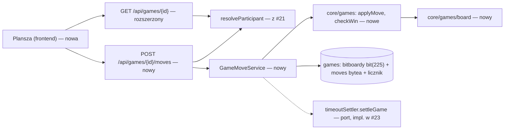
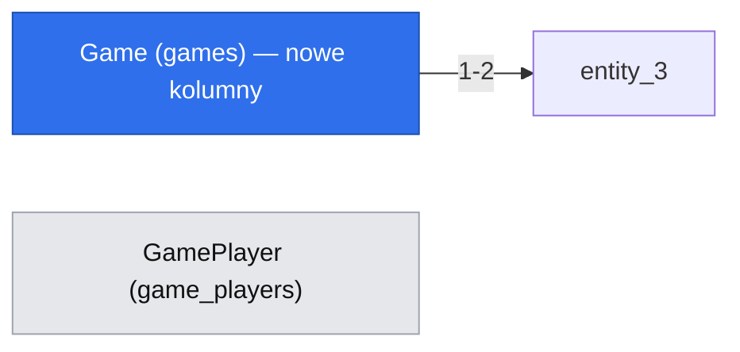

# Ruchy, model planszy i detekcja wygranej w O(1) (E02-S02, #22)

> Status: **wdrożona (2026-10-31; zgłoszenie #22 domknięte, dowody w sekcji „Odstępstwa wdrożenia i dowody”)**; wcześniej: **zatwierdzona do implementacji** (`om-auto-write-spec`, 2026-10-25; po krytycznym przeglądzie; Q3 rozstrzygnięte przez właściciela — wariant C, rekomendowany: `bit(225)` + `moves bytea`; pozostałe założenia odwracalne). Źródło: issue #22, `.ai/specs/product-brief.md` (BR-01, BR-10, BR-13, BR-22, D-08), specyfikacja #21 (`.ai/specs/implemented/2026-10-24-game-invitations.md`: `resolveParticipant`, `game_players.is_active`, `timeoutSettler`, Q14), standardy (`.ai/docs/2026-09-01-engineering-standards.md`, §Architecture, §Engineering Principles). Polecenie właściciela: model danych planszy i algorytm wygranej mają być **optymalne pamięciowo, a złożoność — najlepiej O(1)**.

## 📝 TLDR

Dziś w `core` są tylko stałe `BOARD_SIZE = 15` i `WIN_LENGTH = 5`; partia po #21 kończy na ekranie „gotowa”. Po wdrożeniu (zachowanie przyszłe) dwaj uczestnicy wykonują naprzemienne ruchy, a serwer — jedyny autorytet — waliduje każdy ruch, wykrywa wygraną (pięć lub więcej w linii) i remis (pełna plansza) oraz kończy partię dokładnie raz. Plansza to **dwa bitboardy `bit(225)` (po 29 B danych) i dziennik ruchów `moves bytea` (1 B na ruch) w wierszu `games`**, a wygrana jest sprawdzana **lokalnie wokół ostatniego kamienia** — maksymalnie 32 odczytów bitów, niezależnie od długości partii. Cały ruch kosztuje stałą liczbę operacji (jeden odczyt z blokadą i jeden `UPDATE` tego samego wiersza), nie zależy od liczby wykonanych ruchów i nie ładuje historii. **Uczciwy rachunek pamięci:** sam bitboard oszczędza ok. 170 B na partię względem napisu 225 znaków; o rzędy wielkości więcej waży dziennik ruchów (ok. 25 KB w osobnej tabeli, ≤ 225 B w jednej kolumnie) — dlatego dziennik trzymamy jako `bytea` (≤ 225 B), a nie tabelę (Q3). Cały stan i historia partii to jeden wiersz o rozmiarze ≤ ok. 300 B.

## Resolved assumptions (autonomous defaults)

| # | Pytanie | Zastosowane założenie | Dlaczego | Potwierdzenie |
|---|---|---|---|---|
| Q1 | Kto gra czarnymi (zaczyna)? #21/Q14 zostawia to #22. | **Losowanie przy dołączeniu przeciwnika**: `games.black_seat` ∈ {1, 2} ustawia ta sama transakcja, która zmienia `waiting → active` (wstrzykiwane źródło losowości `colorDraw`, jak `invitationCodes`). Czarne wykonują ruch nr 1. | Stałe „twórca zaczyna” daje jednej stronie przewagę pierwszego ruchu (w gomoku bardzo dużą); losowanie jest bezkosztowe i odwracalne. Brief nic nie rozstrzyga. | odwracalne |
| Q2 | Czy nadkreślenie (6 i więcej w linii) wygrywa? | **Tak.** Wygrana = co najmniej `WIN_LENGTH` kamieni w jednej linii. | BR-10 / D-08: swobodne gomoku „bez ograniczeń renju”; zakaz nadkreślenia jest ograniczeniem renju/standardowym, wprost wyłączonym. | odwracalne (jedna stała i jeden test) |
| Q3 | Gdzie trzymać dziennik ruchów (do historii #27 i odtworzenia widoku) i w jakiej postaci plansze? | **Wariant C (rekomendowany, potwierdzony przez właściciela):** `stones_black`/`stones_white` jako **`bit(225)`** oraz `moves bytea` (1 B = indeks komórki na ruch, ≤ 225 B) w wierszu `games`; **bez tabeli `game_moves`**. Inwariant planszy egzekwuje baza przez `CHECK` (zob. Data Model): rozłączność bitboardów, `bit_count(black) + bit_count(white) = move_count = octet_length(moves)`, naprzemienność kolejności (`bit_count(black) − bit_count(white) ∈ {0, 1}`). Zajęte pole łamie `CHECK` (licznik rośnie, liczba bitów nie), co zastępuje unikalny indeks `(game_id, cell)`. Koszt: ≤ ok. 300 B na całą partię (plansza + historia) zamiast ≈ 25 KB; sterownik zwraca `bit` jako napis 0/1 — kodek w granicy repozytorium. | Właściciel prosi o optymalizację pamięci; wariant C daje ją bez rezygnacji z twardych ograniczeń w bazie. Odchodzi od zapisu standardów „tabela `game_moves` z unikalnymi indeksami” — standardy wymagają, by współbieżność egzekwowała baza, a nie konkretnej tabeli; ten warunek jest spełniony przez `CHECK` i warunkowy `UPDATE`. Interfejs HTTP (`moves: number[]`) bez zmian względem wariantu tabelarycznego. | ✅ potwierdzone przez właściciela 2026-10-25 („Q3 wg rekomendacji”); wymaga komentarza w #29 (bez tabeli ruchów) i aktualizacji zapisu w standardach |
| Q4 | Jak klient potwierdza zamiar ruchu i jak bezpiecznie ponawiać? | Ciało `{ x, y, moveNumber }`, gdzie `moveNumber` = numer ruchu, który klient chce wykonać (`moveCount + 1` z ostatniego stanu). Ponowienie tego samego ruchu przez tego samego gracza (ten sam numer, ta sama komórka) zwraca `200` z aktualnym stanem; inny ruch pod zajętym numerem → `409 STALE_MOVE`. | Standardy („Idempotency where retries can happen”); odrzuca podwójne kliknięcie i ponowienie po zerwanym połączeniu bez podwójnego ruchu. | odwracalne |
| Q5 | Skąd klient dowiaduje się o ruchu przeciwnika (transport to otwarte Q-01 / #30)? | Odpytywanie `GET /api/games/{id}?after={moveCount}` co 2 s w statusie `active`; odpowiedź zawiera tylko **nowe** ruchy. Wymiana na transport z #30 nie zmienia kontraktu. | Jak #21/Q6: #22 nie może czekać na spike. Parametr `after` utrzymuje koszt odpowiedzi proporcjonalny do przyrostu (zwykle 0–1 ruch). | odwracalne |
| Q6 | Czy #22 obejmuje poddanie partii, propozycję remisu lub cofnięcie ruchu? | **Nie.** Zakończenia w #22: `five_in_row`, `draw`. Wyczerpanie czasu dodaje #23 (`timeout`). Poddanie (komunikat BR-21 „dokończ albo poddaj partię”) wymaga osobnego zgłoszenia. | Zakres z backlogu (E02-S02); najmniejszy zakres, który daje grywalną partię. Ryzyko: bez zegara i poddania porzucona partia trzyma `is_active` obu graczy bez końca (BR-13) — dlatego #22 **nie może trafić na produkcję bez #23** (zob. Risks & Impact Review). | odwracalne |
> **Adnotacja 2026-10-29:** poddanie jest teraz w zakresie MVP (decyzja właściciela z 2026-10-26): osobna specyfikacja `.ai/specs/implemented/2026-10-29-game-resignation.md` (`resignation` jako kolejna wartość `end_reason`). Propozycja remisu i cofnięcie ruchu pozostają poza zakresem.

| Q7 | Potwierdzenie ruchu w interfejsie (cel dotyku na telefonie 360 px ≈ 22 px/pole). | **Ekran dotykowy (`pointer: coarse`): dwa kroki** — dotknięcie zaznacza przecięcie (podgląd kamienia), „Postaw kamień” wysyła ruch. **Wskaźnik precyzyjny (mysz): jedno kliknięcie wysyła ruch.** `matchMedia` wstrzykiwane przez hook `useCoarsePointer` (testowalne). | Ruchu nie da się cofnąć, a pole 22 px jest poniżej 44 px — pomyłka na telefonie kosztuje; na komputerze dodatkowy krok marnuje czas z zegara 10 min (#23) bez zysku. | odwracalne |
| Q8 | Kiedy rusza zegar pierwszego gracza (dotyczy #23)? | **Zmienione 2026-10-29 (decyzja właściciela, zgodnie z #21 Q20):** zegar rusza, gdy OBAJ uczestnicy mają `seen_at` (a nie w chwili `waiting → active`); #22 nie dodaje pola „start ruchu 1”, to robi #23 (`turn_started_at`). ~~Poprzednio: w chwili `waiting → active` (`startedAt` z #21).~~ | Dołączający bez wiedzy twórcy nie może kosztować go czasu na zegarze; spójne z #21 Q14/Q20 i `2026-10-26-game-clock.md`. | ✅ potwierdzone przez właściciela 2026-10-29 |
| Q9 | Port `timeoutSettler`? | #22 dodaje `settleGame(gameId)` (no-op do czasu #23); #23 implementuje obie metody, `settleFor(userId)` woła `settleGame` po właściwej kolejności blokad. | Jeden interfejs, brak sprzeczności z kolejnością blokad z #21. | ✅ potwierdzone 2026-10-25 |
| Q10 | Transport, limity, nawigacja, testy remisu | Odpytywanie co 2 s bez czekania na spike #30; bez limitu żądań na `POST /moves` i `GET` w #22; plansza z roving `tabindex` (jeden przystanek Tab, strzałki, Enter); remis: test jednostkowy planszy bez piątki + test integracyjny ze stanem 224 kamieni wstawionym do bazy (musi przejść wszystkie `CHECK`-i), a pełna gra 225 ruchów przez HTTP tylko jako scenariusz wygranej. | Najmniejszy zakres, niezależność od #30, dostępność planszy, szybkie i deterministyczne testy. | ✅ potwierdzone 2026-10-25 |

## 📝 Problem Statement

Bez ruchów partia z #21 nie jest grą: dwie osoby widzą „partia gotowa” i nic więcej. Reguły rozstrzygania (kto ma ruch, czy komórka wolna, czy ktoś wygrał) muszą działać po stronie serwera, być odporne na wyścigi (dwa równoległe ruchy, podwójne kliknięcie, ponowienie po zerwaniu) i **nie rosnąć w koszcie z długością partii**. Naiwne podejścia — przechowywanie planszy jako tablicy 2D w JSON (~900 B), przeliczanie wszystkich ruchów z tabeli przy każdym ruchu (O(n) odczytów) albo skan całej planszy przy sprawdzaniu wygranej (O(225)) — marnują pamięć i czas tam, gdzie nie trzeba.

## 📝 Proposed Solution

Trzy decyzje projektowe; dwie pierwsze wynikają z polecenia właściciela:

1. **Model planszy: bitboard na kolor.** Komórka `c = y · 15 + x` (0…224). Każdy kolor ma `Uint8Array(29)` (`⌈225 / 8⌉`), bit `c` w bajcie `c >> 3`, pozycja `c & 7`. Test i ustawienie kamienia to jedna operacja bitowa (O(1)). Cały stan planszy to **58 bajtów** i wędruje z wierszem `games`.
2. **Detekcja wygranej: skan lokalny wokół ostatniego ruchu.** Nowy kamień może utworzyć linię tylko przez własną komórkę. Dla każdej z 4 osi (`→`, `↓`, `↘`, `↗`) liczymy `1 + przodem + tyłem`, gdzie przód i tył to co najwyżej `WIN_LENGTH − 1 = 4` kolejnych własnych kamieni. Wygrana, jeśli suma ≥ 5. Najwyżej `4 osie × 8 kroków = 32` odczytów bitów; **liczba odczytów zależy tylko od stałej `WIN_LENGTH`, nie od rozmiaru planszy ani od liczby ruchów** — rzeczywiste O(1).
3. **Remis: licznik.** `move_count === 225` bez wygranej. O(1); wygrana ostatnim (225.) kamieniem ma pierwszeństwo przed remisem.

**Rozważone i odrzucone:**

| Podejście | Pamięć stanu | Koszt sprawdzenia wygranej | Dlaczego odpada |
|---|---|---|---|
| Tablica 2D / JSON | ≈ 900 B | O(225) skan lub O(n) odczytów | Najwięcej bajtów i najwolniejsze |
| Napis 225 znaków | 225 B | O(1) lokalnie | 4× więcej niż bitboard, brak operacji bitowych |
| 2 bity na komórkę (jedna tablica) | 57 B | O(1) lokalnie | Praktycznie tyle samo; wymaga dekodowania pary bitów przy każdym teście, a bitboard na kolor upraszcza test „czyj kamień” |
| **Bitboard na kolor (wybrane)** | **58 B** | **O(1), ≤ 32 odczyty** | — |
| Bitboard + przesunięcia AND dla całej planszy (`b & b>>d & …`) | 58 B | stała, ale 4 osie × 4 przesunięcia × 8 słów, bez informacji o linii | Czterokrotnie więcej pracy niż skan lokalny i nie zwraca komórek linii |
| Liczniki serii w każdej komórce | ≈ 900 B | O(1) aktualizacja | Wielokrotnie więcej pamięci; złożoność utrzymania |
| Przeliczanie planszy z dziennika ruchów | 0 B stanu | O(n) odczytów | Koszt rośnie z partią; wymaga transakcji z długim odczytem |

## 📝 Architecture

- **`core/src/games/` — czysta logika bez I/O** (standardy: reguły to funkcje czyste w `core`; nowy plik tworzy folder, dlatego krok 1 przenosi istniejący `core/src/game/` na `core/src/games/`, zgodnie z #21 i regułą „folder pojęcia w liczbie mnogiej”):
  - `board.ts` — `BOARD_CELLS = 225`, `BITBOARD_BYTES = 29`, `createBitboard()`, `hasStone(bb, cell)`, `withStone(bb, cell)` (zwraca kopię — 29 B), `cellOf(x, y)`, `coordsOf(cell)`, `countStones(bb)`.
  - `rules.ts` (rozszerzony) — `checkWin(bb, cell): readonly number[] | null` (zwraca komórki linii; ≤ 9 elementów, ≥ 5), `applyMove(state, cell): MoveOutcome`, `turnColor(moveCount)`, `seatOnTurn(moveCount, blackSeat)`.
  - `bitboard-codec.ts` — `decodeBitboard(bits: string)` / `encodeBitboard(bb): string` — napis 225 znaków `0`/`1` (znak *c* = komórka *c*, zgodnie z `get_bit` w PostgreSQL) z walidacją długości i alfabetu; `decodeMoves(bytes)` / `encodeMoves(cells)` dla dziennika. Granica z bazą; reszta `core` nie zna napisów.
  - Typy: `GameColor` (`black | white`), `GameResult` (`{ winnerSeat: 1 | 2 | null; reason: 'five_in_row' | 'draw' }`; #23 dodaje `timeout`).
- **`GameMoveService`** (`app/src/server/services/games/game-move-service.ts`, scoped, `{ em, timeoutSettler }`): ładuje wiersz `games` z blokadą, woła `timeoutSettler.settleGame(gameId)` (port z #23, **na już zablokowanym wierszu** — zob. kolejność blokad poniżej), woła czyste `applyMove`, zapisuje. **Orkiestracja, żadnej logiki reguł.**
- **Route:** `POST /api/games/[id]/moves` (nowy); `GET /api/games/[id]` z #21 rozszerzony **addytywnie**.
- **Tożsamość:** `resolveParticipant(gameId)` z #21 (konto albo gość). #22 nie dodaje drugiego mechanizmu; numer miejsca (`seat`) pochodzi z uczestnika, nigdy z ciała żądania.

Wniosek: cała logika zasad jest w `core` i testowalna bez bazy; serwis tylko ładuje, woła i zapisuje.

## 📝 Data Model

Migrację dostarcza **#29** (E02-S01-T01) albo, jeśli jej kształt nie zawiera poniższych pól, **osobna migracja #22** (krok 0 weryfikuje to z #29, jak #21 — jest to wymaganie wobec schematu, nie założenie, że #29 je zawiera).

| Encja → tabela | Pola | Ograniczenia |
|---|---|---|
| `Game` → `games` (rozszerzenie) | `blackSeat` smallint NULL (1\|2; ustawiane przy `waiting → active`), `moveCount` smallint NOT NULL DEFAULT 0, `stonesBlack` **`bit(225)`** NOT NULL, `stonesWhite` **`bit(225)`** NOT NULL, `moves` **`bytea`** NOT NULL DEFAULT `''` (bajt *n* = komórka ruchu *n + 1*), `winnerSeat` smallint NULL, `endReason` text NULL (`five_in_row`\|`draw`; #23 dodaje `timeout`) | `CHECK ((stones_black & stones_white) = zera)` (rozłączność); `CHECK (bit_count(stones_black) + bit_count(stones_white) = move_count)`; `CHECK (bit_count(stones_black) - bit_count(stones_white) IN (0, 1))` (naprzemienność); `CHECK (octet_length(moves) = move_count)`; `CHECK (move_count BETWEEN 0 AND 225)`; `CHECK (status <> 'finished' OR end_reason IS NOT NULL)`; `CHECK (end_reason IS DISTINCT FROM 'draw' OR winner_seat IS NULL)`; `CHECK (status <> 'active' OR black_seat IS NOT NULL)`; `CHECK (end_reason IN ('five_in_row','draw'))` (#23 rozszerza listę); domyślne: plansze z samych zer (`B'000…0'`), `moves = ''` |

**Wielkość stanu** (ruch czyta i zapisuje wyłącznie ten jeden wiersz): 2 × `bit(225)` (≈ 2 × 33 B) + `moves` (≤ 225 B + nagłówek) + kilka pól statusu — **≤ ok. 300 B na całą partię wraz z historią**, niezależnie od przebiegu; to ≈ 80× mniej niż osobna tabela ruchów (≈ 110 B/ruch → ≈ 25 KB) — **szacunek, nie pomiar**; do zmierzenia (`pg_column_size`) w teście integracyjnym. Wpisy niezależne od `CHECK`: zgodność `moves` z bitboardami (zbiór komórek w `moves` = suma bitboardów, kolor z parzystości numeru) pilnuje `assertBoardConsistent` w testach — bazie nie da się tego tanio wyrazić. *(Adnotacja 2026-10-29: w kodzie zapisu nie ma wywołania; zgodność `moves` ↔ bitboardy jest zachowana konstrukcyjnie, bo `MOVE_SQL` zmienia bitboard, `moves` i licznik jednym `UPDATE`. `assertBoardConsistent`, `coordsOf` i `encodeMoves` służą testom i są częścią API `core/games`. Pomiar `pg_column_size(games.*)` po pełnej partii (225 ruchów, PostgreSQL 17): 402 B, nie ok. 300 B — samo `moves` to 225 B, bitboardy 2 × 33 B; test integracyjny pilnuje progu < 450 B.)*

Komórki linii wygrywającej (`winLine`) **nie są zapisywane**: są przeliczane przy odczycie zakończonej partii z bitboardu zwycięzcy i ostatniej komórki `moves[moveCount − 1]` — O(1), bez dodatkowego zapytania.

**Inwarianty** (testowane i sprawdzane w jednym punkcie — `assertBoardConsistent(state)`, używany w testach i przy migracjach danych): `countStones(black) + countStones(white) = moveCount`; `black ∩ white = ∅`; `|countStones(black) − countStones(white)| ≤ 1`, a `countStones(black) ≥ countStones(white)`.

**Dane wrażliwe:** brak nowych. Ruchy partii są widoczne tylko dla uczestników (`resolveParticipant`).

**Migracja:** up/down na prawdziwym PostgreSQL; istniejące partie `waiting`/`active` z #21 nie mają ruchów — wiersz `games` dostaje domyślne zera i `moveCount = 0`; partie `active` bez `black_seat` dostają je przy migracji (deterministycznie 1). **Kolejność w migracji:** (1) dodać kolumny nullowalne, (2) uzupełnić `black_seat` dla partii `active`, (3) dopiero wtedy dodać `CHECK (status <> 'active' OR black_seat IS NOT NULL)`; migracja w dół usuwa je w odwrotnej kolejności. W środowiskach bez wdrożonego #21 migracja jest pusta dla danych.

## 📝 API Contracts

Koperta odpowiedzi jak w #21: `{ ok: true, data }` / `{ ok: false, error: { code, message } }`. Nagłówek CSRF z `apiCall` obowiązkowy (inaczej `403`).

`POST /api/games/{id}/moves` — ciało `{ x: int 0–14, y: int 0–14, moveNumber: int 1–225 }` (`moveCreateSchema` w `core/src/validators/games/`, dzielony przez klienta i serwer). Uczestnik z `resolveParticipant`; nieuczestnik i brak partii → `404`.

| Wynik | Status | Treść / kod |
|---|---|---|
| Ruch przyjęty | 200 | `data`: stan jak w `GET` (z `moves` od `moveNumber − 1`) |
| Ponowienie tego samego ruchu (Q4) | 200 | aktualny stan, bez drugiego zapisu |
| Zła współrzędna/typ | 400 | `VALIDATION_ERROR` |
| Partia nie jest `active` (oczekuje, anulowana) | 409 | `GAME_NOT_ACTIVE` |
| Partia zakończona | 409 | `GAME_FINISHED` |
| Nie twoja kolej | 409 | `NOT_YOUR_TURN` |
| `moveNumber` ≠ `moveCount + 1` (nieaktualny widok) | 409 | `STALE_MOVE` |
| Komórka zajęta | 409 | `CELL_OCCUPIED` |

**Kolejność sprawdzeń** (po blokadzie wiersza partii): (1) **ponowienie** — `moves[moveNumber − 1]` (z już załadowanego wiersza, bez dodatkowego zapytania) istnieje, jest tą samą komórką, a parzystość `moveNumber` i `blackSeat` wskazują miejsce tego gracza → `200` z aktualnym stanem, **także gdy partia już się zakończyła tym ruchem** (inaczej utrata odpowiedzi na ruch kończący dałaby `GAME_FINISHED` zamiast `200`); (2) partia `finished` → `GAME_FINISHED`, inna niż `active` → `GAME_NOT_ACTIVE`; (3) kolej; (4) `moveNumber`; (5) wolna komórka. Jeśli `timeoutSettler.settleGame` zakończy partię, wynik wraca jako `GAME_FINISHED` (ponowienie z pkt 1 sprawdzane jest przed nim). Dzięki kolejności 3–5 gracz, który wysłał ruch w tym samym czasie co przeciwnik, dostaje `STALE_MOVE`, a nie mylące `CELL_OCCUPIED`.

`GET /api/games/{id}?after={n}` (rozszerzenie #21, addytywne): do istniejących pól dochodzą `moveCount`, `blackSeat`, `turnSeat` (`null` poza `active`), `moves: number[]` (komórki od ruchu `n + 1`; domyślnie `after = 0` zwraca całość, ≤ 225 liczb), `result: null | { winnerSeat: 1 | 2 | null, reason, winLine: number[] | null }`. `after` spoza 0…`moveCount` → `400`. Zakończona partia dalej zwraca pełny stan (powrót do zakończonej partii, kryterium wejścia po fakcie).

## 📝 UI/UX

Strona `/games/[gameId]` (z #21) w statusie `active`/`finished` pokazuje planszę (czysty Tailwind w `packages/app/src/components/games/`, motyw z `frontend.css`; bez shadcn):

- **Plansza** 15×15 jako `role="grid"` > `role="row"` (15) > `role="gridcell"` > `button` (`aria-label="Kolumna C, rząd 7, puste"`; poprawna struktura ARIA), układ kwadratowy skalowany do szerokości ekranu od 360 px (BR-20), stały odstęp 16 px. Nawigacja strzałkami (roving `tabindex`), Enter zaznacza (ekran dotykowy) i zatwierdza drugim Enterem / przyciskiem „Postaw kamień”, a przy wskaźniku precyzyjnym Enter od razu wysyła ruch (Q7).
- **Status:** `role="status"` — „Twój ruch (czarne)” / „Ruch przeciwnika”; własny kolor oznaczony tekstem, nie tylko kolorem kamienia (dostępność); ostatni ruch z markerem obramowania.
- **Koniec:** baner „Wygrałeś / Przegrałeś / Remis” (`role="status"`), linia wygrywająca podświetlona (`winLine`), plansza tylko do odczytu.
- **Rezerwa na zegary** (#23): pasek nad i pod planszą jest w układzie od razu, pusty do czasu #23.
- **Błędy:** `STALE_MOVE`/`NOT_YOUR_TURN` — cichy powrót do aktualnego stanu z krótkim komunikatem; błąd sieci — przycisk „Spróbuj ponownie” ponawia **ten sam** ruch (idempotentny, Q4).
- **Odpytywanie** co 2 s w `active`, wstrzymane w ukrytej karcie, wznawiane przy powrocie; zatrzymane po `finished`.

Mockupy: nie dołączono — brak deskryptora `om-prepare-test-env` (`.ai/qa/test-env.*`), więc przeglądarkowe zrzuty i mockupy zostały pominięte (spec tylko tekstowy).

## 📝 Edge Cases & Failure Scenarios

| Sytuacja | Zachowanie |
|---|---|
| Linia przy krawędzi (kolumna 14 → „następna komórka” w indeksie to kolumna 0 następnego wiersza) | Skan chodzi po **współrzędnych** i sprawdza zakres `0…14` przed konwersją na indeks; test krawędzi dla wszystkich 4 osi i rogów |
| Piąty kamień łączy dwie grupy (`XX_XX`) | Liczymy `1 + przód + tył`, więc łączy obie strony; test |
| Nadkreślenie (6+) | Wygrana (Q2); `winLine` zawiera całą serię (≤ 9 komórek) |
| Wygrana i pełna plansza przy ruchu 225 | Wygrana ma pierwszeństwo; `reason = five_in_row` |
| Dwa równoległe ruchy tego samego gracza (podwójne kliknięcie) | Drugi czeka na blokadę wiersza, potem widzi przesunięty `moveCount`; ta sama komórka i miejsce → `200` (Q4) |
| Dwa ruchy graczy jednocześnie (oba ze starym `moveNumber`) | Blokada serializuje; drugi dostaje `STALE_MOVE`. Nigdy dwa ruchy pod jednym numerem (warunkowy `UPDATE … WHERE move_count = :expected` + `CHECK (octet_length(moves) = move_count)`) |
| Ruch w partii czekającej / anulowanej / zakończonej | `GAME_NOT_ACTIVE` / `GAME_FINISHED`; brak zmian w bazie |
| Ruch gracza nie w partii, obcy gość, niepoprawny `id` | `404` (jak #21) |
| Odświeżenie strony w trakcie partii, drugi karta, powrót po zerwaniu | `GET` odtwarza planszę z `moves`; stan nie żyje w kliencie |
| Zakończenie partii wywołane dwa razy (ruch kończący i równoległy odczyt `timeoutSettler` z #23) | Zakończenie to warunkowy `UPDATE games … WHERE id = :id AND status = 'active' AND move_count = :expected`; 0 wierszy → rollback i odpowiedź `409` (`STALE_MOVE`, a gdy partia jest już `finished` — `GAME_FINISHED`), nigdy `500`. Wynik ustawiany dokładnie raz |
| Naruszenie `CHECK` inwariantu planszy (ostatnia linia obrony, np. błąd w kodzie: kamień na zajętym polu, zła liczba bitów) | Transakcja się wycofuje; to **defekt serwera**, nie błąd klienta: `500` bez treści SQL i z wpisem w logu błędów. Zajęte pole wykrywa wcześniej bitboard w pamięci (`CELL_OCCUPIED`), więc `CHECK` nie powinien być osiągalny z poprawnego żądania |
| Uszkodzony wiersz (bitboard ≠ 225 bitów, `moveCount` ≠ liczba kamieni) | `CHECK` w bazie odrzuca zapis; kodek zgłasza błąd, a serwer odpowiada `500` bez zapisu — **partia nie jest cicho naprawiana** |
| Klient fałszuje miejsce/kolor/wynik | Ciało zawiera wyłącznie `x`, `y`, `moveNumber`; miejsce z sesji/tokena, kolor z `blackSeat`, wynik z serwera |
| Konto usunięte w trakcie partii | #37 blokuje usunięcie przy partii `active` (BR-21); po zakończeniu uczestnik ma `user_id = NULL`, ruchy zostają (historia „Usunięty gracz”) |

## 📝 Risks & Impact Review

- **#22 nie bez #23:** do czasu zegara (#23) porzucona partia trzyma `is_active` obu graczy bez końca (BR-13), a #23 zależy od #22. Wymaganie: oba zgłoszenia trafiają na produkcję razem (wspólne wydanie) albo #22 dostaje minimalne „poddaj się” (zamyka partię i zwalnia BR-13/BR-21). Rekomendacja: wspólne wydanie.
- **Kolejność blokad i port `timeoutSettler`:** #21 ustala kolejność *wiersze `users` rosnąco po `id`, potem `games`*. Ruch blokuje tylko `games` i woła `settleGame(gameId)` **pod tą blokadą** (nie `settleFor(userId)`, który sięga po `users` i odwracałby kolejność, a dla gościa z `user_id = NULL` nie działa). Wymaganie wobec #23: port dostaje metodę `settleGame(gameId)`, która nie blokuje `users`; `settleFor(userId)` z #21 pozostaje dla ścieżek zaproszeń i woła ją po właściwej kolejności blokad.
- **Trudno odwracalne:** kształt kolumn `games` (`bit(225)` ×2, `moves bytea`) i zestaw `CHECK`-ów. Kontrakt HTTP (`moves: number[]`, `moveNumber`) jest niezależny od zapisu; ewentualny powrót do tabeli ruchów dotyka `GameMoveService` i jednej migracji. Migracja danych istniejących partii jest trywialna (brak ruchów). **Odstępstwo od standardów:** zapis „unikalne `(game_id, move_number)` i `(game_id, x, y)` na ruchach” zastępują `CHECK`-i i warunkowy `UPDATE` — wymaga aktualizacji `.ai/docs/2026-09-01-engineering-standards.md` (§Concurrency) w PR implementacji.
- **Zależności:** #21 (partia `active`, `resolveParticipant`, `is_active`) musi być wdrożony pierwszy; #22 dodaje losowanie koloru do transakcji dołączania. #23 (zegar) i #27 (historia) czytają kolumny `moves`/`end_reason`/`winner_seat` wiersza `games` (bez tabeli ruchów); #29 nie powinno tworzyć tabeli `game_moves` (komentarz w #29).
- **Wymaganie wobec #23:** kończąc partię przez timeout, ustawia `status = 'finished'`, `end_reason = 'timeout'`, `winner_seat` i `is_active = false` obu uczestnikom w jednej transakcji, z tym samym warunkowym `UPDATE`.
- **Wymaganie wobec #21 / #29:** `game_players.is_active = false` przy zakończeniu (już zapisane w #21); w #22 robi to `GameMoveService` w tej samej transakcji co zakończenie.
- **Kontrakt `cell = y·15 + x`:** format indeksu trafia do publicznego API (`moves: number[]`), więc na stałe zakodowana jest szerokość 15; akceptowalne przy N-08 (brak wariantów planszy), ale zmiana rozmiaru byłaby zmianą kontraktu.
- **Biblioteka walidacji:** `moveCreateSchema` używa narzędzia, które wprowadza #19/#21 (w `packages/*/package.json` nie ma jeszcze walidatora) — krok 6 używa tego samego, bez dodawania drugiego.
- **`bit(225)` i `bytea` w MikroORM 7 oraz PostgreSQL ≥ 14:** `bit_count` wymaga PostgreSQL 14+ (sprawdzić wersję obrazu w Testcontainers i w CI); mapowanie `bit(225)` jako napisu (`columnType`) i `bytea` jako `Uint8Array`/`Buffer` w `defineEntity` do sprawdzenia na prawdziwym PostgreSQL w kroku 7 (round-trip, w tym bajt `0x00` i same zera). Plan awaryjny: kodek w granicy repozytorium, bez zmian w `core`; gdyby `bit` sprawiał kłopot, wracamy do `bytea` ×2 bez `CHECK` na bitach (wymaga potwierdzenia właściciela).
- **Brak poddania:** gracz porzucający partię trzyma BR-13 do końca zegara (Q6) — świadomy kompromis do czasu osobnego zgłoszenia.
- **Wydajność:** hot path to 1 `SELECT … FOR UPDATE` (jeden wiersz, ≤ ok. 300 B), 1 `UPDATE` (bitboard + `moves` + licznik; bez osobnego `INSERT`) (+1 `UPDATE game_players` przy zakończeniu). Nie ma pętli po ruchach ani po planszy. Szacunek, **do zmierzenia w teście integracyjnym** (liczba zapytań na ruch jest stała = 3–4, niezależnie od numeru ruchu; nagłówkowe „stała” to założenie projektu, a nie wynik pomiaru).

## 📝 Decisions in play

Opiera się na: **BR-01** (dwóch graczy), **BR-10 / D-08** (swobodne gomoku 15×15, bez ograniczeń renju — Q2), **BR-13** (jedna aktywna partia; `is_active`), **BR-22** (gość jako uczestnik), **BR-20** (telefon), **N-08** (brak wariantów). Niczego nie nadpisuje. Zależy od otwartego **Q-01** (transport, spike #30) — #22 używa odpytywania (Q5) i nie przesądza wyniku.

## 📋 Phasing

- **Faza 1 — Rdzeń reguł (`core`).** Bitboard, `checkWin`, `applyMove`, kodek; pełne testy jednostkowe i test równoważności z naiwnym skanem. Nic nie zmienia aplikacji.
- **Faza 2 — Trwałość i API.** Kolumny `games` (bez nowej tabeli), `GameMoveService`, `POST /moves`, rozszerzony `GET`, losowanie koloru w dołączaniu.
- **Faza 3 — Plansza w UI.** Komponent, odpytywanie, stany końca.
- **Wydanie:** fazy 1–3 i #23 (zegar) trafiają na produkcję razem (zob. Risks & Impact Review).

## 📋 Implementation Plan

### Krok 0 — Uzgodnienie z zależnościami (przed pierwszym commitem kodu)

0. **Zależności:** potwierdzić, że #21 (E02-S01) jest wdrożony (`resolveParticipant`, `GameService`, `game_players.is_active`, `timeoutSettler`). Sprawdzić, co zawiera #29: tabeli `game_moves` **nie tworzyć** (komentarz w #29), kolumny `games` z §Data Model dodać własną migracją w kroku 7. Skomentować w #23 i #27 wymaganie z §Risks.

### Faza 1 — Rdzeń reguł

1. **Przenieść `packages/core/src/game/` → `packages/core/src/games/`** (`git mv`, aktualizacja `packages/core/src/index.ts`). Testy przechodzą bez zmiany zachowania.
2. **`board.ts` + test:** `cellOf`/`coordsOf` (rogi, krawędzie), `hasStone`/`withStone` (bity na granicy bajtu: komórki 7, 8, 224), niemutowalność wejścia, `countStones`, `BITBOARD_BYTES === 29`. 100% pokrycia.
3. **`bitboard-codec.ts` + test:** round-trip napisu 225 znaków (same zera, same jedynki, komórki 0, 7, 8, 224), odrzucenie złej długości i innych znaków, `encodeMoves`/`decodeMoves` (bajt `0x00`, długość ≤ 225).
4. **`checkWin` + test:** wszystkie 4 osie, linie w rogach i na krawędziach (brak „zawijania” wierszy), `XX_XX`, 4 w linii (brak wygranej), 6+ (wygrana, pełna `winLine`), kamień przeciwnika przerywa serię. **Test równoważności:** 2000 losowych partii z ziarnem (deterministyczny PRNG) — wynik `checkWin(ostatni ruch)` równa się naiwnemu pełnemu skanowi planszy po każdym ruchu.
5. **`applyMove`, `seatOnTurn`, `turnColor` + test:** zajęta komórka, ruch poza zakresem, kolej, remis przy ruchu 225, wygrana przy 225, inwarianty (`assertBoardConsistent`). **Test złożoności:** `checkWin(isOwn, cell)` przyjmuje czytnik `isOwn(cell): boolean` (adapter nad bitboardem w kodzie produkcyjnym) — test podstawia czytnik z licznikiem wywołań, bez mocków logiki, i dowodzi ≤ 32 wywołań niezależnie od zapełnienia planszy.

### Faza 2 — Trwałość i API

6. **Walidator `moveCreateSchema`** (`core/src/validators/games/`) + test: granice 0/14/15/−1, ułamki, napisy, brak pól.
7. **Encje i migracja:** rozszerzyć `Game` o kolumny z §Data Model (`defineEntity`; brak nowej encji), `CHECK`-i (kolejność kroków migracji z §Data Model: kolumny → uzupełnienie `black_seat` → `CHECK`); `npm run db:migration:create`, przegląd, up/down/up na PostgreSQL; round-trip `bit(225)` i `bytea`; test, że bazą odrzucane są: zajęte pole, złe liczniki, naruszenie naprzemienności.
8. **Losowanie koloru:** `colorDraw` (singleton, wstrzykiwane `randomInt`) i ustawienie `black_seat` w transakcji `InvitationService.accept` (obok `UPDATE games SET status = 'active'`). Testy: oba wyniki losowania, brak nadpisania przy wyścigu.
9. **`GameMoveService.play(participant, gameId, input)`:** blokada wiersza, `timeoutSettler.settleGame(gameId)` (pod blokadą), kolejność sprawdzeń z §API (ponowienie przed statusem), `applyMove`, jeden warunkowy `UPDATE games SET stones_*, moves = moves || :cell, move_count … WHERE id = :id AND move_count = :expected`, przy zakończeniu `is_active = false` obu uczestnikom. Testy na fałszywym `em`: każda gałąź błędu, idempotentne ponowienie **także ruchu kończącego partię**, `STALE_MOVE`, przegrany warunkowy `UPDATE` → `409`, zakończenie wygraną i remisem, brak drugiego zakończenia.
10. **`POST /api/games/[id]/moves` i rozszerzony `GET`** (`after`, `result`, `winLine`), błędy `AppError` → statusy. Testy handlerów z podstawionym `cradle`.
11. **Testy integracyjne (`fetch`, PostgreSQL w Testcontainers):** pełna partia do wygranej poziomej, pionowej i obu przekątnych; remis (zapełniona plansza bez piątki — z gotowej sekwencji); **wyścig dwóch równoległych ruchów tego samego gracza** (jeden zapis, drugi idempotentne `200`); **ponowienie ruchu kończącego partię → `200`, nie `409`**; **wyścig dwóch graczy** (`STALE_MOVE`); ruch przeciwnika bez kolejki → `409`; ruch w `waiting`; obcy → `404`; CSRF → `403`; liczba zapytań na ruch stała dla ruchu 1. i 100.

### Faza 3 — Plansza w UI

12. **Komponent `Board`** (`app/src/components/games/board.tsx`): siatka, dostępność, dwukrokowe potwierdzenie (Q7), marker ostatniego ruchu, `winLine`. Testy (`renderToStaticMarkup` + jsdom/Testing Library dla interakcji).
13. **`/games/[gameId]`:** stan `active`/`finished`, odpytywanie co 2 s z `after`, wstrzymanie w ukrytej karcie, zatrzymanie po `finished`, ponowienie tego samego ruchu po błędzie sieci. Testy: zatrzymanie odpytywania, `STALE_MOVE`.
14. **Scenariusz agent-browser (telefon 360 px):** twórca i gość grają do wygranej pięcioma kamieniami; widoczne baner i podświetlona linia; odświeżenie w trakcie partii zachowuje planszę.
15. **Dokumentacja i weryfikacja:** README (rozgrywka), `npm run check`; ocena kryteriów akceptacji z issue #22; lekcja w `.ai/lessons/`, jeśli przegląd wykaże korektę.

## 📝 Odstępstwa wdrożenia i dowody (2026-10-31)

Odstępstwa od pierwotnej treści opisują adnotacje w tekście powyżej (m.in. „Adnotacja 2026-10-29” przy rozmiarze stanu; poddanie, które #22 miało poza zakresem, dodała osobna specyfikacja `2026-10-29-game-resignation.md`). Dowody kryteriów zgłoszenia #22:

| Kryterium #22 | Dowód |
| --- | --- |
| Ruch na wolne pole: przeciwnik widzi ruch, tura przechodzi | `tests/integration/game-moves-api.test.ts` — „plays alternately, serves new moves with `after`, ends with the winning line and is idempotent after the end” (`turnSeat`, `moves`, odczyt z `after`); `packages/core/src/games/apply-move.test.ts` — „places black first, then white, and counts moves”; strona: `game-play-pages.test.ts` — „plays a game to five in a row in two browsers, with a move out of turn refused and a reload in the middle” |
| Ruch poza turą lub na zajęte pole odrzucony, stan bez zmian | „answers the documented codes and changes nothing” (`NOT_YOUR_TURN`, `CELL_OCCUPIED`, `STALE_MOVE`; `move_count` i `moves` bez zmian); „the database refuses a stone on an occupied cell even if the code were wrong”; wyścigi: „accepts exactly one of two different parallel moves by the same player”, „serializes both players moving at once…”; `apply-move.test.ts` — „rejects an occupied cell of either colour and cells off the board” |
| Pięć w linii (poziomo, pionowo, ukośnie) kończy wygraną, bez ograniczeń renju (BR-10) | `game-moves-api.test.ts` — „wins on a %s line” (pionowa, dwie przekątne) i test poziomej piątki w „plays alternately…”; `rules.test.ts` — „finds five on the %s axis from any of its stones”, „wins with six or more and returns the whole run”, „joins two groups (XX_XX)”; `win-equivalence.test.ts` — zgodność z naiwnym skanem na 2000 partii |
| Pełna plansza bez piątki: remis | „ends in a draw when the 225th stone completes no five”; „a five with the 225th stone wins instead of a draw”; `apply-move.test.ts` — „declares a draw when the board fills without a five” |
| Klient wysyła zmieniony stan planszy: rozstrzyga serwer | **Tylko kod:** `moveCreateSchema` (`packages/core/src/validators/games/move-create-schema.ts`) przyjmuje wyłącznie `x`, `y`, `moveNumber`; plansza, miejsce i kolor pochodzą z bazy (zob. `MOVE_SQL` w `GameMoveService`). Pokrewne: `game-clock-api.test.ts` — dodatkowe pole `elapsedMs` w ruchu jest ignorowane |

Pomiar rozmiaru stanu: test „runs the same statements for move 1 and move 100, and the whole game stays in one small row” pilnuje progu `pg_column_size(games.*)` < 500 B (adnotacja z 2026-10-29 podaje < 450 B; faktyczny próg w teście to 500 B, pomiar po pełnej partii: 402 B).

Sprawdzenie ponowione 2026-10-31 na `origin/main` przez czytanie testów i kodu; testy nie były uruchamiane w ramach tego domknięcia (zmiana dokumentacyjna).

### Decyzja CP-3 (zgłoszenie #30, spike transportu) — właściciel, 2026-10-31

Rozstrzyga **Q5**: MVP używa **odpytywania** `GET /api/games/{id}?after={moveCount}` co 2–3 s w partii aktywnej (w kodzie 2 s na ruchach, 3 s w `waiting`), z backoffem i wstrzymaniem w ukrytej karcie dla partii zakończonej. **WebSocket/SSE poza zakresem MVP.** Wymiana transportu nie zmienia kontraktu API (odpowiedź niesie `after`/`moveCount` oraz `clock.now`). Q-01/CP-3 uznane za rozstrzygnięte; zapis „odwracalne” przy Q5 staje się decyzją.
