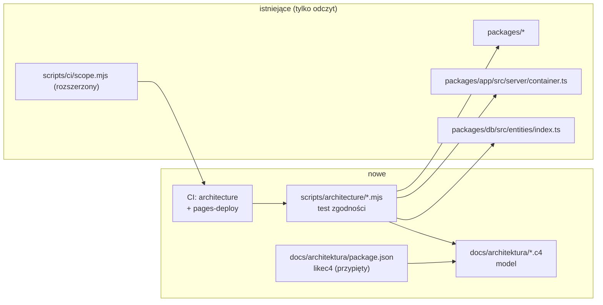

# Interaktywna dokumentacja architektury w LikeC4 (L1–L3, przepływy, model danych)

Extends: .ai/specs/implemented/2026-10-18-monorepo-architecture.md
Extends: .ai/specs/implemented/2026-10-19-ci-and-testing.md
Brief: .ai/specs/briefs/2026-11-20-architecture-likec4.md

- Data: 2026-11-20
- Status: wdrożona (PR #330; publikacja na Pages czeka na jednorazowy krok właściciela: Settings → Pages → Source: GitHub Actions)
- Kategoria: documentation · priorytet: medium · ryzyko: low

## 📝 TLDR

Właściciel (i każda nowa osoba lub agent) chce zrozumieć zbudowany system od ogółu do szczegółu. Dziś jedynym opisem jest `docs/architektura.md`: proza per funkcja i jeden diagram zależności pakietów, bez widoku kontekstu, kontenerów, przepływów i modelu danych. **Proponujemy** jeden model architektury jako kod w LikeC4 (`docs/architektura/*.c4`) — klikalne widoki L1 → L2 → L3, cztery przepływy i model danych — publikowany na GitHub Pages z `main`. Test w CI porównuje model z kodem (pakiety, rejestracje DI, encje), więc model nie zestarzeje się tak jak proza.

## Resolved assumptions (autonomous defaults)

Brief (tabela „Resolved unknowns”) rozstrzyga kierunek, narzędzie, publikację, głębokość i sposób egzekwowania. Poniżej tylko pytania, które zostawił otwarte; każde ustalenie jest odwracalne przed merge.

| # | Pytanie | Przyjęte ustalenie | Uzasadnienie |
|---|---------|--------------------|--------------|
| Q1 | Rozdzielić na osobne specyfikacje (model / test zgodności / Pages)? | **Nie** — jedna specyfikacja, jeden PR implementacji z trzema fazami. | Właściciel ustalił to w briefie („jeden PR specyfikacji, potem jeden PR implementacji z fazami”). Test bez modelu i Pages bez modelu nie mają sensu samodzielnie. |
| Q2 | Gdzie instalować LikeC4? Brief przyjął devDependency w roocie jako ustalenie domyślne, którego nikt nie kwestionował. | **Osobny, niewchodzący do workspaces pakiet narzędziowy `docs/architektura/package.json`** z własnym `package-lock.json` i dokładnie przypiętą wersją `likec4` (dziś 1.61.0). Root dostaje tylko skrypty `docs:arch` / `docs:arch:build` / `docs:arch:check`, które wywołują ten pakiet. | `Dockerfile` robi `npm ci` ze wszystkimi devDependencies i niczego nie przycina („nothing is pruned here”), więc devDependency w roocie trafiłaby do obrazu produkcyjnego i do każdego joba CI. `likec4` ciągnie `vite`, `react` i `playwright` (npm), a VPS ma 2 GB i budowa obrazu już tam brakuje pamięci. Pakiet osobny nie dotyka obrazu, `package-lock.json` w roocie ani jobów `lint`/`unit`/`build`. Powrót do roota to przeniesienie jednej zależności. |
| Q3 | Jak szczegółowo mapować `container.ts` na model? | Każda rejestracja z `createContainer().register({...})` w `container.ts` jest **przypisana do dokładnie jednego** komponentu L3 przez metadane elementu (`metadata { di 'gameService, gameMoveService' }`). Komponenty L3 są na poziomie domen (auth, games/…, chat, email, rate-limit, admin, MCP, infrastruktura DI) — nie jeden element na serwis. | Brief wyklucza poziom kodu. Przypisanie pilnuje kompletności (nowy serwis musi trafić do jakiejś domeny), a nie rozdmuchuje diagramu do ~55 pudełek. |
| Q4 | Co, jeśli Pages nie jest jeszcze włączone w ustawieniach repozytorium? | Job `pages-deploy` działa **tylko** przy pushu na `main` i nie jest wymaganym checkiem. Dopóki właściciel nie ustawi Settings → Pages → Source: GitHub Actions, job kończy się błędem z czytelnym komunikatem i nie blokuje PR-ów. | Krok właściciela jest jednorazowy i opisany w briefie. Wymagany check zależny od ustawienia repozytorium zablokowałby wszystkie PR-y. |
| Q5 | Język etykiet w diagramach? | Etykiety, opisy i tytuły widoków **po polsku**. Identyfikatory elementów, rodzaje (`kind`) i klucze metadanych po angielsku. | Zgodnie z `AGENTS.md`: dokumentacja po polsku, identyfikatory po angielsku. |

## 📝 Problem Statement

- `docs/architektura.md` (382 linie) to tabela stacku, drzewo katalogów, jeden diagram Mermaid (`app → core/db/ui`) i proza per funkcja. Brakuje w nim: aktorów i systemów zewnętrznych (Brevo, VPS, agent MCP), podziału aplikacji na strony, panel, API i MCP, przekroju żądania (route handler → `withRequestScope` → serwis → `em`), modelu danych i przepływów krok po kroku.
- `docs/security/threat-model.md` ma diagram, ale to widok bezpieczeństwa, nie mapa systemu.
- Proza się starzeje. `docs/architektura.md` nie wymienia na przykład pokazu (E14) ani bota hostowanego, choć oba są w `container.ts` (`showService`, `botTurnService`, `botEngine`).
- **Miara sukcesu (właściciel):** sam przechodzi od L1 do modelu danych i bez czytania kodu potrafi wyjaśnić ruch w partii, dołączenie agenta przez MCP, turę bota oraz rejestrację z potwierdzeniem e-maila.

## 📝 Proposed Solution

Jeden model LikeC4 w `docs/architektura/`, z którego powstają wszystkie widoki. Element na L1 prowadzi do swojego widoku L2 (`navigateTo`), kontener na L2 prowadzi do widoku L3. Statyczną stronę buduje `likec4 build`; lokalny podgląd z hot reloadem daje `likec4 serve`.

Odrzucone alternatywy (szczegóły w briefie): osobne diagramy Mermaid per poziom (brak zagłębiania, poziomy rozjeżdżają się), jednorazowa strona HTML w cockpicie, serwowanie z VPS, sama konwencja bez testu i „nic nie budować”.

**Kryterium porzucenia (z briefu):** jeśli w fazie 1 `likec4 build` nie działa w CI (np. wymaga przeglądarki albo nie mieści się w `timeout-minutes: 10`), implementacja zatrzymuje się, specyfikacja wraca do właściciela, a fallbackiem jest Mermaid w Markdownie z nawigacją linkami.

### Zawartość modelu

| Widok | Zawartość (źródło w kodzie) |
| --- | --- |
| **L1 Kontekst** (`index`) | Gracz (konto lub gość), administrator instancji, agent AI (klient MCP), system Gomoku, Brevo (wysyłka e-maili przez API), hosting (VPS, Docker, `compose.prod.yaml`). |
| **L2 Kontenery** | Aplikacja Next.js z czterema powierzchniami: strony `(frontend)`, panel `(backend)` `/backend`, route handlery `/api/*` i endpoint MCP `/api/mcp`. Do tego PostgreSQL oraz cron `db:cleanup` (CLI `@gomoku/db` uruchamiane przez `docker exec` na VPS). **Bot nie jest kontenerem:** liczy w `worker_threads` (`bot-worker-spawn.ts`) w procesie Next.js, uruchamiany przez `after()` za `ComputeGate`. |
| **L3 Komponenty aplikacji** | Domeny serwisów z `packages/app/src/server/services/*`: auth, games (rdzeń partii, lobby, zaproszenia, bot, pokaz, widz, papier i ołówek, rozliczanie czasu), chat, email (Brevo / plik / brak konfiguracji), rate-limit, admin, health. Do tego warstwa MCP (`server/mcp`), kontener DI Awilix (`container.ts`) z `withRequestScope` (fork `em` per żądanie) oraz pakiety `@gomoku/core` (zasady gry, silnik bota), `@gomoku/db` (MikroORM, encje, migracje) i `@gomoku/ui` (DS graczy, shadcn dla panelu). |
| **Przepływy** (`dynamic view`) | 1. Ruch w partii (klient → `/api/games/…` → `GameMoveService` → `em.transactional` → odpowiedź / odświeżanie u przeciwnika). 2. Agent dołącza przez MCP (`/api/mcp` → narzędzia MCP → `AgentSeatService` / `AgentGameService`). 3. Tura bota (ruch gracza → `after()` → `BotAdmission` / `ComputeGate` → wątek roboczy → `BotTurnService` zapisuje ruch). 4. Rejestracja z potwierdzeniem e-maila (`UserService` → `EmailVerificationService` → `EmailSender` → Brevo → link → potwierdzenie). Kroki każdego przepływu implementacja weryfikuje w kodzie, nie w tej specyfikacji. |
| **Model danych** | 15 encji z `packages/db/src/entities/index.ts` jako elementy rodzaju `entity` wewnątrz kontenera PostgreSQL, z relacjami odpowiadającymi kluczom obcym (np. `GamePlayer → Game`, `Session → User`). Bez pól. |

Każdy element L2/L3 ma `link` do swojego katalogu lub pliku na GitHubie (`https://github.com/bartoszmwojcik/ai_techleaders_gomoku/tree/main/…`).

## 📝 Architecture

Najważniejsze: nowe narzędzie jest odizolowane od aplikacji. Kod aplikacji niczego nie importuje z modelu, a model ani narzędzie nie trafiają do obrazu Dockera ani do `package-lock.json` w roocie.

### Pliki

| Ścieżka | Rola |
| --- | --- |
| `docs/architektura/package.json` + `package-lock.json` | Pakiet narzędziowy poza `workspaces` (`"private": true`, `"type": "module"`): dokładnie przypięta zależność `likec4`, skrypty `serve` i `build`. Nie zawiera kodu JS. |
| `docs/architektura/*.c4` | Model: `specification.c4` (rodzaje: `actor`, `system`, `external`, `container`, `component`, `package`, `entity`; tagi), `model.c4` (L1–L3), `data.c4` (encje), `views.c4` (widoki statyczne i dynamiczne). |
| `scripts/architecture/likec4-model.mjs` | Cienki adapter: `loadModel({ workspace, importLikeC4 })` wywołuje `LikeC4.fromWorkspace(workspace)`, potem `getErrors()`, i zwraca `{ errors, elements: [{ id, kind, metadata }] }`. Domyślny `importLikeC4` rozwiązuje `likec4` z `docs/architektura/node_modules` (`createRequire` na `docs/architektura/package.json`). W testach wstrzykuje się fałszywy moduł. Tylko ten plik zna API LikeC4. |
| `scripts/architecture/compliance.mjs` | Czyste funkcje porównujące zrzut modelu z faktami z kodu; zwracają listę problemów. |
| `scripts/architecture/code-facts.mjs` | Wyciąga fakty z kodu: katalogi i nazwy z `packages/*/package.json`, klucze obiektu przekazanego do `register({...})` w `container.ts` oraz identyfikatory z tablicy `entities` w `entities/index.ts`. Parsuje AST kompilatorem `typescript` (`typescript ^6.0.3` jest już w devDependencies roota): `ts.createSourceFile(text, ScriptKind.TS)` na tekście pliku. Nie importuje modułów aplikacji i nie używa wyrażeń regularnych na źródle. |
| `scripts/architecture/cli.mjs` + `main.mjs` | Spina całość: model z adaptera i fakty z kodu, wypisuje problemy, kod wyjścia 0/1. Logika w `main()` z wstrzykiwanymi zależnościami, `cli.mjs` tylko ją wywołuje (wzorzec `scripts/ci/cli.mjs` + `main.mjs`). |
| `scripts/ci/scope.mjs` | Nowe wyjście `arch` (patrz niżej). |
| `.github/workflows/ci.yml` | Joby `architecture` i `pages-deploy`. |

### Reguły zgodności (test w CI)

Każda reguła działa w obie strony: element modelu bez odpowiednika w kodzie to też błąd.

1. **Pakiety:** każdy katalog `packages/<x>` ma dokładnie jeden element rodzaju `package` z `metadata { package '@gomoku/<x>' }`. Każdy taki element wskazuje istniejący pakiet.
2. **Rejestracje DI:** każdy klucz rejestracji w `container.ts` występuje w metadanych `di` dokładnie jednego elementu (rodzaju `component`). Każda nazwa w metadanych `di` istnieje w `container.ts`. Wartości infrastrukturalne (`orm`, `clock`, `random`, `serverConfig`, `passwordHashCost`…) przypisuje się do komponentu „Kontener DI i konfiguracja”. Test nie ma listy wyjątków.
3. **Encje:** każdy identyfikator z tablicy `entities` ma dokładnie jeden element rodzaju `entity` z `metadata { entity '<Nazwa>' }` i odwrotnie.
4. **Poprawność modelu:** `getErrors()` jest puste (składnia, nieznane referencje, zduplikowane identyfikatory).

Komunikat błędu podaje, co dopisać i gdzie, np. `container.ts: rejestracja "fooService" nie jest przypisana do żadnego komponentu — dopisz ją do metadata.di w docs/architektura/model.c4`.

### Testowalność i pokrycie (bez nowych wyjątków)

- Cały kod JS leży w `scripts/architecture/`. Katalog trafia do `coverage.include` (`scripts/architecture/**/*.mjs`) i ma 100% pokrycia w projekcie Vitest `scripts`. Testy działają na fikstury: małe źródła `container.ts` / `index.ts` w pamięci, ręcznie zbudowane zrzuty modelu i fałszywy moduł `likec4` dla adaptera. Nie potrzebują instalacji LikeC4. Gałąź domyślnego `importLikeC4` pokrywa test, który oczekuje czytelnego błędu („uruchom `npm ci --prefix docs/architektura`”), gdy pakietu nie ma.
- `docs/architektura/` zawiera tylko pliki `.c4` i `package.json`/lockfile, więc nie ma tam kodu poza progiem. Nie powstaje żaden nowy wyjątek od pokrycia.
- ESLint: `**/node_modules/**` jest ignorowany domyślnie, a `docs/architektura/dist/**` trafia do `globalIgnores` w `eslint.config.mjs`. Skan tokenów (`check:tokens`) obejmuje tylko `packages/ui`, więc go to nie dotyczy.

### Zakres CI (`scripts/ci/scope.mjs`)

- `classify()` zwraca dodatkowo `arch: true`, gdy zmienił się dowolny plik pod `docs/architektura/` albo `scripts/architecture/`. `cli.mjs scope` wypisuje `arch=true|false` obok `code=…`.
- `arch` liczy się niezależnie od `code`. `docs/architektura/**` (również `package.json` i lockfile tego katalogu) pozostaje dokumentacją dla reguły `code`, więc PR zmieniający tylko model uruchamia `architecture`, ale nie `build`/`integration`/`docker`. Wyjątek dla manifestów: `DOCS_ONLY` już dziś obejmuje cały `docs/`, więc reguła `code` się nie zmienia.
- `scripts/architecture/*.mjs` to kod (`code=true`) i dodatkowo `arch=true`. Zmiana testu zgodności uruchamia pełne CI, tak jak dziś każda zmiana w `scripts/`. To zamierzone.
- Wyjście `arch` jest dodane do `outputs` joba `changes` (`arch: ${{ steps.scope.outputs.arch }}`), a `cli.mjs scope` wypisuje obie linie.
- Job `architecture` uruchamia się, gdy `code == 'true' || arch == 'true'`, a przy awarii joba `changes` zawsze (fail-safe jak w pozostałych jobach). Zmiana w `container.ts` lub w encjach jest kodem, więc test zgodności złapie brakujący element modelu.
- Nowe przypadki w `scope.test.ts`: `.c4`, `docs/architektura/package-lock.json`, `scripts/architecture/*.mjs`, zwykły `docs/*.md` (`arch=false`).

### Job `architecture` (każdy PR objęty regułą wyżej, push na `main`)

`if: ${{ !cancelled() && (needs.changes.result != 'success' || needs.changes.outputs.code == 'true' || needs.changes.outputs.arch == 'true') }}`. Kroki: `npm ci` (root, potrzebny `typescript`), `npm ci --prefix docs/architektura`, `npm run docs:arch:check` (adapter → zgodność), `npm run docs:arch:build` (dowód, że strona się buduje) i kontrola, że `likec4` nie trafił do lockfile'a w roocie (`! grep -q '"node_modules/likec4"' package-lock.json`). Krok `actions/upload-pages-artifact` ma `if: github.event_name == 'push' && github.ref == 'refs/heads/main'`. Na PR-ach wgrywanie nie jest testowane, sprawdzany jest tylko sam build. Limit: `timeout-minutes: 10`.

### Job `pages-deploy` (tylko push na `main`)

`needs: architecture`, `if: ${{ github.event_name == 'push' && github.ref == 'refs/heads/main' && needs.architecture.result == 'success' }}`. Fail-safe joba `architecture` (uruchomienie przy awarii `changes`) nie może więc opublikować strony z czerwonego builda. `permissions: { pages: write, id-token: write }` tylko w tym jobie (globalnie zostaje `contents: read`), `environment: github-pages`, `actions/deploy-pages`. Akcje są przypięte do SHA z tagiem w komentarzu (aktualizuje je Dependabot). Strona: `https://bartoszmwojcik.github.io/ai_techleaders_gomoku/`. Ścieżkę bazową (`--base /ai_techleaders_gomoku/` albo odpowiednik w `likec4.app.config`) potwierdza faza 3.

### Skrypty w roocie

- `docs:arch` → lokalny podgląd (`likec4 serve`) z hot reloadem.
- `docs:arch:build` → `docs/architektura/dist` (dopisany do `.gitignore`).
- `docs:arch:check` → walidacja modelu i test zgodności.

Wszystkie wymagają jednorazowego `npm ci --prefix docs/architektura`. Komunikat skryptu mówi o tym, gdy pakietu brakuje. `npm run setup` się nie zmienia.

## 📝 Edge Cases & Failure Scenarios

| Sytuacja | Zachowanie |
| --- | --- |
| PR dodaje serwis do `container.ts` bez aktualizacji modelu | Job `architecture` jest czerwony z komunikatem, który nazywa rejestrację i plik `.c4` do uzupełnienia. |
| PR zmienia tylko pliki `.c4` | Uruchamia się `architecture`, ciężkie joby są pominięte. Pominięty job liczy się jako zaliczony. |
| Literówka lub zła referencja w `.c4` | `getErrors()` nie jest puste → job czerwony z lokalizacją błędu. Lokalnie to samo daje `docs:arch:check`. |
| `container.ts` zmieni kształt (np. rejestracje rozbite na kilka `register()` albo wydzielone do funkcji) | `code-facts.mjs` zbiera klucze ze wszystkich wywołań `register({...})` w pliku. Kształt, którego nie rozpoznaje (spread, klucz wyliczany), jest błędem testu, a nie cichym pominięciem. |
| Pages nie jest włączone | `pages-deploy` kończy się błędem tylko na `main`. Nie jest wymaganym checkiem, więc PR-y nie są blokowane (Q4). |
| `likec4` wymaga nowszego Node (dziś `engines: >=22.23.3`) niż minimum repozytorium (`>=22.17`) | CI używa najnowszego Node 22 i spełnia warunek. Lokalnie starszy Node daje ostrzeżenie `EBADENGINE` tylko w pakiecie narzędziowym. Aplikacja i `npm run setup` działają jak dotąd. |
| Aktualizacja `likec4` zmienia format lub API | Wersja jest przypięta dokładnie. Aktualizacja to świadomy PR (Dependabot dla `docs/architektura` w `.github/dependabot.yml`), który przechodzi job `architecture`. |
| `likec4 build` potrzebuje przeglądarki albo przekracza limit czasu | Kryterium porzucenia: zatrzymanie po fazie 1 i powrót do właściciela (Mermaid w Markdownie). |
| Model jest poprawny, ale opisy przepływów rozjadą się z kodem | Test pilnuje tylko kompletności elementów, nie kroków przepływów. Reguła w `AGENTS.md` wymaga aktualizacji przepływu przy zmianie jego serwisu, a review ją egzekwuje. To świadome ograniczenie: test kroków byłby testem poziomu kodu, który brief wyklucza. |

## 📝 Risks & Impact Review

- **Nowe narzędzie dev (zgoda właściciela w briefie).** Jest odizolowane w `docs/architektura/`: wycofanie to usunięcie katalogu, dwóch jobów, trzech skryptów i wyjścia `arch`. Nie wymaga migracji danych ani zmian kontraktów z `BACKWARD_COMPATIBILITY.md`.
- **Nowe uprawnienie w CI:** `pages: write` / `id-token: write`, ograniczone do jednego joba, uruchamianego tylko na `main`. PR-y z forków go nie dostają.
- **Publiczna strona:** repozytorium jest publiczne, więc strona nie ujawnia niczego nowego. Model nie zawiera adresów VPS, sekretów ani zmiennych z `.env*`, tylko nazwy usług. Gitleaks skanuje także pliki `.c4`.
- **Koszt utrzymania:** każdy nowy serwis lub encja wymaga dopisania jednej nazwy w metadanych. To celowe, bo inaczej model by się zestarzał.
- **Odchylenie od briefu:** LikeC4 nie jest devDependency w roocie (Q2). Uzasadnienie: obraz produkcyjny i pamięć VPS. Do potwierdzenia przy review specyfikacji.

## 📝 Delta

### Capability: architecture-docs

**ADDED — Model architektury jest zgodny z kodem**
- WHEN PR dodaje rejestrację do `container.ts`, encję do `entities/index.ts` albo pakiet do `packages/` bez odpowiadającego elementu w `docs/architektura/*.c4` THEN job `architecture` kończy się błędem z nazwą brakującej pozycji.
- WHEN model zawiera element z metadanymi wskazującymi nieistniejącą rejestrację, encję lub pakiet THEN job `architecture` kończy się błędem.
- Frozen by: none (nowa funkcja; testy jednostkowe `scripts/architecture/*.test.ts`).

**ADDED — Strona architektury jest publikowana z `main`**
- WHEN commit trafia na `main` i Pages jest włączone THEN `pages-deploy` publikuje aktualną stronę LikeC4.
- WHEN element L1/L2 ma widok niższego poziomu THEN kliknięcie elementu otwiera ten widok.
- Frozen by: none (nowa funkcja).

**MODIFIED — Klasyfikacja zakresu CI (`scripts/ci/scope.mjs`)**
- WHEN PR zmienia wyłącznie Markdown poza `docs/architektura/` THEN `code=false` i `arch=false` (bez zmian względem dziś).
- WHEN PR zmienia plik pod `docs/architektura/` albo `scripts/architecture/` THEN `arch=true`, a reguła `code` działa jak dotąd.
- Frozen by: `scripts/ci/scope.test.ts` (istniejące przypadki muszą przejść bez zmian, zanim zostanie dodane `arch`).

## 📋 Phasing

1. **Faza 1 — L1–L2 i narzędzie.** Pakiet narzędziowy, specyfikacja rodzajów, model L1–L2, `docs:arch`, `docs:arch:build`, walidacja `getErrors()`. Bramka: `likec4 build` działa w CI w limicie czasu (kryterium porzucenia).
2. **Faza 2 — L3, przepływy, dane, zgodność.** Komponenty L3 z metadanymi `di`/`package`, encje, cztery widoki dynamiczne, test zgodności, wyjście `arch` i job `architecture`, reguła w `AGENTS.md`, wstęp w `docs/architektura.md`.
3. **Faza 3 — publikacja.** Job `pages-deploy`, ścieżka bazowa, Dependabot dla `docs/architektura`, instrukcja kroku właściciela (Settings → Pages).

Fazy idą w jednym PR implementacji (decyzja z briefu), commitowane po krokach.

## 📋 Implementation Plan

### Faza 1 — L1–L2 i narzędzie

1. Utwórz `docs/architektura/package.json` (poza `workspaces`, przypięty `likec4`) i jego `package-lock.json`. Dopisz `docs/architektura/node_modules` i `dist` do `.gitignore`, a `docs/architektura/dist/**` do `globalIgnores` w ESLint. Test: `npm ci --prefix docs/architektura` przechodzi, a `npm ci` w roocie nie zmienia `package-lock.json`.
2. `specification.c4` + `model.c4` (L1: aktorzy i systemy zewnętrzne; L2: aplikacja z czterema powierzchniami, PostgreSQL, cron `db:cleanup`) + `views.c4` (`index`, widok kontenerów, `navigateTo`). Do tego `scripts/architecture/likec4-model.mjs` z testami (fałszywy moduł, brak pakietu). Test: adapter na prawdziwym modelu zwraca `errors: []`, a `npm test` ma 100% pokrycia.
3. Skrypty w roocie `docs:arch`, `docs:arch:build`. Test: `npm run docs:arch:build` lokalnie tworzy `dist/index.html`. Ręcznie: `npm run docs:arch` otwiera podgląd, kliknięcie aplikacji na L1 prowadzi do L2.
4. Szkielet joba `architecture` (`build` + adapter), żeby zmierzyć czas i sprawdzić, czy potrzebna jest przeglądarka. **Bramka porzucenia:** jeśli nie przechodzi, zatrzymaj się i zgłoś to właścicielowi.

### Faza 2 — L3, przepływy, dane, zgodność

5. Characterization: uruchom istniejące `scripts/ci/scope.test.ts` i potwierdź, że jest zielone. Dodaj wyjście `arch` w `scope.mjs`/`main.mjs` z nowymi przypadkami testów (100% pokrycia).
6. `code-facts.mjs` + testy na fikstury (pakiety, wszystkie wywołania `register({...})`, tablica `entities`, nierozpoznany kształt = błąd).
7. `compliance.mjs` + `cli.mjs` + testy (każda reguła w obie strony, duplikat przypisania, komunikaty). Dopisz `scripts/architecture/**/*.mjs` do `coverage.include`. Test: `npm test` ze 100% pokrycia.
8. Model L3: komponenty domen z metadanymi `di` i `package`, linki do źródeł, widoki L3 aplikacji. Test: `npm run docs:arch:check` jest zielony przy aktualnym `container.ts`. Kontrola: tymczasowo usunięta rejestracja z modelu daje czerwony wynik.
9. `data.c4`: 15 encji i relacje (klucze obce sprawdzone w `packages/db/src/entities/**`), widok modelu danych. Test: reguła encji jest zielona.
10. Cztery widoki dynamiczne. Kroki każdego sprawdź w kodzie (pliki tras, serwisy, `after()`, `ComputeGate`, `EmailSender`). Ręcznie: przejdź każdy przepływ w podglądzie.
11. Job `architecture` w `ci.yml` (warunek `code || arch`, fail-safe, przypięte akcje). Wstęp w `docs/architektura.md` (link do strony, opis poziomów, `npm run docs:arch`). Krótka reguła w `AGENTS.md` (zmiana serwisu, encji, pakietu lub przepływu → aktualizacja modelu; egzekwuje ją `docs:arch:check`) i w tabeli komend.

### Faza 3 — publikacja

12. `upload-pages-artifact` w `architecture` (tylko `main`) + job `pages-deploy` (`pages: write`, `id-token: write`, `environment: github-pages`, akcje przypięte do SHA). Ścieżka bazowa `/ai_techleaders_gomoku/`. Test: `docs:arch:build` z bazą generuje poprawne ścieżki zasobów (sprawdzenie `dist/index.html`).
13. Wpis `npm` dla `/docs/architektura` w `.github/dependabot.yml`. Instrukcja kroku właściciela w opisie PR i w `docs/architektura.md`.
14. Weryfikacja: `npm run check` w roocie (pełna bramka repozytorium) + `docs:arch:check` + `docs:arch:build`. Po merge i włączeniu Pages: strona działa pod adresem publicznym. Właściciel wykonuje test miary sukcesu (cztery przepływy bez czytania kodu).
15. Archiwizacja: przenieś specyfikację do `.ai/specs/implemented/` po spełnieniu kryteriów.

## Kryteria akceptacji

- [x] `npm run docs:arch` lokalnie pokazuje model. Z L1 można kliknięciami dojść do L3 i do modelu danych.
- [x] Cztery widoki dynamiczne istnieją, a ich kroki zgadzają się z kodem (review).
- [x] `npm run docs:arch:check` jest zielony. Usunięcie dowolnej rejestracji DI, encji lub pakietu z modelu (albo dodanie nieistniejącej) daje czerwony wynik z czytelnym komunikatem.
- [x] PR zmieniający tylko `.c4` uruchamia `architecture`, ale nie `build`/`integration`/`docker`.
- [x] `package-lock.json` w roocie nie zawiera `likec4` (sprawdza job `architecture`), więc `npm ci` w `Dockerfile` go nie instaluje.
- [x] Nowy kod w `scripts/` ma 100% pokrycia bez nowych wyjątków.
- [ ] Po merge i włączeniu Pages strona jest dostępna pod `https://bartoszmwojcik.github.io/ai_techleaders_gomoku/`. *(po merge; build z bazą `/ai_techleaders_gomoku/` i nawigacja sprawdzone lokalnie)*
- [x] `docs/architektura.md` ma wstęp z linkiem, a `AGENTS.md` regułę aktualizacji modelu.

## Notatki z implementacji (PR #330)

- **Metadane `package` na kontenerze:** `@gomoku/app` to kontener „Aplikacja Next.js” (rodzaj `container`) z `metadata { package '@gomoku/app' }`, a nie osobny element rodzaju `package`. Reguła 1 dopuszcza `package` na rodzajach `package` i `container`; element rodzaju `package` bez tych metadanych jest błędem.
- **`em` jest rejestracją DI:** `withRequestScope` wywołuje `scope.register({ em })`, więc test zgodności (wszystkie wywołania `register({...})`) liczy 46 rejestracji; `em` należy do „Kontener DI i konfiguracja”.
- **Relacja `Game.rematchGame → Game`** jest w opisie encji: LikeC4 nie pozwala na relację elementu do samego siebie.
- **Przepływ 4:** po rejestracji użytkownik jest od razu zalogowany; potwierdzenie (przycisk na `/verify-email`) ustawia tylko `emailVerifiedAt`. **Przepływ 3:** `BotAdmission` działa przy tworzeniu partii, a na każdą turę — `ComputeGate`.
- **Plik capability** ma nazwę `.ai/specs/capabilities/2026-11-20-architecture-docs.md` (konwencja nazw `.ai/` z `AGENTS.md`).
- **Skrypty `docs:arch` / `docs:arch:build`** najpierw wywołują `cli.mjs ensure` — przy braku pakietu narzędziowego wypisują `npm ci --prefix docs/architektura`.

