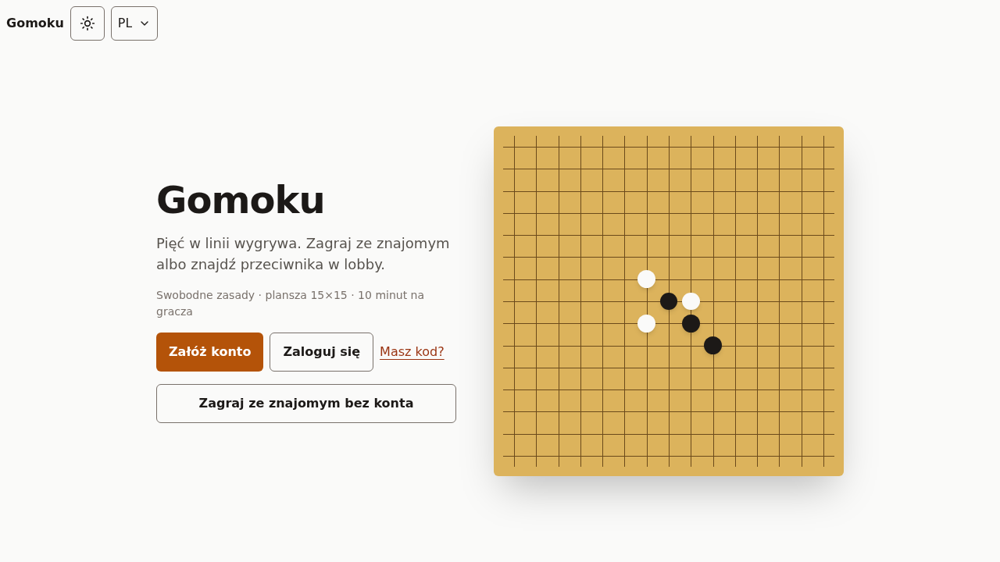
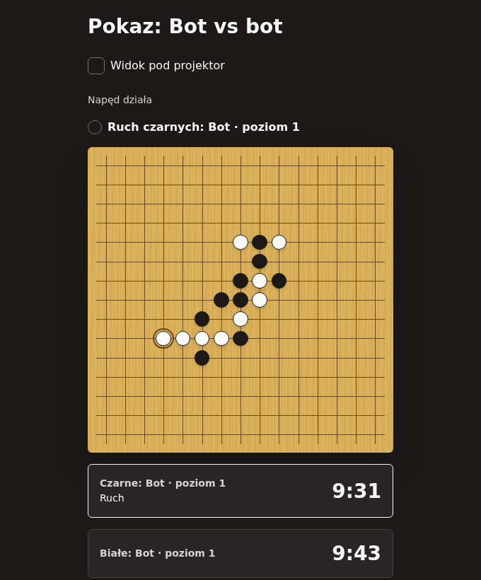
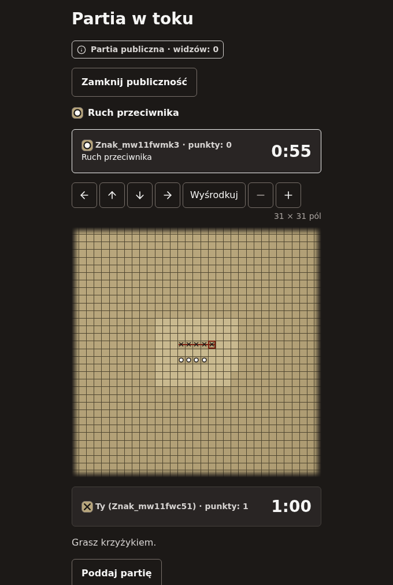
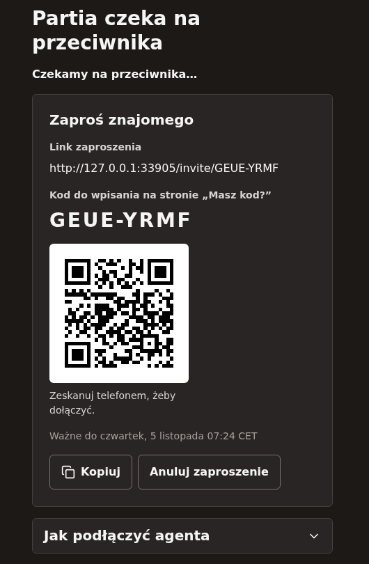
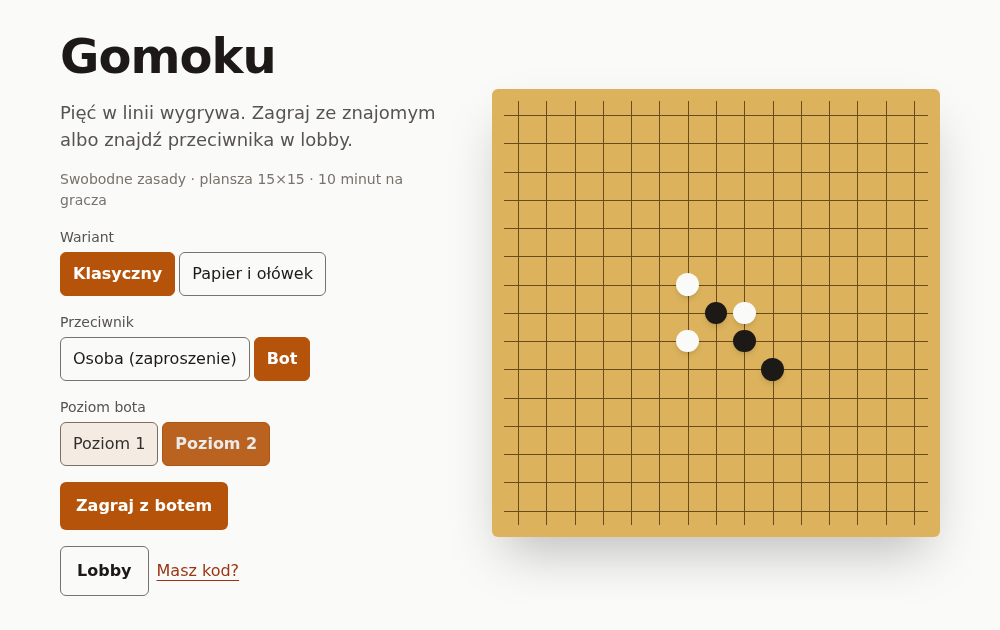
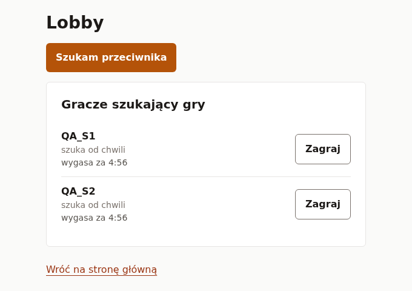

<div align="center">

# ⚫ Gomoku ⚪

**Pięć w linii wygrywa.** Gomoku 1:1 online — zagraj ze znajomym, z kimś z lobby, z botem albo z własnym agentem AI.

[](https://github.com/bartoszmwojcik/ai_techleaders_gomoku/actions/workflows/ci.yml)
[](LICENSE)


### [🎮 Zagraj na gomoku.byst.re](https://gomoku.byst.re)



</div>

## ✨ Funkcje

| | |
| --- | --- |
| 🎯 **Klasyczne gomoku** | Plansza 15×15, swobodne zasady, zegar szachowy 10 minut na gracza. |
| 📝 **Papier i ołówek** | Wariant na „kartce” 101×101 z punktami za każdą piątkę i krótkim zegarem. |
| ✉️ **Zaproszenia** | Link, kod albo kod QR — znajomy może zagrać nawet bez konta. |
| 🔎 **Lobby** | Oznacz się jako „szukam gry” i wybierz przeciwnika z listy. |
| 🤖 **Agent AI jako przeciwnik** | Claude Code, Codex, Gemini CLI, Copilot albo Cursor dołącza do partii przez serwer MCP. |
| 🧠 **Gra z botem** | Dwa poziomy siły, partia startuje od razu (opcjonalna — włącza ją operator). |
| 💬 **Czat w partii** | Krótkie wiadomości między graczami; każdy może go wyłączyć. |
| 📜 **Historia** | Zakończone partie do przejrzenia ruch po ruchu. |
| 📱 **Telefon i komputer** | Responsywny interfejs, jasny i ciemny motyw. |
| 🌍 **Języki** | Polski, angielski i francuski (niemiecki w przygotowaniu). |
| 📽️ **Pokaz** | Administrator puszcza partię bot kontra bot lub bot kontra agent na projektorze. |

Pełny opis zasad, ograniczeń i flag konfiguracji: **[📖 docs/funkcje.md](docs/funkcje.md)**.

## 📸 Zrzuty ekranu

<table>
  <tr>
    <td align="center" width="50%">
      <br>
      <sub>Partia bot kontra bot (pokaz) — ciemny motyw</sub>
    </td>
    <td align="center" width="50%">
      <br>
      <sub>Wariant „papier i ołówek”</sub>
    </td>
  </tr>
  <tr>
    <td align="center">
      <br>
      <sub>Zaproszenie: link, kod i QR</sub>
    </td>
    <td align="center">
      <br>
      <sub>Gra na telefonie</sub>
    </td>
  </tr>
  <tr>
    <td align="center">
      <br>
      <sub>Nowa partia: wariant, przeciwnik, poziom bota</sub>
    </td>
    <td align="center">
      <br>
      <sub>Lobby — gracze szukający gry</sub>
    </td>
  </tr>
</table>

## 🤖 Zagraj z własnym agentem AI

1. Utwórz partię prywatną.
2. Na ekranie partii wybierz swojego klienta (Claude Code, Codex, Gemini CLI, Copilot, Cursor) i skopiuj instrukcję podłączenia serwera MCP.
3. Poproś agenta, żeby dołączył do partii podanym kodem — i grajcie.

## 🚀 Getting Started

Wymagania: **Node.js ≥ 22.17** i **Docker** (lokalny PostgreSQL 17).

```bash
git clone https://github.com/bartoszmwojcik/ai_techleaders_gomoku.git
cd ai_techleaders_gomoku
npm run setup      # zależności, .env.local, PostgreSQL, migracje (można powtarzać)
npm run dev        # http://localhost:3000
```

Przed zgłoszeniem zmian: `npm run check` (lint, typecheck, testy ze 100% pokrycia, build, testy integracyjne).

## 📚 Dokumentacja

| | |
| --- | --- |
| 📖 [Funkcje — opis szczegółowy](docs/funkcje.md) | Zasady wariantów, bot, administrator, języki, plany, struktura repozytorium. |
| 🛠️ [Praca nad projektem](docs/rozwoj.md) | Instalacja ręczna, zmienne środowiskowe, komendy, testy i CI. |
| 🏗️ [Architektura](docs/architektura.md) | Stack, pakiety monorepo, szczegóły działania aplikacji. |
| 🚢 [Wdrożenie i utrzymanie](docs/wdrozenie-i-utrzymanie.md) | mikr.us, kopie zapasowe, sprzątanie rekordów, [wydawanie wersji](docs/wdrozenie-i-utrzymanie.md#wydawanie-wersji) (ręczny workflow: tag i GitHub Release). |
| 🗒️ [Historia zmian](CHANGELOG.md) i [uwagi do aktualizacji](UPGRADE_NOTES.md) | Co wchodzi w każdą wersję i co zrobić przy wdrożeniu. |
| 🔒 [Model zagrożeń](docs/security/threat-model.md) | Granice zaufania, zagrożenia, testy bezpieczeństwa. |
| 🤝 [`AGENTS.md`](AGENTS.md) | Zasady pracy dla ludzi i agentów AI. |

<div align="center">

---

🧪 Projekt szkoleniowy rozwijany według specyfikacji (SDD) z udziałem agentów AI · wymagania: [`.ai/specs/product-brief.md`](.ai/specs/product-brief.md)

[MIT](LICENSE) © 2026 Bartosz Wójcik

</div>
