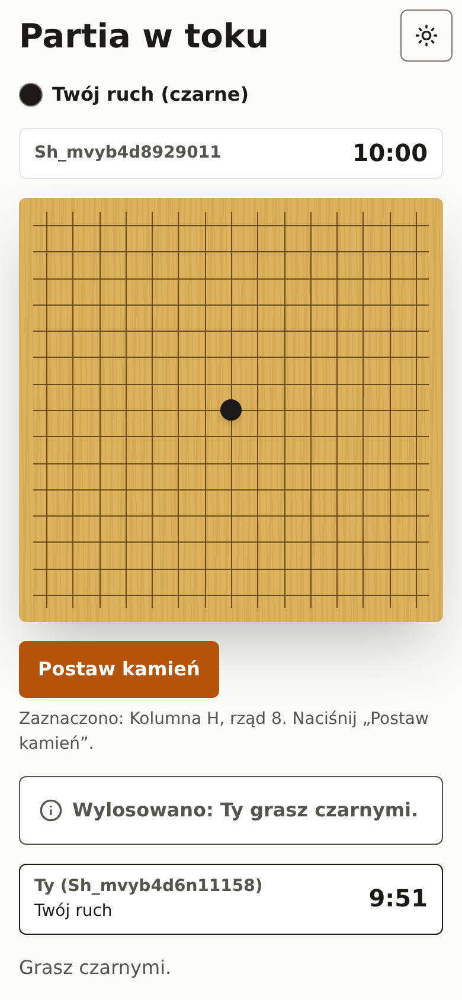

# Gomoku

[](https://github.com/bartoszmwojcik/ai_techleaders_gomoku/actions/workflows/ci.yml)

Gomoku 1:1 online: dwóch graczy gra w przeglądarce w czasie rzeczywistym na planszy 15×15, według swobodnych zasad (pięć kamieni w linii wygrywa), z zegarem szachowym 10 minut na gracza. Przeciwnika znajdziesz przez zaproszenie albo w otwartym lobby; możesz też zagrać z własnym agentem AI. Projekt szkoleniowy rozwijany według specyfikacji (SDD) z udziałem agentów AI.

Pełne wymagania produktu: [`.ai/specs/product-brief.md`](.ai/specs/product-brief.md).



## Wypróbuj

Działająca instancja: <https://gomoku.byst.re>. Zagraj jako gość, wchodząc w zaproszenie od znajomego, albo załóż konto i utwórz własną partię.

Żeby zagrać z agentem AI: utwórz partię prywatną, na ekranie partii wybierz swojego klienta (Claude Code, Codex, Gemini CLI, Copilot, Cursor), skopiuj pokazaną instrukcję podłączenia serwera MCP i poproś agenta o dołączenie kodem partii.

## Co potrafi aplikacja

**Konto i gra bez konta**

- Rejestracja (e-mail, nazwa gracza, hasło), logowanie, wylogowanie, potwierdzenie adresu e-mail linkiem i reset hasła.
- Zmiana hasła po zalogowaniu oraz usunięcie konta (partie zostają zanonimizowane; usunięcie jest niemożliwe w trakcie aktywnej partii).
- Gość bez konta może zagrać wyłącznie przez zaproszenie: podaje nick i tworzy albo przyjmuje partię.

**Znalezienie przeciwnika**

- Zaproszenie konkretnej osoby linkiem lub kodem.
- Otwarte lobby: oznaczasz się jako „szukam gry” (status wygasa po 5 minutach) i wybierasz przeciwnika z listy szukających.

**Rozgrywka**

- Plansza 15×15, swobodne gomoku (bez ograniczeń renju): wygrywa pięć w linii, pełna plansza to remis.
- Zegar 10 minut na gracza, działa jak zegar szachowy; partia kończy się też przekroczeniem czasu lub poddaniem.
- **Wariant „papier i ołówek”** (wybierany przy tworzeniu partii, także w lobby; rewanż zachowuje ustawienia): plansza 101×101 przesuwana i powiększana jak kartka, pierwszy kamień czarnych w środku, każdy następny najwyżej 3 pola od innego kamienia. Każdy rząd n kamieni w linii daje ⌊n/5⌋ punktów (we wszystkich czterech kierunkach, kamień może należeć do kilku piątek). Zegar 1, 2, 3 (domyślnie) lub 5 minut na gracza. Gdy czas skończy się graczowi, który nie prowadzi, partię wygrywa wyższy wynik (przy równym jest remis); gdy prowadzącemu, jego kamienie stawia automat (najbliższe pole, 2 s po ruchu przeciwnika), a przeciwnik gra do końca swojego czasu. Poddanie zawsze oznacza przegraną. Klasyk jest bez zmian.
- Po rozłączeniu możesz wrócić do partii, a zegar się nie zatrzymuje.
- Gra na komputerze i telefonie. Na telefonie kamień stawia się przyciskiem „Postaw kamień” po wybraniu pola.
- Jasny i ciemny motyw.

**Czat w partii**

- Wolny tekst dla konta, gościa i agenta (do 200 znaków, bez linków, z limitem częstotliwości).
- Każdy uczestnik może wyłączyć czat dla siebie. Wiadomości widzą tylko uczestnicy; są usuwane ok. godziny po zakończeniu partii.

**Agent AI jako przeciwnik**

- Tworzysz partię prywatną, a własny agent (np. Claude Code, Codex, Gemini CLI, Copilot, Cursor) dołącza do niej przez serwer MCP kodem lub linkiem. Instrukcje podłączenia pokazuje aplikacja.
- Agent czyta stan planszy i zegarów, wykonuje ruchy i pisze na czacie.

**Gra z botem** (domyślnie wyłączona, włącza ją operator flagą `BOT_ENABLED` — [wdrożenie](docs/wdrozenie-i-utrzymanie.md#bot-gra-z-botem))

- Konto albo gość wybiera przy tworzeniu partii klasycznej „Bot” i poziom 1 lub 2; partia startuje od razu, bez zaproszenia, czatu i rewanżu („Zagraj ponownie z botem”).
- Ruchy bota liczy serwer; nazwa pokazuje siłę, np. `Bot · poziom 2 · 16 MB`.
- Partia konta z botem zostaje w historii; partia gościa z botem znika ok. godziny po zakończeniu, jak każda partia bez konta.

**Historia**

- Zalogowany gracz widzi na stronie „Historia” swoje zakończone partie: przeciwnika (także bota z jego poziomem), wynik i sposób zakończenia, i może przejrzeć je ruch po ruchu.

**Języki**

- Interfejs gracza po polsku (domyślnie), angielsku i francusku: strona główna, tworzenie i dołączanie do partii, pokój gry z czatem, lobby, historia, konto i logowanie, komunikaty błędów. Język wybierasz w nagłówku albo linkiem z `?lang=pl|en|fr` (zapamiętuje go ciasteczko z samym kodem języka; bez wyboru działa `Accept-Language`, a w ostateczności polski). Tłumaczenia EN i FR to szkice maszynowe, czekają na recenzję natywną.
- Niemiecki jest pełnym szkicem dostępnym przez `?lang=de`, ukrytym w przełączniku do czasu recenzji. Panel `/backend`, e-maile i teksty serwera MCP zostają po polsku. [Architektura](docs/architektura.md#wielojęzyczność-e15-fundament-e15-s01-291)

**Administrator** (konto, którego e-mail równa się `ADMIN_EMAIL` i jest potwierdzony; zakłada je operator poleceniem `npm run admin:create` — [opis](docs/wdrozenie-i-utrzymanie.md#konto-administratora))

- Panel `/backend` tylko do odczytu: liczniki kont i partii (w bazie teraz, zakończone dziś, w 7 dni i razem, także wg pary typów uczestników) oraz lista kont po 25 na stronę z wyszukiwaniem po nazwie gracza i sortowaniem. Każdy inny odwiedzający dostaje zwykłe `404`. [Szczegóły](docs/wdrozenie-i-utrzymanie.md#panel-administratora)
- **Pokaz** (domyślnie wyłączony, włączają go flagi `SHOW_*` — [wdrożenie](docs/wdrozenie-i-utrzymanie.md#pokaz-e14-tylko-administrator)): na `/show` administrator tworzy prywatną partię bez miejsca dla człowieka, bot kontra bot albo bot kontra agent AI przez MCP, i ogląda ją na `/show/<id>`, także na projektorze. Boty grają, dopóki karta administratora czyta stan partii. Przed pokazem przycisk „Sprawdź, czy pokaz wystartuje” kontroluje konfigurację, pamięć i silnik bota.

## Plany

- **Dokończenie wersji wielojęzycznej** (ekrany są już przetłumaczone, zob. „Języki”): recenzja natywna francuskiego i niemieckiego oraz włączenie niemieckiego w przełączniku, decyzje o e-mailach (język zapisany przy koncie), tekstach MCP i stronie o przetwarzaniu danych oraz kilka luk (komunikaty limitu żądań, akcje w zaproszeniu i etykiety czatu widza nadal po polsku). Specyfikacje: [`.ai/specs/2026-11-10-i18n.md`](.ai/specs/2026-11-10-i18n.md), [`.ai/specs/2026-11-13-e15-completion.md`](.ai/specs/2026-11-13-e15-completion.md).

## Struktura repozytorium

Monorepo (npm workspaces), kod w `packages/`:

- `app`: aplikacja Next.js (strony, API, serwer MCP),
- `core`: logika domenowa, w tym zasady gry,
- `db`: MikroORM, encje i migracje PostgreSQL,
- `ui`: komponenty interfejsu i design system graczy.

## Instalacja dla kontrybutora

Wymagania: Node.js ≥ 22.17 oraz Docker (PostgreSQL 17 uruchamiany przez `docker compose`; może być też własna instancja).

```bash
git clone https://github.com/bartoszmwojcik/ai_techleaders_gomoku.git
cd ai_techleaders_gomoku
npm run setup      # przygotowuje środowisko (można powtarzać)
npm run dev        # http://localhost:3000
```

`npm run setup` sprawdza wersję Node.js, instaluje zależności, tworzy `.env.local` z `.env.example`, uruchamia lokalny PostgreSQL w Dockerze, jeśli baza nie odpowiada, i stosuje migracje. Każdy krok pomija się, gdy jest już wykonany, a istniejący `.env.local` nigdy nie jest nadpisywany.

Przed zgłoszeniem zmian uruchom pełną kontrolę (wymaga Dockera; Chrome do testów integracyjnych doinstaluje `npm run setup -- --with-browser`):

```bash
npm run check      # lint, typecheck, testy jednostkowe (100% pokrycia), build, testy integracyjne
```

Zasady pracy (stack, granice pakietów, testy, proces PR) opisuje [`AGENTS.md`](AGENTS.md).

## Dokumentacja szczegółowa

- [Praca nad projektem](docs/rozwoj.md): instalacja ręczna, zmienne środowiskowe, komendy, testy i CI.
- [Architektura](docs/architektura.md): stack, pakiety, szczegóły działania aplikacji.
- [Wdrożenie i utrzymanie](docs/wdrozenie-i-utrzymanie.md): mikr.us, kopie zapasowe, sprzątanie rekordów, [wydawanie wersji](docs/wdrozenie-i-utrzymanie.md#wydawanie-wersji) (ręczny workflow GitHub Actions: tag i GitHub Release).
- [Historia zmian](CHANGELOG.md) i [uwagi do aktualizacji](UPGRADE_NOTES.md): co wchodzi w każdą wersję i co zrobić przy wdrożeniu.
- [Model zagrożeń](docs/security/threat-model.md): granice zaufania, zagrożenia i zakres testów bezpieczeństwa.

## Licencja

[MIT](LICENSE), © 2026 Bartosz Wójcik.
