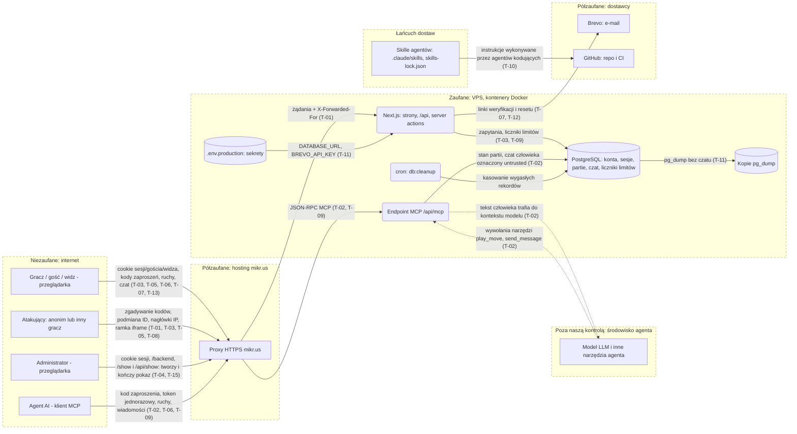

# Model zagrożeń: Gomoku online

**Zakres:** cały system (projekt), nie pojedyncza funkcja
**Ostatnia aktualizacja:** 2026-11-04 (stan kodu: `main` @ 045a93f; PR „security hardening A+B” i „C” opisane w changelogu, niewdrożone)
**Właściciel:** Bartosz Wójcik

Gomoku to aplikacja webowa do gry 1:1 online (klasyk 15×15 i wariant „papier i ołówek” 101×101), z kontami, graczami-gośćmi, zaproszeniami (kod `XXXX-XXXX`, QR), lobby, widzami partii publicznych, czatem między ludźmi i serwerem MCP dla agentów AI. Najważniejsze zagrożenia: (1) czat człowieka trafia do kontekstu agenta AI (wstrzykiwanie poleceń, T-02), (2) działanie ochrony przed nadużyciami zależy od nieweryfikowanego założenia, że proxy mikr.us przekazuje adres klienta (T-01), (3) brak HSTS i CSP (T-08; podstawowe nagłówki dodane w PR „security hardening”) oraz łańcuch dostaw skilli agentów kodujących (T-10; reguła CI i weryfikacja hashy dodane w tym samym PR). Kontrola dostępu między użytkownikami i rolami jest w kodzie zaprojektowana dobrze (jednolite 404), ale wymaga stałych testów dwoma kontami (T-03, T-04).

> Status: dokument powstał na podstawie lektury kodu, nie testów na żywo i nie konfiguracji produkcji. Co potwierdzono w kodzie, a co jest założeniem, wyraźnie oznaczono (sekcja „Założenia i pytania otwarte”).

## 1. Nad czym pracujemy?

### Profil systemu

| Aplikacja | Typ | Stack | Wdrożenie | Uwierzytelnianie | Tenancy | AI |
| --- | --- | --- | --- | --- | --- | --- |
| `@gomoku/app` (strony + `/api/*` + server actions) | aplikacja webowa z API | Next.js 16, React 19, MikroORM 7, Awilix | Docker (`compose.prod.yaml`) na VPS mikr.us za proxy HTTPS | sesja w cookie `__Host-gomoku_session` (HttpOnly, Secure, SameSite=Lax, 30 dni, w bazie tylko hash), gość: cookie `__Host-gomoku_guest`, widz: `__Host-gomoku_spectator`, agent: token na jedną partię (SHA-256 w bazie) | brak organizacji; „najemcą” jest uczestnik partii (konto, gość, widz, agent), role: gracz i administrator instalacji (`ADMIN_EMAIL`) | brak własnego modelu; serwer MCP wystawia agentom zewnętrznym |
| Endpoint MCP `/api/mcp` (`packages/app/src/server/mcp/`) | serwer MCP (Streamable HTTP, bezstanowy) | `@modelcontextprotocol/server` | ten sam proces | kod zaproszenia przy `join`, potem token partii; brak cookie i sesji | j.w. | tak: agent AI klienta gra przeciw człowiekowi |
| `db:cleanup`, `admin:create` | zadanie cykliczne (cron na VPS) i CLI | tsx w kontenerze | `docker exec` | dostęp do kontenera | n/d | brak |
| Pakiety `core`, `db`, `ui` | biblioteki | TS | bez własnego modelu (konsumuje `app`) | n/d | n/d | brak |

Architektura: modularny monolit Next.js + PostgreSQL; zależności składa Awilix, każde żądanie ma własny `EntityManager`.
Magazyny danych: PostgreSQL (konta, hasła bcrypt koszt 12, sesje, tokeny, partie, ruchy, czat tymczasowy, `rate_limit_buckets`); kopie `pg_dump` na dysku VPS; plik `.env.production` na serwerze.
Systemy zewnętrzne: Brevo (e-mail transakcyjny), GitHub (repo, CI), proxy HTTPS mikr.us, klienci MCP (cudzy modele AI).
Multi-tenancy: brak; izolacja między użytkownikami to przynależność do partii sprawdzana w `server/http/participant.ts` (`resolveParticipant`) i `server/http/spectator.ts` (`resolveSpectator`); historia po `user.id` z sesji.

### Aktywa

- Konta graczy: e-mail, hash hasła, sesje, tokeny weryfikacji, resetu i zmiany e-maila.
- Tokeny uczestników partii (gość, widz, agent) i kody zaproszeń (kto zna kod, dołącza lub ogląda).
- Integralność partii (ruchy, zegary, wynik) i prywatność partii niepublicznych.
- Rola administratora i dane panelu `/backend` (lista kont, liczniki).
- Sekrety: `POSTGRES_PASSWORD`, `BREVO_API_KEY`, `.env.production`; kopie bazy z danymi użytkowników.
- Dostępność usługi na VPS 2 GB RAM (bez swapu) i limit wysyłki e-maili.
- Integralność repozytorium: kod, workflow CI, skille agentów.

### Aktorzy

| Aktor | Dostęp | Motywacja |
| --- | --- | --- |
| Anonimowy użytkownik internetu | publiczne strony i `/api/*` bez sesji | zgadywanie kodów, spam, DoS, wyliczanie kont |
| Zalogowany gracz A | własne partie i historia | czytać/zmieniać partie gracza B, zepsuć cudzą partię |
| Gość, widz | cookie gościa / widza | wyjść poza swoją partię, nadużyć czat |
| Gracz bez roli administratora | standardowe funkcje | dostać się do `/backend` |
| Człowiek przeciwnik agenta AI | czat w partii z agentem | wstrzyknąć polecenia do kontekstu agenta |
| Treść niezaufana czytana przez system | tekst czatu, pseudonim widza, `agentName`, nazwa gracza | wstrzykiwanie poleceń, XSS, nadużycia |
| Skompromitowana zależność lub skill | npm, `.claude/skills`, GitHub Actions | przejęcie środowiska agenta lub CI |
| Operator/serwer | root na VPS | błąd operacyjny (uprawnienia kopii, sekrety) |

### Punkty wejścia

| Aplikacja | Punkt wejścia | Auth wymagane | Uwagi |
| --- | --- | --- | --- |
| app | `POST /api/auth/{register,login,logout,password,display-name,email-change,email-verification/*,password-reset/*}`, `POST /api/account/delete` | rejestracja/logowanie/reset: nie; reszta: sesja | CSRF: nagłówek `Origin` = `APP_ORIGIN` + `X-Gomoku-Request` (`api-handler.ts`); limity w `rate_limit_buckets` |
| app | `GET/POST /api/games`, `/api/games/[id]`, `/moves`, `/chat`, `/chat/settings`, `/resign`, `/cancel`, `/rematch*`, `/qr`, `/audience/close` | uczestnik partii (konto lub token gościa) | jednolity 404 dla obcych (`resolveParticipant`) |
| app | `POST /api/invitations/[code]/accept`, `/spectate`; `GET/POST /api/games/[id]/spectate`, `/spectate/chat` | kod zaproszenia lub cookie widza | pula nieudanych kodów (`invitation-lookup.ts`) |
| app | `GET /api/lobby`, `POST /api/lobby/seeking`, `/api/lobby/seekers/[id]/pick`, `GET /api/history` | sesja (lobby, historia); lobby zależy od trybu | historia po `user.id` |
| app | `/backend/*` (strony i ewentualne akcje) | administrator (`requireAdmin`, 404 dla pozostałych) | wymuszone testem `admin-gate.guard.test.ts` |
| app | `/show`, `/show/[gameId]`, `GET/POST /api/show`, `POST /api/show/preflight`, `GET /api/show/[id]`, `POST /api/show/[id]/end` (pokaz, E14) | administrator (`requireAdmin` na stronach, `requireAdminApi` jako `gate` przed CSRF w trasach; 404 dla pozostałych) | jedyne zapisy administratora (utworzenie i zakończenie pokazu); wymuszone testem `show-routes.guard.test.ts`; limit 10 pokazów/h |
| MCP | `POST /api/mcp`: `join`, `get_state`, `play_move`, `send_message` | kod zaproszenia, potem token partii | `GET`/`DELETE` to 405; kontrola `Origin` |
| app | `GET /api/health` | nie | w produkcji bez szczegółów infrastruktury |
| Infra | `docker exec` cron `db:cleanup`, `admin:create`, `pg_dump` | dostęp do VPS | poza aplikacją |
| Repo | PR, workflow CI, `.claude/skills/*`, `skills-lock.json` | uprawnienia w repo | docs-only PR pomija ciężkie joby |

### Przepływ danych i granice zaufania

Granice: przeglądarka ↔ proxy/aplikacja; proxy mikr.us ↔ aplikacja (adres klienta); aplikacja ↔ baza; aplikacja ↔ Brevo; **tekst człowieka ↔ kontekst modelu agenta**; **wyjście modelu ↔ narzędzia MCP**; repo/skille ↔ agenci kodujący.
Źródło diagramu: `docs/security/threat-model.mmd`. Plik SVG nie został wygenerowany (brak `mmdc` w środowisku); render: `npx @mermaid-js/mermaid-cli -i docs/security/threat-model.mmd -o docs/security/threat-model.svg`.

### Komponenty AI i werdykt Rule of Two

| Komponent | Niezaufane wejście | Wrażliwe dane/systemy | Zmienia stan / komunikuje na zewnątrz | Werdykt Rule of Two |
| --- | --- | --- | --- | --- |
| Agent AI klienta MCP grający przeciw człowiekowi (model i host poza naszą kontrolą; serwer: `mcp-server.ts`, `agent-game-service.ts`) | **tak**: czat człowieka w `get_state` (oznaczony `untrusted: true`, opis narzędzia ostrzega) | **po stronie serwera: prawie nie**: wyłącznie własny token jednej partii (jednorazowy w odpowiedzi `join`), brak danych innych graczy; **po stronie hosta agenta: nieznane** (inne narzędzia, pliki, sekrety) | **tak**: `play_move`, `send_message` (w obrębie jednej partii; URL-e i „sekrety” odrzuca `looksLikeSecret`/walidacja czatu) | Serwer: **2 z 3** (niezaufane wejście + zmiana stanu w wąskim zakresie, dane wrażliwe poza samym tokenem nieobecne), więc zgodne z regułą; **szkoda ograniczona z założenia** (jedna partia). **Warunek:** jeśli host agenta ma własne narzędzia z dostępem do danych lub sieci, wszystkie 3 właściwości zbiegają się po jego stronie (nasz tekst staje się wektorem). To ryzyko właściciela agenta; mitigacje po naszej stronie: tekst bez URL-i, krótki limit (200 znaków), znaczniki `untrusted`, brak narzędzi poza grą. |

Nie ma modelu uruchamianego przez naszą aplikację (brak wywołań LLM po stronie serwera), więc prompt injection „do nas” nie istnieje; dotyczy to wyłącznie agentów łączących się z `/api/mcp`.

### Założenia i pytania otwarte

- [x] **Z-1 (#112):** zmierzone 2026-11-04: przez domenę proxy mikr.us dopisuje adres klienta na końcu `X-Forwarded-For`, `TRUST_PROXY_HOPS=1` jest właściwe, wpis klienta po lewej jest ignorowany. Bezpośredni port aplikacji (publikowany na wszystkich interfejsach) ufa nagłówkowi klienta w całości, więc limity per adres da się ominąć; ryzyko resztkowe zaakceptowane (zob. T-01 i `docs/wdrozenie-i-utrzymanie.md`, „Adres klienta za proxy”).
- [ ] **Z-2:** czy proxy/hosting dokłada nagłówki bezpieczeństwa (HSTS, CSP, X-Frame-Options)? W kodzie aplikacji ich nie ma (poza `Referrer-Policy` na 3 stronach z tokenem w adresie, `no-referrer` na stronie zaproszenia i CSP na obrazie QR).
- [ ] **Z-3:** uprawnienia plików `.env.production` i katalogu kopii oraz ich położenie. Dokumentacja (`docs/wdrozenie-i-utrzymanie.md`) podaje `/var/backups/gomoku`, a właściciel wskazał `/root/backups`: do ujednolicenia; uprawnienia (`700`/`600`) niesprawdzone.
- [ ] **Z-4:** ochrona gałęzi `main` (wymagane przeglądy, wymagane checki, brak force-push) opisana w `AGENTS.md`, ale ustawienia GitHuba nie były sprawdzane.
- [ ] **Z-5:** czy `skills-lock.json` (hashe) jest weryfikowany gdziekolwiek (CI, pre-commit)? W `.github/workflows/ci.yml` nie znaleziono takiego kroku.
- [ ] **Z-6:** czy `EMAIL_DAILY_LIMIT` jest ustawiony w produkcji (bez niego nie ma globalnego limitu wysyłki), oraz stan konta Brevo (2FA, zakres klucza).
- [ ] **Z-7:** brak swapu i 2 GB RAM wynikają z opisu zadania i `docs/wdrozenie-i-utrzymanie.md`; stanu serwera nie sprawdzano.
- [ ] **Z-8:** rzeczywista konfiguracja kontenera (`USER node` w `Dockerfile` potwierdzono; reszta, np. limity pamięci kontenerów, nie jest ustawiona w `compose.prod.yaml`).
- [ ] **Z-9:** czy pula globalna `INVITATION_LOOKUP_GLOBAL_LIMIT` (300 / 15 min) może być wyczerpana przez jednego atakującego i zablokować dołączanie wszystkim, zależy od miejsca użycia w `invitation-lookup.ts`; nie przeanalizowano do końca.

## 2. Co może pójść nie tak?

| ID | Zagrożenie | STRIDE | Gdzie | L | I | Odpowiedź | Kontrola dziś | Jak weryfikujemy | OWASP / CWE |
| --- | --- | --- | --- | --- | --- | --- | --- | --- | --- |
| T-01 | Ochrona przed nadużyciami (limity logowania, rejestracji, kodów, MCP) opiera się na adresie klienta z `X-Forwarded-For`. Jeśli proxy mikr.us go nie przekazuje, rejestracja/logowanie/MCP kończą się 500/503 (DoS własny); jeśli `TRUST_PROXY_HOPS` jest za duże, atakujący podszywa się pod adres i omija limity; za małe: wszyscy dzielą jeden licznik | S, D | `packages/app/src/server/http/client-address.ts`, `server/config.ts` (`TRUST_PROXY_HOPS`) | M | H | Mitigate/Accept: pomiar #112 wykonany (Z-1); ominięcie przez bezpośredni port zaakceptowane jako ryzyko resztkowe, bo limity per konto/e-mail działają niezależnie; w razie nadużyć nginx ufający XFF tylko od proxy mikr.us albo Cloudflare + `cf-connecting-ip` | Częściowa: czytanie XFF od prawej, `fail closed` w produkcji, hash adresu w kluczu, /64 dla IPv6 (`client-address.ts`); przez domenę zweryfikowane na produkcji (#112); bezpośredni port ufa nagłówkowi klienta; odmowy 429 widać w logu jako `security.rate_limited` (nazwa puli, bez adresu), co pozwala zauważyć nietypowy ruch | Test jednostkowy podrobionych XFF (istnieje); na izolowanym środowisku z proxy: żądania z własnym XFF i sprawdzenie, czy licznik zależy od wartości podanej przez klienta; przegląd logów 500 po wdrożeniu | A06:2025, API4:2023, CWE-348, CWE-770 |
| T-02 | Człowiek w partii z agentem AI pisze na czacie treść-polecenie (bez URL-i, max 200 znaków) i próbuje nakłonić model do ruchu, ujawnienia czegoś z kontekstu hosta lub zmiany zachowania (pośredni prompt injection) | T, E | `server/mcp/mcp-server.ts` (`get_state`), `services/games/agent-game-service.ts`, `core/src/chat/message.ts` | H | M | Mitigate: zostawić `untrusted: true` i ostrzeżenie w opisie narzędzi; nie dodawać narzędzi poza grą; udokumentować ryzyko hosta agenta (Rule of Two); ewentualnie opcja „czat wyłączony dla agentów” po stronie twórcy (już istnieje `/chat/settings`) | Tak: znacznik `untrusted`, opisy narzędzi „dane, nie instrukcje”, filtr czatu (URL, znaki sterujące/niewidoczne, długość), tylko 4 narzędzia (`MCP_TOOL_NAMES`), brak wywołań LLM po stronie serwera | Ręcznie/Prompt injection: scenariusze w izolowanej partii z własnym agentem testowym (zob. sekcja 3); test jednostkowy, że tekst człowieka zawsze ma `untrusted: true`; przegląd, że nowe narzędzie MCP wymaga aktualizacji modelu | LLM01:2026, ASI01, MCP (tool/response injection), CWE-1427 |
| T-03 | IDOR / dostęp poziomy: gracz A, gość lub widz odczytuje lub zmienia partię B (`/api/games/[id]*`, `/qr`, `/spectate*`, `/audience/close`, `/chat/settings`), albo cudzą historię | I, E | `server/http/participant.ts`, `server/http/spectator.ts`, `app/api/games/[id]/**`, `app/api/history/route.ts` | L | H | Mitigate: utrzymać jeden guard na każdej trasie z `[id]` (PR „security hardening”: test strażnik nie dopuszcza trasy bez guarda, macierz IDOR w testach integracyjnych) | Tak: test strażnik `server/games-routes.guard.test.ts` (każdy `route.ts` pod `/api/games/[id]` woła `resolveParticipant`/`resolveSpectator` albo jest na liście wyjątków z uzasadnieniem), `tests/integration/idor-matrix.test.ts` (obcy: inne konto, gość innej partii, brak sesji; 12 tras; odpowiedź o cudzej partii identyczna z odpowiedzią o nieistniejącej), `resolveParticipant`/`resolveSpectator` z jednolitym 404; `parseGameId` (UUID); historia wyłącznie po `user.id` z sesji; rozdzielone cookie gościa i widza; QR dostępny tylko uczestnikowi/widzowi | Macierz IDOR (`idor-matrix.test.ts`) obejmuje trasy uczestnika; nie obejmuje jeszcze tras `/spectate*` ani widza na trasie gracza i odwrotnie (do rozszerzenia); DAST: podmiana ID z sesją A | A01:2025, API1:2023, API5:2023, CWE-639, CWE-285 |
| T-04 | Eskalacja pionowa: gracz bez roli administratora (lub bez sesji, z niezweryfikowanym e-mailem) wchodzi na `/backend` albo przejmuje konto administratora (reset hasła/e-mail administratora) | E | `server/http/admin-gate.ts`, `app/(backend)/**`, `ADMIN_EMAIL` | L | H | Mitigate: bramka `requireAdmin` w każdej stronie/trasie/akcji; chronić skrzynkę e-mail administratora (2FA); rozważyć podniesienie wymogu (np. ponowne logowanie) | Tak: rola z konfiguracji (nie z bazy ani żądania), wymagany potwierdzony e-mail, 404 zamiast przekierowania, rejestracja na e-mail administratora odrzucana (`user-service.ts`), test strażnik `admin-gate.guard.test.ts`; każda odmowa bramki zostawia linię `security.admin_denied` (bez konta) | Test integracyjny: konto zwykłe, bez sesji, z niepotwierdzonym e-mailem na każdej ścieżce `/backend` (oczekiwane 404); DAST bez sesji i z sesją gracza; przegląd, że nowy plik w `(backend)` wywołuje `requireAdmin` (test strażnik) | A01:2025, API5:2023, CWE-269, CWE-862 |
| T-05 | Zgadywanie kodów zaproszeń (`XXXX-XXXX`, alfabet 31 znaków, ok. 8,5·10^11 kombinacji) w celu dołączenia do cudzej partii lub oglądania prywatnej; wyczerpanie puli limitów, by zablokować dołączanie innym | S, I, D | `server/http/invitation-lookup.ts`, `services/games/join-core.ts`, `app/api/invitations/[code]/*`, `core/src/games/invitation-code.ts` | L | M | Mitigate: utrzymać limity; zweryfikować Z-1 (bez wiarygodnego adresu limit per-IP nie działa); krótkie życie zaproszeń | Tak: kod z CSPRNG (`randomInt`), pula nieudanych prób 20/15 min/adres + 300 globalnie, jednolite 410 dla nieznanego/prywatnego/zakończonego, strona zaproszenia z `no-referrer` | Test jednostkowy/integracyjny limitu; manualnie na środowisku testowym: seria błędnych kodów z jednego adresu daje 429, a poprawny kod potem nadal działa (nie ma blokady konta); sprawdzenie, że 410 nie różnicuje przypadków | A07:2025, API2:2023, API4:2023, CWE-307, CWE-330 |
| T-06 | Kradzież lub ponowne użycie tokenów uczestnika (gość, widz, agent): ujawnienie w logu agenta, w czacie lub przez XSS; przejęcie miejsca gracza w trwającej partii | S, I | `server/http/guest-cookie.ts`, `spectator-cookie.ts`, `opaque-token.ts`, `services/games/agent-seat-service.ts`, `agent-game-service.ts` | M | L | Mitigate: tokeny na jedną partię i krótkie życie (gość 2 h, widz 1 h, agent jak gość); agent nie wysyła tokenu (filtr `looksLikeSecret`); w razie wycieku unieważnienie przez koniec partii | Tak: 32 B CSPRNG, w bazie tylko SHA-256, cookie HttpOnly + Secure + `__Host-`, token agenta pokazany raz, filtr wiadomości agenta przeciw tokenom | Test jednostkowy atrybutów cookie i braku tokenu w odpowiedziach JSON; test, że token jednej partii nie działa w innej; przegląd logów aplikacji pod kątem tokenów | A07:2025, API2:2023, CWE-522, CWE-613 |
| T-07 | Przejęcie konta: credential stuffing, wyliczanie kont, nadużycie tokenów weryfikacji/resetu/zmiany e-maila (przechwycenie z `Referer`, długa ważność), długa sesja (30 dni) | S, I, E | `app/api/auth/**`, `services/auth/*`, `server/http/auth.ts` | M | H | Mitigate: utrzymać limity 3-warstwowe i bcrypt 12; rozważyć krótszą sesję bezczynną | Tak: unieważnianie wszystkich sesji po zmianie e-maila (`email-change-service.ts`, `revokeAll`), limity login (adres, e-mail+adres, e-mail), jednolite komunikaty logowania/rejestracji/resetu, reset w `after()` (brak różnicy czasowej), unieważnianie innych sesji po zmianie hasła, `Referrer-Policy: no-referrer` na stronach z tokenem (`next.config.ts`), hasła bcrypt | Test integracyjny: kolejne błędne logowania → 429; odpowiedzi rejestracji/resetu dla istniejącego i nieistniejącego konta identyczne (treść i czas); token resetu jednorazowy i wygasa; po zmianie hasła stara sesja nie działa | A07:2025, A04:2025, API2:2023, CWE-307, CWE-640, CWE-204 |
| T-08 | Brak globalnych nagłówków bezpieczeństwa (CSP, `frame-ancestors`/`X-Frame-Options`, HSTS, `nosniff`): clickjacking na akcjach gry/konta; brak „drugiej linii” przy ewentualnym XSS (dziś React escapuje, jedyny `dangerouslySetInnerHTML` to statyczny skrypt motywu w `(frontend)/layout.tsx`) | T, I | `packages/app/next.config.ts` (tylko Referrer-Policy), `(frontend)/layout.tsx` | M | M | Mitigate: podstawowe nagłówki dodane (PR „security hardening”); zostają HSTS (trudny do cofnięcia, po potwierdzeniu Z-2/domeny) i CSP z nonce dla skryptu motywu (następny PR) | Częściowa: globalne `X-Frame-Options: DENY`, `X-Content-Type-Options: nosniff`, `Referrer-Policy: strict-origin-when-cross-origin`, `Permissions-Policy` (kamera, mikrofon, geolokalizacja, płatności, USB i in. wyłączone) w `next.config.ts` na `/:path*`; trzy strony z tokenem zachowują `no-referrer` (reguły po bazowej, bo późniejsza wygrywa; test), obraz QR zachowuje własne `nosniff` i CSP; CSRF (Origin + nagłówek niestandardowy, SameSite=Lax), React escapuje treści użytkowników, CSP tylko na obrazie QR | Skan nagłówków na środowisku testowym (DAST passive); `next.config.test.ts` i `security-headers.test.ts` (nagłówki na `/`, `/api/health`, stronach z tokenem i QR); po wdrożeniu CSP i HSTS: test ich obecności i próba osadzenia w iframe na stronie testowej | A02:2025, CWE-1021, CWE-693 |
| T-09 | DoS zasobów: VPS 2 GB RAM bez swapu, pula DB 5, `max_connections=30`; long-polling `get_state` (do 25 s) trzyma połączenia, każdy limit zapisuje do bazy, duże plansze 101×101 powiększają odpowiedzi; build na serwerze zabija pamięć | D | `server/mcp/*`, `services/rate-limit/rate-limiter.ts`, `compose.prod.yaml`, `Dockerfile` | M | M | Mitigate/Accept: limity per adres i per token są; do zrobienia (osobny PR C): limity pamięci/CPU kontenerów w `compose.prod.yaml`, `statement_timeout`, limit równoległych `get_state` oraz monitoring; build poza serwerem lub zatrzymanie aplikacji na czas buildu (decyzja właściciela) | Częściowa: limity żądań MCP (300/min/adres, 60/min/token), limit rozmiaru ciała (MCP 8 KB; reszta `/api/*` 64 KB, `413` przed parsowaniem, zarówno po `Content-Length`, jak i po strumieniu), 429 widoczne w logu jako `security.rate_limited` (jedna linia na pulę i okno), limit czatu, `LOW_MEMORY`, limit widzów 20; brak (sprawdzone w kodzie i `compose.prod.yaml`): limitu równoległych długich odpytań, `statement_timeout` i limitów zasobów kontenerów | Test obciążeniowy łagodny wyłącznie na środowisku testowym (nie produkcji): wiele równoległych `get_state` z `waitSeconds`; obserwacja pamięci i liczby połączeń DB; sprawdzenie 429 zamiast 5xx | A06:2025, API4:2023, LLM10:2026, CWE-400, CWE-770 |
| T-10 | Łańcuch dostaw: zewnętrzne skille w `.claude/skills` (instrukcje wykonywane przez agentów kodujących, `defaultMode: auto` w `.claude/settings.json`), zmiana `SKILL.md` lub dowolnego `*.md` w PR pomijała ciężkie joby CI (naprawione w PR „security hardening”), brak weryfikacji hashy z `skills-lock.json` (dodana); zależności npm i akcje GitHub (wersje tagami, przypięte do SHA w PR „security hardening”). Uwaga: `.claude/skills/*` to dowiązania symboliczne do `.agents/skills/*`, więc treść skilli jest w `.agents/skills` | T, E | `.claude/skills/*`, `skills-lock.json`, `.claude/settings.json`, `.github/workflows/ci.yml` (job `changes`) | M | H | Mitigate: wykonane w PR „security hardening” (hashe, wyłączenie z reguły „tylko dokumentacja”, SHA, Dependabot); zostaje przegląd każdej zmiany skilla jak kodu, przegląd wyniku `npm audit` i zasada najmniejszych uprawnień dla agentów (`defaultMode: auto`) | Tak (po PR): job `skills-lock` liczy hash folderu każdego skilla algorytmem CLI `skills` (SHA-256 po ścieżkach i treści plików) i porównuje z `skills-lock.json`; `.agents/`, `.claude/`, `.github/`, `skills-lock.json`, `.ai/{skills,scripts,trackers,browsers}/` i `.ai/agentic.config.json` zawsze uruchamiają pełne CI (`scripts/ci/scope.mjs`, testy jednostkowe); akcje przypięte do SHA, `.github/dependabot.yml` (npm i github-actions, co tydzień). Zostaje: skrypt CI pochodzi z PR, więc zmiana reguły w tym samym PR jest widoczna tylko w przeglądzie; `AGENTS.md`/`CLAUDE.md` nadal liczą się jako dokumentacja; `npm audit` działa w CI tylko informacyjnie (job `audit`, `continue-on-error`, bez wymagania); obrazy bazowe `node:22-slim` i `postgres:17` przypięte do digestów (Dependabot `docker`, `docker-compose`); `package-lock.json` + `npm ci`, ochrona gałęzi (Z-4), `permissions: contents: read` w CI | `scripts/ci/skills-lock.test.ts` i job `skills-lock`; `scripts/ci/scope.test.ts` (ścieżki skilli, `.claude/`, `.github/` to kod); przegląd diffu skilli ręcznie; SAST/`npm audit` | A03:2025, A08:2025, ASI04, Skills Top 10, CWE-1357, CWE-829 |
| T-11 | Wyciek danych z infrastruktury: kopie `pg_dump` z kontami (e-maile, hashe) i `.env.production` z sekretami (`POSTGRES_PASSWORD`, `BREVO_API_KEY`) odczytane przez innego użytkownika/proces na VPS, przez błąd uprawnień lub zrzut backupu poza serwer; usunięte konto zostaje w kopiach do rotacji | I | VPS: kopie (`docs/wdrozenie-i-utrzymanie.md`), `.env.production`, `compose.prod.yaml` | L | H | Mitigate: `chmod 700` katalogu kopii, `600` na `.env.production`, szyfrowanie kopii poza serwerem; rotacja sekretów po incydencie | Częściowa: czat wyłączony z kopii (`--exclude-table-data=chat_messages`, test `tests/integration/chat-cleanup.test.ts`), `.env.production` poza gitem, baza niepublikowana na hosta, kontener działa jako `USER node` | Przegląd uprawnień na serwerze (`ls -l`) przez operatora; test integracyjny braku danych czatu w zrzucie (istnieje); skan repo pod kątem sekretów (SAST) | A02:2025, A04:2025, CWE-200, CWE-732 |
| T-12 | Nadużycie kanału e-mail: masowe żądania resetu/weryfikacji/zmiany e-maila kierowane na cudze adresy (spam) lub wyczerpanie globalnego dziennego limitu wysyłki, co blokuje weryfikację nowych kont wszystkim; wyciek klucza Brevo | D, I | `services/auth/*-service.ts`, `services/email/brevo-email-sender.ts`, `EMAIL_DAILY_LIMIT` | M | M | Mitigate: ustawić `EMAIL_DAILY_LIMIT`, limity per adres i per e-mail (są), alerty o zbliżaniu się do limitu | Częściowa: limity per adres IP i per e-mail, budżet dzienny z udziałem dla weryfikacji (`verificationDailyBudget`); w kodzie limit globalny jest opcjonalny (Z-6) | Test integracyjny limitów resetu/weryfikacji; na środowisku testowym z transportem `file`: seria żądań na jeden adres daje 200 i maksymalnie N maili | A06:2025, API4:2023, API6:2023, CWE-770 |
| T-13 | Nadużycia treścią: obraźliwy czat, pseudonim widza, nazwa gracza lub `agentName`; brak mechanizmu zgłoszeń i brak śladu audytowego (czat jest tymczasowy, BR-34), więc nadużycie jest niewykazywalne | R, T | `services/chat/chat-service.ts`, `spectator-service.ts`, `core/src/games/nickname.ts` | M | L | Accept/Mitigate: kill-switch twórcy partii istnieje; zastrzeżone nazwy wspólne dla kont, gości i widzów (zrobione); rozważyć zgłaszanie; świadomie krótkie retention czatu (prywatność ważniejsza) | Częściowa: filtr (URL, znaki niewidoczne, długość, limit tempa 2 s, 500 wiadomości/partię), białe listy znaków nazw konta (bez homoglifów) i `agentName` (alfabet łaciński, bez adresów; pokazywany jako „Agent · nazwa (deklarowane)”), zastrzeżone nazwy (`admin`, `agent`, `usunietygracz` itd.) odrzucane także dla pseudonimu gościa i widza (PR „security hardening”, `isReservedNickname`, te same warianty co `normalizeDisplayName`, dodatkowo bez spacji), twórca może zamknąć publiczność i wyłączyć czat, limit 20 widzów | Test jednostkowy filtra; ręcznie: znaki zawierające RTL, homoglify, bardzo długie sekwencje; sprawdzenie, że render nie interpretuje HTML | A09:2025, CWE-117, CWE-79 |
| T-15 | Pokaz administratora (E14): gracz bez roli lub z niepotwierdzonym e-mailem otwiera `/show*` albo `/api/show*`, czyta cudzą partię przez trasę pokazu (podmiana `id`), tworzy wiele pokazów naraz i zajmuje sloty bota (`BOT_MAX_ACTIVE_GAMES`) lub CPU; pokaz zawyża liczniki produktu; człowiek zajmuje miejsce agenta kodem pokazu; sesja administratora zostaje na cudzym komputerze po pokazie | E, I, D, T | `server/http/admin-gate.ts`, `app/api/show/**`, `app/(frontend)/show/**`, `services/games/show-service.ts`, `finished-game-counter.ts`, `admin-overview-service.ts`, `invitation-service.ts` | L | M | Mitigate: jedna decyzja `isAdminSession()` dla stron i tras, bramka przed CSRF; każda trasa filtruje `origin = 'show'`; blokada doradcza „jeden pokaz naraz” + limit 10/h; wykluczenie z liczników; kod pokazu nieważny w przeglądarce; „Wyloguj” po pokazie i runbook (faza d) | Tak (faza a): bramka i strażnik `show-routes.guard.test.ts`, 404 identyczne z brakującą stroną/partią także dla żądania z innej strony, `security.admin_denied`/`show_created`/`show_ended` w logu, `pg_advisory_xact_lock` + test współbieżny, `RECORD_SQL`/`GAME_COUNTERS_SQL` z `origin <> 'show'`, `InvitationService` traktuje kod pokazu jak nieznany, przycisk „Wyloguj” po końcu pokazu; funkcja za flagami `SHOW_*` (domyślnie wyłączone) | `tests/integration/show-api.test.ts`: brak sesji, gracz, niepotwierdzony e-mail i sesja nieważna → 404 na każdej stronie i trasie; partia gracza przez `/api/show/[id]` → 404; dwa równoległe tworzenia → jeden pokaz; liczniki bez zmian po zakończonym pokazie; kod pokazu → `INVALID_INVITATION` | A01:2025, API5:2023, API4:2023, CWE-862, CWE-639, CWE-770 |
| T-14 | Naruszenie integralności partii: równoległe ruchy/timeouty (rozstrzyganie zegara „leniwie” przy odczycie), wyścigi dołączania drugiego gracza lub rematchu dające podwójne miejsce lub ruch po czasie | T | `services/games/game-move-service.ts`, `paper-move-service.ts`, `timeout-settler.ts`, `join-core.ts` | L | M | Mitigate: blokada wiersza partii w każdej mutacji (jest), ograniczenia unikalności w bazie | Tak: wiersz partii jest celem blokady każdej mutacji, numer ruchu (`moveNumber`) chroni przed ruchem na nieaktualnej planszy, ograniczenie `SEAT_CONSTRAINT`, zegar po stronie serwera | Test integracyjny na PostgreSQL: dwa równoległe ruchy tego samego gracza/obu graczy, dwóch dołączających na jedno miejsce, ruch po upływie czasu | A06:2025, API6:2023, CWE-362, CWE-367 |

### Pokrycie STRIDE i brzegi

- S: T-01, T-05, T-06, T-07. T: T-02, T-08, T-10, T-13, T-14, T-15. R: T-13 (brak audytu); zapisy administratora (utworzenie i zakończenie pokazu, T-15) zostawiają tylko linię `security.show_created`/`show_ended` bez identyfikatorów, panel `/backend` jest tylko do odczytu. I: T-03, T-05, T-07, T-08, T-11, T-12, T-15. D: T-01, T-05, T-09, T-12, T-15. E: T-02, T-04, T-07, T-10, T-15.
- Przekroczenia granic bez własnego wiersza (uznane za bezpieczne lub objęte): przeglądarka ↔ aplikacja CSRF (kontrola w T-08), SQL injection (wszystkie wartości w zapytaniach surowych to parametry wiązane, `rate-limiter.ts`), SSRF (aplikacja nie pobiera adresów podanych przez użytkownika; URL-e w czacie odrzucane), upload plików (brak), cross-tenant (brak organizacji; odpowiednikiem jest T-03).

## 3. Zakres testów bezpieczeństwa

Sekcja do ponownego użycia przez późniejszy pentest lub DAST. Skopiowana z kolumny „Jak weryfikujemy”.

| Metoda | Co próbować | Zagrożenia |
| --- | --- | --- |
| Testy integracyjne (Vitest + Testcontainers) | dwa konta + dwóch gości + widz: zamiana `id` partii na każdej trasie `/api/games/[id]/*`, `/spectate*`, `/qr`; identyczność odpowiedzi 404; `/backend`, `/show*` i `/api/show*` dla: braku sesji, gracza, niepotwierdzonego e-maila; równoległe ruchy, dołączenia i tworzenia pokazu na PostgreSQL | T-03, T-04, T-14, T-15 |
| Testy integracyjne limitów | seria błędnych logowań, kodów zaproszeń, resetów: oczekiwane 429 i `Retry-After`; zachowanie bez nagłówka adresu w trybie produkcyjnym (500/503) | T-01, T-05, T-07, T-12 |
| SAST / przegląd | brak `dangerouslySetInnerHTML` poza skryptem motywu; parametry wiązane w SQL; sekrety w repozytorium; każdy nowy plik w `(backend)` wywołuje `requireAdmin`; skrypt weryfikujący hashe z `skills-lock.json`; `npm audit` | T-08, T-10, T-11 |
| DAST bez sesji, potem z sesją gracza A | skan pasywny nagłówków (CSP, `frame-ancestors`, HSTS, `nosniff`), próba osadzenia w iframe, trasy `/backend` i `/api/*` bez sesji i z sesją A (podmiana ID), poprawność CSRF (brak `Origin`/nagłówka) | T-03, T-04, T-08 |
| Ręcznie, dwa konta | pełny przepływ: zaproszenie, QR, widz, czat, historia, usunięcie konta; wygaśnięcie tokenów gościa/widza/agenta; unieważnienie sesji po zmianie hasła | T-03, T-06, T-07 |
| Prompt injection (agent testowy własnego autorstwa na środowisku testowym) | człowiek pisze na czacie polecenia (zmień sposób gry, ujawnij token, napisz adres URL, „zignoruj instrukcje”); sprawdzenie, że tekst ma `untrusted: true`, filtr czatu odrzuca adresy i tokeny, a agent bez dodatkowych narzędzi nie ma co ujawnić | T-02, T-06, T-13 |
| Obciążenie łagodne (tylko środowisko testowe) | równoległe `get_state` z `waitSeconds`, duże plansze papierowe; obserwacja pamięci i połączeń DB | T-09 |

**Poza zakresem:** produkcja (`mikr.us`) i serwer VPS, infrastruktura i proxy dostawcy hostingu, konta i klucz Brevo (testy transportem `file`), GitHub i ustawienia repozytorium (poza przeglądem), wolumetryczny DoS, socjotechnika wobec właściciela, cudze agenty AI poza własnym agentem testowym, jakiekolwiek dane prawdziwych graczy, współdzielone środowiska DEV/QA.

**Zasady prowadzenia testów:** wyłącznie izolowane środowisko z własnej instancji (np. `compose` lokalnie lub efemeryczna maszyna z kopią builda), dane wyłącznie syntetyczne (min. dwa konta graczy, konto administratora z `ADMIN_EMAIL` testowym, dwóch gości, widz, agent testowy), e-maile tylko przez transport `file`, bez uderzania w produkcyjnego Brevo; testy limitów i obciążenia nigdy na produkcji; wynik z tego dokumentu nie zawiera instrukcji ataku, a ustalenia zapisujemy jako zgłoszenia z ID zagrożenia.

## 4. Czy dobrze to zrobiliśmy?

- [x] Każda aplikacja w zakresie ma wiersz w profilu systemu
- [x] Punkty wejścia i granice na diagramie przejrzano pod kątem sześciu liter STRIDE (tabela „Pokrycie STRIDE”)
- [x] Komponent AI ma werdykt Rule of Two
- [x] Każde zagrożenie High wpływu ma mitygację i weryfikację
- [x] Zagrożenia między użytkownikami (T-03) i między rolami (T-04) są obecne
- [x] ID zagrożeń są na przepływach diagramu
- [x] Założenia są oznaczone (Z-1 … Z-9), nie przedstawione jako fakty
- [x] Dokument nie zawiera instrukcji ataków, payloadów ani exploitów
- [x] Poza zakresem i zasady prowadzenia testów są zapisane
- [ ] Nie sprawdzano konfiguracji produkcji, ustawień GitHuba ani zachowania na żywo (celowo: tylko lektura kodu)

## Changelog

- 2026-11-04 Pierwsza wersja (cały system, stan `main` @ 9a9c5b3)
- 2026-11-04 PR „security hardening A+B”: T-08 globalne nagłówki bezpieczeństwa (bez HSTS i CSP), T-03 test strażnik i macierz IDOR, T-13 zastrzeżone nazwy także dla gości i widzów, T-10 reguła CI (skille i `.github/` to kod), job `skills-lock`, Dependabot, akcje przypięte do SHA; poprawki dokumentu: T-07 (unieważnianie sesji po zmianie e-maila już istnieje), T-09 i T-13 (opis kontroli), T-10 (dowiązania `.claude/skills`). Zostają: HSTS i CSP z nonce, Z-2…Z-6 (właściciel), T-12 egzekwowanie `EMAIL_DAILY_LIMIT`, T-09 limity kontenerów (PR C).
- 2026-11-04 Z-1 zamknięte pomiarem #112 (adres klienta przez domenę działa, obejście przez bezpośredni port zaakceptowane); T-01 zaktualizowane.
- 2026-11-04 PR „security hardening C” (#243): A09 zdarzenia bezpieczeństwa w logu (`security.rate_limited`, `csrf_rejected`, `admin_denied`, `login_failed`, `invitation_lookup_failed`, `mcp_token_invalid`; JSON bez PII, tabela i przepis `grep` w `docs/wdrozenie-i-utrzymanie.md`), co uzupełnia „Kontrolę dziś” w T-01, T-04 i T-09 (ślad zdarzeń istnieje, nadal bez alertów i SIEM); T-09 limit ciała 64 KB (`413`) i `Cache-Control: private, no-store` na odpowiedziach `apiHandler`; T-10 job `audit` (informacyjny), digesty obrazów bazowych, Dependabot `docker`; strażnik `api-routes.guard.test.ts` (API9: każda trasa `/api` używa `apiHandler`, wyjątki `health` i `mcp`); `/api/health` i log panelu `/backend` podają tylko klasę i kod błędu bazy. Zostają: HSTS i CSP, T-12, T-09 limity kontenerów, `statement_timeout`, limit równoległych `get_state`.
- 2026-11-10 E14-S01 (#280, pokaz administratora, faza a): nowe punkty wejścia `/show*` i `/api/show*`, granica „administrator zapisuje” (utworzenie i zakończenie pokazu) na diagramie, zagrożenie T-15 (bramka `isAdminSession` dla stron i tras, bramka przed CSRF, strażnik `show-routes.guard.test.ts`, jeden pokaz naraz, wykluczenie z liczników, kod pokazu nieważny w przeglądarce); zdarzenia `security.show_created`/`show_ended`. Napęd botów z MCP (faza c) dopisze kolejna historia.
